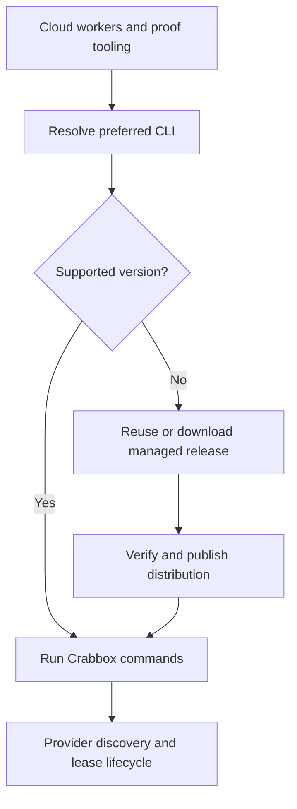

Codex review: blocked before merge. _Reviewed September 10, 2026, 4:40 AM ET / 08:40 UTC (Revision 7)._

# ClawSweeper review

## What this changes

The Crabbox plugin installs a verified supported CLI when the selected executable is missing or outdated, shares that installation with remote-proof tooling, and updates Doctor, lifecycle tests, and operator documentation.

## Merge readiness

⛔ **Blocked before merge - 2 items remain**

This PR remains useful: current main explains outdated CLI limitations but does not automatically repair them. No blocking introduced defect was found, and the previously raised compatibility choice is explicitly accepted and documented.

**Priority:** P2
**Reviewed head:** `3c0e1111547cf27bd4f950d1a5aeb0d734e440e6`

## Review scores

| Measure | Result | What it means |
|---|---|---|
| **Overall readiness** | 🐚 platinum hermit **(4/6)** | A coherent implementation with meaningful lifecycle coverage and an explicitly accepted compatibility tradeoff. |
| **Proof confidence** | 🌊 off-meta tidepool | Not applicable: The supplied repository state identifies maintainer authorship, so ordinary contributor proof is exempt. The captured body reports macOS upgrade and Linux installation/reuse through the changed installer; those observations were not rerun here. |
| **Patch quality** | 🐚 platinum hermit **(4/6)** | No actionable review findings were identified. |

## Verification

| Check | Result | Evidence |
|---|---|---|
| **Real behavior** | Not applicable | Not applicable: The supplied repository state identifies maintainer authorship, so ordinary contributor proof is exempt. The captured body reports macOS upgrade and Linux installation/reuse through the changed installer; those observations were not rerun here. |
| **Evidence reviewed** | 9 items | Pinned installation owner and safeguards: The installer pins Crabbox 0.55.0, restricts HTTPS download hosts, bounds downloads and extraction, checks SHA-256 before execution, preserves companion executables, and publishes under a file lock while retaining damaged installations. Current-main necessity: Current main still uses separate version checks, including the 0.53.1 non-Linux floor. Tree checks found no managed Crabbox installer in fetched main or v2026.9.3; no shipped implementation of this automatic acquisition path was established. Related merged work is partial: https://github.com/openclaw/openclaw/pull/143798 is merged and exposes unavailable operating systems with upgrade guidance; its body explicitly retains version requirements and provisioning rejection. It does not replace automatic installation. |
| **Findings** | None | None. |
| **Security** | None | None. |

## How this fits together

Crabbox connects OpenClaw cloud workers and remote-proof tooling to external compute providers. The plugin resolves the local CLI before discovering machines, allocating workers, renewing leases, or performing cleanup.

## Before merge

- [ ] **Resolve merge risk (P1)** - Restricted hosts with only an outdated CLI cannot inspect or stop existing leases until a supported executable becomes available; heartbeat renewal stops when teardown begins. This operational tradeoff is explicitly accepted, with pre-upgrade preparation documented.
- [ ] **Add data-model compatibility proof** - Confirm migration or upgrade compatibility proof before merge.

<strong>Agent review details</strong>

### Security

None.

### PR surface

Source +263, Tests +119, Docs 0, Other -164. Total +218 across 25 files.

View PR surface stats

| Area | Files | Added | Removed | Net |
|---|---:|---:|---:|---:|
| Source | 7 | 540 | 277 | +263 |
| Tests | 10 | 932 | 813 | +119 |
| Docs | 6 | 22 | 22 | 0 |
| Config | 0 | 0 | 0 | 0 |
| Generated | 0 | 0 | 0 | 0 |
| Other | 2 | 17 | 181 | -164 |
| **Total** | **25** | **1511** | **1293** | **+218** |

### Review metrics

| Metric | Value | Why it matters |
|---|---|---|
| **Net code growth** | Production/tooling +99 lines; tests/support +120 lines | Growth adds one verified installation owner while removing scattered version checks and retaining lifecycle regression coverage. |
| **Unified CLI baseline** | Crabbox 0.55.0+ for discovery, allocation, inspection, and teardown | The requirement also changes the upgrade contract for hosts that already own leases. |

### Stored data model

Persistent data-model change detected: `migration/backfill/repair: extensions/crabbox/src/crabbox-worker-heartbeat.ts`, `migration/backfill/repair: extensions/crabbox/src/crabbox-worker-machine-options.ts`, `migration/backfill/repair: extensions/crabbox/src/crabbox-worker-provider.ts`, `migration/backfill/repair: extensions/crabbox/src/doctor.ts`, `unknown-data-model-change: extensions/crabbox/src/doctor.ts`. Confirm migration or upgrade compatibility proof before merge.

### Merge-risk options

**Maintainer options:**
1. **Retain the accepted supported-CLI requirement (recommended)**  
   Carry forward the documented requirement to prepare a supported executable on restricted hosts before upgrading, including hosts with existing leases.

### Technical review

Best possible solution:

Use the shared plugin-owned installer while honoring the accepted restricted-host upgrade requirement and preserving operator binaries, configuration, and cleanup obligations.

Do we have a high-confidence way to reproduce the issue?

Not applicable as a defect reproduction: current source deliberately gates older CLIs, and this PR adds automatic repair of that previously manual prerequisite.

Is this the best way to solve the issue?

Yes. A single plugin-owned installer is narrower than maintaining separate upgrades and version policies in each caller, and the compatibility tradeoff has an explicit disposition.

AGENTS.md: found and applied where relevant.

Codex review notes: model internal, reasoning medium; reviewed against [05963f8b5e4b](https://github.com/openclaw/openclaw/commit/05963f8b5e4b758e4c3e24aa2008110c3f8ac072).

### Labels

Label justifications:

- `P2`: This is a bounded cloud-worker and developer-tooling improvement without evidence of an urgent broad runtime outage.
- `merge-risk: 🚨 compatibility`: Existing restricted-host setups need a supported CLI prepared before upgrading or lease inspection and teardown can fail.
- `rating: 🐚 platinum hermit`: Overall readiness is 🐚 platinum hermit; proof is 🌊 off-meta tidepool and patch quality is 🐚 platinum hermit.
- `status: 👀 ready for maintainer look`: ClawSweeper has no concrete contributor-facing blocker left for this PR. Not applicable: The supplied repository state identifies maintainer authorship, so ordinary contributor proof is exempt. The captured body reports macOS upgrade and Linux installation/reuse through the changed installer; those observations were not rerun here.

### Evidence

What I checked:

- **Pinned installation owner and safeguards:** The installer pins Crabbox 0.55.0, restricts HTTPS download hosts, bounds downloads and extraction, checks SHA-256 before execution, preserves companion executables, and publishes under a file lock while retaining damaged installations. ([`extensions/crabbox/src/crabbox-managed-binary.ts:13`](https://github.com/openclaw/openclaw/blob/3c0e1111547cf27bd4f950d1a5aeb0d734e440e6/extensions/crabbox/src/crabbox-managed-binary.ts#L13), [3c0e1111547c](https://github.com/openclaw/openclaw/commit/3c0e1111547cf27bd4f950d1a5aeb0d734e440e6))
- **Current-main necessity:** Current main still uses separate version checks, including the 0.53.1 non-Linux floor. Tree checks found no managed Crabbox installer in fetched main or v2026.9.3; no shipped implementation of this automatic acquisition path was established. ([`extensions/crabbox/src/crabbox-worker-doctor-runtime.ts:5`](https://github.com/openclaw/openclaw/blob/05963f8b5e4b758e4c3e24aa2008110c3f8ac072/extensions/crabbox/src/crabbox-worker-doctor-runtime.ts#L5), [05963f8b5e4b](https://github.com/openclaw/openclaw/commit/05963f8b5e4b758e4c3e24aa2008110c3f8ac072))
- **Related merged work is partial:** https://github.com/openclaw/openclaw/pull/143798 is merged and exposes unavailable operating systems with upgrade guidance; its body explicitly retains version requirements and provisioning rejection. It does not replace automatic installation. ([`extensions/crabbox/src/crabbox-worker-machine-options.ts`](https://github.com/openclaw/openclaw/blob/1c72b612a852d7d5ae7cc8615748d19a9cb8a9ad/extensions/crabbox/src/crabbox-worker-machine-options.ts), [1c72b612a852](https://github.com/openclaw/openclaw/commit/1c72b612a852d7d5ae7cc8615748d19a9cb8a9ad))
- **Compatibility disposition:** The captured PR body expressly accepts requiring a supported CLI for existing-lease inspection and teardown. Documentation instructs restricted hosts to provision the executable or managed distribution before upgrading; teardown stops heartbeats before acquisition. Public docs: [`docs/gateway/config-cloud-workers.md`](https://docs.openclaw.ai/gateway/config-cloud-workers). ([`docs/gateway/config-cloud-workers.md:67`](https://docs.openclaw.ai/gateway/config-cloud-workers), [3c0e1111547c](https://github.com/openclaw/openclaw/commit/3c0e1111547cf27bd4f950d1a5aeb0d734e440e6))
- **Re-review continuity:** Comparison with the previously reviewed head shows only the Gateway preflight fixture changed: it now answers the version probe and adjusts the expected call count. Existing failed-state persistence and cleanup-order assertions remain. The previous completed review contained no findings or published rank-up moves. ([`src/gateway/worker-environments/provider-crabbox-runtime-preflight.test.ts:87`](https://github.com/openclaw/openclaw/blob/3c0e1111547cf27bd4f950d1a5aeb0d734e440e6/src/gateway/worker-environments/provider-crabbox-runtime-preflight.test.ts#L87), [3c0e1111547c](https://github.com/openclaw/openclaw/commit/3c0e1111547cf27bd4f950d1a5aeb0d734e440e6))
- **Dependency release contract:** The patch directly downloads and executes Crabbox, establishing the dependency signal. The official v0.55.0 release and its release configuration provide all six expected platform/architecture archives, checksums.txt, and the Darwin companion helper; the tag resolves to this dependency commit. ([`.goreleaser.yaml`](https://github.com/openclaw/crabbox/blob/ab12f01d0ba3bcf2669fd6de32b53548b2ffdabf/.goreleaser.yaml), [ab12f01d0ba3](https://github.com/openclaw/crabbox/commit/ab12f01d0ba3bcf2669fd6de32b53548b2ffdabf))

Likely related people:

- **steipete:** Suggested for follow-up; no historical authorship or introduction is verified. (role: unverified routing candidate; confidence: low)

### Rating scale

| Score | Internal tier | Crab rank | Meaning |
|---:|:---:|---|---|
| **6/6** | S | 🦀 challenger crab | Exceptional readiness |
| **5/6** | A | 🦞 diamond lobster | Very strong readiness |
| **4/6** | B | 🐚 platinum hermit | Good normal PR; ordinary maintainer review |
| **3/6** | C | 🦐 gold shrimp | Useful, but confidence is limited |
| **2/6** | D | 🦪 silver shellfish | Proof or implementation needs work |
| **1/6** | F | 🧂 unranked krab | Not merge-ready |
| N/A | NA | 🌊 off-meta tidepool | Rating does not apply |

Overall follows the weaker of proof and patch quality.
Shiny media proof means a screenshot, video, or linked artifact directly shows the changed behavior. Runtime, network, CSP, and security claims still need visible diagnostics.

### Workflow

- ClawSweeper keeps one durable marker-backed review comment per issue or PR.
- Re-runs edit this comment so the latest verdict, findings, and automation markers stay together instead of adding duplicate bot comments.
- A fresh review can be triggered by eligible `@clawsweeper re-review` comments, exact-item GitHub events, scheduled/background review runs, or manual workflow dispatch.
- PR/issue authors and users with repository write access can comment `@clawsweeper re-review` or `@clawsweeper re-run` on an open PR or issue to request a fresh review only.
- Maintainers can also comment `@clawsweeper review` to request a fresh review only.
- Fresh-review commands do not start repair, autofix, rebase, CI repair, or automerge.
- Maintainer-only repair and merge flows require explicit commands such as `@clawsweeper autofix`, `@clawsweeper automerge`, `@clawsweeper fix ci`, or `@clawsweeper address review`.
- Maintainers can comment `@clawsweeper explain` to ask for more context, or `@clawsweeper stop` to stop active automation.

### History

Review history (6 earlier review cycles)

<!-- clawsweeper-review-history v=1 total=6 -->
- reviewed 2026-09-10T06:34:20.108Z sha 2ec032fae78331617aa577284730ce54ec159848 :: blocked before merge. :: none
- reviewed 2026-09-10T06:47:35.838Z sha f27e2b9ad6e4a097735d04d58ec9c8d84878e034 :: blocked before merge. :: none
- reviewed 2026-09-10T07:01:30.057Z sha f27e2b9ad6e4a097735d04d58ec9c8d84878e034 :: blocked before merge. :: none
- reviewed 2026-09-10T07:26:12.887Z sha f9c20162ab0c29628c4b6dbb9c3edac25800c6dd :: blocked before merge. :: none
- reviewed 2026-09-10T07:52:43.697Z sha 91b6720ff960a73cacb28c88b9b26fd7c7b6ab8c :: blocked before merge. :: none
- reviewed 2026-09-10T08:09:58.950Z sha 84e40e687ec8b9e33f0b2ecbd539afbc7181f44b :: blocked before merge. :: none

<!-- clawsweeper-verdict:needs-human item=143768 sha=3c0e1111547cf27bd4f950d1a5aeb0d734e440e6 confidence=high updated_at=2026-09-10T08:36:07Z reviewed_at=2026-09-10T08:40:17.808Z lease_owner=github-run-34455853410-1 lease_comment_id=5615661525 source_revision=de462252c797f7e2135257eec9cc58c72a74a9cd2a444185ac5c8e487dc2bf26 live_verification=absent -->
<!-- clawsweeper-review-state:blocked item=143768 sha=3c0e1111547cf27bd4f950d1a5aeb0d734e440e6 v=1 -->

<!-- clawsweeper-review-version item=143768 reviewed_at=2026-09-10T08:40:17.808Z sha=3c0e1111547cf27bd4f950d1a5aeb0d734e440e6 source_revision=de462252c797f7e2135257eec9cc58c72a74a9cd2a444185ac5c8e487dc2bf26 lease_owner=github-run-34455853410-1 lease_comment_id=5615661525 v=1 -->

<!-- clawsweeper-review item=143768 -->