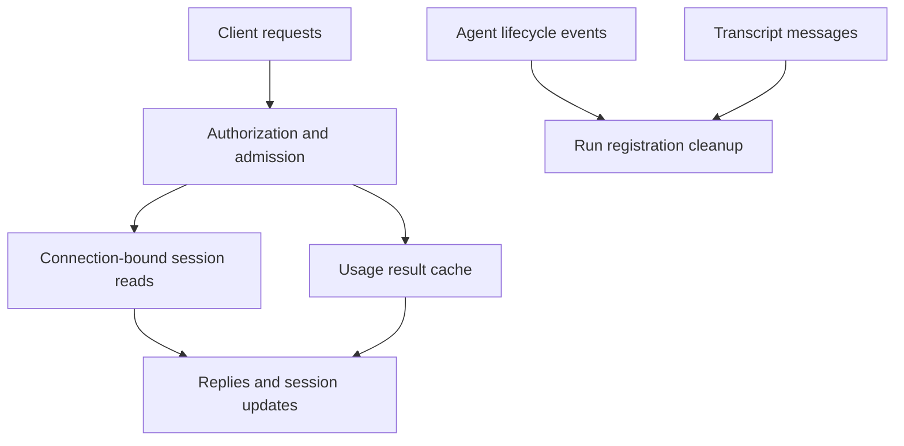

Codex review: blocked before merge. _Reviewed October 2, 2026, 7:46 PM ET / 23:46 UTC (Revision 2)._

# ClawSweeper review

## What this changes

The Gateway releases completed chat registrations, replaces obsolete usage results, avoids retaining prompt text through diagnostics, and stops disconnected session-read preparation.

## Merge readiness

⛔ **Blocked before merge - 1 item remains**

This PR remains useful against fetched main, and no actionable introduced defect was found. The earlier migration concern does not apply: the changed caches and request lifetimes are process-local.

**Priority:** P2
**Reviewed head:** `29e6804889ea2ffee26897bd671315e4ffc61560`

## Review scores

| Measure | Result | What it means |
|---|---|---|
| **Overall readiness** | 🐚 platinum hermit **(4/6)** | Strong measured runtime evidence supports a coherent owner-level repair with no actionable findings. |
| **Proof confidence** | 🦞 diamond lobster **(5/6)** | Sufficient (live_output): The supplied Testbox comparison exercises the compiled Gateway's session and usage owners through real WebSocket requests and reconnects, showing 92.01% lower synthetic heap growth with zero workload failures; owner probes and failing original-source regressions supplement it. No stored-data contract changes, so migration proof is not applicable. |
| **Patch quality** | 🐚 platinum hermit **(4/6)** | No actionable review findings were identified. |

## Verification

| Check | Result | Evidence |
|---|---|---|
| **Real behavior** | Verified | Sufficient (live_output): The supplied Testbox comparison exercises the compiled Gateway's session and usage owners through real WebSocket requests and reconnects, showing 92.01% lower synthetic heap growth with zero workload failures; owner probes and failing original-source regressions supplement it. No stored-data contract changes, so migration proof is not applicable. |
| **Evidence reviewed** | 9 items | Pinned introduction boundary: Reviewed the merge-base-to-head introduction, keeping base-only session-suggestion tests outside PR ownership. The host verified the original head and the test merge's separate parent identities. Current main still retains historical usage keys: Fetched main includes profile and usage revisions in query keys and lacks the candidate's revision replacement and idle-entry eviction. The central retention repair therefore remains necessary; no merged replacement was established. No persisted data-model change: Both usage caches are module-local Maps. Query axes, including visibility identity, remain intact while revision becomes entry metadata. Prompt diagnostics use WeakMap/WeakRef ownership. No schema, serialized state, migration, or stored preference changes are introduced, resolving the previous review's upgrade-proof concern. |
| **Findings** | None | None. |
| **Security** | None | None. |

## How this fits together

The Gateway receives client requests and agent lifecycle events, prepares session information, and publishes replies and updates. Its request and cache owners determine how long completed work and derived content remain in memory.

## Before merge

- [ ] **Add data-model compatibility proof** - Confirm migration or upgrade compatibility proof before merge.

<strong>Agent review details</strong>

### Security

None.

### PR surface

Source +92, Tests +315, Docs +2, Other +642. Total +1051 across 27 files.

View PR surface stats

| Area | Files | Added | Removed | Net |
|---|---:|---:|---:|---:|
| Source | 11 | 419 | 327 | +92 |
| Tests | 11 | 689 | 374 | +315 |
| Docs | 1 | 2 | 0 | +2 |
| Config | 0 | 0 | 0 | 0 |
| Generated | 0 | 0 | 0 | 0 |
| Other | 4 | 643 | 1 | +642 |
| **Total** | **27** | **1753** | **702** | **+1051** |

### Review metrics

| Metric | Value | Why it matters |
|---|---|---|
| **Code growth by responsibility** | runtime +92 lines; tests/support +415; tooling/config +642 | Runtime growth implements cancellation settlement; most added tooling is the isolated heap comparison rig. |
| **Measured heap retention** | 92.01% lower synthetic heap growth over minutes 5–30 | The matched workload provides direct evidence for the retention repair without claiming production GC improvement. |

### Stored data model

Persistent data-model change detected: `serialized state: scripts/bench-gateway-heap-retention.ts`, `unknown-data-model-change: scripts/bench-gateway-heap-retention.ts`. Confirm migration or upgrade compatibility proof before merge.

### Technical review

Best possible solution:

Keep derived content bounded by its existing owner and end disconnected observations while allowing accepted execution, persistence, and delivery to settle.

Do we have a high-confidence way to reproduce the issue?

Yes: current-main source retains historical usage revisions, and the supplied matched Gateway run and original-source negative controls demonstrate retention. This reviewer did not execute a reproduction.

Is this the best way to solve the issue?

Yes: the patch repairs existing lifecycle and cache owners while preserving query isolation, authorization, and accepted-work settlement.

AGENTS.md: found and applied where relevant.

Codex review notes: model internal, reasoning medium; reviewed against [810018486a55](https://github.com/openclaw/openclaw/commit/810018486a558c441822580f42e368ec326a576c).

### Labels

Label changes:

No label changes.

Label justifications:

- `P2`: This repairs measured long-running Gateway heap retention without evidence of an immediate outage.
- `rating: 🐚 platinum hermit`: Overall readiness is 🐚 platinum hermit; proof is 🦞 diamond lobster and patch quality is 🐚 platinum hermit.
- `status: 👀 ready for maintainer look`: ClawSweeper has no concrete contributor-facing blocker left for this PR. Sufficient (live_output): The supplied Testbox comparison exercises the compiled Gateway's session and usage owners through real WebSocket requests and reconnects, showing 92.01% lower synthetic heap growth with zero workload failures; owner probes and failing original-source regressions supplement it. No stored-data contract changes, so migration proof is not applicable.
- `proof: sufficient`: Contributor real behavior proof is sufficient. The supplied Testbox comparison exercises the compiled Gateway's session and usage owners through real WebSocket requests and reconnects, showing 92.01% lower synthetic heap growth with zero workload failures; owner probes and failing original-source regressions supplement it. No stored-data contract changes, so migration proof is not applicable.

### Evidence

What I checked:

- **Pinned introduction boundary:** Reviewed the merge-base-to-head introduction, keeping base-only session-suggestion tests outside PR ownership. The host verified the original head and the test merge's separate parent identities. ([29e6804889ea](https://github.com/openclaw/openclaw/commit/29e6804889ea2ffee26897bd671315e4ffc61560))
- **Current main still retains historical usage keys:** Fetched main includes profile and usage revisions in query keys and lacks the candidate's revision replacement and idle-entry eviction. The central retention repair therefore remains necessary; no merged replacement was established. ([`src/gateway/server-methods/usage-result-cache.ts:65`](https://github.com/openclaw/openclaw/blob/810018486a558c441822580f42e368ec326a576c/src/gateway/server-methods/usage-result-cache.ts#L65), [810018486a55](https://github.com/openclaw/openclaw/commit/810018486a558c441822580f42e368ec326a576c))
- **No persisted data-model change:** Both usage caches are module-local Maps. Query axes, including visibility identity, remain intact while revision becomes entry metadata. Prompt diagnostics use WeakMap/WeakRef ownership. No schema, serialized state, migration, or stored preference changes are introduced, resolving the previous review's upgrade-proof concern. ([`src/gateway/server-methods/usage-result-cache.ts:24`](https://github.com/openclaw/openclaw/blob/29e6804889ea2ffee26897bd671315e4ffc61560/src/gateway/server-methods/usage-result-cache.ts#L24), [29e6804889ea](https://github.com/openclaw/openclaw/commit/29e6804889ea2ffee26897bd671315e4ffc61560))
- **Cancellation retains accepted settlement:** The observation scope surrounds preparation and authorization, retains existing root admission at handler entry, drains tracked descendants, and releases the root afterward. Method scopes, profile checks, session authorization, and final invocation guards remain present. ([`src/gateway/server-request-lifecycle.ts:128`](https://github.com/openclaw/openclaw/blob/29e6804889ea2ffee26897bd671315e4ffc61560/src/gateway/server-request-lifecycle.ts#L128), [29e6804889ea](https://github.com/openclaw/openclaw/commit/29e6804889ea2ffee26897bd671315e4ffc61560))
- **Terminal cleanup preserves delivery ownership:** Registration retirement now occurs independently of visible terminal publication. Reply-dispatch-owned completion remains excluded, superseded lifecycle events return before cleanup, and maintenance preserves active execution and queued delivery owners. ([`src/gateway/server-chat.ts:531`](https://github.com/openclaw/openclaw/blob/29e6804889ea2ffee26897bd671315e4ffc61560/src/gateway/server-chat.ts#L531), [29e6804889ea](https://github.com/openclaw/openclaw/commit/29e6804889ea2ffee26897bd671315e4ffc61560))
- **Real Gateway heap comparison:** The supplied PR body records matched Testbox runs through a compiled Gateway and real WebSocket clients: 300 turns, 7,754 RPCs, and 82 connections per run with zero failures. Post-GC growth fell from 197,351,336 to 15,768,888 bytes. The inspected benchmark exercises session reads, usage queries, committed updates, and reconnects with a mock provider. This supports synthetic retention improvement, not a production GC-time claim. ([`scripts/bench-gateway-heap-retention.ts:1`](https://github.com/openclaw/openclaw/blob/29e6804889ea2ffee26897bd671315e4ffc61560/scripts/bench-gateway-heap-retention.ts#L1), [29e6804889ea](https://github.com/openclaw/openclaw/commit/29e6804889ea2ffee26897bd671315e4ffc61560))

Likely related people:

- **steipete:** Suggested for follow-up; no historical authorship or introduction is verified. (role: unverified routing candidate; confidence: low)

### Rating scale

| Score | Internal tier | Crab rank | Meaning |
|---:|:---:|---|---|
| **6/6** | S | 🦀 challenger crab | Exceptional readiness |
| **5/6** | A | 🦞 diamond lobster | Very strong readiness |
| **4/6** | B | 🐚 platinum hermit | Good normal PR; ordinary maintainer review |
| **3/6** | C | 🦐 gold shrimp | Useful, but confidence is limited |
| **2/6** | D | 🦪 silver shellfish | Proof or implementation needs work |
| **1/6** | F | 🧂 unranked krab | Not merge-ready |
| N/A | NA | 🌊 off-meta tidepool | Rating does not apply |

Overall follows the weaker of proof and patch quality.
Shiny media proof means a screenshot, video, or linked artifact directly shows the changed behavior. Runtime, network, CSP, and security claims still need visible diagnostics.

### Workflow

- ClawSweeper keeps one durable marker-backed review comment per issue or PR.
- Re-runs edit this comment so the latest verdict, findings, and automation markers stay together instead of adding duplicate bot comments.
- A fresh review can be triggered by eligible `@clawsweeper re-review` comments, exact-item GitHub events, scheduled/background review runs, or manual workflow dispatch.
- PR/issue authors and users with repository write access can comment `@clawsweeper re-review` or `@clawsweeper re-run` on an open PR or issue to request a fresh review only.
- Maintainers can also comment `@clawsweeper review` to request a fresh review only.
- Fresh-review commands do not start repair, autofix, rebase, CI repair, or automerge.
- Maintainer-only repair and merge flows require explicit commands such as `@clawsweeper autofix`, `@clawsweeper automerge`, `@clawsweeper fix ci`, or `@clawsweeper address review`.
- Maintainers can comment `@clawsweeper explain` to ask for more context, or `@clawsweeper stop` to stop active automation.

### History

Review history (1 earlier review cycle)

<!-- clawsweeper-review-history v=1 total=1 -->
- reviewed 2026-10-02T22:52:54.530Z sha e3b3c66d37dba8f62cd27d7222ee1b320a860c7d :: blocked before merge. :: none

<!-- clawsweeper-verdict:needs-human item=163834 sha=29e6804889ea2ffee26897bd671315e4ffc61560 confidence=high updated_at=2026-10-02T23:42:43Z reviewed_at=2026-10-02T23:46:22.505Z lease_owner=github-run-37078799094-1 lease_comment_id=5963203630 source_revision=a6ef9f428f62edb64efea2b8ce46c922a2ee4abcdf43e7ececd4bdf8fadfc918 live_verification=absent -->
<!-- clawsweeper-review-state:blocked item=163834 sha=29e6804889ea2ffee26897bd671315e4ffc61560 v=1 -->

<!-- clawsweeper-review-version item=163834 reviewed_at=2026-10-02T23:46:22.505Z sha=29e6804889ea2ffee26897bd671315e4ffc61560 source_revision=a6ef9f428f62edb64efea2b8ce46c922a2ee4abcdf43e7ececd4bdf8fadfc918 lease_owner=github-run-37078799094-1 lease_comment_id=5963203630 v=1 -->

<!-- clawsweeper-review item=163834 -->