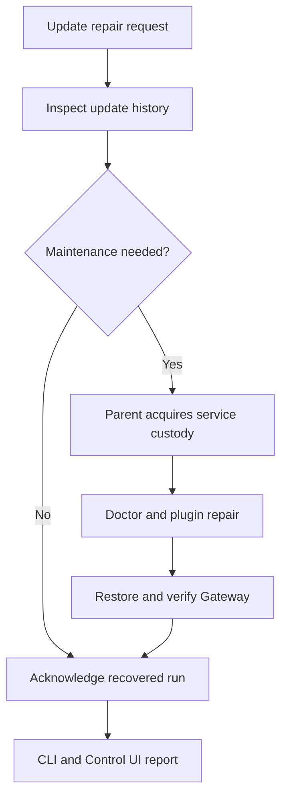

Codex review: blocked before merge. _Reviewed September 17, 2026, 7:03 PM ET / 23:03 UTC (Revision 8)._

# ClawSweeper review

## What this changes

The PR makes update repair restore its stopped Gateway after failures, fence timed-out writes, and clear acknowledged recovery warnings from CLI and Control UI reports.

## Merge readiness

⛔ **Blocked before merge - 1 item remains**

This remains a useful follow-up to the merged repair fixes. The previous deadline/restoration finding is addressed, the supplied upgrade evidence satisfies the earlier compatibility reminder, and no new blocking defect was identified.

**Priority:** P1
**Reviewed head:** `63bc9ba3ac62fb118f19d2496eb02c76ccd078dc`

## Review scores

| Measure | Result | What it means |
|---|---|---|
| **Overall readiness** | 🦞 diamond lobster **(5/6)** | The coherent ownership repair has strong failure-path evidence, useful visual proof, and no remaining actionable finding. |
| **Proof confidence** | 🦞 diamond lobster **(5/6)** | Sufficient (terminal): The captured packaged Linux transcript exercises the repair parent, real Gateway processes, and a real config writer through the managed-service fixture: deadline cancellation rejects the late write and restores verified service before exit 1. Production bytes match the qualified revision; inspected before/after screenshots cover the visible acknowledgement change. |
| **Patch quality** | 🦞 diamond lobster **(5/6)** | No actionable review findings were identified. |

## Verification

| Check | Result | Evidence |
|---|---|---|
| **Real behavior** | Verified | Sufficient (terminal): The captured packaged Linux transcript exercises the repair parent, real Gateway processes, and a real config writer through the managed-service fixture: deadline cancellation rejects the late write and restores verified service before exit 1. Production bytes match the qualified revision; inspected before/after screenshots cover the visible acknowledgement change. |
| **Evidence reviewed** | 9 items | Introduced scope and review continuity: Reviewed the pinned merge-base-to-head changes. Comparing qualified source 16da82964cc0c47e9b421ced2749f0daea32b191 with HEAD under src and ui shows only strengthened test assertions; production behavior remains unchanged. The latest commit consolidates the deadline fixture into the registered survivor helper. Restoration now survives phase failure: Finalization acquires maintenance before starting the Doctor phase deadline, releases database fences before Doctor children, and restores through the enclosing finally. Phase deadlines revoke write guards and join work before propagating failure. Live authority remains required: Restoration checks the original maintenance instance, current custody, update admission, native operation lock, and service identity before restart. Focused cases cover copied, consumed, released, and concurrently revoked handles, plus a Doctor child attempting to activate its parent's service. |
| **Findings** | None | None. |
| **Security** | None | None. |

## How this fits together

Update repair coordinates Doctor and plugin maintenance against an installed OpenClaw instance. Its parent manages Gateway restoration, while the update ledger supplies recovery status to the CLI and Control UI.

## Before merge

- [ ] **Add data-model compatibility proof** - Confirm migration or upgrade compatibility proof before merge.

<strong>Agent review details</strong>

### Security

None.

### PR surface

Source +278, Tests +471, Docs +2, Other +304. Total +1055 across 44 files.

View PR surface stats

| Area | Files | Added | Removed | Net |
|---|---:|---:|---:|---:|
| Source | 22 | 701 | 423 | +278 |
| Tests | 16 | 509 | 38 | +471 |
| Docs | 1 | 22 | 20 | +2 |
| Config | 0 | 0 | 0 | 0 |
| Generated | 0 | 0 | 0 | 0 |
| Other | 5 | 352 | 48 | +304 |
| **Total** | **44** | **1584** | **529** | **+1055** |

### Review metrics

| Metric | Value | Why it matters |
|---|---|---|
| **Production versus validation growth** | Production net +278 lines; tests and proof net +775 lines | Production growth supports explicit restoration custody and shared deadline handling, with regression and packaged recovery coverage. |

### Stored data model

Persistent data-model change detected: `migration/backfill/repair: scripts/e2e/lib/upgrade-survivor/abandoned-update.mjs`, `migration/backfill/repair: scripts/e2e/lib/upgrade-survivor/abandoned-update.sh`, `migration/backfill/repair: scripts/e2e/lib/upgrade-survivor/systemd-fixture.mjs`, `migration/backfill/repair: scripts/lib/upgrade-survivor-policy.mjs`, `migration/backfill/repair: src/cli/update-cli.ts`, `migration/backfill/repair: src/commands/doctor-maintenance.ts`, and 4 more. Confirm migration or upgrade compatibility proof before merge.

### Technical review

Best possible solution:

Keep Gateway custody with the repair parent, fence expired work, and derive recovery prompts from the existing ledger acknowledgement.

Do we have a high-confidence way to reproduce the issue?

Yes, source identifies the fatal deadline path that bypassed restoration, and the supplied executable regression reports failure before the fix; this read-only review did not run it.

Is this the best way to solve the issue?

Yes. Reusing Doctor's maintenance owner and the existing deadline machinery avoids competing service owners, and acknowledgement changes preserve historical records.

AGENTS.md: found and applied where relevant.

Codex review notes: model internal, reasoning medium; reviewed against [c16e3db100bd](https://github.com/openclaw/openclaw/commit/c16e3db100bd06d7a23e2bd138048a483379a45e).

### Labels

Label changes:

- add `rating: 🦞 diamond lobster`: Overall readiness is 🦞 diamond lobster; proof is 🦞 diamond lobster and patch quality is 🦞 diamond lobster.
- remove `rating: 🐚 platinum hermit`: Current PR rating is `rating: 🦞 diamond lobster`, so this older rating label is no longer current.

Label justifications:

- `P1`: Failed update repair can leave a managed Gateway stopped and users stuck in recovery.
- `rating: 🦞 diamond lobster`: Overall readiness is 🦞 diamond lobster; proof is 🦞 diamond lobster and patch quality is 🦞 diamond lobster.
- `status: 👀 ready for maintainer look`: ClawSweeper has no concrete contributor-facing blocker left for this PR. Sufficient (terminal): The captured packaged Linux transcript exercises the repair parent, real Gateway processes, and a real config writer through the managed-service fixture: deadline cancellation rejects the late write and restores verified service before exit 1. Production bytes match the qualified revision; inspected before/after screenshots cover the visible acknowledgement change.
- `proof: sufficient`: Contributor real behavior proof is sufficient. The captured packaged Linux transcript exercises the repair parent, real Gateway processes, and a real config writer through the managed-service fixture: deadline cancellation rejects the late write and restores verified service before exit 1. Production bytes match the qualified revision; inspected before/after screenshots cover the visible acknowledgement change.

### Evidence

What I checked:

- **Introduced scope and review continuity:** Reviewed the pinned merge-base-to-head changes. Comparing qualified source 16da82964cc0c47e9b421ced2749f0daea32b191 with HEAD under src and ui shows only strengthened test assertions; production behavior remains unchanged. The latest commit consolidates the deadline fixture into the registered survivor helper. ([`scripts/e2e/lib/upgrade-survivor/abandoned-update.mjs:330`](https://github.com/openclaw/openclaw/blob/63bc9ba3ac62fb118f19d2496eb02c76ccd078dc/scripts/e2e/lib/upgrade-survivor/abandoned-update.mjs#L330), [63bc9ba3ac62](https://github.com/openclaw/openclaw/commit/63bc9ba3ac62fb118f19d2496eb02c76ccd078dc))
- **Restoration now survives phase failure:** Finalization acquires maintenance before starting the Doctor phase deadline, releases database fences before Doctor children, and restores through the enclosing finally. Phase deadlines revoke write guards and join work before propagating failure. ([`src/cli/update-cli/update-command-finalize.ts:291`](https://github.com/openclaw/openclaw/blob/63bc9ba3ac62fb118f19d2496eb02c76ccd078dc/src/cli/update-cli/update-command-finalize.ts#L291), [63bc9ba3ac62](https://github.com/openclaw/openclaw/commit/63bc9ba3ac62fb118f19d2496eb02c76ccd078dc))
- **Live authority remains required:** Restoration checks the original maintenance instance, current custody, update admission, native operation lock, and service identity before restart. Focused cases cover copied, consumed, released, and concurrently revoked handles, plus a Doctor child attempting to activate its parent's service. ([`src/commands/doctor-maintenance.ts:168`](https://github.com/openclaw/openclaw/blob/63bc9ba3ac62fb118f19d2496eb02c76ccd078dc/src/commands/doctor-maintenance.ts#L168), [63bc9ba3ac62](https://github.com/openclaw/openclaw/commit/63bc9ba3ac62fb118f19d2496eb02c76ccd078dc))
- **Packaged recovery and upgrade evidence:** The captured PR body records published 2026.9.4-driver qualification on Linux: online ledger recovery preserved the Gateway; full repair restored it; an injected 15000 ms plugin deadline refused a real late config write, preserved config, restored health, released custody, and retained exit 1. Qualification used a systemd fixture with real Gateway processes. The backing Actions run reports cancelled after the lease was stopped, so its status is not cited as a passing test; detailed job-log retrieval was blocked by the host's blob-storage allowlist. The captured terminal observations remain the behavioral evidence. ([`scripts/e2e/lib/upgrade-survivor/abandoned-update.sh:76`](https://github.com/openclaw/openclaw/blob/16da82964cc0c47e9b421ced2749f0daea32b191/scripts/e2e/lib/upgrade-survivor/abandoned-update.sh#L76), [16da82964cc0](https://github.com/openclaw/openclaw/commit/16da82964cc0c47e9b421ced2749f0daea32b191))
- **Inspected visual proof:** Both prepared GitHub attachment images were inspected. Before repair, the report shows an abandoned-update warning and recovery controls; afterward, it shows reconciliation without those controls while retaining failed historical phases. These synthetic screenshots prove the visible presentation change, not native service behavior. ([`ui/src/pages/config/updates.ts:116`](https://github.com/openclaw/openclaw/blob/63bc9ba3ac62fb118f19d2496eb02c76ccd078dc/ui/src/pages/config/updates.ts#L116), [63bc9ba3ac62](https://github.com/openclaw/openclaw/commit/63bc9ba3ac62fb118f19d2496eb02c76ccd078dc))
- **Existing persistence contract retained:** The ledger already records completed reconcile:acknowledged steps while preserving the failed outcome. This PR shares the acknowledgement predicate with reports and UI, without changing the schema or introducing a new persistence format. The packaged qualification exercises legacy failed history, including empty failure reasons. ([`src/infra/update-run-ledger.ts:266`](https://github.com/openclaw/openclaw/blob/63bc9ba3ac62fb118f19d2496eb02c76ccd078dc/src/infra/update-run-ledger.ts#L266), [63bc9ba3ac62](https://github.com/openclaw/openclaw/commit/63bc9ba3ac62fb118f19d2496eb02c76ccd078dc))

Likely related people:

- **steipete:** Suggested for follow-up; no historical authorship or introduction is verified. (role: unverified routing candidate; confidence: low)
- **RomneyDa:** Suggested for follow-up; no historical authorship or introduction is verified. (role: unverified routing candidate; confidence: low)

### Rating scale

| Score | Internal tier | Crab rank | Meaning |
|---:|:---:|---|---|
| **6/6** | S | 🦀 challenger crab | Exceptional readiness |
| **5/6** | A | 🦞 diamond lobster | Very strong readiness |
| **4/6** | B | 🐚 platinum hermit | Good normal PR; ordinary maintainer review |
| **3/6** | C | 🦐 gold shrimp | Useful, but confidence is limited |
| **2/6** | D | 🦪 silver shellfish | Proof or implementation needs work |
| **1/6** | F | 🧂 unranked krab | Not merge-ready |
| N/A | NA | 🌊 off-meta tidepool | Rating does not apply |

Overall follows the weaker of proof and patch quality.
Shiny media proof means a screenshot, video, or linked artifact directly shows the changed behavior. Runtime, network, CSP, and security claims still need visible diagnostics.

### Workflow

- ClawSweeper keeps one durable marker-backed review comment per issue or PR.
- Re-runs edit this comment so the latest verdict, findings, and automation markers stay together instead of adding duplicate bot comments.
- A fresh review can be triggered by eligible `@clawsweeper re-review` comments, exact-item GitHub events, scheduled/background review runs, or manual workflow dispatch.
- PR/issue authors and users with repository write access can comment `@clawsweeper re-review` or `@clawsweeper re-run` on an open PR or issue to request a fresh review only.
- Maintainers can also comment `@clawsweeper review` to request a fresh review only.
- Fresh-review commands do not start repair, autofix, rebase, CI repair, or automerge.
- Maintainer-only repair and merge flows require explicit commands such as `@clawsweeper autofix`, `@clawsweeper automerge`, `@clawsweeper fix ci`, or `@clawsweeper address review`.
- Maintainers can comment `@clawsweeper explain` to ask for more context, or `@clawsweeper stop` to stop active automation.

### History

Review history (7 earlier review cycles)

<!-- clawsweeper-review-history v=1 total=7 -->
- reviewed 2026-09-17T16:58:21.344Z sha 56d6ac8e319217fec07cc73b19994bb567b1ba96 :: blocked before merge. :: [P1] Preserve Gateway recovery across fatal phase deadlines
- reviewed 2026-09-17T17:29:53.788Z sha 237dcaf216fafbd6210c41ae4311d1bfd09ca34d :: blocked before merge. :: [P1] Preserve Gateway recovery across fatal phase deadlines
- reviewed 2026-09-17T19:01:51.866Z sha 71f20299b7dd4d69260da47b7e75424bc83e2295 :: blocked before merge. :: [P1] [P1] Preserve Gateway recovery across fatal phase deadlines
- reviewed 2026-09-17T19:46:38.820Z sha 13f084e5c1f800112a2bd4c6a5b44a9fd990b9d9 :: blocked before merge. :: [P1] [P1] Preserve Gateway recovery across fatal phase deadlines
- reviewed 2026-09-17T20:22:19.410Z sha b9b816e78cf78879b656e9ec6f25e9406fe9a47c :: blocked before merge. :: [P1] [P1] Preserve Gateway recovery across fatal phase deadlines
- reviewed 2026-09-17T22:00:52.986Z sha e3bfd95611f1fb8bc2541fecdec0c2833cf15ba2 :: blocked before merge. :: none
- reviewed 2026-09-17T22:40:33.334Z sha 91358d3a7345eddd0c63258f4028bfccc9897a66 :: blocked before merge. :: none

<!-- clawsweeper-verdict:needs-human item=151003 sha=63bc9ba3ac62fb118f19d2496eb02c76ccd078dc confidence=high updated_at=2026-09-17T23:00:00Z reviewed_at=2026-09-17T23:03:52.771Z lease_owner=github-run-35284575211-1 lease_comment_id=5722342824 source_revision=998afc978d64596403ad1ad895ffb194fe9f2c63fbd525701c387684f5d3da47 live_verification=absent -->
<!-- clawsweeper-review-state:blocked item=151003 sha=63bc9ba3ac62fb118f19d2496eb02c76ccd078dc v=1 -->

<!-- clawsweeper-review-version item=151003 reviewed_at=2026-09-17T23:03:52.771Z sha=63bc9ba3ac62fb118f19d2496eb02c76ccd078dc source_revision=998afc978d64596403ad1ad895ffb194fe9f2c63fbd525701c387684f5d3da47 lease_owner=github-run-35284575211-1 lease_comment_id=5722342824 v=1 -->

<!-- clawsweeper-review item=151003 -->