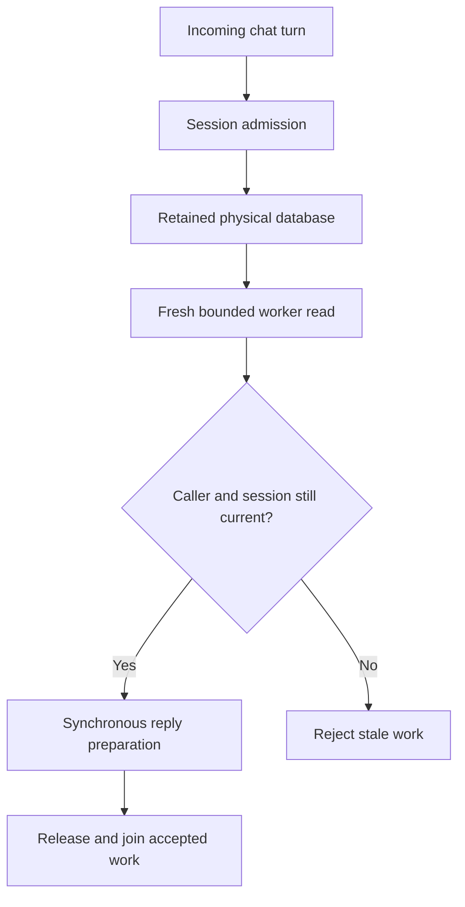

Codex review: blocked before merge. _Reviewed October 8, 2026, 3:58 PM ET / 19:58 UTC (Revision 37)._

# ClawSweeper review

## What this changes

The branch retains the selected session database across reply phases, batches related reads, and delays maintenance writer admission until a mutation is needed.

## Review scores

| Measure | Result | What it means |
|---|---|---|
| **Overall readiness** | 🐚 platinum hermit **(4/6)** | Real Gateway measurements and focused lifecycle regressions support a worthwhile, correct performance change; failed or cancelled CI is not credited as passing coverage. |
| **Proof confidence** | 🦞 diamond lobster **(5/6)** | Sufficient (live_output): Recorded Linux Gateway runs exercise ordinary chat, retained reads, maintenance, compaction, and shutdown after the change, showing lower first-turn and warmed-turn SQL with equivalent completed work. Historical source pins, archive identities, and integration bridges remain explicit; focused regressions supplement the runtime evidence. No stored-data contract changes were identified. |
| **Patch quality** | 🐚 platinum hermit **(4/6)** | No actionable review findings were identified. |

## Product

**Kind:** Performance · **Worth it:** Yes
**User problem:** Chat turns repeatedly prepare the same session database facts, adding avoidable work before replies.
**Reason:** Matched Gateway measurements show a useful reduction in turn work. Existing area ownership and recorded direction support the retained-reader approach without new configuration or public capability.

## Merge readiness

⛔ **Blocked before merge - 2 items remain**

This PR provides distinct, measured performance value and resolves the previously reported conflict. No actionable code finding was established; current-head CI is failed/cancelled and remains an enforced landing gate.

**Priority:** P2
**Reviewed head:** `a7d88719ad32530e1e0ee68c300448487a238e32`

## Before merge

- [ ] **Review config compatibility** - Confirm compatibility and upgrade impact for the changed config or default surface before merge.
- [ ] **Add data-model compatibility proof** - Confirm migration or upgrade compatibility proof before merge.

## Findings

None.

### Provenance

- `Session admission and executor lifetime`: original intent not found (unknown: Metadata history was readable, but the introducing reason was not established; the historical content search encountered unavailable partial-clone objects and HTTP 403.)

<strong>Agent review details</strong>

### How this fits together

The Gateway prepares chat turns using session identity, membership, policy, and transcript facts stored in SQLite. The changed reader carries the selected physical database through preparation and returns fresh facts under the existing execution and authority owners.

### Technical review

Best possible solution:

Keep one admitted database owner through foreground phases, preserving fresh reads, live authorization, acknowledged lifecycle transfers, and joined cleanup.

Do we have a high-confidence way to reproduce the issue?

Not applicable to a bug reproduction: the performance problem is demonstrated by matched first-turn and warmed-turn Gateway measurements; this read-only review did not execute code.

Is this the best way to solve the issue?

Yes: extending the existing execution and reader owners avoids another database owner while preserving physical selection, freshness, and live authority.

AGENTS.md: found and applied where relevant.

Codex review notes: model internal, reasoning medium; reviewed against [c8283bcc86c7](https://github.com/openclaw/openclaw/commit/c8283bcc86c70fe89bd7e778dd0845d7c9857ddc).

### Provenance checked

- `Session entry worker reads and foreground cohorts` keeps the original intent (https://github.com/openclaw/openclaw/pull/164779: Move per-turn session facts off the Gateway thread while retaining physical-store custody and applicable caller checks.)
- `Reply initialization snapshots` keeps the original intent (https://github.com/openclaw/openclaw/pull/165295: Prepare initial reply snapshots through the existing session readers.)
- `Tool-authority fingerprint preparation` keeps the original intent (https://github.com/openclaw/openclaw/pull/165370: Move authority preparation to workers while preserving independent caller policy, retained physical sources, FIFO, and final live checks.)
- `Gateway sharing and custody reads` keeps the original intent (https://github.com/openclaw/openclaw/pull/165600: Prepare exact rows and membership through session readers, then validate original caller authority immediately before dispatch or commit.)
- `Chat pre-admission decisions` keeps the original intent (https://github.com/openclaw/openclaw/pull/164682: Move initial chat preparation through workers while preserving distinct preparation, invocation, and accepted-input lifetimes.)
- `Automatic maintenance planning` keeps the original intent (https://github.com/openclaw/openclaw/pull/148630: Move automatic maintenance database work to workers while preserving active-session protection, retention, recovery, and foreign-write rechecks.)
- `Trajectory target preparation` keeps the original intent (https://github.com/openclaw/openclaw/pull/165410: Prepare trajectory sink targets through the session reader.)

### Testing

Proof path: shipped entry point.

### Security

None.

### Evidence

What I checked:

- **Pinned introduction and conflict resolution:** The introduced delta was inspected against b992cfcd9c31b800f2ca8bfb22b4b892ec8a8149. Raw head records confirm the supplied two parents. The REST comparison with the previous reviewed head preserves main's targetDiscoveryLane fixture, and live PR metadata reports mergeable=true. ([`src/config/sessions/session-logical-entry-read.worker.test.ts:54`](https://github.com/openclaw/openclaw/blob/a7d88719ad32530e1e0ee68c300448487a238e32/src/config/sessions/session-logical-entry-read.worker.test.ts#L54), [a7d88719ad32](https://github.com/openclaw/openclaw/commit/a7d88719ad32530e1e0ee68c300448487a238e32))
- **Live authority at consumption:** Retained reads check execution generation, caller authority, and the native mutation witness before consuming worker results and again before returning; asynchronous consumers are rejected. ([`src/config/sessions/session-entry-read-ordered.ts:106`](https://github.com/openclaw/openclaw/blob/a7d88719ad32530e1e0ee68c300448487a238e32/src/config/sessions/session-entry-read-ordered.ts#L106), [a7d88719ad32](https://github.com/openclaw/openclaw/commit/a7d88719ad32530e1e0ee68c300448487a238e32))
- **Acknowledged lifecycle transfer:** Initialization and compaction handoffs use committed predecessor/current identities on the same prepared native generation. The admission owner replaces the reader, revokes the old borrow, and joins accepted work. ([`src/auto-reply/reply/reply-turn-database-admission.ts:73`](https://github.com/openclaw/openclaw/blob/a7d88719ad32530e1e0ee68c300448487a238e32/src/auto-reply/reply/reply-turn-database-admission.ts#L73), [a7d88719ad32](https://github.com/openclaw/openclaw/commit/a7d88719ad32530e1e0ee68c300448487a238e32))
- **Sharing boundary preserved:** Configured incognito target validation precedes both retained and discovery reads. Retained sharing reads refresh membership and compose routing and invocation checks rather than treating captured identity as permission. ([`src/gateway/session-sharing-policy.ts:164`](https://github.com/openclaw/openclaw/blob/a7d88719ad32530e1e0ee68c300448487a238e32/src/gateway/session-sharing-policy.ts#L164), [a7d88719ad32](https://github.com/openclaw/openclaw/commit/a7d88719ad32530e1e0ee68c300448487a238e32))
- **Real Gateway performance evidence:** The full PR body records three alternating 7b416/789106 Linux Gateway comparisons: first-turn all-thread SQL 3,539→3,441 and warmed-turn SQL 1,340.9→1,249.6, with equivalent memory completion and zero failed SQL. Ordinary archive digest: 1e5c449955142d70d5c61df5c9d7b0a8f4f2045ca633c597cef898f535bc32ff. Historical pins and subsequent unchanged-input bridges remain explicit. Captured body identity: SHA-256 8bd9ef387612fe9482b7c30b5c57ce833ae8e90dad5fb54b3bafc214d31763a9. ([789106d11e61](https://github.com/openclaw/openclaw/commit/789106d11e61cf2fcec8d26f73b04bd61104bf57))
- **Accepted maintenance phase tradeoff:** The maintainer-authored body explicitly retains the approved read-only/late-writer contract: cold backdate maintenance grows while warm no-op maintenance shrinks; the complete combined window remains counted at 800→809 statements. This does not establish a universal latency improvement. ([`src/config/sessions/session-accessor.sqlite-maintenance-transaction.ts:174`](https://github.com/openclaw/openclaw/blob/a7d88719ad32530e1e0ee68c300448487a238e32/src/config/sessions/session-accessor.sqlite-maintenance-transaction.ts#L174), [a7d88719ad32](https://github.com/openclaw/openclaw/commit/a7d88719ad32530e1e0ee68c300448487a238e32))

### PR surface

PR surface statistics unavailable: the file list is incomplete.

### Review metrics

| Metric | Value | Why it matters |
|---|---|---|
| **Warmed-turn SQL** | 1,340.9 → 1,249.6 statements per turn (−6.81%) | Matched real Gateway measurements establish reduced worker-side work without claiming equivalent latency savings. |
| **Production and regression growth** | src production +2,341/−443; src tests and support +2,516/−835 | The substantial growth implements retained lifetime and bounded-read contracts, with regression coverage for their revocation and settlement boundaries. |

### Stored data model

Persistent data-model change detected: `unknown-truncated-pull-files`. Confirm migration or upgrade compatibility proof before merge.

### Labels

Label changes:

No label changes.

Label justifications:

- `P2`: This is a measured internal performance improvement with bounded chat-turn impact, rather than an urgent user-facing regression.
- `rating: 🐚 platinum hermit`: Overall readiness is 🐚 platinum hermit; proof is 🦞 diamond lobster and patch quality is 🐚 platinum hermit.
- `status: 👀 ready for maintainer look`: ClawSweeper has no concrete contributor-facing blocker left for this PR.
- `proof: sufficient`: Contributor real behavior proof is sufficient.

### Rating scale

6/6 🦀 challenger crab · 5/6 🦞 diamond lobster · 4/6 🐚 platinum hermit · 3/6 🦐 gold shrimp · 2/6 🦪 silver shellfish · 1/6 🧂 unranked krab. Overall follows the weaker of proof and patch quality; ✨ marks media proof (a screenshot, video, or linked artifact) that directly shows the changed behavior.

### Workflow

ClawSweeper edits this one comment on every review. Comment `@clawsweeper re-review` for a fresh review only; repair and merge need explicit maintainer commands such as `@clawsweeper autofix` or `@clawsweeper automerge`.

### History

Review history (36 earlier review cycles; latest 8 shown)

<!-- clawsweeper-review-history v=1 total=36 -->
- reviewed 2026-10-08T14:53:45.330Z sha 789106d11e61cf2fcec8d26f73b04bd61104bf57 :: blocked before merge. :: none
- reviewed 2026-10-08T15:21:26.432Z sha 789106d11e61cf2fcec8d26f73b04bd61104bf57 :: blocked before merge. :: none
- reviewed 2026-10-08T15:47:41.142Z sha 789106d11e61cf2fcec8d26f73b04bd61104bf57 :: blocked before merge. :: none
- reviewed 2026-10-08T17:24:41.151Z sha 1a4f9ed8ae38fedf444d7657ee4a4a409ec87325 :: blocked before merge. :: none
- reviewed 2026-10-08T17:50:55.329Z sha 1a4f9ed8ae38fedf444d7657ee4a4a409ec87325 :: blocked before merge. :: none
- reviewed 2026-10-08T18:34:44.606Z sha bc4c6f4e133f4061d9e275c153cb93707ca1ba99 :: blocked before merge. :: none
- reviewed 2026-10-08T19:01:12.800Z sha d0b45affb8094f92f65444c29b954314ed74849e :: blocked before merge. :: none
- reviewed 2026-10-08T19:26:44.790Z sha 793a0f7730f158a4adc5c58a122c1c4a9658a8e0 :: blocked before merge. :: none

<!-- clawsweeper-verdict:needs-human item=166703 sha=a7d88719ad32530e1e0ee68c300448487a238e32 confidence=high updated_at=2026-10-08T19:52:52Z reviewed_at=2026-10-08T19:58:37.629Z lease_owner=github-run-37835091925-1 lease_comment_id=6067868219 source_revision=80a6939a376e4a9ef59b1b2ae050b29a4e2206932972f043fba05ef0fa489d93 live_verification=absent -->
<!-- clawsweeper-review-state:blocked item=166703 sha=a7d88719ad32530e1e0ee68c300448487a238e32 v=1 -->

<!-- clawsweeper-review-version item=166703 reviewed_at=2026-10-08T19:58:37.629Z sha=a7d88719ad32530e1e0ee68c300448487a238e32 source_revision=80a6939a376e4a9ef59b1b2ae050b29a4e2206932972f043fba05ef0fa489d93 lease_owner=github-run-37835091925-1 lease_comment_id=6067868219 v=1 -->

<!-- clawsweeper-review item=166703 -->