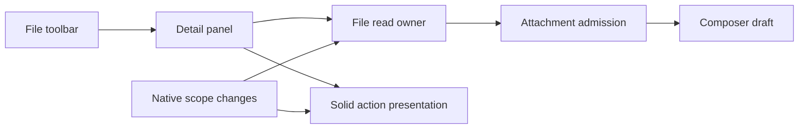

Codex review: needs real behavior proof before merge.

## What this changes

This PR uses Solid actions to present file operations and synchronously retires transfers when their source, destination, or availability changes.

**Example:** Attach notes.md, then switch from agent:main:first to agent:main:replacement while its read is pending.
- **Before:** The old transfer can retain presentation state until reactive cleanup runs.
- **After:** The native property change aborts the transfer and releases its pending-read reservation before publishing the replacement.

## Review scores

| Measure | Result | What it means |
|---|---|---|
| **Overall readiness** | 🦪 silver shellfish **(2/6)** | The implementation preserves established owners and has focused regression coverage, but the supplied screenshots do not settle the changed authority boundary. |
| **Proof confidence** | 🦪 silver shellfish **(2/6)** | Real behavior proof is necessary before merge. See [Before merge](#before-merge). |
| **Patch quality** | 🦐 gold shrimp **(3/6)** | Security review found an item that needs attention. |

## Product

**Kind:** Refactor · **Worth it:** Yes · **Fix scope:** Complete
**User problem:** A pending file operation can retain the old panel's presentation while the host changes content or composer destination.
**Reason:** The maintainer-directed refactor preserves existing capabilities and addresses a concrete lifetime boundary without adding settings or public APIs.

## Merge readiness

⛔ **Blocked before merge - 4 items remain**

Keep this PR open: it is a useful maintainer-directed lifecycle refactor, with no discrete introduced defect found; GitHub reports a conflict on the reviewed head.

**Priority:** P2
**Reviewed head:** `3d7e82a9e1c91efdfa4c3f070c6dd414ff367544`

## Before merge

- [ ] **Add real behavior proof** - Authority-chain proof required: the inspected synthetic Control UI screenshots establish editor saving states, while the reported tests exercise held reads and cancellation; supply a redacted production-path trace showing notes.md reaching its authorized composer, then destination reassignment and source-authority revocation preventing late bytes from reaching final publication even when the read ignores abort. After adding proof, update the PR body, then request a new review with `@clawsweeper re-review`. The PR author or someone with repository write access can request it.
- [ ] **Resolve security review attention item** - No concrete security regression was found, but the changed cross-session transfer boundary needs final-effect evidence.
- [ ] **Resolve merge risk** - Confirm that the changed transfer-retirement boundary prevents stale session or revoked source authority from reaching final composer publication.
- [ ] **Complete next step** - Resolve the reported merge conflict while preserving current main's settled cleanup lifecycle.

## Findings

None.

### Tests

- Missing end-to-end proof: The supplied material does not demonstrate allowed and revoked or reassigned transfers through final composer publication, and does not show the retirement regressions failing on the base.

<strong>Agent review details</strong>

### How this fits together

The Control UI detail panel reads authorized file bytes, delegates attachment admission to the composer, and presents download and editor-operation progress without owning write authority.

### Technical review

Best possible solution:

Keep synchronous admission and final scope checks with the existing owners, while sharing only the retireable Solid presentation lifetime.

Do we have a high-confidence way to reproduce the issue?

Source and focused deferred-read cases identify the native-property-to-reactive-publication interval; this read-only review did not execute the reproduction.

Is this the best way to solve the issue?

The shared presentation helper follows the repository's action recipe and leaves admission, draft retention, save settlement, and attachment processing with their existing owners.

AGENTS.md: found and applied where relevant.

Codex review notes: model internal, reasoning medium; reviewed against [8f290f351f25](https://github.com/openclaw/openclaw/commit/8f290f351f2500fa84dc1829303bee6f53f96a7e).

### Merge-risk options

**Maintainer options:**
1. **Verify final transfer effects (recommended)**  
   Provide a production-path trace showing an allowed attachment reaching its intended composer and a held transfer rejected after destination replacement or authority revocation.

### Provenance checked

- `Attachment staging and cancellation` keeps the original intent (f6580eb85f4db861cbb8b585abd95035ed6de73b: https://github.com/openclaw/openclaw/pull/179609 added open-file staging through existing attachment admission, retaining explicit send and cancellation on scope changes.)
- `Download presentation` keeps the original intent (242fa5233273f3934b6f35e3c858bfeb5cfa295f: https://github.com/openclaw/openclaw/pull/173694 moved feedback into Solid while preserving synchronous request identity and live-scope checks.)
- `Editor operation lifecycle` keeps the original intent (9e2c766d84abbfa51658315044ad43b9176d7ba8: https://github.com/openclaw/openclaw/pull/176339 separated reader presentation from retained drafts, file identity, and save lifecycle.)
- `Native detail-panel rendering` keeps the original intent (4fddb196362ec0c45eb86850aa55491a3be7c503: https://github.com/openclaw/openclaw/pull/168762 established the shared Solid bridge and prepared file selection and runtime facts together before rendering.)

### Testing

Proof path: shipped entry point.

### Security

Needs attention: No concrete security regression was found, but the changed cross-session transfer boundary needs final-effect evidence.

### Evidence

What I checked:

- **Introduced patch:** The pinned introduction replaces download and transfer pending signals, adds shared presentation retirement, and retains synchronous editor-save admission. ([`ui/src/pages/chat/components/chat-detail-panel-operation-lifetime.ts:62`](https://github.com/openclaw/openclaw/blob/3d7e82a9e1c91efdfa4c3f070c6dd414ff367544/ui/src/pages/chat/components/chat-detail-panel-operation-lifetime.ts#L62), [3d7e82a9e1c9](https://github.com/openclaw/openclaw/commit/3d7e82a9e1c91efdfa4c3f070c6dd414ff367544))
- **Final attachment admission:** The transfer checks its abort signal, request identity, current source and destination identity, and availability immediately before handing bytes to the existing attachment owner. ([`ui/src/pages/chat/components/chat-file-session-attachment.ts:231`](https://github.com/openclaw/openclaw/blob/3d7e82a9e1c91efdfa4c3f070c6dd414ff367544/ui/src/pages/chat/components/chat-file-session-attachment.ts#L231), [3d7e82a9e1c9](https://github.com/openclaw/openclaw/commit/3d7e82a9e1c91efdfa4c3f070c6dd414ff367544))
- **Inspected visual evidence:** All four downloaded screenshots were inspected; they show synthetic notes.md editor save-pending and completed states, but do not show transfer retirement or revoked-authority settlement. ([3d7e82a9e1c9](https://github.com/openclaw/openclaw/commit/3d7e82a9e1c91efdfa4c3f070c6dd414ff367544))
- **Current merge state:** The REST response reports the reviewed head as open, mergeable=false, and mergeable_state=dirty. ([3d7e82a9e1c9](https://github.com/openclaw/openclaw/commit/3d7e82a9e1c91efdfa4c3f070c6dd414ff367544))
- **Existing feature contracts:** https://github.com/openclaw/openclaw/pull/179609 established explicit attachment staging without automatic sending; https://github.com/openclaw/openclaw/pull/173694 retained synchronous download admission and live-scope checks; https://github.com/openclaw/openclaw/pull/176339 preserved editor drafts and save lifecycle. ([`ui/src/pages/chat/components/chat-file-session-attachment.ts:29`](https://github.com/openclaw/openclaw/blob/8f290f351f2500fa84dc1829303bee6f53f96a7e/ui/src/pages/chat/components/chat-file-session-attachment.ts#L29), [8f290f351f25](https://github.com/openclaw/openclaw/commit/8f290f351f2500fa84dc1829303bee6f53f96a7e))
- **Policy and inspection limits:** Root and UI AGENTS.md policies were read and applied; no deeper ancestor policy or maintainer-notes directory exists here. Installed Solid reference files are absent, and an older content-history search reached an unavailable promisor object; neither limitation establishes a patch defect. ([`ui/AGENTS.md:1`](https://github.com/openclaw/openclaw/blob/3d7e82a9e1c91efdfa4c3f070c6dd414ff367544/ui/AGENTS.md#L1), [3d7e82a9e1c9](https://github.com/openclaw/openclaw/commit/3d7e82a9e1c91efdfa4c3f070c6dd414ff367544))

Likely related people:

- **Peter Steinberger:** Raw commit 242fa5233273f3934b6f35e3c858bfeb5cfa295f adds ui/src/pages/chat/components/chat-attachment-download.ts:14 relative to its recorded parents. This identifies author metadata, not feature responsibility or a PR merger. (role: source-line author; confidence: high; commits: [242fa5233273](https://github.com/openclaw/openclaw/commit/242fa5233273f3934b6f35e3c858bfeb5cfa295f); files: `ui/src/pages/chat/components/chat-attachment-download.ts`)

### PR surface

Source +157, Tests +336. Total +493 across 9 files. Added test files: 2.

View PR surface stats

| Area | Files | Added | Removed | Net |
|---|---:|---:|---:|---:|
| Source | 5 | 347 | 190 | +157 |
| Tests | 4 | 343 | 7 | +336 |
| Docs | 0 | 0 | 0 | 0 |
| Config | 0 | 0 | 0 | 0 |
| Generated | 0 | 0 | 0 | 0 |
| Other | 0 | 0 | 0 | 0 |
| **Total** | **9** | **690** | **197** | **+493** |

### Review metrics

| Metric | Value | Why it matters |
|---|---|---|
| **Production versus test growth** | Production +157 net lines; tests +336 net lines. | The production growth supplies synchronous native retirement and shared action presentation; the tests cover cancellation, replacement isolation, retry, and editor-save continuity. |

### Labels

Label changes:

- add `P2`: The change addresses bounded file-panel lifecycle behavior without evidence of a widespread runtime outage.
- add `merge-risk: 🚨 security-boundary`: The changed transfer identity and retirement checks determine whether asynchronously obtained file bytes may enter a session composer.
- add `proof: 📸 screenshot`: Contributor real behavior proof includes screenshot evidence.
- add `rating: 🦪 silver shellfish`: Overall readiness is 🦪 silver shellfish; proof is 🦪 silver shellfish and patch quality is 🦐 gold shrimp.
- add `status: 📣 needs proof`: The PR needs real behavior proof before ClawSweeper can clear the contributor ask.

Label justifications:

- `P2`: The change addresses bounded file-panel lifecycle behavior without evidence of a widespread runtime outage.
- `merge-risk: 🚨 security-boundary`: The changed transfer identity and retirement checks determine whether asynchronously obtained file bytes may enter a session composer.
- `rating: 🦪 silver shellfish`: Overall readiness is 🦪 silver shellfish; proof is 🦪 silver shellfish and patch quality is 🦐 gold shrimp.
- `status: 📣 needs proof`: The PR needs real behavior proof before ClawSweeper can clear the contributor ask.
- `proof: 📸 screenshot`: Contributor real behavior proof includes screenshot evidence.

### Rank-up moves

Optional improvements that raise the rating; they are not merge blockers.

- Add final-effect proof for the replacement composer and revoked source authority, showing rejection before attachment publication.

### Rating scale

6/6 🦀 challenger crab · 5/6 🦞 diamond lobster · 4/6 🐚 platinum hermit · 3/6 🦐 gold shrimp · 2/6 🦪 silver shellfish · 1/6 🧂 unranked krab. Overall follows the weaker of proof and patch quality; ✨ marks media proof (a screenshot, video, or linked artifact) that directly shows the changed behavior.

### Workflow

ClawSweeper edits this one comment on every review. Comment `@clawsweeper re-review` for a fresh review only. Repair and merge execution lanes are retired.

_Reviewed October 21, 2026, 5:31 PM ET / 21:31 UTC._

<!-- clawsweeper-security:security-sensitive item=179908 sha=3d7e82a9e1c91efdfa4c3f070c6dd414ff367544 confidence=high updated_at=2026-10-21T21:27:39Z reviewed_at=2026-10-21T21:31:12.688Z lease_owner=github-run-39678818114-1 lease_comment_id=6326931982 source_revision=8b911b978fbae7aab1e06c7f538fbd1ca296a76e051601e91d643c6333a66158 -->
<!-- clawsweeper-verdict:needs-human item=179908 sha=3d7e82a9e1c91efdfa4c3f070c6dd414ff367544 confidence=high updated_at=2026-10-21T21:27:39Z reviewed_at=2026-10-21T21:31:12.688Z lease_owner=github-run-39678818114-1 lease_comment_id=6326931982 source_revision=8b911b978fbae7aab1e06c7f538fbd1ca296a76e051601e91d643c6333a66158 hold=security findings=0 -->
<!-- clawsweeper-review-state:blocked item=179908 sha=3d7e82a9e1c91efdfa4c3f070c6dd414ff367544 v=1 -->

<!-- clawsweeper-review-version item=179908 reviewed_at=2026-10-21T21:31:12.688Z sha=3d7e82a9e1c91efdfa4c3f070c6dd414ff367544 source_revision=8b911b978fbae7aab1e06c7f538fbd1ca296a76e051601e91d643c6333a66158 lease_owner=github-run-39678818114-1 lease_comment_id=6326931982 v=1 -->

<!-- clawsweeper-review item=179908 -->