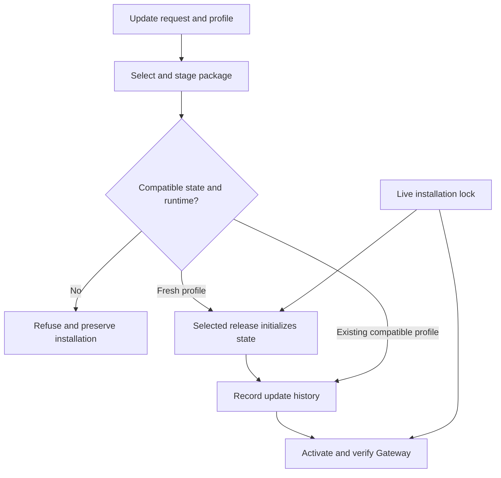

Codex review: blocked before merge. _Reviewed September 11, 2026, 4:41 PM ET / 20:41 UTC (Revision 13)._

# ClawSweeper review

## What this changes

The PR lets selected releases initialize compatible fresh-profile state before update history, repairs update-lock initialization and recovery, and corrects the skill-environment security scanner.

> [!WARNING]
> **SQLite table change**
>
> This PR modifies persisted SQLite tables in `src/infra/update-run-ledger.ts`. Prefer a design that avoids changing persisted SQLite tables. If the change is necessary, verify migration and upgrade compatibility against an existing database before merge.

## Merge readiness

⛔ **Blocked before merge - 3 items remain**

Keep open: this remains a useful fix for fresh-profile transitions to older stable releases. The prior blockers are resolved, and this review found no new actionable defect; the latest commit changes only tests.

**Priority:** P1
**Reviewed head:** `b3b061117a9948ce5c08949f7b120b210ca16843`

## Review scores

| Measure | Result | What it means |
|---|---|---|
| **Overall readiness** | 🐚 platinum hermit **(4/6)** | The patch addresses the owning invariants with strong recorded runtime proof, resolved prior findings, and no newly identified blocking defect. |
| **Proof confidence** | 🦞 diamond lobster **(5/6)** ✨ media proof bonus | Sufficient (linked_artifact): The captured report ties the changed updater and control-store owners to 26 real update cases with observed Gateway health or safe refusal, plus addon-free and Windows recovery/privacy checks. Runtime source is unchanged since that proof revision; blocked trace retrieval is a reviewer limitation. |
| **Patch quality** | 🐚 platinum hermit **(4/6)** | No actionable review findings were identified. |

## Verification

| Check | Result | Evidence |
|---|---|---|
| **Real behavior** | Verified | Sufficient (linked_artifact): The captured report ties the changed updater and control-store owners to 26 real update cases with observed Gateway health or safe refusal, plus addon-free and Windows recovery/privacy checks. Runtime source is unchanged since that proof revision; blocked trace retrieval is a reviewer limitation. |
| **Evidence reviewed** | 10 items | Pinned patch and review continuity: The comparison against the previous reviewed head contains only the new Doctor process-settlement test, its test helper, and the Gateway deletion benchmark adjustment. Comparing against the recorded live-tested revision identifies five test/test-support files and no runtime changes. Current main still admits history first: Current main admits the update run before target selection and schema preflight. The ledger bootstraps missing databases using the invoking runtime, so an explicit older stable target can still encounter the reported mismatch. Latest release does not contain the new admission flow: The v2026.9.4 source also admits history first. Its state schema is 17, so that release being compatible with current main does not resolve transitions to older schema-16 or schema-1 targets. |
| **Findings** | None | None. |
| **Security** | None | None. |

## How this fits together

The updater selects a package, checks its compatibility with profile data, and coordinates installation and Gateway restart. Its installation lock remains separate from the profile database so replacing the runtime cannot invalidate update ownership.

## Before merge

- [ ] **Resolve merge risk (P1)** - Fresh-profile custom artifacts without schema declarations now refuse and require a declared artifact or exact published release; target-created state can remain after a later refusal. These operator-visible effects are documented and accepted.
- [ ] **Resolve merge risk (P1)** - The review environment could not retrieve the linked Testbox traces, so runtime observations rely on the captured source-specific proof report rather than independently downloaded logs.
- [ ] **Add data-model compatibility proof** - Confirm migration or upgrade compatibility proof before merge.

<strong>Agent review details</strong>

### Security

None.

### PR surface

Source +1195, Tests +3256, Docs +82, Config 0, Other +450. Total +4983 across 73 files.

View PR surface stats

| Area | Files | Added | Removed | Net |
|---|---:|---:|---:|---:|
| Source | 26 | 1703 | 508 | +1195 |
| Tests | 33 | 3554 | 298 | +3256 |
| Docs | 6 | 89 | 7 | +82 |
| Config | 1 | 1 | 1 | 0 |
| Generated | 0 | 0 | 0 | 0 |
| Other | 7 | 464 | 14 | +450 |
| **Total** | **73** | **5811** | **828** | **+4983** |

### Review metrics

| Metric | Value | Why it matters |
|---|---|---|
| **Runtime versus regression coverage** | Runtime production net +1,195 lines; tests and fixtures net +3,432 lines | Production growth supports target-owned initialization and retained staging; the larger test delta covers cross-version, concurrency, refusal, and recovery contracts. |

### Stored data model

Persistent data-model change detected: `database schema: src/infra/update-run-ledger.ts`, `migration/backfill/repair: src/cli/update-cli/update-command-fresh-doctor.ts`, `migration/backfill/repair: src/cli/update-cli/update-command-run.ts`, `serialized state: security/opengrep/compile-rules.mjs`, `unknown-data-model-change: security/opengrep/compile-rules.mjs`, `unknown-data-model-change: src/infra/update-run-ledger.ts`. Confirm migration or upgrade compatibility proof before merge.

### Root-cause cluster

Relationship: `fixed_by_candidate`
Canonical: https://github.com/openclaw/openclaw/issues/144132
Summary: This PR is the implementation candidate for fresh-profile schema incompatibility; the merged control-store permission repair overlaps only part of its supporting recovery work.

Members:
- `canonical`: https://github.com/openclaw/openclaw/issues/144132 - The linked issue defines the reproduced defect and accepted repair boundary.
- `partial_overlap`: https://github.com/openclaw/openclaw/pull/145085 - The merged repair restores interrupted control-store permissions, which this branch preserves, but does not fix target-owned fresh initialization.

Proposal only: this assessment does not dispatch repair, suppress jobs, mutate sibling items, close, or merge anything.

### Merge-risk options

**Maintainer options:**
1. **Retain the accepted compatibility boundary (recommended)**  
   Keep the documented artifact refusal and retained target-state behavior supported by the recorded fresh-profile and existing-state matrix.

### Technical review

Best possible solution:

Keep the accepted target-owned bootstrap, schema-preserving history, and live installation ownership together, preserving the documented refusal and recovery boundaries.

Do we have a high-confidence way to reproduce the issue?

Yes, from source: a fresh main profile targeting 2026.9.3 admits schema-17 history before checking the schema-16 target. The linked issue supplies a pinned reproduction; no target code was executed during this review.

Is this the best way to solve the issue?

Yes: letting the selected runtime initialize state fixes the incompatible-state producer while reusing the existing ledger, package transaction, and installation-lock owners.

AGENTS.md: found and applied where relevant.

Codex review notes: model internal, reasoning medium; reviewed against [0f0ddbc12ca0](https://github.com/openclaw/openclaw/commit/0f0ddbc12ca036908b87339c8329a3980873fae5).

### Labels

Label justifications:

- `P1`: The fix addresses updates that can create incompatible state and leave the selected Gateway unable to start.
- `merge-risk: 🚨 compatibility`: Fresh custom artifacts without schema metadata now refuse, and target initialization may persist after a later refusal.
- `rating: 🐚 platinum hermit`: Overall readiness is 🐚 platinum hermit; proof is 🦞 diamond lobster and patch quality is 🐚 platinum hermit.
- `status: 👀 ready for maintainer look`: ClawSweeper has no concrete contributor-facing blocker left for this PR. Sufficient (linked_artifact): The captured report ties the changed updater and control-store owners to 26 real update cases with observed Gateway health or safe refusal, plus addon-free and Windows recovery/privacy checks. Runtime source is unchanged since that proof revision; blocked trace retrieval is a reviewer limitation.
- `proof: sufficient`: Contributor real behavior proof is sufficient. The captured report ties the changed updater and control-store owners to 26 real update cases with observed Gateway health or safe refusal, plus addon-free and Windows recovery/privacy checks. Runtime source is unchanged since that proof revision; blocked trace retrieval is a reviewer limitation.

### Evidence

What I checked:

- **Pinned patch and review continuity:** The comparison against the previous reviewed head contains only the new Doctor process-settlement test, its test helper, and the Gateway deletion benchmark adjustment. Comparing against the recorded live-tested revision identifies five test/test-support files and no runtime changes. ([`src/commands/doctor-update.child-process.test.ts:19`](https://github.com/openclaw/openclaw/blob/b3b061117a9948ce5c08949f7b120b210ca16843/src/commands/doctor-update.child-process.test.ts#L19), [b3b061117a99](https://github.com/openclaw/openclaw/commit/b3b061117a9948ce5c08949f7b120b210ca16843))
- **Current main still admits history first:** Current main admits the update run before target selection and schema preflight. The ledger bootstraps missing databases using the invoking runtime, so an explicit older stable target can still encounter the reported mismatch. ([`src/cli/update-cli/update-command.ts:128`](https://github.com/openclaw/openclaw/blob/0f0ddbc12ca036908b87339c8329a3980873fae5/src/cli/update-cli/update-command.ts#L128), [0f0ddbc12ca0](https://github.com/openclaw/openclaw/commit/0f0ddbc12ca036908b87339c8329a3980873fae5))
- **Latest release does not contain the new admission flow:** The v2026.9.4 source also admits history first. Its state schema is 17, so that release being compatible with current main does not resolve transitions to older schema-16 or schema-1 targets. ([`src/cli/update-cli/update-command.ts`](https://github.com/openclaw/openclaw/blob/3a9d69db306cd7f081e06254cb89c4bcc14a7107/src/cli/update-cli/update-command.ts), [3a9d69db306c](https://github.com/openclaw/openclaw/commit/3a9d69db306cd7f081e06254cb89c4bcc14a7107))
- **Target-owned initialization:** Fresh profiles branch before ledger admission; older targets initialize through their Doctor before run registration. Previews avoid initialization, while staged artifacts require declared schema support and retain one staged package. ([`src/cli/update-cli/update-command.ts:97`](https://github.com/openclaw/openclaw/blob/b3b061117a9948ce5c08949f7b120b210ca16843/src/cli/update-cli/update-command.ts#L97), [b3b061117a99](https://github.com/openclaw/openclaw/commit/b3b061117a9948ce5c08949f7b120b210ca16843))
- **Prior publication blockers resolved:** The database owner now exclusively creates a private read/write file and initializes SQLite on that inode without native-only publication. Windows applies the protected ACL during creation. Existing-identity helpers reject replacement or missing state and recheck identity at transaction commit. ([`src/infra/update-managed-service-handoff-database.ts:109`](https://github.com/openclaw/openclaw/blob/b3b061117a9948ce5c08949f7b120b210ca16843/src/infra/update-managed-service-handoff-database.ts#L109), [b3b061117a99](https://github.com/openclaw/openclaw/commit/b3b061117a9948ce5c08949f7b120b210ca16843))
- **Recorded real behavior proof:** The captured PR body reports 26/26 production cases at 934e8b778690c84b3429efa3a9279ed8850a726b: 16 successful updates and 10 safe refusals, including Doctor/Gateway health and configuration/source preservation. It separately records addon-free and native Windows first-use, concurrency, crash-recovery, ACL, and sealed-state rejection proof. The linked Testbox workflows ended cancelled after lease shutdown; their workflow status is not treated as a test result. Log retrieval redirected to a blocked artifact host, preventing independent inspection of retained traces in this review. ([934e8b778690](https://github.com/openclaw/openclaw/commit/934e8b778690c84b3429efa3a9279ed8850a726b))

Likely related people:

- **steipete:** Suggested for follow-up; no historical authorship or introduction is verified. (role: unverified routing candidate; confidence: low)
- **vincentkoc:** Suggested for follow-up; no historical authorship or introduction is verified. (role: unverified routing candidate; confidence: low)
- **fuller-stack-dev:** Suggested for follow-up; no historical authorship or introduction is verified. (role: unverified routing candidate; confidence: low)

### Rating scale

| Score | Internal tier | Crab rank | Meaning |
|---:|:---:|---|---|
| **6/6** | S | 🦀 challenger crab | Exceptional readiness |
| **5/6** | A | 🦞 diamond lobster | Very strong readiness |
| **4/6** | B | 🐚 platinum hermit | Good normal PR; ordinary maintainer review |
| **3/6** | C | 🦐 gold shrimp | Useful, but confidence is limited |
| **2/6** | D | 🦪 silver shellfish | Proof or implementation needs work |
| **1/6** | F | 🧂 unranked krab | Not merge-ready |
| N/A | NA | 🌊 off-meta tidepool | Rating does not apply |

Overall follows the weaker of proof and patch quality.
Shiny media proof means a screenshot, video, or linked artifact directly shows the changed behavior. Runtime, network, CSP, and security claims still need visible diagnostics.

### Workflow

- ClawSweeper keeps one durable marker-backed review comment per issue or PR.
- Re-runs edit this comment so the latest verdict, findings, and automation markers stay together instead of adding duplicate bot comments.
- A fresh review can be triggered by eligible `@clawsweeper re-review` comments, exact-item GitHub events, scheduled/background review runs, or manual workflow dispatch.
- PR/issue authors and users with repository write access can comment `@clawsweeper re-review` or `@clawsweeper re-run` on an open PR or issue to request a fresh review only.
- Maintainers can also comment `@clawsweeper review` to request a fresh review only.
- Fresh-review commands do not start repair, autofix, rebase, CI repair, or automerge.
- Maintainer-only repair and merge flows require explicit commands such as `@clawsweeper autofix`, `@clawsweeper automerge`, `@clawsweeper fix ci`, or `@clawsweeper address review`.
- Maintainers can comment `@clawsweeper explain` to ask for more context, or `@clawsweeper stop` to stop active automation.

### History

Review history (12 earlier review cycles; latest 8 shown)

<!-- clawsweeper-review-history v=1 total=12 -->
- reviewed 2026-09-11T16:20:21.745Z sha 69dd595037540cf5f609a0a61464a2bfd5333c87 :: blocked before merge. :: [P1] [P1] Open the staging database with write access before fsync
- reviewed 2026-09-11T17:11:22.800Z sha b5f8693f586b120d62c843f40f1e1a0e997a3bc4 :: blocked before merge. :: [P1] [P1] Open the staging database with write access before fsync
- reviewed 2026-09-11T17:46:26.795Z sha 01c050cd34024b8da3740fa5758259c7fd255b93 :: blocked before merge. :: [P1] [P1] Preserve updates when optional native bindings are absent
- reviewed 2026-09-11T18:24:14.753Z sha f9f961b2864a3b7ba985521d74bf182169a939c8 :: blocked before merge. :: [P1] [P1] Preserve first-use updates without optional native bindings
- reviewed 2026-09-11T18:33:23.358Z sha f9f961b2864a3b7ba985521d74bf182169a939c8 :: blocked before merge. :: [P1] [P1] Preserve first-use updates without optional native bindings
- reviewed 2026-09-11T19:04:32.214Z sha d96f45513d71bcc63205ec2238ce4516258976b7 :: blocked before merge. :: none
- reviewed 2026-09-11T19:20:24.159Z sha 934e8b778690c84b3429efa3a9279ed8850a726b :: blocked before merge. :: none
- reviewed 2026-09-11T19:58:15.865Z sha 13ccc03f99f794797642c14601021431f04c9861 :: blocked before merge. :: none

<!-- clawsweeper-verdict:needs-human item=144155 sha=b3b061117a9948ce5c08949f7b120b210ca16843 confidence=high updated_at=2026-09-11T20:37:05Z reviewed_at=2026-09-11T20:41:08.739Z lease_owner=github-run-34644940846-1 lease_comment_id=5640339387 source_revision=c72185c59cd40f58aa571db49453f33537f81693d04beb72bedb425a5e146456 live_verification=absent -->
<!-- clawsweeper-review-state:blocked item=144155 sha=b3b061117a9948ce5c08949f7b120b210ca16843 v=1 -->

<!-- clawsweeper-review-version item=144155 reviewed_at=2026-09-11T20:41:08.739Z sha=b3b061117a9948ce5c08949f7b120b210ca16843 source_revision=c72185c59cd40f58aa571db49453f33537f81693d04beb72bedb425a5e146456 lease_owner=github-run-34644940846-1 lease_comment_id=5640339387 v=1 -->

<!-- clawsweeper-review item=144155 -->