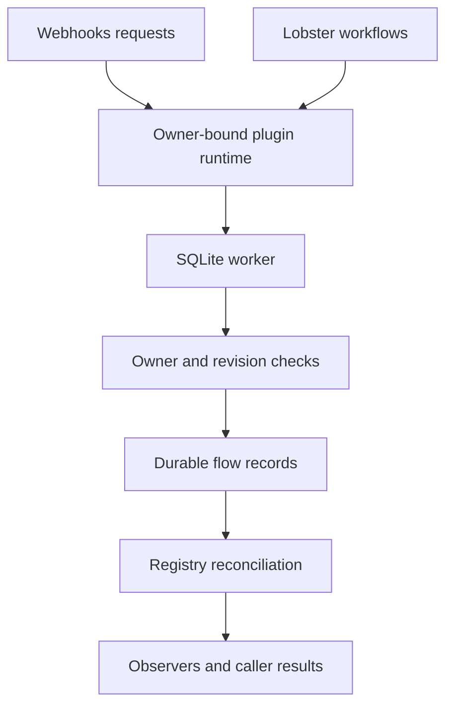

Codex review: blocked before merge. _Reviewed September 12, 2026, 5:38 PM ET / 21:38 UTC._

# ClawSweeper review

## What this changes

Moves managed workflow creation and state changes into the SQLite worker, migrates Webhooks and Lobster callers, and preserves synchronous plugin APIs.

## Merge readiness

⛔ **Blocked before merge - 1 item remains**

This remains useful planned work: current main provides asynchronous reads but not managed-flow writes. No blocking correctness defect was found, and the existing storage coordination issue supports this direction.

**Priority:** P2
**Reviewed head:** `309d8bd0c17ef9795bf509745e2a8919304c785a`

## Review scores

| Measure | Result | What it means |
|---|---|---|
| **Overall readiness** | 🐚 platinum hermit **(4/6)** | A coherent owner-level refactor with meaningful persistence and ordering coverage and no identified blocking defect. |
| **Proof confidence** | 🌊 off-meta tidepool | Not applicable: The maintainer-authored internal refactor is exempt from the external-contributor proof gate; its body reports actual worker persistence and registered Webhooks/Lobster runs, with the limited host environment clearly stated. |
| **Patch quality** | 🐚 platinum hermit **(4/6)** | No actionable review findings were identified. |

## Verification

| Check | Result | Evidence |
|---|---|---|
| **Real behavior** | Not applicable | Not applicable: The maintainer-authored internal refactor is exempt from the external-contributor proof gate; its body reports actual worker persistence and registered Webhooks/Lobster runs, with the limited host environment clearly stated. |
| **Evidence reviewed** | 11 items | Introduced implementation: The pinned merge-base-to-head changes add seven awaited managed-flow methods. Inputs are captured before awaiting, writes retain the worker through reconciliation, and nested outcome-unknown errors propagate without silently returning creation failure. Transactional checks and committed outcomes: Worker updates reread owner and managed mode inside the existing write transaction, then use the shared revision-checking kernel. A recorded committed result survives subsequent coordinator cleanup failure. Projection lifecycle: Reconciliation checks database identity and projection epochs, preserves intervening synchronous updates, and leaves failed reconciliation dirty without replaying the durable mutation. |
| **Findings** | None | None. |
| **Security** | None | None. |

## How this fits together

Managed flows persist workflow progress for plugins such as Webhooks and Lobster. The runtime accepts owner-bound operations, commits SQLite changes, and reconciles the in-process registry before notifying observers.

## Before merge

- [ ] **Resolve merge risk (P1)** - Third-party controllers adopting the new asynchronous SDK methods must await completion and reconcile outcome-unknown creation errors before retrying; bundled-plugin coverage does not establish correct migration of external controllers.

<strong>Agent review details</strong>

### Security

None.

### PR surface

Source +460, Tests +1057, Docs +26, Other -1. Total +1542 across 25 files.

View PR surface stats

| Area | Files | Added | Removed | Net |
|---|---:|---:|---:|---:|
| Source | 14 | 607 | 147 | +460 |
| Tests | 8 | 1132 | 75 | +1057 |
| Docs | 2 | 37 | 11 | +26 |
| Config | 0 | 0 | 0 | 0 |
| Generated | 0 | 0 | 0 | 0 |
| Other | 1 | 0 | 1 | -1 |
| **Total** | **25** | **1776** | **234** | **+1542** |

### Review metrics

| Metric | Value | Why it matters |
|---|---|---|
| **SDK compatibility surface** | 7 async write methods added; 7 synchronous counterparts deprecated, 0 removed | The change expands the public contract while preserving existing synchronous callers. |
| **Production versus test growth** | Production net +460 lines; tests and test support net +1,057 lines | Production growth supports worker operations and registry reconciliation; most added coverage protects persistence, ordering, and failure behavior. |

### Root-cause cluster

Relationship: `partial_overlap`
Canonical: https://github.com/openclaw/openclaw/issues/144592
Summary: This PR implements the managed-flow write slice of the broader asynchronous storage program.

Members:
- `canonical`: https://github.com/openclaw/openclaw/issues/144592 - The open coordination issue explicitly includes task/flow mutation ownership and SDK caller conversion.
- `adjacent_distinct`: https://github.com/openclaw/openclaw/pull/145851 - The merged prerequisite supplies async reads and explicitly leaves worker mutations unfinished.
- `adjacent_distinct`: https://github.com/openclaw/openclaw/pull/146172 - The merged prerequisite supplies worker-owned database admission and lifecycle handling used by these writes.

Proposal only: this assessment does not dispatch repair, suppress jobs, mutate sibling items, close, or merge anything.

### Merge-risk options

**Maintainer options:**
1. **Accept the documented opt-in SDK contract (recommended)**  
   Retain synchronous methods for existing plugins and accept the new awaited methods with their documented uncertain-outcome handling and major-version removal boundary.

### Technical review

Best possible solution:

Keep worker-backed mutations on the shared row kernels while retaining synchronous SDK compatibility and the documented external-plugin migration boundary.

Do we have a high-confidence way to reproduce the issue?

Not applicable as a discrete bug report: this is a planned storage refactor. Current source confirms synchronous writes, and the added contention test targets application-loop blocking; this review did not execute it.

Is this the best way to solve the issue?

Yes. Reusing the existing worker, transaction owner, and row kernels while migrating both bundled callers is a coherent continuation of the accepted storage plan.

AGENTS.md: found and applied where relevant.

Codex review notes: model internal, reasoning medium; reviewed against [f634a96fd509](https://github.com/openclaw/openclaw/commit/f634a96fd5091d350d8e8fc3e22f2c128ecec06b).

### Labels

Label changes:

- add `P2`: This is a bounded runtime responsiveness improvement without evidence of an urgent user-facing outage.
- add `merge-risk: 🚨 compatibility`: Seven new asynchronous SDK mutations introduce completion and uncertain-outcome handling obligations for migrating plugin controllers.
- add `rating: 🐚 platinum hermit`: Overall readiness is 🐚 platinum hermit; proof is 🌊 off-meta tidepool and patch quality is 🐚 platinum hermit.
- add `status: 👀 ready for maintainer look`: ClawSweeper has no concrete contributor-facing blocker left for this PR. Not applicable: The maintainer-authored internal refactor is exempt from the external-contributor proof gate; its body reports actual worker persistence and registered Webhooks/Lobster runs, with the limited host environment clearly stated.

Label justifications:

- `P2`: This is a bounded runtime responsiveness improvement without evidence of an urgent user-facing outage.
- `merge-risk: 🚨 compatibility`: Seven new asynchronous SDK mutations introduce completion and uncertain-outcome handling obligations for migrating plugin controllers.
- `rating: 🐚 platinum hermit`: Overall readiness is 🐚 platinum hermit; proof is 🌊 off-meta tidepool and patch quality is 🐚 platinum hermit.
- `status: 👀 ready for maintainer look`: ClawSweeper has no concrete contributor-facing blocker left for this PR. Not applicable: The maintainer-authored internal refactor is exempt from the external-contributor proof gate; its body reports actual worker persistence and registered Webhooks/Lobster runs, with the limited host environment clearly stated.

### Evidence

What I checked:

- **Introduced implementation:** The pinned merge-base-to-head changes add seven awaited managed-flow methods. Inputs are captured before awaiting, writes retain the worker through reconciliation, and nested outcome-unknown errors propagate without silently returning creation failure. ([`src/plugins/runtime/runtime-tasks-async.ts:115`](https://github.com/openclaw/openclaw/blob/309d8bd0c17ef9795bf509745e2a8919304c785a/src/plugins/runtime/runtime-tasks-async.ts#L115), [309d8bd0c17e](https://github.com/openclaw/openclaw/commit/309d8bd0c17ef9795bf509745e2a8919304c785a))
- **Transactional checks and committed outcomes:** Worker updates reread owner and managed mode inside the existing write transaction, then use the shared revision-checking kernel. A recorded committed result survives subsequent coordinator cleanup failure. ([`src/state/openclaw-state.worker.ts:88`](https://github.com/openclaw/openclaw/blob/309d8bd0c17ef9795bf509745e2a8919304c785a/src/state/openclaw-state.worker.ts#L88), [309d8bd0c17e](https://github.com/openclaw/openclaw/commit/309d8bd0c17ef9795bf509745e2a8919304c785a))
- **Projection lifecycle:** Reconciliation checks database identity and projection epochs, preserves intervening synchronous updates, and leaves failed reconciliation dirty without replaying the durable mutation. ([`src/tasks/task-flow-registry.ts:234`](https://github.com/openclaw/openclaw/blob/309d8bd0c17ef9795bf509745e2a8919304c785a/src/tasks/task-flow-registry.ts#L234), [309d8bd0c17e](https://github.com/openclaw/openclaw/commit/309d8bd0c17ef9795bf509745e2a8919304c785a))
- **Current-main and release necessity:** Fetched main still exposes read-only async managed-flow bindings. The latest release has no runtime-tasks-async.ts entry; this inspection does not establish a released implementation of the requested writes. ([`src/plugins/runtime/runtime-tasks-async.ts`](https://github.com/openclaw/openclaw/blob/f634a96fd5091d350d8e8fc3e22f2c128ecec06b/src/plugins/runtime/runtime-tasks-async.ts), [f634a96fd509](https://github.com/openclaw/openclaw/commit/f634a96fd5091d350d8e8fc3e22f2c128ecec06b))
- **Latest release inspection:** The command returned no entry for the asynchronous task runtime in v2026.9.4. ([`src/plugins/runtime/runtime-tasks-async.ts`](https://github.com/openclaw/openclaw/blob/3a9d69db306cd7f081e06254cb89c4bcc14a7107/src/plugins/runtime/runtime-tasks-async.ts), [3a9d69db306c](https://github.com/openclaw/openclaw/commit/3a9d69db306cd7f081e06254cb89c4bcc14a7107))
- **Accepted storage direction:** The open coordination issue explicitly includes asynchronous task/flow and SDK contracts, complete owner-and-caller conversions, synchronous SQLite transaction callbacks, and real SQLite validation: https://github.com/openclaw/openclaw/issues/144592.

Likely related people:

- **steipete:** Suggested for follow-up; no historical authorship or introduction is verified. (role: unverified routing candidate; confidence: low)
- **vincentkoc:** Suggested for follow-up; no historical authorship or introduction is verified. (role: unverified routing candidate; confidence: low)

### Rating scale

| Score | Internal tier | Crab rank | Meaning |
|---:|:---:|---|---|
| **6/6** | S | 🦀 challenger crab | Exceptional readiness |
| **5/6** | A | 🦞 diamond lobster | Very strong readiness |
| **4/6** | B | 🐚 platinum hermit | Good normal PR; ordinary maintainer review |
| **3/6** | C | 🦐 gold shrimp | Useful, but confidence is limited |
| **2/6** | D | 🦪 silver shellfish | Proof or implementation needs work |
| **1/6** | F | 🧂 unranked krab | Not merge-ready |
| N/A | NA | 🌊 off-meta tidepool | Rating does not apply |

Overall follows the weaker of proof and patch quality.
Shiny media proof means a screenshot, video, or linked artifact directly shows the changed behavior. Runtime, network, CSP, and security claims still need visible diagnostics.

### Workflow

- ClawSweeper keeps one durable marker-backed review comment per issue or PR.
- Re-runs edit this comment so the latest verdict, findings, and automation markers stay together instead of adding duplicate bot comments.
- A fresh review can be triggered by eligible `@clawsweeper re-review` comments, exact-item GitHub events, scheduled/background review runs, or manual workflow dispatch.
- PR/issue authors and users with repository write access can comment `@clawsweeper re-review` or `@clawsweeper re-run` on an open PR or issue to request a fresh review only.
- Maintainers can also comment `@clawsweeper review` to request a fresh review only.
- Fresh-review commands do not start repair, autofix, rebase, CI repair, or automerge.
- Maintainer-only repair and merge flows require explicit commands such as `@clawsweeper autofix`, `@clawsweeper automerge`, `@clawsweeper fix ci`, or `@clawsweeper address review`.
- Maintainers can comment `@clawsweeper explain` to ask for more context, or `@clawsweeper stop` to stop active automation.

<!-- clawsweeper-verdict:needs-human item=146495 sha=309d8bd0c17ef9795bf509745e2a8919304c785a confidence=high updated_at=2026-09-12T21:34:42Z reviewed_at=2026-09-12T21:38:22.374Z lease_owner=github-run-34720262235-1 lease_comment_id=5648842833 source_revision=f1324d0ebaa762485ed6805dd4933977dc81a20ab55f81d1eb242cfce5e02fa8 live_verification=absent -->
<!-- clawsweeper-review-state:blocked item=146495 sha=309d8bd0c17ef9795bf509745e2a8919304c785a v=1 -->

<!-- clawsweeper-review-version item=146495 reviewed_at=2026-09-12T21:38:22.374Z sha=309d8bd0c17ef9795bf509745e2a8919304c785a source_revision=f1324d0ebaa762485ed6805dd4933977dc81a20ab55f81d1eb242cfce5e02fa8 lease_owner=github-run-34720262235-1 lease_comment_id=5648842833 v=1 -->

<!-- clawsweeper-review item=146495 -->