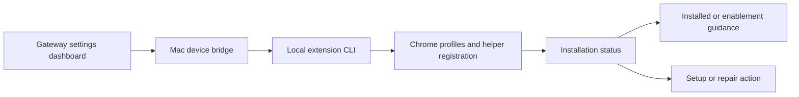

Codex review: blocked before merge. _Reviewed September 19, 2026, 8:06 PM ET / September 20, 2026, 00:06 UTC (Revision 2)._

# ClawSweeper review

## What this changes

The Mac settings page automatically checks Chrome extension installation and distinguishes installed, disabled, and missing-helper states.

## Regression provenance

Possible regression — suspected (reviewed change). No predecessor PR is attributed.

## Merge readiness

⛔ **Blocked before merge - 4 items remain**

The fix remains useful: current main still learns installation status only after setup. The previously reported shipped-app compatibility regression remains unfixed on the unchanged head.

**Priority:** P2
**Reviewed head:** `ec6ef00c91fcef970d5d7962d995fa9f2bf24784`

## Review scores

| Measure | Result | What it means |
|---|---|---|
| **Overall readiness** | 🦐 gold shrimp **(3/6)** | Useful implementation and clear visual evidence are held back by the unresolved shipped-bridge regression. |
| **Proof confidence** | 🐚 platinum hermit **(4/6)** | Not applicable: The ordinary external-contributor gate does not apply to this member-authored PR. Inspected screenshots show the intended settings presentation through a synthetic bridge; the separate CLI observation does not demonstrate native bridge execution or shipped-app upgrade compatibility. |
| **Patch quality** | 🦐 gold shrimp **(3/6)** | 1 actionable review finding remain. |

## Verification

| Check | Result | Evidence |
|---|---|---|
| **Real behavior** | Not applicable | Not applicable: The ordinary external-contributor gate does not apply to this member-authored PR. Inspected screenshots show the intended settings presentation through a synthetic bridge; the separate CLI observation does not demonstrate native bridge execution or shipped-app upgrade compatibility. |
| **Evidence reviewed** | 8 items | Introduced setup gate: The introduced needsSetup condition requires a successful status result. A rejected status request leaves the result null and removes the installation button. The previous review examined the identical head; the finding remains applicable.<br>Released native request contract: The v2026.9.5 request decoder accepts install-chrome-extension but rejects chrome-extension-status. The released message handler replies with Invalid device settings request when decoding fails.<br>Released reply and upgrade contract: The released installation reply contains nativeHostRegistered, installRequested, and discoveredProfiles, without installedProfiles. Its stable Gateway compatibility rule accepts newer versions within the same major, so updating the Gateway can deliver this dashboard to an older Mac bridge. |
| **Findings** | 1 actionable finding | [P1] Preserve Chrome setup for shipped Mac app versions |
| **Security** | None | None. |

## How this fits together

The Gateway serves the settings dashboard inside the Mac app, whose native bridge runs the local Chrome extension CLI. Discovery results determine the installation status and available setup actions.



## Before merge

- [ ] **Preserve Chrome setup for shipped Mac app versions (P1)** - When the v2026.9.5 Mac app loads this dashboard from an updated Gateway, its native bridge rejects `chrome-extension-status`. The result stays null, so this condition removes the previously working setup button permanently. The shipped app accepts newer stable Gateways. Preserve setup when status is unsupported and accept the existing installation reply, which lacks the newly required `installedProfiles` field. Cover this released-app/new-dashboard combination. This prior finding remains unfixed on the same head.
- [ ] **Resolve merge risk (P1)** - A Gateway upgrade can remove working in-app Chrome setup for v2026.9.5 Mac users; the submitted validation does not cover that mixed-version combination.
- [ ] **Complete next step (P2)** - Restore setup for Mac bridges without status support, accept their existing installation replies, and validate released-app and updated-app behavior.
- [ ] **Add data-model compatibility proof** - Confirm migration or upgrade compatibility proof before merge.

## Findings

- [P1] Preserve Chrome setup for shipped Mac app versions — `ui/src/pages/device/device-page.ts:199-201`


<details>
<summary><strong>Agent review details</strong></summary>

### Security

None.

### PR surface

Source +99, Tests +192, Docs +7, Other +32. Total +330 across 17 files.

<details>
<summary>View PR surface stats</summary>

| Area | Files | Added | Removed | Net |
|---|---:|---:|---:|---:|
| Source | 3 | 154 | 55 | +99 |
| Tests | 6 | 201 | 9 | +192 |
| Docs | 1 | 7 | 0 | +7 |
| Config | 0 | 0 | 0 | 0 |
| Generated | 0 | 0 | 0 | 0 |
| Other | 7 | 48 | 16 | +32 |
| **Total** | **17** | **410** | **80** | **+330** |

</details>

### Review metrics

| Metric | Value | Why it matters |
|---|---|---|
| **Native wire contract** | 1 new request; 1 newly required reply field | The independently installed Mac app can lag the Gateway-served dashboard. |
| **Production versus test growth** | Production +125 net lines; tests +198 net lines | Production growth supports discovery and request lifecycle handling; coverage exercises status states but omits the released bridge. |

### Stored data model

Persistent data-model change detected: `migration/backfill/repair: ui/src/i18n/locales/en-settings.ts`. Confirm migration or upgrade compatibility proof before merge.

### Merge-risk options

**Maintainer options:**
1. **Preserve shipped bridge compatibility (recommended)**  
   Keep setup available without status support, accept the released installation reply, and verify both released and updated Mac bridges.

<details>
<summary>Copy recommended automerge instruction</summary>

```text
@clawsweeper automerge

Special instructions:
Preserve Chrome setup with the v2026.9.5 Mac bridge when chrome-extension-status is unsupported, accept its installation reply without installedProfiles, and add focused mixed-version regression coverage while retaining updated-bridge discovery and stale-response protection.
```

</details>

### Technical review

Best possible solution:

Keep automatic discovery on capable Mac bridges while preserving the shipped installation action and reply contract on older apps.

Do we have a high-confidence way to reproduce the issue?

Yes, from source: load the new dashboard with the v2026.9.5 native bridge, whose status rejection leaves setup hidden. This read-only review did not execute the application.

Is this the best way to solve the issue?

The existing CLI discovery owner is the right solution, but the dashboard must retain compatibility with the shipped native installation contract.

Full review comments:

- [P1] Preserve Chrome setup for shipped Mac app versions — `ui/src/pages/device/device-page.ts:199-201`
  When the v2026.9.5 Mac app loads this dashboard from an updated Gateway, its native bridge rejects `chrome-extension-status`. The result stays null, so this condition removes the previously working setup button permanently. The shipped app accepts newer stable Gateways. Preserve setup when status is unsupported and accept the existing installation reply, which lacks the newly required `installedProfiles` field. Cover this released-app/new-dashboard combination. This prior finding remains unfixed on the same head.
  Confidence: 0.99

Overall correctness: patch is incorrect
Overall confidence: 0.98

AGENTS.md: found and applied where relevant.

Codex review notes: model internal, reasoning medium; reviewed against [572ef2ce9b3f](https://github.com/openclaw/openclaw/commit/572ef2ce9b3fb97ebd7f832921aa986d5ec7e4b6).

### Labels

Label justifications:

- `P2`: This repairs misleading installation status in a bounded Mac settings workflow.
- `merge-risk: 🚨 compatibility`: The new dashboard requires a request and reply field absent from the released v2026.9.5 Mac bridge.
- `rating: 🦐 gold shrimp`: Overall readiness is 🦐 gold shrimp; proof is 🐚 platinum hermit and patch quality is 🦐 gold shrimp.
- `status: ⏳ waiting on author`: ClawSweeper has contributor-facing work open and is waiting for author action. Not applicable: The ordinary external-contributor gate does not apply to this member-authored PR. Inspected screenshots show the intended settings presentation through a synthetic bridge; the separate CLI observation does not demonstrate native bridge execution or shipped-app upgrade compatibility.
- `proof: 📸 screenshot`: Contributor real behavior proof includes screenshot evidence. The ordinary external-contributor gate does not apply to this member-authored PR. Inspected screenshots show the intended settings presentation through a synthetic bridge; the separate CLI observation does not demonstrate native bridge execution or shipped-app upgrade compatibility.

### Evidence

Acceptance criteria:

- [P1] pnpm --dir ui test src/app/native-device-settings.test.ts src/pages/device/device-pages.test.ts.
- [P1] pnpm test:ui:e2e ui/src/e2e/chrome-extension-status.e2e.test.ts.
- [P1] git diff --check.

What I checked:

- **Introduced setup gate:** The introduced needsSetup condition requires a successful status result. A rejected status request leaves the result null and removes the installation button. The previous review examined the identical head; the finding remains applicable. ([`ui/src/pages/device/device-page.ts:201`](https://github.com/openclaw/openclaw/blob/ec6ef00c91fcef970d5d7962d995fa9f2bf24784/ui/src/pages/device/device-page.ts#L201), [ec6ef00c91fc](https://github.com/openclaw/openclaw/commit/ec6ef00c91fcef970d5d7962d995fa9f2bf24784))
- **Released native request contract:** The v2026.9.5 request decoder accepts install-chrome-extension but rejects chrome-extension-status. The released message handler replies with Invalid device settings request when decoding fails. ([`apps/shared/OpenClawKit/Sources/OpenClawKit/DeviceSettingsContract.swift:160`](https://github.com/openclaw/openclaw/blob/ec9c1a13db8938e5a3eaa51fca2e981cde2395a9/apps/shared/OpenClawKit/Sources/OpenClawKit/DeviceSettingsContract.swift#L160), [ec9c1a13db89](https://github.com/openclaw/openclaw/commit/ec9c1a13db8938e5a3eaa51fca2e981cde2395a9))
- **Released reply and upgrade contract:** The released installation reply contains nativeHostRegistered, installRequested, and discoveredProfiles, without installedProfiles. Its stable Gateway compatibility rule accepts newer versions within the same major, so updating the Gateway can deliver this dashboard to an older Mac bridge. ([`apps/macos/Sources/OpenClaw/ChromeExtensionSetup.swift:4`](https://github.com/openclaw/openclaw/blob/ec9c1a13db8938e5a3eaa51fca2e981cde2395a9/apps/macos/Sources/OpenClaw/ChromeExtensionSetup.swift#L4), [ec9c1a13db89](https://github.com/openclaw/openclaw/commit/ec9c1a13db8938e5a3eaa51fca2e981cde2395a9))
- **Mandatory new reply field survives merge:** The new shared result schema requires installedProfiles for installation replies as well as status replies. Inspection of the verified test merge against its recorded main parent confirms this change survives the merge. ([`ui/src/app/native-device-settings.ts:196`](https://github.com/openclaw/openclaw/blob/440fd5538a5d19cd6950ef86d22570a004889218/ui/src/app/native-device-settings.ts#L196), [440fd5538a5d](https://github.com/openclaw/openclaw/commit/440fd5538a5d19cd6950ef86d22570a004889218))
- **Current-main necessity:** At the fetched main revision, the settings card still renders the setup button unconditionally and obtains extension information only through installation. The relevant production files match the PR merge-base versions; the central improvement is not already implemented there. ([`ui/src/pages/device/device-page.ts:187`](https://github.com/openclaw/openclaw/blob/572ef2ce9b3fb97ebd7f832921aa986d5ec7e4b6/ui/src/pages/device/device-page.ts#L187), [572ef2ce9b3f](https://github.com/openclaw/openclaw/commit/572ef2ce9b3fb97ebd7f832921aa986d5ec7e4b6))
- **Existing discovery owner and security boundary:** The new native action invokes the existing read-only browser extension status command. Browser-plugin discovery already separates Store installation from enablement. Native requests retain main-frame, trusted-document, current-session, and cancellation checks; no Codex dependency contract is involved. ([`apps/macos/Sources/OpenClaw/ChromeExtensionSetup.swift:60`](https://github.com/openclaw/openclaw/blob/ec6ef00c91fcef970d5d7962d995fa9f2bf24784/apps/macos/Sources/OpenClaw/ChromeExtensionSetup.swift#L60), [ec6ef00c91fc](https://github.com/openclaw/openclaw/commit/ec6ef00c91fcef970d5d7962d995fa9f2bf24784))

Likely related people:

- **Peter Steinberger:** Raw commit 8964a4d8dc2f24979c773fbf96bc4a3ca79ed5f2 adds apps/macos/Sources/OpenClaw/ChromeExtensionSetup.swift:43 relative to its recorded parents. This identifies author metadata, not feature responsibility or a PR merger. (role: source-line author; confidence: high; commits: [8964a4d8dc2f](https://github.com/openclaw/openclaw/commit/8964a4d8dc2f24979c773fbf96bc4a3ca79ed5f2); files: `apps/macos/Sources/OpenClaw/ChromeExtensionSetup.swift`)

### Rank-up moves

Optional improvements that raise the rating; they are not merge blockers.

- Preserve the released native installation contract and verify the new dashboard against both v2026.9.5 and updated Mac bridges.

### Rating scale

| Score | Internal tier | Crab rank | Meaning |
|---:|:---:|---|---|
| **6/6** | S | 🦀 challenger crab | Exceptional readiness |
| **5/6** | A | 🦞 diamond lobster | Very strong readiness |
| **4/6** | B | 🐚 platinum hermit | Good normal PR; ordinary maintainer review |
| **3/6** | C | 🦐 gold shrimp | Useful, but confidence is limited |
| **2/6** | D | 🦪 silver shellfish | Proof or implementation needs work |
| **1/6** | F | 🧂 unranked krab | Not merge-ready |
| N/A | NA | 🌊 off-meta tidepool | Rating does not apply |

Overall follows the weaker of proof and patch quality.
Shiny media proof means a screenshot, video, or linked artifact directly shows the changed behavior. Runtime, network, CSP, and security claims still need visible diagnostics.

### Workflow

- ClawSweeper keeps one durable marker-backed review comment per issue or PR.
- Re-runs edit this comment so the latest verdict, findings, and automation markers stay together instead of adding duplicate bot comments.
- A fresh review can be triggered by eligible `@clawsweeper re-review` comments, exact-item GitHub events, scheduled/background review runs, or manual workflow dispatch.
- PR/issue authors and users with repository write access can comment `@clawsweeper re-review` or `@clawsweeper re-run` on an open PR or issue to request a fresh review only.
- Maintainers can also comment `@clawsweeper review` to request a fresh review only.
- Fresh-review commands do not start repair, autofix, rebase, CI repair, or automerge.
- Maintainer-only repair and merge flows require explicit commands such as `@clawsweeper autofix`, `@clawsweeper automerge`, `@clawsweeper fix ci`, or `@clawsweeper address review`.
- Maintainers can comment `@clawsweeper explain` to ask for more context, or `@clawsweeper stop` to stop active automation.

### History

<details>
<summary>Review history (1 earlier review cycle)</summary>

<!-- clawsweeper-review-history v=1 total=1 -->
- reviewed 2026-09-19T23:58:55.835Z sha ec6ef00c91fcef970d5d7962d995fa9f2bf24784 :: blocked before merge. :: [P1] Preserve Chrome setup for shipped Mac app versions

</details>

</details>

<!-- clawsweeper-verdict:needs-human item=153266 sha=ec6ef00c91fcef970d5d7962d995fa9f2bf24784 confidence=high updated_at=2026-09-20T00:03:31Z reviewed_at=2026-09-20T00:06:30.355Z lease_owner=github-run-35477672886-1 lease_comment_id=5746277122 source_revision=41a88d203cf90cf22efa3135f327ad1ea49bb9b64faef27054e71fa1c8e37e65 live_verification=absent -->
<!-- clawsweeper-review-state:blocked item=153266 sha=ec6ef00c91fcef970d5d7962d995fa9f2bf24784 v=1 -->

<!-- clawsweeper-review-version item=153266 reviewed_at=2026-09-20T00:06:30.355Z sha=ec6ef00c91fcef970d5d7962d995fa9f2bf24784 source_revision=41a88d203cf90cf22efa3135f327ad1ea49bb9b64faef27054e71fa1c8e37e65 lease_owner=github-run-35477672886-1 lease_comment_id=5746277122 v=1 -->

<!-- clawsweeper-review item=153266 -->