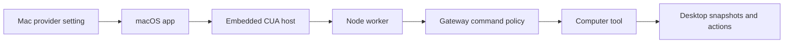

Codex review: found issues before merge. _Reviewed August 14, 2026, 11:47 AM ET / 15:47 UTC._

# ClawSweeper review

## What this changes

This PR adds an embedded CUA driver option to the macOS Computer Control setting, with app-owned daemon lifecycle, MCP worker transport, packaging, and provider-specific command dispatch.

## Regression provenance

Possible regression — probable (reviewed change; reproduction). No predecessor PR is attributed.

## Merge readiness

⛔ **Blocked by patch quality or review findings - 10 items remain**

Keep open and do not merge: enabling the CUA plugin by default on Darwin makes its global dangerous-command policy remove the existing Peekaboo `computer.act` default unless users add a new allowlist entry. The prior embedded-socket authentication blocker also remains unaddressed, and the PR itself says signed-app TCC proof is pending.

**Priority:** P1
**Reviewed head:** `e12226bc89c8a1813186214b6a7fe21c7d3b87bd`

## Review scores

| Measure | Result | What it means |
|---|---|---|
| **Overall readiness** | 🧂 unranked krab **(1/6)** | The feature has substantial test evidence, but two P1 default/security blockers make the patch not quality-ready. |
| **Proof confidence** | 🌊 off-meta tidepool | Not applicable: This is maintainer-authored work, so the external-contributor proof gate does not apply; nevertheless, the PR body explicitly says signed-app TCC inheritance proof remains pending before landing. |
| **Patch quality** | 🧂 unranked krab **(1/6)** | Security review found an item that needs attention. |

## Verification

| Check | Result | Evidence |
|---|---|---|
| **Real behavior** | Not applicable | Not applicable: This is maintainer-authored work, so the external-contributor proof gate does not apply; nevertheless, the PR body explicitly says signed-app TCC inheritance proof remains pending before landing. |
| **Evidence reviewed** | 7 items | Default-path regression: The PR adds Darwin default activation for cua-computer. The plugin registers computer.act as dangerous, while Gateway removes every dangerous plugin command from the runtime allowlist before adding explicit operator allows; that applies by command name, not selected provider. Current policy owner: Current main collects dangerous plugin node commands globally and filters them out of the default command allowlist. The macOS platform otherwise includes computer.act by default. Plugin policy registration: The current CUA plugin registers computer.act as a dangerous invoke policy without provider or platform scoping. |
| **Findings** | 2 actionable findings | [P1] Preserve Peekaboo’s default computer-control allowlist [P1] Authenticate the embedded CUA socket client |
| **Security** | Needs attention | Embedded CUA endpoint lacks proven client authentication: The previous review identified a P1 at the app-owned socket boundary; later commits supplied in context do not modify that protocol, so the new desktop-control authority cannot yet be treated as isolated to the intended worker. |

## How this fits together

The macOS app advertises screen and computer-control commands to Gateway; Gateway then applies command policy before the agent’s computer tool can invoke them. The selected provider supplies snapshots and actions through the existing native path or the new embedded CUA host.

## Before merge

- [ ] **Preserve Peekaboo’s default computer-control allowlist (P1)** - Enabling this plugin by default on Darwin loads its dangerous `computer.act` policy even when the Mac has selected Peekaboo. Gateway filters that command globally, so existing macOS users lose the documented default until they add a new allow entry. Scope the policy to CUA-advertising nodes or keep this plugin opt-in, and add the upgrade regression.
- [ ] **Authenticate the embedded CUA socket client (P1)** - This re-raises the prior P1: the app-owned driver carries the app’s desktop-control authority, while the worker reaches it through a private socket. The commits after the prior reviewed head do not repair that host protocol, so an unauthorized local client can still reach the daemon unless the endpoint authenticates the current worker.
- [ ] **Resolve security concern: Embedded CUA endpoint lacks proven client authentication** - The previous review identified a P1 at the app-owned socket boundary; later commits supplied in context do not modify that protocol, so the new desktop-control authority cannot yet be treated as isolated to the intended worker.
- [ ] **Resolve merge risk (P1)** - Merging the Darwin default activation silently makes existing macOS Peekaboo computer control require gateway.nodes.commands.allow: ["computer.act"].
- [ ] **Resolve merge risk (P1)** - The embedded host exposes unrestricted desktop authority through a private socket; the prior P1 requiring client authentication has not been superseded by a host-protocol change.
- [ ] **Resolve merge risk (P1)** - The PR body explicitly leaves signed-app Accessibility and Screen Recording inheritance proof pending; unit, packaging, and UI-picker evidence do not establish that TCC behavior.
- [ ] **Complete next step (P2)** - A maintainer-owned, security-sensitive provider boundary needs the two P1 repairs and signed-app proof rather than automated triage closure.
- [ ] **Improve patch quality** - Scope CUA policy to CUA-advertising nodes and prove existing Peekaboo upgrades retain computer.act.
- [ ] **Improve patch quality** - Authenticate the embedded socket client and add a focused negative-client regression.
- [ ] **Improve patch quality** - Attach redacted signed-app Accessibility and Screen Recording inheritance evidence.

## Findings

- [P1] Preserve Peekaboo’s default computer-control allowlist — `extensions/cua-computer/openclaw.plugin.json:7`
- [P1] Authenticate the embedded CUA socket client — `apps/macos/Sources/OpenClaw/CuaDriverHostCoordinator.swift:1`
- [high] Embedded CUA endpoint lacks proven client authentication

<strong>Agent review details</strong>

### Security

Needs attention: The PR adds an unrestricted TCC-bearing driver boundary, and its previously reported worker-socket authentication defect remains unresolved.

### PR surface

Source +727, Tests +423, Docs +19, Config 0, Other +2248. Total +3417 across 35 files.

View PR surface stats

| Area | Files | Added | Removed | Net |
|---|---:|---:|---:|---:|
| Source | 4 | 742 | 15 | +727 |
| Tests | 4 | 426 | 3 | +423 |
| Docs | 1 | 36 | 17 | +19 |
| Config | 1 | 1 | 1 | 0 |
| Generated | 0 | 0 | 0 | 0 |
| Other | 25 | 2292 | 44 | +2248 |
| **Total** | **35** | **3497** | **80** | **+3417** |

### Review metrics

| Metric | Value | Why it matters |
|---|---|---|
| **Production versus test delta** | production +1,715/-68; tests +934/-3 | The PR body reports substantial new lifecycle and transport code, so the default-path and security boundaries need direct proof. |
| **Default and settings surfaces** | 1 persisted provider setting added; 1 platform default activation added | The new provider picker and Darwin plugin default can affect upgraded macOS installations before an operator changes configuration. |

### Stored data model

Persistent data-model change detected: `serialized state: apps/macos/Tests/OpenClawIPCTests/CuaDriverHostCoordinatorTests.swift`, `serialized state: extensions/cua-computer/index.test.ts`, `serialized state: extensions/cua-computer/src/mcp-driver-client.test.ts`. Confirm migration or upgrade compatibility proof before merge.

### Merge-risk options

**Maintainer options:**
1. **Repair provider-scoped policy and socket trust (recommended)**  
   Keep the CUA picker, but prevent its policy from downgrading Peekaboo and prove only the intended worker can use the embedded endpoint before merge.
2. **Pause the embedded provider**  
   Defer the macOS CUA path if provider-scoped authorization and signed-app TCC proof cannot be established in this PR.

### Technical review

Best possible solution:

Scope CUA’s dangerous policy to nodes that advertise the CUA provider so it cannot change Peekaboo’s existing default, authenticate the embedded-worker endpoint, add an upgrade regression, then record a redacted signed-app TCC run.

Do we have a high-confidence way to reproduce the issue?

Yes—source-reproducible: activate the Darwin CUA plugin without an explicit gateway allow entry; its dangerous policy removes computer.act despite the normal macOS default. Current policy coverage demonstrates that exact allowlist behavior.

Is this the best way to solve the issue?

No. App-owned CUA lifecycle is a plausible TCC boundary, but global CUA policy must not govern the unrelated Peekaboo provider, and the worker endpoint needs authentication plus real signed-app proof.

Full review comments:

- [P1] Preserve Peekaboo’s default computer-control allowlist — `extensions/cua-computer/openclaw.plugin.json:7`
  Enabling this plugin by default on Darwin loads its dangerous `computer.act` policy even when the Mac has selected Peekaboo. Gateway filters that command globally, so existing macOS users lose the documented default until they add a new allow entry. Scope the policy to CUA-advertising nodes or keep this plugin opt-in, and add the upgrade regression.
  Confidence: 0.98
- [P1] Authenticate the embedded CUA socket client — `apps/macos/Sources/OpenClaw/CuaDriverHostCoordinator.swift:1`
  This re-raises the prior P1: the app-owned driver carries the app’s desktop-control authority, while the worker reaches it through a private socket. The commits after the prior reviewed head do not repair that host protocol, so an unauthorized local client can still reach the daemon unless the endpoint authenticates the current worker.
  Confidence: 0.82

Overall correctness: patch is incorrect
Overall confidence: 0.94

AGENTS.md: found and applied where relevant.

Codex review notes: model internal, reasoning high; reviewed against [59533cb0fb4a](https://github.com/openclaw/openclaw/commit/59533cb0fb4af11709f6818ba4bb651dfc001e78).

### Labels

Label changes:

- remove `merge-risk: 🚨 availability`: Current PR review merge-risk labels are `merge-risk: 🚨 compatibility`, `merge-risk: 🚨 security-boundary`.

Label justifications:

- `P1`: The branch can break the existing default macOS computer-control workflow for users who have not changed gateway command settings.
- `merge-risk: 🚨 compatibility`: Default activation changes whether an existing computer.act capability stays in Gateway’s default allowlist.
- `merge-risk: 🚨 security-boundary`: The embedded daemon receives desktop-control authority through a local worker endpoint whose client-authentication blocker remains open.
- `rating: 🧂 unranked krab`: Overall readiness is 🧂 unranked krab; proof is 🌊 off-meta tidepool and patch quality is 🧂 unranked krab.
- `status: ⏳ waiting on author`: ClawSweeper has contributor-facing work open and is waiting for author action. Not applicable: This is maintainer-authored work, so the external-contributor proof gate does not apply; nevertheless, the PR body explicitly says signed-app TCC inheritance proof remains pending before landing.

### Evidence

Security concerns:

- [high] Embedded CUA endpoint lacks proven client authentication
  The previous review identified a P1 at the app-owned socket boundary; later commits supplied in context do not modify that protocol, so the new desktop-control authority cannot yet be treated as isolated to the intended worker.
  Confidence: 0.82

What I checked:

- **Default-path regression:** The PR adds Darwin default activation for cua-computer. The plugin registers computer.act as dangerous, while Gateway removes every dangerous plugin command from the runtime allowlist before adding explicit operator allows; that applies by command name, not selected provider. ([`extensions/cua-computer/openclaw.plugin.json:7`](https://github.com/openclaw/openclaw/blob/e12226bc89c8/extensions/cua-computer/openclaw.plugin.json#L7), [e12226bc89c8](https://github.com/openclaw/openclaw/commit/e12226bc89c8))
- **Current policy owner:** Current main collects dangerous plugin node commands globally and filters them out of the default command allowlist. The macOS platform otherwise includes computer.act by default. ([`src/gateway/node-command-policy.ts:411`](https://github.com/openclaw/openclaw/blob/59533cb0fb4a/src/gateway/node-command-policy.ts#L411), [59533cb0fb4a](https://github.com/openclaw/openclaw/commit/59533cb0fb4a))
- **Plugin policy registration:** The current CUA plugin registers computer.act as a dangerous invoke policy without provider or platform scoping. ([`extensions/cua-computer/index.ts:29`](https://github.com/openclaw/openclaw/blob/59533cb0fb4a/extensions/cua-computer/index.ts#L29), [59533cb0fb4a](https://github.com/openclaw/openclaw/commit/59533cb0fb4a))
- **Existing regression proof:** Current main’s policy test explicitly proves that registering CUA’s dangerous policy makes computer.act unavailable until gateway.nodes.commands.allow contains it. ([`src/gateway/node-command-policy.test.ts:785`](https://github.com/openclaw/openclaw/blob/59533cb0fb4a/src/gateway/node-command-policy.test.ts#L785), [59533cb0fb4a](https://github.com/openclaw/openclaw/commit/59533cb0fb4a))
- **History and ownership:** Blame attributes the current CUA dangerous-policy registration and macOS computer-command default to Peter Steinberger’s current-main commit ee6c2cb; feature history includes the original macOS computer-use commit f8dbd34. ([`extensions/cua-computer/index.ts:29`](https://github.com/openclaw/openclaw/blob/ee6c2cb50df0/extensions/cua-computer/index.ts#L29), [ee6c2cb50df0](https://github.com/openclaw/openclaw/commit/ee6c2cb50df0))
- **Prior blocker continuity:** The prior completed review at a7f5294 listed embedded CUA socket-client authentication as a P1. The supplied later commits are i18n, Swift style, and Gateway connect-parameter refactoring, not a host-protocol repair. ([e12226bc89c8](https://github.com/openclaw/openclaw/commit/e12226bc89c8))

Likely related people:

- **steipete:** Current-main blame ties the CUA policy and macOS computer command defaults to Peter Steinberger, and the supplied PR history identifies steipete as the current feature author. (role: original macOS computer-use owner and recent area contributor; confidence: high; commits: [f8dbd34ab8e8](https://github.com/openclaw/openclaw/commit/f8dbd34ab8e832889d7c4e253f25d5aba36eb369), [5c6bccff4a10](https://github.com/openclaw/openclaw/commit/5c6bccff4a1016a7f64cb768df917fc900d443c8), [ee6c2cb50df0](https://github.com/openclaw/openclaw/commit/ee6c2cb50df086e83575753313fd5131afe186b6); files: `src/gateway/node-command-policy.ts`, `extensions/cua-computer/index.ts`, `extensions/cua-computer/openclaw.plugin.json`)
- **Dallin Romney:** Recent current-main history owns the CUA Driver 0.19.3 upgrade and retired-driver handling used by this provider. (role: recent CUA dependency contributor; confidence: medium; commits: [1d45930162ca](https://github.com/openclaw/openclaw/commit/1d45930162ca3d1922e193b649c72b17192f1305), [484765582656](https://github.com/openclaw/openclaw/commit/484765582656a86eb6fa7700f5998f32a996c3be); files: `extensions/cua-computer/package.json`, `extensions/cua-computer/src/driver-client.ts`)

### Rating scale

| Score | Internal tier | Crab rank | Meaning |
|---:|:---:|---|---|
| **6/6** | S | 🦀 challenger crab | Exceptional readiness |
| **5/6** | A | 🦞 diamond lobster | Very strong readiness |
| **4/6** | B | 🐚 platinum hermit | Good normal PR; ordinary maintainer review |
| **3/6** | C | 🦐 gold shrimp | Useful, but confidence is limited |
| **2/6** | D | 🦪 silver shellfish | Proof or implementation needs work |
| **1/6** | F | 🧂 unranked krab | Not merge-ready |
| N/A | NA | 🌊 off-meta tidepool | Rating does not apply |

Overall follows the weaker of proof and patch quality.
Shiny media proof means a screenshot, video, or linked artifact directly shows the changed behavior. Runtime, network, CSP, and security claims still need visible diagnostics.

### Workflow

- ClawSweeper keeps one durable marker-backed review comment per issue or PR.
- Re-runs edit this comment so the latest verdict, findings, and automation markers stay together instead of adding duplicate bot comments.
- A fresh review can be triggered by eligible `@clawsweeper re-review` comments, exact-item GitHub events, scheduled/background review runs, or manual workflow dispatch.
- PR/issue authors and users with repository write access can comment `@clawsweeper re-review` or `@clawsweeper re-run` on an open PR or issue to request a fresh review only.
- Maintainers can also comment `@clawsweeper review` to request a fresh review only.
- Fresh-review commands do not start repair, autofix, rebase, CI repair, or automerge.
- Maintainer-only repair and merge flows require explicit commands such as `@clawsweeper autofix`, `@clawsweeper automerge`, `@clawsweeper fix ci`, or `@clawsweeper address review`.
- Maintainers can comment `@clawsweeper explain` to ask for more context, or `@clawsweeper stop` to stop active automation.

### History

Review history (5 earlier review cycles)

<!-- clawsweeper-review-history v=1 total=5 -->
- reviewed 2026-08-14T12:05:09.617Z sha 053532685bf2f731fc5a6ddb958c5ce8867d0e05 :: needs maintainer review before merge. :: none
- reviewed 2026-08-14T13:29:44.862Z sha 36c381d51f61fbff088b5ba0c1e7035af00bd8e2 :: found issues before merge. :: [P1] Authenticate the embedded daemon socket client
- reviewed 2026-08-14T14:24:18.045Z sha 9c5613f4613929742d36e7f2998abfd988c0b183 :: found issues before merge. :: [P1] Authenticate the embedded CUA socket client
- reviewed 2026-08-14T14:39:27.442Z sha a7f5294f68c8771a351ad44418ef6e7af93bbfb3 :: found issues before merge. :: [P1] Authenticate the embedded CUA socket client | [P2] Preserve CUA selection when the driver is unavailable
- reviewed 2026-08-14T14:56:48.618Z sha a7f5294f68c8771a351ad44418ef6e7af93bbfb3 :: found issues before merge. :: [P1] Prevent CUA policy from revoking native macOS control | [P1] Authenticate the embedded CUA socket client

<!-- clawsweeper-security:security-sensitive item=123635 sha=e12226bc89c8a1813186214b6a7fe21c7d3b87bd confidence=high updated_at=2026-08-14T15:43:28Z reviewed_at=2026-08-14T15:47:15.647Z lease_owner=github-run-31815787387-1 lease_comment_id=5295266700 source_revision=a9f588e4dbf8e5bfdcb48b5d31d704160c6dc2f2181180ef164aeb8d0cbe3b2e -->
<!-- clawsweeper-verdict:needs-human item=123635 sha=e12226bc89c8a1813186214b6a7fe21c7d3b87bd confidence=high updated_at=2026-08-14T15:43:28Z reviewed_at=2026-08-14T15:47:15.647Z lease_owner=github-run-31815787387-1 lease_comment_id=5295266700 source_revision=a9f588e4dbf8e5bfdcb48b5d31d704160c6dc2f2181180ef164aeb8d0cbe3b2e -->

<!-- clawsweeper-review-version item=123635 reviewed_at=2026-08-14T15:47:15.647Z sha=e12226bc89c8a1813186214b6a7fe21c7d3b87bd source_revision=a9f588e4dbf8e5bfdcb48b5d31d704160c6dc2f2181180ef164aeb8d0cbe3b2e lease_owner=github-run-31815787387-1 lease_comment_id=5295266700 v=1 -->

<!-- clawsweeper-review item=123635 -->