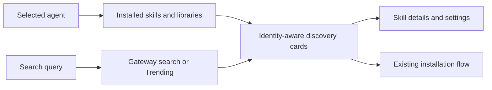

Codex review: needs maintainer review before merge. _Reviewed September 10, 2026, 2:39 AM ET / 06:39 UTC (Revision 2)._

# ClawSweeper review

## What this changes

Combines installed skills and ClawHub listings into one searchable view, adds a dedicated settings route and Workshop tab, and uses Trending for empty searches.

## Merge readiness

✅ **Ready for maintainer review**

This PR remains useful: current main does not provide the unified discovery experience. No blocking introduced defect was found, and the inspected visual evidence supports the UI changes.

**Priority:** P2
**Reviewed head:** `bdbdc77a63968338082e74c4e0c58fb191d41090`

## Review scores

| Measure | Result | What it means |
|---|---|---|
| **Overall readiness** | 🐚 platinum hermit **(4/6)** | A coherent implementation with useful visual proof and focused lifecycle coverage; no blocking defect was identified. |
| **Proof confidence** | 🦞 diamond lobster **(5/6)** ✨ media proof bonus | Sufficient (screenshot): Inspected desktop/mobile before-and-after Control UI screenshots directly demonstrate the new discovery renderer and navigation with synthetic fixtures; the captured body also reports isolated-Gateway and live-ClawHub exercise, with focused tests as supplemental evidence. |
| **Patch quality** | 🐚 platinum hermit **(4/6)** | No actionable review findings were identified. |

## Verification

| Check | Result | Evidence |
|---|---|---|
| **Real behavior** | Verified | Sufficient (screenshot): Inspected desktop/mobile before-and-after Control UI screenshots directly demonstrate the new discovery renderer and navigation with synthetic fixtures; the captured body also reports isolated-Gateway and live-ClawHub exercise, with focused tests as supplemental evidence. |
| **Evidence reviewed** | 9 items | Introduced discovery behavior: The projection merges listings only with valid installed provenance matching both registry and source-qualified reference; local cards remain independent of registry availability. Lifecycle and destination coverage: Inspected tests cover previous-agent response rejection, same-client reconnects, and withholding installation until the personal-versus-workspace destination is known. These tests were read, not executed. External contract dependency: The introduced empty-query branch directly calls ClawHub’s Trending API and maps publisher.handle, install references, and metrics.updatedAt; this establishes the relevant ClawHub dependency boundary. |
| **Findings** | None | None. |
| **Security** | None | None. |

## How this fits together

The Skills page combines the selected agent’s installed skills, personal libraries, and ClawHub results. Its cards lead into existing detail, configuration, and installation flows through the Gateway.

## Before merge

None.

<strong>Agent review details</strong>

### Security

None.

### PR surface

Source +303, Tests +678, Docs 0, Other 0. Total +981 across 48 files.

View PR surface stats

| Area | Files | Added | Removed | Net |
|---|---:|---:|---:|---:|
| Source | 24 | 770 | 467 | +303 |
| Tests | 22 | 855 | 177 | +678 |
| Docs | 1 | 1 | 1 | 0 |
| Config | 0 | 0 | 0 | 0 |
| Generated | 0 | 0 | 0 | 0 |
| Other | 1 | 1 | 1 | 0 |
| **Total** | **48** | **1627** | **646** | **+981** |

### Review metrics

| Metric | Value | Why it matters |
|---|---|---|
| **Production versus test growth** | Production net +303 lines; tests/support net +678 lines | The body justifies production growth with the discovery projection, renderer, identity matching, and separate settings route. |
| **Protocol result fields** | 1 required registry field and 1 optional publisher field added | These fields carry discovery identity from the Gateway without introducing a configuration or storage migration. |

### Technical review

Best possible solution:

Maintain one discovery projection over existing inventory and registry owners, with configuration and installation consent retained in their established flows.

Do we have a high-confidence way to reproduce the issue?

Not applicable as a feature proposal; current-main source and before captures establish the split discovery experience.

Is this the best way to solve the issue?

Yes. The implementation reuses existing registry mapping, settings, library, and installation owners while replacing the competing discovery controls.

AGENTS.md: found and applied where relevant.

Codex review notes: model internal, reasoning medium; reviewed against [5e85c8f20902](https://github.com/openclaw/openclaw/commit/5e85c8f209024a96a94735143ca5fca2cdff4f97).

### Labels

Label justifications:

- `P2`: This is a bounded Skills discovery improvement with meaningful operator value and no demonstrated urgent regression.
- `rating: 🐚 platinum hermit`: Overall readiness is 🐚 platinum hermit; proof is 🦞 diamond lobster and patch quality is 🐚 platinum hermit.
- `status: 👀 ready for maintainer look`: ClawSweeper has no concrete contributor-facing blocker left for this PR. Sufficient (screenshot): Inspected desktop/mobile before-and-after Control UI screenshots directly demonstrate the new discovery renderer and navigation with synthetic fixtures; the captured body also reports isolated-Gateway and live-ClawHub exercise, with focused tests as supplemental evidence.
- `proof: sufficient`: Contributor real behavior proof is sufficient. Inspected desktop/mobile before-and-after Control UI screenshots directly demonstrate the new discovery renderer and navigation with synthetic fixtures; the captured body also reports isolated-Gateway and live-ClawHub exercise, with focused tests as supplemental evidence.
- `proof: 📸 screenshot`: Contributor real behavior proof includes screenshot evidence. Inspected desktop/mobile before-and-after Control UI screenshots directly demonstrate the new discovery renderer and navigation with synthetic fixtures; the captured body also reports isolated-Gateway and live-ClawHub exercise, with focused tests as supplemental evidence.

### Evidence

What I checked:

- **Introduced discovery behavior:** The projection merges listings only with valid installed provenance matching both registry and source-qualified reference; local cards remain independent of registry availability. ([`ui/src/pages/skills/discovery.ts:54`](https://github.com/openclaw/openclaw/blob/bdbdc77a63968338082e74c4e0c58fb191d41090/ui/src/pages/skills/discovery.ts#L54), [bdbdc77a6396](https://github.com/openclaw/openclaw/commit/bdbdc77a63968338082e74c4e0c58fb191d41090))
- **Lifecycle and destination coverage:** Inspected tests cover previous-agent response rejection, same-client reconnects, and withholding installation until the personal-versus-workspace destination is known. These tests were read, not executed. ([`ui/src/pages/skills/skills-page.test.ts:118`](https://github.com/openclaw/openclaw/blob/bdbdc77a63968338082e74c4e0c58fb191d41090/ui/src/pages/skills/skills-page.test.ts#L118), [bdbdc77a6396](https://github.com/openclaw/openclaw/commit/bdbdc77a63968338082e74c4e0c58fb191d41090))
- **External contract dependency:** The introduced empty-query branch directly calls ClawHub’s Trending API and maps publisher.handle, install references, and metrics.updatedAt; this establishes the relevant ClawHub dependency boundary. ([`src/infra/clawhub-skills.ts:225`](https://github.com/openclaw/openclaw/blob/bdbdc77a63968338082e74c4e0c58fb191d41090/src/infra/clawhub-skills.ts#L225), [bdbdc77a6396](https://github.com/openclaw/openclaw/commit/bdbdc77a63968338082e74c4e0c58fb191d41090))
- **Verified upstream Trending fields:** The upstream card validator and producers supply publisher.handle for native entries, source-qualified install.reference for external entries, and numeric metrics.updatedAt, matching the proposed mapping. ([`convex/lib/canonicalTrending.ts:26`](https://github.com/openclaw/clawhub/blob/694ff719e9b161ea770fe2abfdc43f2ff5401fe4/convex/lib/canonicalTrending.ts#L26), [694ff719e9b1](https://github.com/openclaw/clawhub/commit/694ff719e9b161ea770fe2abfdc43f2ff5401fe4))
- **Current-main necessity:** Fetched main still defines the single original Skills route and uses the search endpoint for all queries; it does not contain the proposed discovery/settings split. ([`ui/src/pages/skills/route.ts:63`](https://github.com/openclaw/openclaw/blob/5e85c8f209024a96a94735143ca5fca2cdff4f97/ui/src/pages/skills/route.ts#L63), [5e85c8f20902](https://github.com/openclaw/openclaw/commit/5e85c8f209024a96a94735143ca5fca2cdff4f97))
- **Latest-release check:** The latest supplied release also exposes the original single Skills route, rather than the new discovery/settings routes. ([`ui/src/pages/skills/route.ts`](https://github.com/openclaw/openclaw/blob/1391f7cd2d40ab5bbcf2f5f831d3a64f520e72d7/ui/src/pages/skills/route.ts), [1391f7cd2d40](https://github.com/openclaw/openclaw/commit/1391f7cd2d40ab5bbcf2f5f831d3a64f520e72d7))

Likely related people:

- **Patrick-Erichsen:** Suggested for follow-up; no historical authorship or introduction is verified. (role: unverified routing candidate; confidence: low)
- **vyctorbrzezowski:** Suggested for follow-up; no historical authorship or introduction is verified. (role: unverified routing candidate; confidence: low)

### Rating scale

| Score | Internal tier | Crab rank | Meaning |
|---:|:---:|---|---|
| **6/6** | S | 🦀 challenger crab | Exceptional readiness |
| **5/6** | A | 🦞 diamond lobster | Very strong readiness |
| **4/6** | B | 🐚 platinum hermit | Good normal PR; ordinary maintainer review |
| **3/6** | C | 🦐 gold shrimp | Useful, but confidence is limited |
| **2/6** | D | 🦪 silver shellfish | Proof or implementation needs work |
| **1/6** | F | 🧂 unranked krab | Not merge-ready |
| N/A | NA | 🌊 off-meta tidepool | Rating does not apply |

Overall follows the weaker of proof and patch quality.
Shiny media proof means a screenshot, video, or linked artifact directly shows the changed behavior. Runtime, network, CSP, and security claims still need visible diagnostics.

### Workflow

- ClawSweeper keeps one durable marker-backed review comment per issue or PR.
- Re-runs edit this comment so the latest verdict, findings, and automation markers stay together instead of adding duplicate bot comments.
- A fresh review can be triggered by eligible `@clawsweeper re-review` comments, exact-item GitHub events, scheduled/background review runs, or manual workflow dispatch.
- PR/issue authors and users with repository write access can comment `@clawsweeper re-review` or `@clawsweeper re-run` on an open PR or issue to request a fresh review only.
- Maintainers can also comment `@clawsweeper review` to request a fresh review only.
- Fresh-review commands do not start repair, autofix, rebase, CI repair, or automerge.
- Maintainer-only repair and merge flows require explicit commands such as `@clawsweeper autofix`, `@clawsweeper automerge`, `@clawsweeper fix ci`, or `@clawsweeper address review`.
- Maintainers can comment `@clawsweeper explain` to ask for more context, or `@clawsweeper stop` to stop active automation.

### History

Review history (1 earlier review cycle)

<!-- clawsweeper-review-history v=1 total=1 -->
- reviewed 2026-09-10T06:22:11.708Z sha 1a281d67ecac33e9df1b5d900698a1d45d74cc3a :: needs maintainer review before merge. :: none

<!-- clawsweeper-verdict:needs-human item=143758 sha=bdbdc77a63968338082e74c4e0c58fb191d41090 confidence=high updated_at=2026-09-10T06:36:45Z reviewed_at=2026-09-10T06:39:29.458Z lease_owner=github-run-34445841727-1 lease_comment_id=5614256874 source_revision=0b6c54471dc409f0efed6da62d97dfa4a35cea89653259acab65a27675e46711 live_verification=absent -->
<!-- clawsweeper-review-state:ready item=143758 sha=bdbdc77a63968338082e74c4e0c58fb191d41090 v=1 -->

<!-- clawsweeper-review-version item=143758 reviewed_at=2026-09-10T06:39:29.458Z sha=bdbdc77a63968338082e74c4e0c58fb191d41090 source_revision=0b6c54471dc409f0efed6da62d97dfa4a35cea89653259acab65a27675e46711 lease_owner=github-run-34445841727-1 lease_comment_id=5614256874 v=1 -->

<!-- clawsweeper-review item=143758 -->