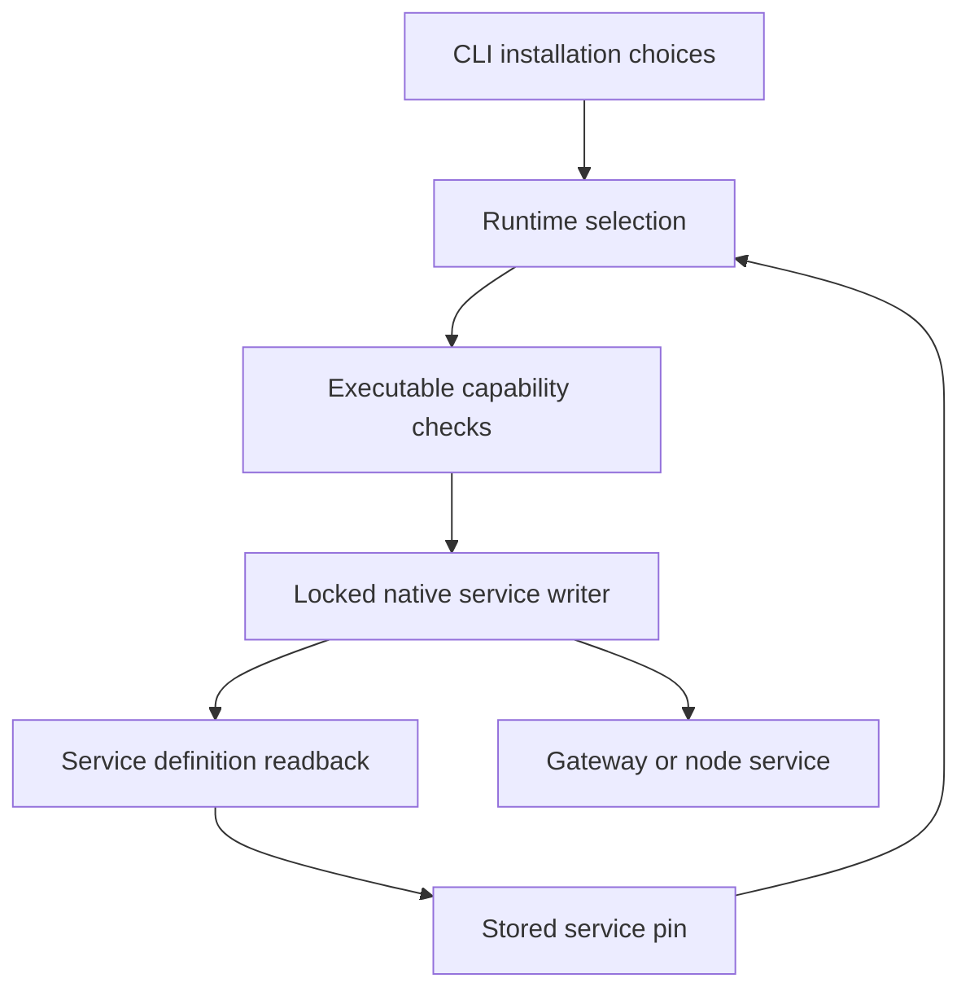

Codex review: blocked before merge. _Reviewed September 16, 2026, 11:07 PM ET / September 17, 2026, 03:07 UTC (Revision 9)._

# ClawSweeper review

## What this changes

Adds persistent Node/Bun executable selection for Gateway and node services, preserves it through maintenance, and updates documentation, supporting fixtures, and deferred UI chunk loading.

## Merge readiness

⛔ **Blocked before merge - 1 item remains**

This PR remains useful: current main lacks persistent executable selection. The recorded upgrade evidence resolves the previous review’s compatibility follow-up, and this review found no actionable introduced defect.

**Priority:** P2
**Reviewed head:** `0701e29346b49987020d29d0fb2e5ade4137ae71`

## Review scores

| Measure | Result | What it means |
|---|---|---|
| **Overall readiness** | 🐚 platinum hermit **(4/6)** | Useful implementation with applicable native and upgrade evidence, resolved prior findings, and no new blocking defect found. |
| **Proof confidence** | 🐚 platinum hermit **(4/6)** | Sufficient (live_output): The matching captured body records real macOS launchd pin installation, preservation, invalid-pin refusal with a healthy prior PID, reset, and uninstall, plus successful published-driver upgrade and recovery. Core runtime files match the proven candidate exactly; Linux/systemd and Windows/schtasks remain unit-level coverage. |
| **Patch quality** | 🐚 platinum hermit **(4/6)** | No actionable review findings were identified. |

## Verification

| Check | Result | Evidence |
|---|---|---|
| **Real behavior** | Verified | Sufficient (live_output): The matching captured body records real macOS launchd pin installation, preservation, invalid-pin refusal with a healthy prior PID, reset, and uninstall, plus successful published-driver upgrade and recovery. Core runtime files match the proven candidate exactly; Linux/systemd and Windows/schtasks remain unit-level coverage. |
| **Evidence reviewed** | 9 items | Current main still uses automatic selection: Current main selects supported current/system runtimes; its service CLI and daemon sources contain no explicit runtime-path option or persistent pin owner. Latest release contract: The v2026.9.4 Gateway install registration exposes runtime-family and wrapper options, but no runtime-path option. GitHub contents inspection supplied this evidence after the local release-blob read failed. Complete captured proof and compatibility disposition: The retrieved body matched captured SHA-256 ef84e48c1f2d9050f1db852b0ab3c16515f265eb34f10951c1ba611351059c88. Its previously omitted sections record real launchd installation, preservation, refusal, reset and uninstall, plus a successful published-2026.9.4 upgrade into candidate db371e91a6eb5a3332d72803cbde4ab5b3602ab0. Durable run ded7c0c3-2315-4d4f-a4be-33aeaef1a791 reports healthy, settled candidate activation. The body explicitly records persistence acceptance and downgrade limits. |
| **Findings** | None | None. |
| **Security** | None | None. |

## How this fits together

Managed service installation translates CLI choices into operating-system service definitions. Runtime pins preserve the operator’s executable choice through setup and repair, using OpenClaw’s existing machine-state database.

## Before merge

- [ ] **Add data-model compatibility proof** - Confirm migration or upgrade compatibility proof before merge.

<strong>Agent review details</strong>

### Security

None.

### PR surface

Source +523, Tests +985, Docs +34. Total +1542 across 51 files.

View PR surface stats

| Area | Files | Added | Removed | Net |
|---|---:|---:|---:|---:|
| Source | 24 | 693 | 170 | +523 |
| Tests | 23 | 1160 | 175 | +985 |
| Docs | 4 | 44 | 10 | +34 |
| Config | 0 | 0 | 0 | 0 |
| Generated | 0 | 0 | 0 | 0 |
| Other | 0 | 0 | 0 | 0 |
| **Total** | **51** | **1897** | **355** | **+1542** |

### Review metrics

| Metric | Value | Why it matters |
|---|---|---|
| **Operator configuration** | 1 new flag across Gateway, daemon alias, and node installation | Executable pinning is explicit opt-in; existing unpinned selection remains automatic. |
| **Production versus test growth** | Production +693/-170; tests and test support +1160/-175 | Production growth is justified by durable intent, guarded service writes, and maintenance-callsite integration. |

### Stored data model

Persistent data-model change detected: `migration/backfill/repair: src/cli/daemon-cli/start-repair.ts`, `migration/backfill/repair: src/commands/doctor-gateway-daemon-flow.ts`, `migration/backfill/repair: src/commands/doctor-gateway-runtime-plan.ts`, `migration/backfill/repair: src/commands/doctor-gateway-services.ts`, `unknown-data-model-change: src/cli/daemon-cli/start-repair.ts`, `unknown-data-model-change: src/commands/doctor-gateway-daemon-flow.ts`, and 1 more. Confirm migration or upgrade compatibility proof before merge.

### Technical review

Best possible solution:

Retain explicit per-service runtime intent in the existing state owner while preserving automatic selection for unpinned installations and explicit reset recovery.

Do we have a high-confidence way to reproduce the issue?

Not applicable as a regression: this adds explicit runtime selection. Current-source inspection confirms the missing option, and recorded native execution demonstrates the new behavior.

Is this the best way to solve the issue?

Yes. Explicit intent uses the existing machine-state and service-write owners, avoiding automatic pin inference or a competing environment-variable persistence contract.

AGENTS.md: found and applied where relevant.

Codex review notes: model internal, reasoning medium; reviewed against [9ca2d1dfcd16](https://github.com/openclaw/openclaw/commit/9ca2d1dfcd161ed862a30749f40486e95d6459f1).

### Labels

Label justifications:

- `P2`: This is a bounded operator capability for predictable service runtime selection, without evidence of an urgent default-path regression.
- `rating: 🐚 platinum hermit`: Overall readiness is 🐚 platinum hermit; proof is 🐚 platinum hermit and patch quality is 🐚 platinum hermit.
- `status: 👀 ready for maintainer look`: ClawSweeper has no concrete contributor-facing blocker left for this PR. Sufficient (live_output): The matching captured body records real macOS launchd pin installation, preservation, invalid-pin refusal with a healthy prior PID, reset, and uninstall, plus successful published-driver upgrade and recovery. Core runtime files match the proven candidate exactly; Linux/systemd and Windows/schtasks remain unit-level coverage.
- `proof: sufficient`: Contributor real behavior proof is sufficient. The matching captured body records real macOS launchd pin installation, preservation, invalid-pin refusal with a healthy prior PID, reset, and uninstall, plus successful published-driver upgrade and recovery. Core runtime files match the proven candidate exactly; Linux/systemd and Windows/schtasks remain unit-level coverage.

### Evidence

What I checked:

- **Current main still uses automatic selection:** Current main selects supported current/system runtimes; its service CLI and daemon sources contain no explicit runtime-path option or persistent pin owner. ([`src/daemon/runtime-paths.ts:430`](https://github.com/openclaw/openclaw/blob/9ca2d1dfcd161ed862a30749f40486e95d6459f1/src/daemon/runtime-paths.ts#L430), [9ca2d1dfcd16](https://github.com/openclaw/openclaw/commit/9ca2d1dfcd161ed862a30749f40486e95d6459f1))
- **Latest release contract:** The v2026.9.4 Gateway install registration exposes runtime-family and wrapper options, but no runtime-path option. GitHub contents inspection supplied this evidence after the local release-blob read failed. ([`src/cli/daemon-cli/register-service-commands.ts:95`](https://github.com/openclaw/openclaw/blob/3a9d69db306cd7f081e06254cb89c4bcc14a7107/src/cli/daemon-cli/register-service-commands.ts#L95), [3a9d69db306c](https://github.com/openclaw/openclaw/commit/3a9d69db306cd7f081e06254cb89c4bcc14a7107))
- **Complete captured proof and compatibility disposition:** The retrieved body matched captured SHA-256 ef84e48c1f2d9050f1db852b0ab3c16515f265eb34f10951c1ba611351059c88. Its previously omitted sections record real launchd installation, preservation, refusal, reset and uninstall, plus a successful published-2026.9.4 upgrade into candidate db371e91a6eb5a3332d72803cbde4ab5b3602ab0. Durable run ded7c0c3-2315-4d4f-a4be-33aeaef1a791 reports healthy, settled candidate activation. The body explicitly records persistence acceptance and downgrade limits. ([0701e29346b4](https://github.com/openclaw/openclaw/commit/0701e29346b49987020d29d0fb2e5ade4137ae71))
- **Proof remains applicable and review continuity:** The four central runtime files have no differences from the proven candidate. Since the previous reviewed head, only the Qwen clock fixture and archive/Undo failed-read fixtures changed; existing assertions remain intact. ([`src/daemon/service.ts:634`](https://github.com/openclaw/openclaw/blob/0701e29346b49987020d29d0fb2e5ade4137ae71/src/daemon/service.ts#L634), [0701e29346b4](https://github.com/openclaw/openclaw/commit/0701e29346b49987020d29d0fb2e5ade4137ae71))
- **Persistence and native-write boundary:** Pin reads bind intent to the managed definition; the service writer checks revisions and definitions under the existing native lock, rejects pin-unaware rewrites, verifies readback, and clears metadata after successful uninstall. The existing machine-state owner performs synchronous transactional updates. ([`src/daemon/runtime-pin-state.ts:45`](https://github.com/openclaw/openclaw/blob/0701e29346b49987020d29d0fb2e5ade4137ae71/src/daemon/runtime-pin-state.ts#L45), [0701e29346b4](https://github.com/openclaw/openclaw/commit/0701e29346b49987020d29d0fb2e5ade4137ae71))
- **Earlier findings addressed:** Node reinstall rehydrates pin intent; setup callers pass the inspected revision; automatic choices remain unpinned; validation reuses the bounded, sanitized runtime probe. Source inspection also confirms environment-value sources and the Windows recursive-wrapper guard remain present. ([`src/cli/node-cli/daemon.ts:168`](https://github.com/openclaw/openclaw/blob/0701e29346b49987020d29d0fb2e5ade4137ae71/src/cli/node-cli/daemon.ts#L168), [0701e29346b4](https://github.com/openclaw/openclaw/commit/0701e29346b49987020d29d0fb2e5ade4137ae71))

Likely related people:

- **Peter Steinberger:** Suggested for follow-up; no historical authorship or introduction is verified. (role: unverified routing candidate; confidence: low)
- **Vincent Koc:** Suggested for follow-up; no historical authorship or introduction is verified. (role: unverified routing candidate; confidence: low)

### Rating scale

| Score | Internal tier | Crab rank | Meaning |
|---:|:---:|---|---|
| **6/6** | S | 🦀 challenger crab | Exceptional readiness |
| **5/6** | A | 🦞 diamond lobster | Very strong readiness |
| **4/6** | B | 🐚 platinum hermit | Good normal PR; ordinary maintainer review |
| **3/6** | C | 🦐 gold shrimp | Useful, but confidence is limited |
| **2/6** | D | 🦪 silver shellfish | Proof or implementation needs work |
| **1/6** | F | 🧂 unranked krab | Not merge-ready |
| N/A | NA | 🌊 off-meta tidepool | Rating does not apply |

Overall follows the weaker of proof and patch quality.
Shiny media proof means a screenshot, video, or linked artifact directly shows the changed behavior. Runtime, network, CSP, and security claims still need visible diagnostics.

### Workflow

- ClawSweeper keeps one durable marker-backed review comment per issue or PR.
- Re-runs edit this comment so the latest verdict, findings, and automation markers stay together instead of adding duplicate bot comments.
- A fresh review can be triggered by eligible `@clawsweeper re-review` comments, exact-item GitHub events, scheduled/background review runs, or manual workflow dispatch.
- PR/issue authors and users with repository write access can comment `@clawsweeper re-review` or `@clawsweeper re-run` on an open PR or issue to request a fresh review only.
- Maintainers can also comment `@clawsweeper review` to request a fresh review only.
- Fresh-review commands do not start repair, autofix, rebase, CI repair, or automerge.
- Maintainer-only repair and merge flows require explicit commands such as `@clawsweeper autofix`, `@clawsweeper automerge`, `@clawsweeper fix ci`, or `@clawsweeper address review`.
- Maintainers can comment `@clawsweeper explain` to ask for more context, or `@clawsweeper stop` to stop active automation.

### History

Review history (8 earlier review cycles)

<!-- clawsweeper-review-history v=1 total=8 -->
- reviewed 2026-07-01T01:01:31.318Z sha 002772ef66faffcb6d531b3fbb94522a67b826bc :: needs real behavior proof before merge. :: [P1] Pass node environment value sources through install | [P1] Preserve the Windows task wrapper guard | [P2] Align runtime pins with the Node 22.19 floor
- reviewed 2026-09-09T19:31:45.441Z sha 002772ef66faffcb6d531b3fbb94522a67b826bc :: needs real behavior proof before merge. :: [P1] Keep automatic Doctor selections out of explicit pin metadata | [P2] Bound the runtime validation subprocess
- reviewed 2026-09-17T00:11:20.025Z sha 6e53dcea47cecfc27819d8c5add2b6ebc7849fbb :: needs real behavior proof before merge. :: [P2] Carry runtime-pin intent through setup reinstalls
- reviewed 2026-09-17T00:27:48.669Z sha d4f96c59c84635431c2c3e3e7ba001c5d47e1963 :: needs real behavior proof before merge. :: [P2] Carry runtime-pin intent through setup reinstalls
- reviewed 2026-09-17T01:04:50.152Z sha db371e91a6eb5a3332d72803cbde4ab5b3602ab0 :: needs real behavior proof before merge. :: none
- reviewed 2026-09-17T01:59:15.128Z sha e298fe817d9ca2c8e2703b286e6467acd19ac544 :: needs real behavior proof before merge. :: none
- reviewed 2026-09-17T02:17:07.592Z sha 40302b932775053f7de88d44de95aa716d9fab98 :: needs maintainer review before merge. :: none
- reviewed 2026-09-17T02:39:15.741Z sha c0c61c60aad5f3489ef7c63676e73366d97f4083 :: blocked before merge. :: none

<!-- clawsweeper-verdict:needs-human item=82290 sha=0701e29346b49987020d29d0fb2e5ade4137ae71 confidence=high updated_at=2026-09-17T03:03:53Z reviewed_at=2026-09-17T03:07:27.183Z lease_owner=github-run-35176597762-1 lease_comment_id=5707830058 source_revision=d59a08d4908145c95ebdc6d3d66912ae128b1999f5935a4b83d9adfcbab41891 live_verification=absent -->
<!-- clawsweeper-review-state:blocked item=82290 sha=0701e29346b49987020d29d0fb2e5ade4137ae71 v=1 -->

<!-- clawsweeper-review-version item=82290 reviewed_at=2026-09-17T03:07:27.183Z sha=0701e29346b49987020d29d0fb2e5ade4137ae71 source_revision=d59a08d4908145c95ebdc6d3d66912ae128b1999f5935a4b83d9adfcbab41891 lease_owner=github-run-35176597762-1 lease_comment_id=5707830058 v=1 -->

<!-- clawsweeper-review item=82290 -->