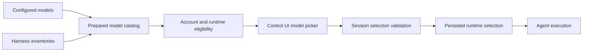

Codex review: blocked before merge. _Reviewed September 14, 2026, 9:55 AM ET / 13:55 UTC (Revision 7)._

# ClawSweeper review

## What this changes

Adds configurable harness alternatives to the model picker, carries selections through new and existing sessions, and preserves runtime-specific capabilities and saved draft choices.

## Merge readiness

⛔ **Blocked before merge - 2 items remain**

Keep open: this remains a distinct, maintainer-sponsored feature. No blocking introduced defect was identified; the earlier context-window finding and compatibility question are addressed by the current implementation and discussion.

**Priority:** P2
**Reviewed head:** `42c948c48e6d009551284e13c5cc57b721a0845b`

## Review scores

| Measure | Result | What it means |
|---|---|---|
| **Overall readiness** | 🐚 platinum hermit **(4/6)** | Useful browser evidence, focused regression coverage, and reuse of existing owners support normal good-quality readiness without a newly identified blocker. |
| **Proof confidence** | 🐚 platinum hermit **(4/6)** ✨ media proof bonus | Sufficient (screenshot): Inspected before/after images directly demonstrate the picker change, and the reported browser run exercises create, patch, and reset against a mocked Gateway. This is UI boundary proof; the body explicitly leaves a production Codex turn pending, which is not an additional contributor-proof gate for this maintainer-authored PR. |
| **Patch quality** | 🐚 platinum hermit **(4/6)** | No actionable review findings were identified. |

## Verification

| Check | Result | Evidence |
|---|---|---|
| **Real behavior** | Verified | Sufficient (screenshot): Inspected before/after images directly demonstrate the picker change, and the reported browser run exercises create, patch, and reset against a mocked Gateway. This is UI boundary proof; the body explicitly leaves a production Codex turn pending, which is not an additional contributor-proof gate for this maintainer-authored PR. |
| **Evidence reviewed** | 11 items | Pinned PR remains open: The GitHub read confirmed the supplied head and base, an open unmerged PR, and no assignees or requested reviewers. The provided maintainer label and MEMBER association independently prevent automated closure. Feature is still distinct from current main: The fetched main configuration schema supports a configured runtime but lacks pickerRuntimes. The merged eligibility work at https://github.com/openclaw/openclaw/pull/143588 supplies the existing selection owner; it does not supersede the new picker presentation. Release-source inspection could not complete because a required blob was unavailable, so no shipped implementation is claimed. Existing selection authority is reused: Runtime preparation calls the existing published-catalog selection owner. The patch engine retains caller authorization and adds the returned runtime validator to the synchronous commit guards; context replacement and personal-account checks remain in the owning mutation flow. |
| **Findings** | None | None. |
| **Security** | None | None. |

## How this fits together

The Gateway combines configured models with harness inventories and account eligibility, then publishes choices to the Control UI. Session creation and updates validate the chosen runtime before persisting it for subsequent agent turns.

## Before merge

- [ ] **Review config compatibility** - Confirm compatibility and upgrade impact for the changed config or default surface before merge.
- [ ] **Add data-model compatibility proof** - Confirm migration or upgrade compatibility proof before merge.

<strong>Agent review details</strong>

### Security

None.

### PR surface

PR surface statistics unavailable: the file list is incomplete.

### Review metrics

| Metric | Value | Why it matters |
|---|---|---|
| **Optional configuration surface** | 1 setting at defaults and per-agent scopes; up to 8 runtime IDs | The bounded pickerRuntimes setting leaves the configured default unchanged. |
| **Production versus test growth** | Production/tooling +1,199 net lines; tests/support +2,799 net lines | Production growth supports runtime-specific catalog projection and session selection, with substantial boundary regression coverage. |

### Stored data model

Persistent data-model change detected: `unknown-data-model-change: packages/gateway-protocol/src/schema/agents-models-skills.ts`, `unknown-truncated-pull-files`. Confirm migration or upgrade compatibility proof before merge.

### Technical review

Best possible solution:

Keep one canonical model identity with optional runtime choices, while existing catalog, authorization, and session owners govern selection and preserve configured defaults.

Do we have a high-confidence way to reproduce the issue?

Not applicable as a feature request; current-main schema inspection confirms the missing picker configuration, and inspected browser evidence demonstrates the proposed presentation.

Is this the best way to solve the issue?

Yes: extending the existing picker and published runtime-selection owner avoids a competing routing implementation, and the current changes address the earlier capability-isolation concern.

AGENTS.md: found and applied where relevant.

Codex review notes: model internal, reasoning medium; reviewed against [36a725a599bc](https://github.com/openclaw/openclaw/commit/36a725a599bcd3dcef1035cab064e32d5b407cdd).

### Labels

Label justifications:

- `P2`: This is an optional model-selection improvement with bounded operator impact, without an established urgent regression.
- `rating: 🐚 platinum hermit`: Overall readiness is 🐚 platinum hermit; proof is 🐚 platinum hermit and patch quality is 🐚 platinum hermit.
- `status: 👀 ready for maintainer look`: ClawSweeper has no concrete contributor-facing blocker left for this PR. Sufficient (screenshot): Inspected before/after images directly demonstrate the picker change, and the reported browser run exercises create, patch, and reset against a mocked Gateway. This is UI boundary proof; the body explicitly leaves a production Codex turn pending, which is not an additional contributor-proof gate for this maintainer-authored PR.
- `proof: sufficient`: Contributor real behavior proof is sufficient. Inspected before/after images directly demonstrate the picker change, and the reported browser run exercises create, patch, and reset against a mocked Gateway. This is UI boundary proof; the body explicitly leaves a production Codex turn pending, which is not an additional contributor-proof gate for this maintainer-authored PR.
- `proof: 📸 screenshot`: Contributor real behavior proof includes screenshot evidence. Inspected before/after images directly demonstrate the picker change, and the reported browser run exercises create, patch, and reset against a mocked Gateway. This is UI boundary proof; the body explicitly leaves a production Codex turn pending, which is not an additional contributor-proof gate for this maintainer-authored PR.

### Evidence

What I checked:

- **Pinned PR remains open:** The GitHub read confirmed the supplied head and base, an open unmerged PR, and no assignees or requested reviewers. The provided maintainer label and MEMBER association independently prevent automated closure. ([42c948c48e6d](https://github.com/openclaw/openclaw/commit/42c948c48e6d009551284e13c5cc57b721a0845b))
- **Feature is still distinct from current main:** The fetched main configuration schema supports a configured runtime but lacks pickerRuntimes. The merged eligibility work at https://github.com/openclaw/openclaw/pull/143588 supplies the existing selection owner; it does not supersede the new picker presentation. Release-source inspection could not complete because a required blob was unavailable, so no shipped implementation is claimed. ([`src/config/zod-schema.agent-entry-base.ts:19`](https://github.com/openclaw/openclaw/blob/36a725a599bcd3dcef1035cab064e32d5b407cdd/src/config/zod-schema.agent-entry-base.ts#L19), [36a725a599bc](https://github.com/openclaw/openclaw/commit/36a725a599bcd3dcef1035cab064e32d5b407cdd))
- **Existing selection authority is reused:** Runtime preparation calls the existing published-catalog selection owner. The patch engine retains caller authorization and adds the returned runtime validator to the synchronous commit guards; context replacement and personal-account checks remain in the owning mutation flow. ([`src/gateway/server-methods/sessions-patch-engine.ts:494`](https://github.com/openclaw/openclaw/blob/42c948c48e6d009551284e13c5cc57b721a0845b/src/gateway/server-methods/sessions-patch-engine.ts#L494), [42c948c48e6d](https://github.com/openclaw/openclaw/commit/42c948c48e6d009551284e13c5cc57b721a0845b))
- **Earlier context-window finding addressed:** Create, patch, session projection, and fork admission now select capabilities from the chosen runtime. The inspected regressions distinguish a native 64k window from a base 32k window, reject borrowed metadata, and exercise fork limits. This matches the repair described at https://github.com/openclaw/openclaw/pull/147994#issuecomment-5660706326. The immediately previous reviewed SHA was unavailable locally, so no patch-equivalence claim is made. ([`src/gateway/server-methods/sessions-mutations.runtime-windows.test-support.ts:25`](https://github.com/openclaw/openclaw/blob/42c948c48e6d009551284e13c5cc57b721a0845b/src/gateway/server-methods/sessions-mutations.runtime-windows.test-support.ts#L25), [42c948c48e6d](https://github.com/openclaw/openclaw/commit/42c948c48e6d009551284e13c5cc57b721a0845b))
- **Compatibility explanation matches storage behavior:** The captured body and compatibility comment describe optional config/RPC/browser fields and reuse of agentRuntimeOverride. Inspection confirms older preferences normalize without a runtime field, explicit clearing removes only the selected agent's preference, and unrelated agent preferences survive. No new database schema is introduced. ([`ui/src/pages/new-session/preferences.ts:83`](https://github.com/openclaw/openclaw/blob/42c948c48e6d009551284e13c5cc57b721a0845b/ui/src/pages/new-session/preferences.ts#L83), [42c948c48e6d](https://github.com/openclaw/openclaw/commit/42c948c48e6d009551284e13c5cc57b721a0845b))
- **Partial native discovery and recovery:** The catalog owner retains successful sibling inventories, tracks native failures separately from provider renewal, and rechecks publication currency after discovery. Inspected regression coverage includes cached partial results, unrelated provider renewal, explicit native recovery, total failure, and supersession. ([`src/agents/prepared-model-runtime.native-picker-failures.test.ts:122`](https://github.com/openclaw/openclaw/blob/42c948c48e6d009551284e13c5cc57b721a0845b/src/agents/prepared-model-runtime.native-picker-failures.test.ts#L122), [42c948c48e6d](https://github.com/openclaw/openclaw/commit/42c948c48e6d009551284e13c5cc57b721a0845b))

Likely related people:

- **obviyus:** Suggested for follow-up; no historical authorship or introduction is verified. (role: unverified routing candidate; confidence: low)
- **vincentkoc:** Suggested for follow-up; no historical authorship or introduction is verified. (role: unverified routing candidate; confidence: low)

### Rating scale

| Score | Internal tier | Crab rank | Meaning |
|---:|:---:|---|---|
| **6/6** | S | 🦀 challenger crab | Exceptional readiness |
| **5/6** | A | 🦞 diamond lobster | Very strong readiness |
| **4/6** | B | 🐚 platinum hermit | Good normal PR; ordinary maintainer review |
| **3/6** | C | 🦐 gold shrimp | Useful, but confidence is limited |
| **2/6** | D | 🦪 silver shellfish | Proof or implementation needs work |
| **1/6** | F | 🧂 unranked krab | Not merge-ready |
| N/A | NA | 🌊 off-meta tidepool | Rating does not apply |

Overall follows the weaker of proof and patch quality.
Shiny media proof means a screenshot, video, or linked artifact directly shows the changed behavior. Runtime, network, CSP, and security claims still need visible diagnostics.

### Workflow

- ClawSweeper keeps one durable marker-backed review comment per issue or PR.
- Re-runs edit this comment so the latest verdict, findings, and automation markers stay together instead of adding duplicate bot comments.
- A fresh review can be triggered by eligible `@clawsweeper re-review` comments, exact-item GitHub events, scheduled/background review runs, or manual workflow dispatch.
- PR/issue authors and users with repository write access can comment `@clawsweeper re-review` or `@clawsweeper re-run` on an open PR or issue to request a fresh review only.
- Maintainers can also comment `@clawsweeper review` to request a fresh review only.
- Fresh-review commands do not start repair, autofix, rebase, CI repair, or automerge.
- Maintainer-only repair and merge flows require explicit commands such as `@clawsweeper autofix`, `@clawsweeper automerge`, `@clawsweeper fix ci`, or `@clawsweeper address review`.
- Maintainers can comment `@clawsweeper explain` to ask for more context, or `@clawsweeper stop` to stop active automation.

### History

Review history (6 earlier review cycles)

<!-- clawsweeper-review-history v=1 total=6 -->
- reviewed 2026-09-14T06:31:40.985Z sha 81bf8fb9c786bf5ca4bbe78c6f328635752148c9 :: blocked before merge. :: [P2] Validate context windows against the selected runtime
- reviewed 2026-09-14T07:59:51.979Z sha 5baed09dd52f613ca4c8aab1e3861e70b7edff02 :: blocked before merge. :: none
- reviewed 2026-09-14T08:22:30.476Z sha 291839fd65c5c4f9c4d8de5fb7be6714268a74e2 :: blocked before merge. :: none
- reviewed 2026-09-14T09:30:39.701Z sha a1ba912eb35f883f3b28724446ea55c651d3856b :: blocked before merge. :: none
- reviewed 2026-09-14T09:56:55.829Z sha 1d391a9888bedb1796fe69693efc3e0d4a133e6c :: blocked before merge. :: none
- reviewed 2026-09-14T12:47:31.334Z sha bb99f8d566ed07669642bc48ea22e40763b36c8b :: blocked before merge. :: none

<!-- clawsweeper-verdict:needs-human item=147994 sha=42c948c48e6d009551284e13c5cc57b721a0845b confidence=high updated_at=2026-09-14T13:51:59Z reviewed_at=2026-09-14T13:55:39.907Z lease_owner=github-run-34851655284-1 lease_comment_id=5665065794 source_revision=6b96ff4c9770cf0416372c49314a170a711d5a55af62a854a06a72bc8f093979 live_verification=absent -->
<!-- clawsweeper-review-state:blocked item=147994 sha=42c948c48e6d009551284e13c5cc57b721a0845b v=1 -->

<!-- clawsweeper-review-version item=147994 reviewed_at=2026-09-14T13:55:39.907Z sha=42c948c48e6d009551284e13c5cc57b721a0845b source_revision=6b96ff4c9770cf0416372c49314a170a711d5a55af62a854a06a72bc8f093979 lease_owner=github-run-34851655284-1 lease_comment_id=5665065794 v=1 -->

<!-- clawsweeper-review item=147994 -->