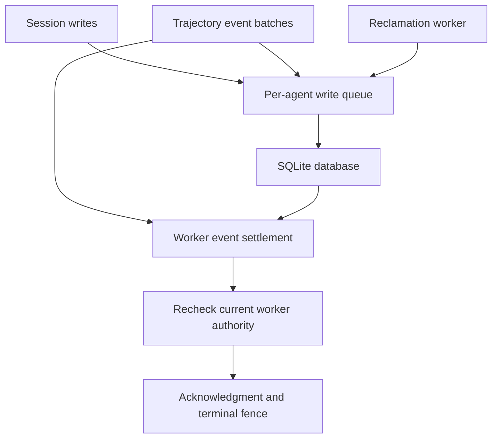

Codex review: blocked before merge. _Reviewed September 12, 2026, 9:57 PM ET / September 13, 2026, 01:57 UTC (Revision 3)._

# ClawSweeper review

## What this changes

The PR coordinates session and trajectory database writes, preserves failed recording batches and selected paths, and makes worker acknowledgments and shutdown await accepted writes.

## Merge readiness

⛔ **Blocked before merge - 2 items remain**

This protected maintainer PR remains useful: current main and the latest release retain the failed-batch loss mechanism. No blocking introduced defect was found.

**Priority:** P2
**Reviewed head:** `46a0ed3630e3aa6530e1828c32817607d59585ae`

## Review scores

| Measure | Result | What it means |
|---|---|---|
| **Overall readiness** | 🐚 platinum hermit **(4/6)** | A coherent owner-level repair with meaningful regression coverage and no identified blocking defect. |
| **Proof confidence** | 🌊 off-meta tidepool | Not applicable: The ordinary contributor-proof gate does not apply to this maintainer-authored repair. Source and regression coverage connect queued trajectory persistence to RPC settlement and revocation checks; the separately declared integrated performance acceptance remains outstanding. |
| **Patch quality** | 🐚 platinum hermit **(4/6)** | No actionable review findings were identified. |

## Verification

| Check | Result | Evidence |
|---|---|---|
| **Real behavior** | Not applicable | Not applicable: The ordinary contributor-proof gate does not apply to this maintainer-authored repair. Source and regression coverage connect queued trajectory persistence to RPC settlement and revocation checks; the separately declared integrated performance acceptance remains outstanding. |
| **Evidence reviewed** | 9 items | Current-main necessity: Current main clears pendingEvents and queuedBytes before calling the synchronous append; an append exception therefore loses the buffered batch. Latest-release comparison: Inspection of v2026.9.4 at the supplied release commit shows the same clear-before-append implementation and no new agent write-admission files. Shared admission and handle lifetime: The helper captures environment and paths before waiting, shares the canonical queue, checks an expected borrowed handle after admission, and retains it through callback settlement. Worker reservations disable inherited foreground reentrancy. |
| **Findings** | None | None. |
| **Security** | None | None. |

## How this fits together

Trajectory recording stores diagnostic events alongside agent sessions in SQLite. Session reclamation and worker progress reporting share these databases, so write scheduling affects Gateway responsiveness and acknowledgment timing.

## Before merge

- [ ] **Resolve merge risk (P1)** - The declared integrated 500 ms Swarm responsiveness target remains unverified; focused correctness coverage does not establish that performance result.
- [ ] **Complete next step (P2)** - Land the declared prerequisite https://github.com/openclaw/openclaw/pull/146491 and satisfy the PR's stated integrated 500 ms Swarm acceptance gate before landing.

<strong>Agent review details</strong>

### Security

None.

### PR surface

Source +194, Tests +856, Docs +59. Total +1109 across 31 files.

View PR surface stats

| Area | Files | Added | Removed | Net |
|---|---:|---:|---:|---:|
| Source | 12 | 378 | 184 | +194 |
| Tests | 18 | 1077 | 221 | +856 |
| Docs | 1 | 59 | 0 | +59 |
| Config | 0 | 0 | 0 | 0 |
| Generated | 0 | 0 | 0 | 0 |
| Other | 0 | 0 | 0 | 0 |
| **Total** | **31** | **1514** | **405** | **+1109** |

### Review metrics

| Metric | Value | Why it matters |
|---|---|---|
| **Production versus regression coverage** | Production +194 net lines; tests/support +856 net lines | Production growth has a stated purpose: centralizing admission and completing worker-event settlement, with most growth devoted to regression coverage. |

### Merge-risk options

**Maintainer options:**
1. **Decide the mitigation before merge**  
   Keep one per-agent FIFO write owner, retain batches until successful persistence, and settle accepted worker work before acknowledging under freshly checked authority.
2. **Pause or close**  
   Do not merge this PR until maintainers decide whether the risk is worth taking.

### Technical review

Best possible solution:

Keep one per-agent FIFO write owner, retain batches until successful persistence, and settle accepted worker work before acknowledging under freshly checked authority.

Do we have a high-confidence way to reproduce the issue?

Yes, from source: an append exception on current main discards the already-cleared trajectory batch. The branch includes targeted failure and contention regressions; this review did not execute them.

Is this the best way to solve the issue?

Yes. Extending the existing queue and lifecycle owners addresses the failure without adding a competing store, schema, or configuration mode.

AGENTS.md: found and applied where relevant.

Codex review notes: model internal, reasoning medium; reviewed against [b4b790b8692f](https://github.com/openclaw/openclaw/commit/b4b790b8692fdbd105f99241b83f52d112cac204).

### Labels

Label justifications:

- `P2`: This is a bounded storage and worker-lifecycle reliability repair, without evidence of an urgent widespread outage.
- `rating: 🐚 platinum hermit`: Overall readiness is 🐚 platinum hermit; proof is 🌊 off-meta tidepool and patch quality is 🐚 platinum hermit.
- `status: 👀 ready for maintainer look`: ClawSweeper has no concrete contributor-facing blocker left for this PR. Not applicable: The ordinary contributor-proof gate does not apply to this maintainer-authored repair. Source and regression coverage connect queued trajectory persistence to RPC settlement and revocation checks; the separately declared integrated performance acceptance remains outstanding.

### Evidence

What I checked:

- **Current-main necessity:** Current main clears pendingEvents and queuedBytes before calling the synchronous append; an append exception therefore loses the buffered batch. ([`src/trajectory/runtime.ts:380`](https://github.com/openclaw/openclaw/blob/b4b790b8692fdbd105f99241b83f52d112cac204/src/trajectory/runtime.ts#L380), [b4b790b8692f](https://github.com/openclaw/openclaw/commit/b4b790b8692fdbd105f99241b83f52d112cac204))
- **Latest-release comparison:** Inspection of v2026.9.4 at the supplied release commit shows the same clear-before-append implementation and no new agent write-admission files. ([`src/trajectory/runtime.ts`](https://github.com/openclaw/openclaw/blob/3a9d69db306cd7f081e06254cb89c4bcc14a7107/src/trajectory/runtime.ts), [3a9d69db306c](https://github.com/openclaw/openclaw/commit/3a9d69db306cd7f081e06254cb89c4bcc14a7107))
- **Shared admission and handle lifetime:** The helper captures environment and paths before waiting, shares the canonical queue, checks an expected borrowed handle after admission, and retains it through callback settlement. Worker reservations disable inherited foreground reentrancy. ([`src/state/openclaw-agent-db-write.ts:17`](https://github.com/openclaw/openclaw/blob/46a0ed3630e3aa6530e1828c32817607d59585ae/src/state/openclaw-agent-db-write.ts#L17), [46a0ed3630e3](https://github.com/openclaw/openclaw/commit/46a0ed3630e3aa6530e1828c32817607d59585ae))
- **Acknowledgment and authority ordering:** The receiver joins accepted trajectory promises and retains its window through final validation. The RPC owner awaits that operation under its existing environment lock and revalidates placement, credentials, and shutdown state before updating acknowledgment cursors or terminal fences. ([`src/gateway/worker-environments/worker-turn-rpc.ts:530`](https://github.com/openclaw/openclaw/blob/46a0ed3630e3aa6530e1828c32817607d59585ae/src/gateway/worker-environments/worker-turn-rpc.ts#L530), [46a0ed3630e3](https://github.com/openclaw/openclaw/commit/46a0ed3630e3aa6530e1828c32817607d59585ae))
- **Focused regression coverage:** Read the registered-dispatch tests for persisted, failed, revoked, and stopped outcomes, including no early response or durable cursor update; additional tests cover failed-batch retry, captured paths, callback failure, duplicate acknowledgment, and eviction during settlement. Tests were inspected, not executed in this read-only review. ([`src/gateway/worker-environments/live-events-settlement.test.ts:23`](https://github.com/openclaw/openclaw/blob/46a0ed3630e3aa6530e1828c32817607d59585ae/src/gateway/worker-environments/live-events-settlement.test.ts#L23), [46a0ed3630e3](https://github.com/openclaw/openclaw/commit/46a0ed3630e3aa6530e1828c32817607d59585ae))
- **Private facade and storage contract:** The documentation explicitly limits the additive operation to the existing private SQLite facade and preserves caller-owned transactions and authorization. The introduced delta changes no schema, retention limit, configuration default, dependency, or public typed SDK contract. Public docs: [`docs/plugins/sdk-runtime/state-and-system.md`](https://docs.openclaw.ai/plugins/sdk-runtime/state-and-system). ([`docs/plugins/sdk-runtime/state-and-system.md:193`](https://docs.openclaw.ai/plugins/sdk-runtime/state-and-system), [46a0ed3630e3](https://github.com/openclaw/openclaw/commit/46a0ed3630e3aa6530e1828c32817607d59585ae))

Likely related people:

- **steipete:** Suggested for follow-up; no historical authorship or introduction is verified. (role: unverified routing candidate; confidence: low)
- **gaoanze888:** Suggested for follow-up; no historical authorship or introduction is verified. (role: unverified routing candidate; confidence: low)

### Rank-up moves

Optional improvements that raise the rating; they are not merge blockers.

- Record the outcome of the already-declared integrated 500 ms Swarm acceptance gate.

### Rating scale

| Score | Internal tier | Crab rank | Meaning |
|---:|:---:|---|---|
| **6/6** | S | 🦀 challenger crab | Exceptional readiness |
| **5/6** | A | 🦞 diamond lobster | Very strong readiness |
| **4/6** | B | 🐚 platinum hermit | Good normal PR; ordinary maintainer review |
| **3/6** | C | 🦐 gold shrimp | Useful, but confidence is limited |
| **2/6** | D | 🦪 silver shellfish | Proof or implementation needs work |
| **1/6** | F | 🧂 unranked krab | Not merge-ready |
| N/A | NA | 🌊 off-meta tidepool | Rating does not apply |

Overall follows the weaker of proof and patch quality.
Shiny media proof means a screenshot, video, or linked artifact directly shows the changed behavior. Runtime, network, CSP, and security claims still need visible diagnostics.

### Workflow

- ClawSweeper keeps one durable marker-backed review comment per issue or PR.
- Re-runs edit this comment so the latest verdict, findings, and automation markers stay together instead of adding duplicate bot comments.
- A fresh review can be triggered by eligible `@clawsweeper re-review` comments, exact-item GitHub events, scheduled/background review runs, or manual workflow dispatch.
- PR/issue authors and users with repository write access can comment `@clawsweeper re-review` or `@clawsweeper re-run` on an open PR or issue to request a fresh review only.
- Maintainers can also comment `@clawsweeper review` to request a fresh review only.
- Fresh-review commands do not start repair, autofix, rebase, CI repair, or automerge.
- Maintainer-only repair and merge flows require explicit commands such as `@clawsweeper autofix`, `@clawsweeper automerge`, `@clawsweeper fix ci`, or `@clawsweeper address review`.
- Maintainers can comment `@clawsweeper explain` to ask for more context, or `@clawsweeper stop` to stop active automation.

### History

Review history (2 earlier review cycles)

<!-- clawsweeper-review-history v=1 total=2 -->
- reviewed 2026-09-12T23:36:51.287Z sha 3681e586ae4d89e2b4ac410002d411b6324f07c8 :: needs changes before merge. :: none
- reviewed 2026-09-12T23:45:04.393Z sha 3681e586ae4d89e2b4ac410002d411b6324f07c8 :: needs changes before merge. :: none

<!-- clawsweeper-verdict:needs-human item=146563 sha=46a0ed3630e3aa6530e1828c32817607d59585ae confidence=high updated_at=2026-09-13T01:53:47Z reviewed_at=2026-09-13T01:57:27.908Z lease_owner=github-run-34731578882-1 lease_comment_id=5650067817 source_revision=6fb036a34f32af1501da9affe31e067b119f4868be931ac41e72f7c2d496a40a live_verification=absent -->
<!-- clawsweeper-review-state:blocked item=146563 sha=46a0ed3630e3aa6530e1828c32817607d59585ae v=1 -->

<!-- clawsweeper-review-version item=146563 reviewed_at=2026-09-13T01:57:27.908Z sha=46a0ed3630e3aa6530e1828c32817607d59585ae source_revision=6fb036a34f32af1501da9affe31e067b119f4868be931ac41e72f7c2d496a40a lease_owner=github-run-34731578882-1 lease_comment_id=5650067817 v=1 -->

<!-- clawsweeper-review item=146563 -->