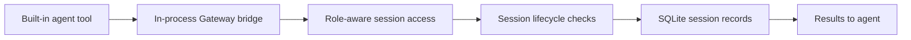

Codex review: blocked before merge. _Reviewed September 3, 2026, 3:53 AM ET / 07:53 UTC._

# ClawSweeper review

## What this changes

The PR lets Gateway-bound agents manage visible sessions, including bounded multi-session patches, and strengthens interruption handling for session groups and resets.

## Regression provenance

Possible regression — suspected (reviewed change). No predecessor PR is attributed.

## Merge readiness

⛔ **Blocked before merge - 5 items remain**

Keep open: the role-aware session access and bulk patch work remains needed, but detached cleanup can delete a successor session at the reused child key.

**Priority:** P1
**Reviewed head:** `04c6984443b76cc5e895ab0fb522c6f7455057cf`

## Review scores

| Measure | Result | What it means |
|---|---|---|
| **Overall readiness** | 🦐 gold shrimp **(3/6)** | The main session-access path is substantially covered, but the detached-cleanup race is a merge blocker. |
| **Proof confidence** | 🦐 gold shrimp **(3/6)** | Not applicable: Real behavior proof is not required for maintainer- or bot-authored pull requests. |
| **Patch quality** | 🦐 gold shrimp **(3/6)** | Security review found an item that needs attention. |

## Verification

| Check | Result | Evidence |
|---|---|---|
| **Real behavior** | Not applicable | Not applicable: Real behavior proof is not required for maintainer- or bot-authored pull requests. |
| **Evidence reviewed** | 6 items | Introduced detached cleanup: This PR introduces a wrapper that clears the worker caller identity before non-create cleanup calls, allowing accepted cleanup to outlive the source turn. Unfenced rollback request: Visible-session rollback deletes by child key only and does not preserve the created session identity or lifecycle revision. Delete fence is optional: The delete handler only rejects a changed session when optional expected identity fields are supplied; otherwise it snapshots the entry present when detached cleanup arrives. |
| **Findings** | 1 actionable finding | [P1] Fence detached cleanup to the created child session |
| **Security** | Needs attention | Detached cleanup can delete a successor session: Cleanup dispatches deletion by key after dropping caller identity, so a replacement at that key can satisfy optional identity checks intended for the original child. |

## How this fits together

Built-in agent tools use the local Gateway to list and mutate persisted sessions. Gateway role filtering and lifecycle checks decide which session records may be changed before results return to the agent.

## Before merge

- [ ] **Fence detached cleanup to the created child session (P1)** - The new cleanup wrapper drops the caller identity, then rollback calls `sessions.delete` with only the child key. Because delete treats expected session identity and lifecycle revision as optional, a reset or replacement admitted before cleanup can be deleted as though it were the original child. Preserve the created entry's session ID and lifecycle revision through abort/delete cleanup so the existing changed-session check rejects a successor.
- [ ] **Resolve security concern: Detached cleanup can delete a successor session** - Cleanup dispatches deletion by key after dropping caller identity, so a replacement at that key can satisfy optional identity checks intended for the original child.
- [ ] **Resolve merge risk (P1)** - Detached cleanup can delete a replacement session at the same child key because it omits the created session's identity and lifecycle revision.
- [ ] **Complete next step (P2)** - Fence detached child cleanup to the created session identity and lifecycle revision, add the successor-race Gateway/SQLite regression, and complete exact-head Gateway, agent, and session-state checks before merge.
- [ ] **Add data-model compatibility proof** - Confirm migration or upgrade compatibility proof before merge.

## Findings

- [P1] Fence detached cleanup to the created child session — `src/gateway/worker-environments/worker-session-tool-executor.ts:206-211`
- [high] Detached cleanup can delete a successor session — `src/gateway/worker-environments/worker-session-tool-executor.ts:209`

<strong>Agent review details</strong>

### Security

Needs attention: The detached authority transfer lacks an exact child-generation fence and can act on a successor session.

### PR surface

Source +304, Tests +1359, Docs +30, Other +1. Total +1694 across 28 files.

View PR surface stats

| Area | Files | Added | Removed | Net |
|---|---:|---:|---:|---:|
| Source | 16 | 626 | 322 | +304 |
| Tests | 9 | 1381 | 22 | +1359 |
| Docs | 1 | 31 | 1 | +30 |
| Config | 0 | 0 | 0 | 0 |
| Generated | 0 | 0 | 0 | 0 |
| Other | 2 | 2 | 1 | +1 |
| **Total** | **28** | **2040** | **346** | **+1694** |

### Review metrics

| Metric | Value | Why it matters |
|---|---|---|
| **Production and test delta** | production +304 net; tests/test support +1,359 net; docs +30 net | The broad production growth supports the batch capability and lifecycle protections, but the detached-cleanup ownership gap must be repaired. |

### Stored data model

Persistent data-model change detected: `serialized state: src/agents/tools/sessions-tool-patch.ts`, `unknown-data-model-change: src/agents/tools/sessions-tool-patch.ts`. Confirm migration or upgrade compatibility proof before merge.

### Root-cause cluster

Relationship: `fixed_by_candidate`
Canonical: https://github.com/openclaw/openclaw/issues/136818
Summary: This PR is the candidate repair for the canonical role-aware session-access issue; its detached-cleanup race is an introduced defect in that repair.

Members:
- `canonical`: https://github.com/openclaw/openclaw/issues/136818 - The PR targets its role-aware built-in session tool access problem.
- `partial_overlap`: https://github.com/openclaw/openclaw/pull/120850 - It shares session lifecycle batching context, while this PR also changes role context and generalized patch targets.

Proposal only: this assessment does not dispatch repair, suppress jobs, mutate sibling items, close, or merge anything.

### Merge-risk options

**Maintainer options:**
1. **Fence detached cleanup (recommended)**  
   Preserve the created child identity and lifecycle revision through rollback, then add a Gateway/SQLite successor-race regression.

### Technical review

Best possible solution:

Fence detached abort/delete cleanup to the exact child created by this operation, prove the replacement race cannot affect a successor, then complete exact-head checks.

Do we have a high-confidence way to reproduce the issue?

Yes, from source: create a visible child, close the worker turn, replace or reset that child before detached cleanup is admitted, and observe that cleanup deletes by key without an expected identity.

Is this the best way to solve the issue?

No: retaining only Gateway cleanup context is insufficient; the cleanup request must retain the created child generation so the existing delete fence rejects a successor.

Full review comments:

- [P1] Fence detached cleanup to the created child session — `src/gateway/worker-environments/worker-session-tool-executor.ts:206-211`
  The new cleanup wrapper drops the caller identity, then rollback calls `sessions.delete` with only the child key. Because delete treats expected session identity and lifecycle revision as optional, a reset or replacement admitted before cleanup can be deleted as though it were the original child. Preserve the created entry's session ID and lifecycle revision through abort/delete cleanup so the existing changed-session check rejects a successor.
  Confidence: 0.92

Overall correctness: patch is incorrect
Overall confidence: 0.92

AGENTS.md: found and applied where relevant.

Codex review notes: model internal, reasoning high; reviewed against [7b67c28e2e96](https://github.com/openclaw/openclaw/commit/7b67c28e2e96237b4eea9ce095a74d6936ce8c50).

### Labels

Label changes:

- add `rating: 🦐 gold shrimp`: Overall readiness is 🦐 gold shrimp; proof is 🦐 gold shrimp and patch quality is 🦐 gold shrimp.
- add `status: ⏳ waiting on author`: ClawSweeper has contributor-facing work open and is waiting for author action. Not applicable: Real behavior proof is not required for maintainer- or bot-authored pull requests.
- remove `rating: 🐚 platinum hermit`: Current PR rating is `rating: 🦐 gold shrimp`, so this older rating label is no longer current.
- remove `status: 👀 ready for maintainer look`: Current PR status label is `status: ⏳ waiting on author`.

Label justifications:

- `P1`: The introduced race can remove a current child session during an ordinary agent session workflow.
- `merge-risk: 🚨 security-boundary`: Detached cleanup crosses initiating-turn closure without retaining an exact child-generation fence.
- `merge-risk: 🚨 session-state`: Cleanup intended for an earlier child can delete its successor at the same key.
- `rating: 🦐 gold shrimp`: Overall readiness is 🦐 gold shrimp; proof is 🦐 gold shrimp and patch quality is 🦐 gold shrimp.
- `status: ⏳ waiting on author`: ClawSweeper has contributor-facing work open and is waiting for author action. Not applicable: Real behavior proof is not required for maintainer- or bot-authored pull requests.

### Evidence

Security concerns:

- [high] Detached cleanup can delete a successor session — `src/gateway/worker-environments/worker-session-tool-executor.ts:209`
  Cleanup dispatches deletion by key after dropping caller identity, so a replacement at that key can satisfy optional identity checks intended for the original child.
  Confidence: 0.92

Acceptance criteria:

- [P1] Replace or reset the created child before detached cleanup and verify the successor survives.
- [P1] Complete exact-head Gateway, agent, and session-state checks.

What I checked:

- **Introduced detached cleanup:** This PR introduces a wrapper that clears the worker caller identity before non-create cleanup calls, allowing accepted cleanup to outlive the source turn. ([`src/gateway/worker-environments/worker-session-tool-executor.ts:206`](https://github.com/openclaw/openclaw/blob/21caebff14a58eb0aa9570463172f702ddd3b340/src/gateway/worker-environments/worker-session-tool-executor.ts#L206), [21caebff14a5](https://github.com/openclaw/openclaw/commit/21caebff14a58eb0aa9570463172f702ddd3b340))
- **Unfenced rollback request:** Visible-session rollback deletes by child key only and does not preserve the created session identity or lifecycle revision. ([`src/agents/tools/sessions-spawn-visible.ts:86`](https://github.com/openclaw/openclaw/blob/04c6984443b76cc5e895ab0fb522c6f7455057cf/src/agents/tools/sessions-spawn-visible.ts#L86), [04c6984443b7](https://github.com/openclaw/openclaw/commit/04c6984443b76cc5e895ab0fb522c6f7455057cf))
- **Delete fence is optional:** The delete handler only rejects a changed session when optional expected identity fields are supplied; otherwise it snapshots the entry present when detached cleanup arrives. ([`src/gateway/server-methods/sessions-delete.ts:102`](https://github.com/openclaw/openclaw/blob/04c6984443b76cc5e895ab0fb522c6f7455057cf/src/gateway/server-methods/sessions-delete.ts#L102), [04c6984443b7](https://github.com/openclaw/openclaw/commit/04c6984443b76cc5e895ab0fb522c6f7455057cf))
- **Available creation identity:** Session creation already returns its session ID and entry, from which the cleanup caller can preserve an exact lifecycle fence. ([`src/gateway/server-methods/sessions-create.ts:639`](https://github.com/openclaw/openclaw/blob/04c6984443b76cc5e895ab0fb522c6f7455057cf/src/gateway/server-methods/sessions-create.ts#L639), [04c6984443b7](https://github.com/openclaw/openclaw/commit/04c6984443b76cc5e895ab0fb522c6f7455057cf))
- **Existing closure coverage:** The added test proves ordinary session mutations do not commit after caller closure, but does not cover replacement of a child before detached rollback is admitted. ([`src/gateway/local-request-context.session-tools.test.ts:209`](https://github.com/openclaw/openclaw/blob/04c6984443b76cc5e895ab0fb522c6f7455057cf/src/gateway/local-request-context.session-tools.test.ts#L209), [04c6984443b7](https://github.com/openclaw/openclaw/commit/04c6984443b76cc5e895ab0fb522c6f7455057cf))
- **Current main still lacks the repair:** Current main's in-process bridge has neither the caller-lifetime assertion around bound calls nor the explicit built-in system role actor added by this PR. ([`src/agents/tools/in-process-gateway.ts:101`](https://github.com/openclaw/openclaw/blob/7b67c28e2e96237b4eea9ce095a74d6936ce8c50/src/agents/tools/in-process-gateway.ts#L101), [7b67c28e2e96](https://github.com/openclaw/openclaw/commit/7b67c28e2e96237b4eea9ce095a74d6936ce8c50))

Likely related people:

- **Peter Steinberger:** Suggested for follow-up; no historical authorship or introduction is verified. (role: unverified routing candidate; confidence: low)

### Rank-up moves

Optional improvements that raise the rating; they are not merge blockers.

- Fence cleanup to the exact session generation created by this operation.
- Add a Gateway/SQLite regression that replaces the child before detached cleanup runs.
- Let exact-head Gateway, agent, and session-state checks complete successfully.

### Rating scale

| Score | Internal tier | Crab rank | Meaning |
|---:|:---:|---|---|
| **6/6** | S | 🦀 challenger crab | Exceptional readiness |
| **5/6** | A | 🦞 diamond lobster | Very strong readiness |
| **4/6** | B | 🐚 platinum hermit | Good normal PR; ordinary maintainer review |
| **3/6** | C | 🦐 gold shrimp | Useful, but confidence is limited |
| **2/6** | D | 🦪 silver shellfish | Proof or implementation needs work |
| **1/6** | F | 🧂 unranked krab | Not merge-ready |
| N/A | NA | 🌊 off-meta tidepool | Rating does not apply |

Overall follows the weaker of proof and patch quality.
Shiny media proof means a screenshot, video, or linked artifact directly shows the changed behavior. Runtime, network, CSP, and security claims still need visible diagnostics.

### Workflow

- ClawSweeper keeps one durable marker-backed review comment per issue or PR.
- Re-runs edit this comment so the latest verdict, findings, and automation markers stay together instead of adding duplicate bot comments.
- A fresh review can be triggered by eligible `@clawsweeper re-review` comments, exact-item GitHub events, scheduled/background review runs, or manual workflow dispatch.
- PR/issue authors and users with repository write access can comment `@clawsweeper re-review` or `@clawsweeper re-run` on an open PR or issue to request a fresh review only.
- Maintainers can also comment `@clawsweeper review` to request a fresh review only.
- Fresh-review commands do not start repair, autofix, rebase, CI repair, or automerge.
- Maintainer-only repair and merge flows require explicit commands such as `@clawsweeper autofix`, `@clawsweeper automerge`, `@clawsweeper fix ci`, or `@clawsweeper address review`.
- Maintainers can comment `@clawsweeper explain` to ask for more context, or `@clawsweeper stop` to stop active automation.

### History

Review history (5 earlier review cycles)

<!-- clawsweeper-review-history v=1 total=5 -->
- reviewed 2026-09-03T04:00:36.825Z sha 7da11019930eee652c401e097326925221678b39 :: blocked before merge. :: none
- reviewed 2026-09-03T04:11:54.549Z sha 7da11019930eee652c401e097326925221678b39 :: blocked before merge. :: [P2] Preserve group catalog/member consistency on caller expiry
- reviewed 2026-09-03T04:39:26.830Z sha 804e4411c204c84b8decb81cb880550e2a9ddb68 :: blocked before merge. :: [P1] Transfer reset ownership before destructive cleanup | [P2] Preserve group catalog/member consistency on caller expiry
- reviewed 2026-09-03T06:19:24.055Z sha 53a5dc41becc788b16c60138efde9107a64e128a :: blocked before merge. :: none
- reviewed 2026-09-03T06:49:02.411Z sha 04c6984443b76cc5e895ab0fb522c6f7455057cf :: blocked before merge. :: none

<!-- clawsweeper-security:security-sensitive item=136952 sha=04c6984443b76cc5e895ab0fb522c6f7455057cf confidence=high updated_at=2026-09-03T07:48:27Z reviewed_at=2026-09-03T07:53:48.509Z lease_owner=github-run-33729830054-1 lease_comment_id=5522402902 source_revision=39e4bd8e1498e8bec6149c8d622fa0cc056915330cfe60920a3071c468f6dcb8 live_verification=absent -->
<!-- clawsweeper-verdict:needs-human item=136952 sha=04c6984443b76cc5e895ab0fb522c6f7455057cf confidence=high updated_at=2026-09-03T07:48:27Z reviewed_at=2026-09-03T07:53:48.509Z lease_owner=github-run-33729830054-1 lease_comment_id=5522402902 source_revision=39e4bd8e1498e8bec6149c8d622fa0cc056915330cfe60920a3071c468f6dcb8 live_verification=absent -->
<!-- clawsweeper-review-state:blocked item=136952 sha=04c6984443b76cc5e895ab0fb522c6f7455057cf v=1 -->

<!-- clawsweeper-review-version item=136952 reviewed_at=2026-09-03T07:53:48.509Z sha=04c6984443b76cc5e895ab0fb522c6f7455057cf source_revision=39e4bd8e1498e8bec6149c8d622fa0cc056915330cfe60920a3071c468f6dcb8 lease_owner=github-run-33729830054-1 lease_comment_id=5522402902 v=1 -->

<!-- clawsweeper-review item=136952 -->