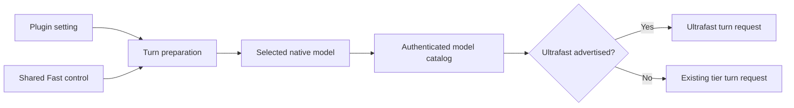

Codex review: blocked before merge. _Reviewed September 26, 2026, 9:29 PM ET / September 27, 2026, 01:29 UTC (Revision 4)._

# ClawSweeper review

## What this changes

The Codex plugin adds an opt-in setting that requests Ultrafast when the selected model's authenticated app-server catalog entry advertises it, with configuration, documentation, and tests.

## Merge readiness

⛔ **Blocked before merge - 2 items remain**

Current main lacks model-aware Ultrafast selection, so this PR remains useful. The earlier Fast-mode and catalog-type findings are addressed in the current head, and this review found no new discrete code defect. A signed-in Codex turn is still needed to verify the native tier request.

**Priority:** P2
**Reviewed head:** `64f0745b701ae4bc83b914326fc2b5e3f2ef4d29`

## Review scores

| Measure | Result | What it means |
|---|---|---|
| **Overall readiness** | 🐚 platinum hermit **(4/6)** | The patch is focused and covers the prior findings; a native account trace would settle its remaining contract risk. |
| **Proof confidence** | 🌊 off-meta tidepool | Not applicable: The verified maintain-access author is exempt from the external-contributor proof gate. The PR's mocked turn tests cover the new tier path, but no authenticated native turn is captured; existing stored config remains valid because the new setting is optional and false when absent. |
| **Patch quality** | 🐚 platinum hermit **(4/6)** | No actionable review findings were identified. |

## Verification

| Check | Result | Evidence |
|---|---|---|
| **Real behavior** | Not applicable | Not applicable: The verified maintain-access author is exempt from the external-contributor proof gate. The PR's mocked turn tests cover the new tier path, but no authenticated native turn is captured; existing stored config remains valid because the new setting is optional and false when absent. |
| **Evidence reviewed** | 10 items | Introduced turn behavior: The PR resolves the tier from the selected model and active client immediately before turn/start, then rechecks turn ownership. Current-main necessity: Current main builds the turn request without conditional Ultrafast catalog selection; its service-tier path is the existing configured or shared Fast value. Previous finding resolved: The new head declares the catalog's serviceTiers field in the Codex model response type, addressing the prior review's TypeScript finding. |
| **Findings** | None | None. |
| **Security** | None | None. |

## How this fits together

The Codex plugin turns OpenClaw model requests into native Codex app-server turns. Plugin settings and the shared Fast control determine a service tier, which is sent with the selected model in the turn request.

## Before merge

- [ ] **Resolve merge risk (P1)** - The app-server source advertises Ultrafast, but the PR has no signed-in turn showing that the bundled Codex runtime accepts the selected tier and preserves the existing tier on an unsupported model.
- [ ] **Complete next step (P2)** - Capture a redacted signed-in Codex 0.155.1 model/list and turn/start trace showing Ultrafast on a supported model and the retained tier on an unsupported model.

<strong>Agent review details</strong>

### Security

None.

### PR surface

Source +100, Tests +395, Docs +11, Generated 0. Total +506 across 17 files.

View PR surface stats

| Area | Files | Added | Removed | Net |
|---|---:|---:|---:|---:|
| Source | 9 | 104 | 4 | +100 |
| Tests | 4 | 397 | 2 | +395 |
| Docs | 2 | 11 | 0 | +11 |
| Config | 0 | 0 | 0 | 0 |
| Generated | 2 | 3 | 3 | 0 |
| Other | 0 | 0 | 0 | 0 |
| **Total** | **17** | **515** | **9** | **+506** |

### Review metrics

| Metric | Value | Why it matters |
|---|---|---|
| **New configuration** | 1 opt-in boolean; default false | Existing configurations retain their tier behavior unless an operator enables the setting. |
| **Production and test growth** | production +100, tests +395 lines | The production growth is confined to the plugin's tier selection; most added lines cover turn and fallback behavior. |

### Merge-risk options

**Maintainer options:**
1. **Verify native tier selection (recommended)**  
   Capture a redacted authenticated Codex 0.155.1 catalog and turn trace showing Ultrafast on an advertised model and the existing tier on an unsupported model.

### Technical review

Best possible solution:

Keep tier selection in the Codex plugin and verify a supported turn and an unsupported-model fallback against the bundled, authenticated app-server before landing.

Do we have a high-confidence way to reproduce the issue?

Not applicable: this PR adds a conditional tier option. Current main's configured service tier does not select Ultrafast per model.

Is this the best way to solve the issue?

Yes, a Codex plugin setting is the narrow owner for model-aware tier selection; the existing serviceTier setting cannot preserve another tier selectively across models.

AGENTS.md: found and applied where relevant.

Codex review notes: model internal, reasoning high; reviewed against [030a6eca356e](https://github.com/openclaw/openclaw/commit/030a6eca356ef4a3c760dfffed558bd1879af323).

### Labels

Label changes:

- add `rating: 🐚 platinum hermit`: Overall readiness is 🐚 platinum hermit; proof is 🌊 off-meta tidepool and patch quality is 🐚 platinum hermit.
- add `status: 👀 ready for maintainer look`: ClawSweeper has no concrete contributor-facing blocker left for this PR. Not applicable: The verified maintain-access author is exempt from the external-contributor proof gate. The PR's mocked turn tests cover the new tier path, but no authenticated native turn is captured; existing stored config remains valid because the new setting is optional and false when absent.
- remove `rating: 🧂 unranked krab`: Current PR rating is `rating: 🐚 platinum hermit`, so this older rating label is no longer current.
- remove `merge-risk: 🚨 compatibility`: Current PR review merge-risk labels are `merge-risk: 🚨 auth-provider`.
- remove `status: ⏳ waiting on author`: Current PR status label is `status: 👀 ready for maintainer look`.

Label justifications:

- `P2`: This is a bounded, opt-in Codex plugin improvement with a native-contract validation gap.
- `merge-risk: 🚨 auth-provider`: The opt-in changes the tier sent for an account-scoped model, and live provider acceptance has not yet been shown.
- `rating: 🐚 platinum hermit`: Overall readiness is 🐚 platinum hermit; proof is 🌊 off-meta tidepool and patch quality is 🐚 platinum hermit.
- `status: 👀 ready for maintainer look`: ClawSweeper has no concrete contributor-facing blocker left for this PR. Not applicable: The verified maintain-access author is exempt from the external-contributor proof gate. The PR's mocked turn tests cover the new tier path, but no authenticated native turn is captured; existing stored config remains valid because the new setting is optional and false when absent.

### Evidence

What I checked:

- **Introduced turn behavior:** The PR resolves the tier from the selected model and active client immediately before turn/start, then rechecks turn ownership. ([`extensions/codex/src/app-server/run-attempt-turn-request.ts:208`](https://github.com/openclaw/openclaw/blob/64f0745b701ae4bc83b914326fc2b5e3f2ef4d29/extensions/codex/src/app-server/run-attempt-turn-request.ts#L208), [64f0745b701a](https://github.com/openclaw/openclaw/commit/64f0745b701ae4bc83b914326fc2b5e3f2ef4d29))
- **Current-main necessity:** Current main builds the turn request without conditional Ultrafast catalog selection; its service-tier path is the existing configured or shared Fast value. ([`extensions/codex/src/app-server/run-attempt-turn-request.ts:166`](https://github.com/openclaw/openclaw/blob/030a6eca356ef4a3c760dfffed558bd1879af323/extensions/codex/src/app-server/run-attempt-turn-request.ts#L166), [030a6eca356e](https://github.com/openclaw/openclaw/commit/030a6eca356ef4a3c760dfffed558bd1879af323))
- **Previous finding resolved:** The new head declares the catalog's serviceTiers field in the Codex model response type, addressing the prior review's TypeScript finding. ([`extensions/codex/src/app-server/protocol.ts:585`](https://github.com/openclaw/openclaw/blob/64f0745b701ae4bc83b914326fc2b5e3f2ef4d29/extensions/codex/src/app-server/protocol.ts#L585), [64f0745b701a](https://github.com/openclaw/openclaw/commit/64f0745b701ae4bc83b914326fc2b5e3f2ef4d29))
- **Existing settings compatibility:** The new option is optional and resolves to false when absent; the tests cover true, false, and absent values while retaining the configured tier. ([`extensions/codex/src/app-server/config.test.ts:333`](https://github.com/openclaw/openclaw/blob/64f0745b701ae4bc83b914326fc2b5e3f2ef4d29/extensions/codex/src/app-server/config.test.ts#L333), [64f0745b701a](https://github.com/openclaw/openclaw/commit/64f0745b701ae4bc83b914326fc2b5e3f2ef4d29))
- **Native proof gap:** The PR body reports focused tests and explicitly says that no live Gateway or provider-routing verification is claimed for this revision. ([64f0745b701a](https://github.com/openclaw/openclaw/commit/64f0745b701ae4bc83b914326fc2b5e3f2ef4d29))
- **Applicable proof policy:** Repository policy calls for live contract proof when changing behavior at an external API boundary; the tier is sent to the Codex app-server. ([`AGENTS.md:92`](https://github.com/openclaw/openclaw/blob/64f0745b701ae4bc83b914326fc2b5e3f2ef4d29/AGENTS.md#L92), [64f0745b701a](https://github.com/openclaw/openclaw/commit/64f0745b701ae4bc83b914326fc2b5e3f2ef4d29))

Likely related people:

- **sjf-oa:** Suggested for follow-up; no historical authorship or introduction is verified. (role: unverified routing candidate; confidence: low)
- **steipete:** Suggested for follow-up; no historical authorship or introduction is verified. (role: unverified routing candidate; confidence: low)
- **shakkernerd:** Suggested for follow-up; no historical authorship or introduction is verified. (role: unverified routing candidate; confidence: low)

### Rank-up moves

Optional improvements that raise the rating; they are not merge blockers.

- Record a redacted authenticated Codex model/list and turn/start trace for a supported model and an unsupported-model fallback.

### Rating scale

| Score | Internal tier | Crab rank | Meaning |
|---:|:---:|---|---|
| **6/6** | S | 🦀 challenger crab | Exceptional readiness |
| **5/6** | A | 🦞 diamond lobster | Very strong readiness |
| **4/6** | B | 🐚 platinum hermit | Good normal PR; ordinary maintainer review |
| **3/6** | C | 🦐 gold shrimp | Useful, but confidence is limited |
| **2/6** | D | 🦪 silver shellfish | Proof or implementation needs work |
| **1/6** | F | 🧂 unranked krab | Not merge-ready |
| N/A | NA | 🌊 off-meta tidepool | Rating does not apply |

Overall follows the weaker of proof and patch quality.
Shiny media proof means a screenshot, video, or linked artifact directly shows the changed behavior. Runtime, network, CSP, and security claims still need visible diagnostics.

### Workflow

- ClawSweeper keeps one durable marker-backed review comment per issue or PR.
- Re-runs edit this comment so the latest verdict, findings, and automation markers stay together instead of adding duplicate bot comments.
- A fresh review can be triggered by eligible `@clawsweeper re-review` comments, exact-item GitHub events, scheduled/background review runs, or manual workflow dispatch.
- PR/issue authors and users with repository write access can comment `@clawsweeper re-review` or `@clawsweeper re-run` on an open PR or issue to request a fresh review only.
- Maintainers can also comment `@clawsweeper review` to request a fresh review only.
- Fresh-review commands do not start repair, autofix, rebase, CI repair, or automerge.
- Maintainer-only repair and merge flows require explicit commands such as `@clawsweeper autofix`, `@clawsweeper automerge`, `@clawsweeper fix ci`, or `@clawsweeper address review`.
- Maintainers can comment `@clawsweeper explain` to ask for more context, or `@clawsweeper stop` to stop active automation.

### History

Review history (3 earlier review cycles)

<!-- clawsweeper-review-history v=1 total=3 -->
- reviewed September 26, 2026, 2:58 AM ET / 06:58 UTC sha unknown :: blocked before merge. :: [P1] Preserve Fast-on behavior for existing flex configurations | [P2] Align the other Codex tier reference pages
- reviewed 2026-09-26T23:58:41.455Z sha 662b846247f5ac8b4bb1cf85be70afd14cf2d9a1 :: blocked before merge. :: [P1] Preserve Fast-on priority for existing configured tiers
- reviewed 2026-09-27T01:18:26.362Z sha a2ea0e52a69869c2f2867057f9bc46ba78bcd76a :: blocked before merge. :: [P1] Declare serviceTiers on the Codex model response type

<!-- clawsweeper-verdict:needs-human item=158703 sha=64f0745b701ae4bc83b914326fc2b5e3f2ef4d29 confidence=high updated_at=2026-09-27T01:24:33Z reviewed_at=2026-09-27T01:29:40.328Z lease_owner=github-run-36285369900-1 lease_comment_id=5851600759 source_revision=8656d1f470f215f5fdadd24050eee8878b3d544e8e095fcf8496016633515e3f live_verification=absent -->
<!-- clawsweeper-review-state:blocked item=158703 sha=64f0745b701ae4bc83b914326fc2b5e3f2ef4d29 v=1 -->

<!-- clawsweeper-review-version item=158703 reviewed_at=2026-09-27T01:29:40.328Z sha=64f0745b701ae4bc83b914326fc2b5e3f2ef4d29 source_revision=8656d1f470f215f5fdadd24050eee8878b3d544e8e095fcf8496016633515e3f lease_owner=github-run-36285369900-1 lease_comment_id=5851600759 v=1 -->

<!-- clawsweeper-review item=158703 -->