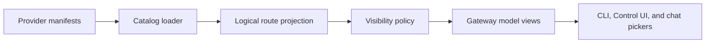

Codex review: needs real behavior proof before merge. _Reviewed July 25, 2026, 6:00 AM ET / 10:00 UTC._

# ClawSweeper review

## What this changes

This PR activates catalog lifecycle status in model selection so default and configured pickers hide deprecated or disabled provider rows while curated provider manifests remove older model entries.

## Merge readiness

⛔ **Blocked until real behavior proof is added - 7 items remain**

Keep this PR open for maintainer handling. The picker filter is applied after every catalog view is constructed, so it also hides deprecated and disabled rows from the documented `provider-config` inventory view rather than limiting curation to default/configured picker views; the PR also needs real after-fix behavior proof before merge.

**Priority:** P2
**Reviewed head:** `8c6aa912432f0aafe2903b020150c8ca0e3924d6`
**Owner decision:** Required. See [Decision needed](#decision-needed).

## Review scores

| Measure | Result | What it means |
|---|---|---|
| **Overall readiness** | 🧂 unranked krab **(1/6)** | The PR has focused tests described in its body, but the unconditional inventory filter is a blocking correctness defect and no real after-fix behavior proof is attached. |
| **Proof confidence** | 🧂 unranked krab **(1/6)** | Needs real behavior proof before merge: The PR body reports focused automated suites, but it does not include inspectable after-fix CLI, Gateway, or Control UI evidence showing the curated picker and preserved legacy-reference behavior; please redact private model/account details before attaching proof. After adding proof, update the PR body; ClawSweeper should re-review automatically. If it does not, the PR author or someone with repository write access can comment `@clawsweeper re-review`. |
| **Patch quality** | 🦪 silver shellfish **(2/6)** | 1 actionable review finding remain. |

## Verification

| Check | Result | Evidence |
|---|---|---|
| **Real behavior** | Needs proof | Needs real behavior proof before merge: The PR body reports focused automated suites, but it does not include inspectable after-fix CLI, Gateway, or Control UI evidence showing the curated picker and preserved legacy-reference behavior; please redact private model/account details before attaching proof. After adding proof, update the PR body; ClawSweeper should re-review automatically. If it does not, the PR author or someone with repository write access can comment `@clawsweeper re-review`. |
| **Evidence reviewed** | 4 items | Unconditional visibility filter: The PR projects the complete result and then filters it with `isPickerVisibleCatalogEntry` without checking the requested view, so lifecycle-hidden rows are removed from every view handled by this function. Documented provider inventory contract: The PR documentation says `view: "provider-config"` is the provider inventory view and should show source-authored rows without picker filtering, while the new final filter applies there as well. Focused test gap: The new visibility tests cover `default`, `configured`, and `all`, but do not cover `provider-config`, which is the view affected by the unconditional final filter. |
| **Findings** | 1 actionable finding | [P1] Limit lifecycle filtering to picker views |
| **Security** | None | None. |

## How this fits together

Provider plugins contribute static model catalogs, which OpenClaw loads and projects into logical model routes before the Gateway serves CLI, Control UI, and chat-picker views. The changed visibility policy sits after route projection and determines which catalog entries each Gateway model view returns.

## Decision needed

| Question | Recommendation |
|---|---|
| Should the approved curation policy hide lifecycle-deprecated rows only from default/configured pickers while keeping the `provider-config` inventory complete? | **Keep inventory views complete:** Restrict lifecycle hiding to default and configured picker views and retain every provider-authored row in `all` and `provider-config` views. |

Why: The PR states a maintainer-directed product decision, but the current implementation conflicts with the documented inventory-view boundary; maintainers need to confirm the intended permanent view contract.

## Before merge

- [ ] **Add real behavior proof** - Needs real behavior proof before merge: The PR body reports focused automated suites, but it does not include inspectable after-fix CLI, Gateway, or Control UI evidence showing the curated picker and preserved legacy-reference behavior; please redact private model/account details before attaching proof. After adding proof, update the PR body; ClawSweeper should re-review automatically. If it does not, the PR author or someone with repository write access can comment `@clawsweeper re-review`.
- [ ] **Limit lifecycle filtering to picker views (P1)** - The final filter runs for every view, including `provider-config`. That view is documented as the unfiltered provider inventory, so deprecated and disabled rows now disappear from it. Apply lifecycle hiding only to the default/configured picker views and add a `provider-config` regression test.
- [ ] **Resolve merge risk (P1)** - The intentional curation changes default discovery across several providers; maintainers should explicitly confirm the current-generation policy and preserve the documented full-inventory escape hatches before merge.
- [ ] **Improve patch quality** - Restrict lifecycle filtering to `default` and `configured` views and cover `provider-config` in the focused visibility suite.
- [ ] **Improve patch quality** - Attach redacted live CLI, Gateway, or Control UI output showing deprecated rows hidden in a picker and visible in the full inventory.
- [ ] **Improve patch quality** - After updating the PR body with proof, request a maintainer `@clawsweeper re-review` if a new review is not triggered automatically.

## Findings

- [P1] Limit lifecycle filtering to picker views — `src/agents/model-catalog-visibility.ts:346-348`

<strong>Agent review details</strong>

### Security

None.

### PR surface

Source -324, Tests +106, Docs -36. Total -254 across 26 files.

View PR surface stats

| Area | Files | Added | Removed | Net |
|---|---:|---:|---:|---:|
| Source | 10 | 92 | 416 | -324 |
| Tests | 11 | 247 | 141 | +106 |
| Docs | 5 | 19 | 55 | -36 |
| Config | 0 | 0 | 0 | 0 |
| Generated | 0 | 0 | 0 | 0 |
| Other | 0 | 0 | 0 | 0 |
| **Total** | **26** | **358** | **612** | **-254** |

### Review metrics

| Metric | Value | Why it matters |
|---|---|---|
| **Visibility contract** | 1 lifecycle filter affects 4 catalog-view modes | The filter is placed after view construction, so its scope determines whether inventory APIs remain complete or become curated. |

### Stored data model

Persistent data-model change detected: `serialized state: src/gateway/sessions-patch.test.ts`, `vector/embedding metadata: extensions/zai/model-definitions.test.ts`. Migration or upgrade compatibility proof is recorded; maintainers should verify it before merge.

### Merge-risk options

**Maintainer options:**
1. **Scope filtering to picker views (recommended)**  
   Guard the lifecycle filter so `default` and `configured` are curated while `all` and `provider-config` retain the full catalog, with focused regression tests.
2. **Accept a broader inventory change**  
   Keep the unconditional filter only if maintainers intentionally redefine `provider-config` as a curated view and approve the resulting compatibility change.

### Technical review

Best possible solution:

Limit lifecycle hiding to the default and configured picker views, preserve `all` and `provider-config` inventories, add regression coverage for each view, and attach redacted live evidence showing both the curated picker and a retained legacy configured reference.

Do we have a high-confidence way to reproduce the issue?

Yes, from source: call `models.list` through the `provider-config` view with a catalog row marked `deprecated` or `disabled`; the final unconditional filter removes that row despite the documented complete-inventory contract.

Is this the best way to solve the issue?

No. Activating lifecycle metadata at the shared seam is a maintainable approach, but applying it after all views are assembled also changes the non-picker `provider-config` inventory; the filter should be restricted to the curated picker views.

Full review comments:

- [P1] Limit lifecycle filtering to picker views — `src/agents/model-catalog-visibility.ts:346-348`
  The final filter runs for every view, including `provider-config`. That view is documented as the unfiltered provider inventory, so deprecated and disabled rows now disappear from it. Apply lifecycle hiding only to the default/configured picker views and add a `provider-config` regression test.
  Confidence: 0.96

Overall correctness: patch is incorrect
Overall confidence: 0.96

AGENTS.md: found and applied where relevant.

Codex review notes: model internal, reasoning high; reviewed against [902cc5327935](https://github.com/openclaw/openclaw/commit/902cc53279358bfad0157917da2166a4164cc547).

### Labels

Label changes:

- add `P2`: This is a bounded but user-visible model-selection and inventory regression affecting provider catalog browsing.
- add `merge-risk: 🚨 compatibility`: The changed visibility boundary can remove previously visible provider-inventory rows from existing CLI and Gateway workflows.
- add `rating: 🧂 unranked krab`: Overall readiness is 🧂 unranked krab; proof is 🧂 unranked krab and patch quality is 🦪 silver shellfish.
- add `status: 📣 needs proof`: The PR needs real behavior proof before ClawSweeper can clear the contributor ask. Needs real behavior proof before merge: The PR body reports focused automated suites, but it does not include inspectable after-fix CLI, Gateway, or Control UI evidence showing the curated picker and preserved legacy-reference behavior; please redact private model/account details before attaching proof. After adding proof, update the PR body; ClawSweeper should re-review automatically. If it does not, the PR author or someone with repository write access can comment `@clawsweeper re-review`.

Label justifications:

- `P2`: This is a bounded but user-visible model-selection and inventory regression affecting provider catalog browsing.
- `merge-risk: 🚨 compatibility`: The changed visibility boundary can remove previously visible provider-inventory rows from existing CLI and Gateway workflows.
- `rating: 🧂 unranked krab`: Overall readiness is 🧂 unranked krab; proof is 🧂 unranked krab and patch quality is 🦪 silver shellfish.
- `status: 📣 needs proof`: The PR needs real behavior proof before ClawSweeper can clear the contributor ask. Needs real behavior proof before merge: The PR body reports focused automated suites, but it does not include inspectable after-fix CLI, Gateway, or Control UI evidence showing the curated picker and preserved legacy-reference behavior; please redact private model/account details before attaching proof. After adding proof, update the PR body; ClawSweeper should re-review automatically. If it does not, the PR author or someone with repository write access can comment `@clawsweeper re-review`.

### Evidence

What I checked:

- **Unconditional visibility filter:** The PR projects the complete result and then filters it with `isPickerVisibleCatalogEntry` without checking the requested view, so lifecycle-hidden rows are removed from every view handled by this function. ([`src/agents/model-catalog-visibility.ts:345`](https://github.com/openclaw/openclaw/blob/8c6aa912432f/src/agents/model-catalog-visibility.ts#L345), [8c6aa912432f](https://github.com/openclaw/openclaw/commit/8c6aa912432f))
- **Documented provider inventory contract:** The PR documentation says `view: "provider-config"` is the provider inventory view and should show source-authored rows without picker filtering, while the new final filter applies there as well. Public docs: [`docs/concepts/models.md`](https://docs.openclaw.ai/concepts/models). ([`docs/concepts/models.md:83`](https://docs.openclaw.ai/concepts/models), [8c6aa912432f](https://github.com/openclaw/openclaw/commit/8c6aa912432f))
- **Focused test gap:** The new visibility tests cover `default`, `configured`, and `all`, but do not cover `provider-config`, which is the view affected by the unconditional final filter. ([`src/agents/model-catalog-visibility.test.ts:39`](https://github.com/openclaw/openclaw/blob/8c6aa912432f/src/agents/model-catalog-visibility.test.ts#L39), [8c6aa912432f](https://github.com/openclaw/openclaw/commit/8c6aa912432f))
- **Repository policy applied:** The supplied repository policy treats provider/catalog behavior and model-selection compatibility as upgrade-sensitive, requiring coverage for changed user-facing selection views. ([`AGENTS.md:54`](https://github.com/openclaw/openclaw/blob/902cc5327935/AGENTS.md#L54), [902cc5327935](https://github.com/openclaw/openclaw/commit/902cc5327935))

Likely related people:

- **steipete:** The PR’s five commits define the proposed picker-visibility and catalog-curation behavior, including the route-metadata propagation and affected provider manifests. (role: recent model-catalog contributor; confidence: medium; commits: [ceacfe89b48d](https://github.com/openclaw/openclaw/commit/ceacfe89b48d087e49e4036de74e538e9834e1da), [2a770d774dc1](https://github.com/openclaw/openclaw/commit/2a770d774dc165a8284cffa7f859cb05482cf845), [0f808d6eca3a](https://github.com/openclaw/openclaw/commit/0f808d6eca3ab1efccc47fceba59112990c73c2c); files: `src/agents/model-catalog-visibility.ts`, `src/agents/model-catalog-route.ts`, `src/agents/model-visibility-policy.ts`)

### Rating scale

| Score | Internal tier | Crab rank | Meaning |
|---:|:---:|---|---|
| **6/6** | S | 🦀 challenger crab | Exceptional readiness |
| **5/6** | A | 🦞 diamond lobster | Very strong readiness |
| **4/6** | B | 🐚 platinum hermit | Good normal PR; ordinary maintainer review |
| **3/6** | C | 🦐 gold shrimp | Useful, but confidence is limited |
| **2/6** | D | 🦪 silver shellfish | Proof or implementation needs work |
| **1/6** | F | 🧂 unranked krab | Not merge-ready |
| N/A | NA | 🌊 off-meta tidepool | Rating does not apply |

Overall follows the weaker of proof and patch quality.
Shiny media proof means a screenshot, video, or linked artifact directly shows the changed behavior. Runtime, network, CSP, and security claims still need visible diagnostics.

### Workflow

- ClawSweeper keeps one durable marker-backed review comment per issue or PR.
- Re-runs edit this comment so the latest verdict, findings, and automation markers stay together instead of adding duplicate bot comments.
- A fresh review can be triggered by eligible `@clawsweeper re-review` comments, exact-item GitHub events, scheduled/background review runs, or manual workflow dispatch.
- PR/issue authors and users with repository write access can comment `@clawsweeper re-review` or `@clawsweeper re-run` on an open PR or issue to request a fresh review only.
- Maintainers can also comment `@clawsweeper review` to request a fresh review only.
- Fresh-review commands do not start repair, autofix, rebase, CI repair, or automerge.
- Maintainer-only repair and merge flows require explicit commands such as `@clawsweeper autofix`, `@clawsweeper automerge`, `@clawsweeper fix ci`, or `@clawsweeper address review`.
- Maintainers can comment `@clawsweeper explain` to ask for more context, or `@clawsweeper stop` to stop active automation.

<!-- clawsweeper-verdict:needs-human item=113594 sha=8c6aa912432f0aafe2903b020150c8ca0e3924d6 confidence=high updated_at=2026-07-25T09:59:07Z reviewed_at=2026-07-25T10:00:26.064Z lease_owner=github-run-30153639245-1 lease_comment_id=5078061482 source_revision=f30d8c8dc7d963e03ad16f4344b387eaf31e79b4a48066348c17ac30bc7e67fc -->

<!-- clawsweeper-review-version item=113594 reviewed_at=2026-07-25T10:00:26.064Z sha=8c6aa912432f0aafe2903b020150c8ca0e3924d6 source_revision=f30d8c8dc7d963e03ad16f4344b387eaf31e79b4a48066348c17ac30bc7e67fc lease_owner=github-run-30153639245-1 lease_comment_id=5078061482 v=1 -->

<!-- clawsweeper-review item=113594 -->