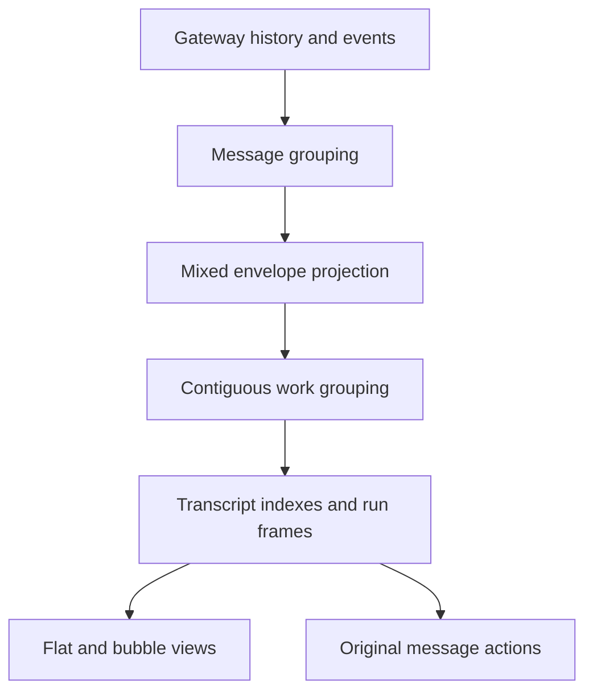

Codex review: needs maintainer review before merge.

## What this changes

Keeps completed assistant narration inline and collapses contiguous tool and reasoning activity into separate disclosures.

**Example:** A completed dashboard run contains “Checking.”, a read operation, and “Done.”
- **Before:** Flat mode hides “Checking.” with the completed work.
- **After:** “Checking.” remains visible, followed by a collapsed Worked disclosure and “Done.”

## Review scores

| Measure | Result | What it means |
|---|---|---|
| **Overall readiness** | 🦐 gold shrimp **(3/6)** | Strong visual evidence and no identified introduced defect; this PR implements only the web portion of the linked cross-client request. |
| **Proof confidence** | 🦞 diamond lobster **(5/6)** ✨ media proof bonus | Sufficient (screenshot): Inspected before/after screenshots exercise the running Control UI with synthetic mock-Gateway history and show flat narration preserved and bubble work collapsed; supporting regressions cover source actions, recovery, timing, and media. |
| **Patch quality** | 🐚 platinum hermit **(4/6)** | No actionable review findings were identified. |

## Product

**Kind:** Preference · **Worth it:** Yes · **Fix scope:** Partial
**User problem:** Narration containing findings and caveats disappears behind completed work, making the visible reply appear incomplete.
**Reason:** This changes the original final-answer-first policy, with the feature owner's repair commit recording the new direction; the native portion remains in the companion PR.

## Merge readiness

✅ **Ready for maintainer review**

Keep this PR open: it provides a useful web presentation change that current main lacks, with no actionable introduced defects found.

**Priority:** P2
**Reviewed head:** `833e2d7c76aec9be8009cd0362fe5916fb23b46c`

## Before merge

None.

## Findings

None.

<strong>Agent review details</strong>

### How this fits together

The Control UI projects Gateway history and live chat events into transcript rows, disclosures, previews, and source-message actions.

### Technical review

Best possible solution:

Retain this focused web implementation alongside the native companion, preserving original transcript identities and keeping whole-run timing in the final recap.

Do we have a high-confidence way to reproduce the issue?

Current-main predicates establish narration folding, and the supplied before captures show it; no target code was executed during this review.

Is this the best way to solve the issue?

The projection addresses mixed envelopes at the presentation boundary while preserving source actions, parser context, recovery, and attachment ownership.

AGENTS.md: found and applied where relevant.

Codex review notes: model internal, reasoning medium; reviewed against [ca305f7d9425](https://github.com/openclaw/openclaw/commit/ca305f7d942550ea5aea5a218193fb506e55208a).

### Provenance checked

- `Completed-work visibility and ordering` changes intended behavior with a stated reason (https://github.com/openclaw/openclaw/pull/105012: The original feature deliberately folded commentary and tools so completed turns read final-output-first.)
- `Whole-run duration placement` changes intended behavior with a stated reason (25f6775438504e84499620683e704f4d4636eed3: The earlier repair retained known run duration in one Worked disclosure; multiple bounded work stretches now require that duration to remain in the final recap.)
- `Tool pairing, preview order, and source identities` keeps the original intent (3e4daf8497737e0655aa865ae2da873f3bf8fc28: Existing owners preserve ordered visual results and original message actions; the new fragment projections retain those contracts. Older local content searches hit unavailable promisor history, supplemented by GitHub records.)

### Testing

Proof path: shipped entry point.

### Security

None.

### Evidence

What I checked:

- **Current main retains narration folding:** Current main still treats nonfinal assistant commentary as collapsible work and bypasses completed-work grouping in bubble mode. ([`ui/src/pages/chat/chat-turn-presentation.ts:102`](https://github.com/openclaw/openclaw/blob/ca305f7d942550ea5aea5a218193fb506e55208a/ui/src/pages/chat/chat-turn-presentation.ts#L102), [ca305f7d9425](https://github.com/openclaw/openclaw/commit/ca305f7d942550ea5aea5a218193fb506e55208a))
- **Introduced presentation change:** The pinned diff preserves visible narration, groups only contiguous eligible work, anchors disclosures to the following boundary, and leaves whole-run timing in the recap. ([`ui/src/pages/chat/chat-turn-presentation.ts:290`](https://github.com/openclaw/openclaw/blob/833e2d7c76aec9be8009cd0362fe5916fb23b46c/ui/src/pages/chat/chat-turn-presentation.ts#L290), [833e2d7c76ae](https://github.com/openclaw/openclaw/commit/833e2d7c76aec9be8009cd0362fe5916fb23b46c))
- **Recovery and attachment fixes retained:** Capped and media-bearing envelopes remain whole; split fragments retain original action identities and designate a single footer and terminal-status owner. ([`ui/src/pages/chat/chat-work-chunks.ts:73`](https://github.com/openclaw/openclaw/blob/833e2d7c76aec9be8009cd0362fe5916fb23b46c/ui/src/pages/chat/chat-work-chunks.ts#L73), [833e2d7c76ae](https://github.com/openclaw/openclaw/commit/833e2d7c76aec9be8009cd0362fe5916fb23b46c))
- **Inspected visual proof:** The four prepared desktop screenshots show the running Control UI with synthetic Gateway history: flat narration remains visible, and bubble tool activity changes to a Worked disclosure. ([833e2d7c76ae](https://github.com/openclaw/openclaw/commit/833e2d7c76aec9be8009cd0362fe5916fb23b46c))
- **Recorded owner direction:** The original rollup deliberately folded commentary in https://github.com/openclaw/openclaw/pull/105012; the same feature owner's repair commit explicitly adopts contiguous work between visible replies while retaining source actions and pagination identity. ([`ui/src/pages/chat/chat-turn-presentation.ts`](https://github.com/openclaw/openclaw/blob/965511636aa426377ec13f75ba092d69d19ba493/ui/src/pages/chat/chat-turn-presentation.ts), [965511636aa4](https://github.com/openclaw/openclaw/commit/965511636aa426377ec13f75ba092d69d19ba493))
- **Accepted test-budget adjustment:** The feature owner's commit records the bounded ceiling increase for observed main-tree growth; test inclusion and assertions remain enabled. ([`config/test-lines-baseline.txt:1`](https://github.com/openclaw/openclaw/blob/461b6b588cb20bf101fabe20258c721c0363b17e/config/test-lines-baseline.txt#L1), [461b6b588cb2](https://github.com/openclaw/openclaw/commit/461b6b588cb20bf101fabe20258c721c0363b17e))

Likely related people:

- **Peter Steinberger:** Raw commit f421a5e3ade01a9d60f3133b0852b1ceb6df948c adds ui/src/pages/chat/chat-turn-presentation.ts:40 relative to its recorded parents. This identifies author metadata, not feature responsibility or a PR merger. (role: source-line author; confidence: high; commits: [f421a5e3ade0](https://github.com/openclaw/openclaw/commit/f421a5e3ade01a9d60f3133b0852b1ceb6df948c); files: `ui/src/pages/chat/chat-turn-presentation.ts`)

### PR surface

Source +300, Tests +1453, Docs +4, Other 0. Total +1757 across 39 files. Added test files: 4.

View PR surface stats

| Area | Files | Added | Removed | Net |
|---|---:|---:|---:|---:|
| Source | 18 | 538 | 238 | +300 |
| Tests | 19 | 1618 | 165 | +1453 |
| Docs | 1 | 10 | 6 | +4 |
| Config | 0 | 0 | 0 | 0 |
| Generated | 0 | 0 | 0 | 0 |
| Other | 1 | 1 | 1 | 0 |
| **Total** | **39** | **2167** | **410** | **+1757** |

### Review metrics

| Metric | Value | Why it matters |
|---|---|---|
| **Production versus test growth** | Production +538/-238; tests and fixtures +1618/-165. | The growth supports mixed-envelope projection and distinct ordering, action identity, privacy, recovery, timing, attachment, and pagination regressions. |

### Root-cause cluster

Relationship: `partial_overlap`
Canonical: https://github.com/openclaw/openclaw/issues/180490
Summary: This PR supplies the web portion of the cross-client narration request; native rendering and explicit delivery identity have separate implementations.

Members:
- `canonical`: https://github.com/openclaw/openclaw/issues/180490 - Tracks the shared request to preserve completed narration across web and native chat.
- `partial_overlap`: https://github.com/openclaw/openclaw/pull/181339 - Open companion implementing the same presentation direction in native chat.
- `adjacent_distinct`: https://github.com/openclaw/openclaw/pull/184545 - Preserves explicit delivery identity through Gateway history and rendering rather than changing visibility for all narration.

Proposal only: this assessment does not dispatch repair, suppress jobs, mutate sibling items, close, or merge anything.

### Labels

Label changes:

No label changes.

Label justifications:

- `P2`: Completed narration becomes harder to discover, but remains recoverable through an in-product disclosure.
- `rating: 🦐 gold shrimp`: Overall readiness is 🦐 gold shrimp; proof is 🦞 diamond lobster and patch quality is 🐚 platinum hermit.
- `status: 👀 ready for maintainer look`: ClawSweeper has no concrete contributor-facing blocker left for this PR.
- `proof: sufficient`: Contributor real behavior proof is sufficient.
- `proof: 📸 screenshot`: Contributor real behavior proof includes screenshot evidence.

### Rating scale

6/6 🦀 challenger crab · 5/6 🦞 diamond lobster · 4/6 🐚 platinum hermit · 3/6 🦐 gold shrimp · 2/6 🦪 silver shellfish · 1/6 🧂 unranked krab. Overall follows the weaker of proof and patch quality; ✨ marks media proof (a screenshot, video, or linked artifact) that directly shows the changed behavior.

### Workflow

ClawSweeper edits this one comment on every review. Comment `@clawsweeper re-review` for a fresh review only. Repair and merge execution lanes are retired.

### History

Review history (13 earlier review cycles; latest 8 shown)

<!-- clawsweeper-review-history v=1 total=13 -->
- reviewed 2026-10-27T22:13:30.403Z sha 9283f8bf1aae20c3a50d8165a3fbf8da4b0c0099 :: needs changes before merge. :: [P2] Preserve restored run duration when opening a fresh pane
- reviewed 2026-10-27T22:30:45.628Z sha 81364a240a36d69365fd83013f63a97bce07b842 :: needs changes before merge. :: [P2] Restore saved timing from cached transcript metadata
- reviewed 2026-10-27T22:45:20.345Z sha 4ae9e9144b7b9b963056a9c17deb06b4f9b83a47 :: needs maintainer review before merge. :: none
- reviewed 2026-10-27T23:11:05.147Z sha 665665ca6aeda2c2ac7dce2765bbc8ecd6885dad :: needs maintainer review before merge. :: none
- reviewed 2026-10-27T23:32:16.532Z sha 65fac8b7833825a22b3fd62716f16eac0c23836c :: needs maintainer review before merge. :: none
- reviewed 2026-10-27T23:50:20.600Z sha 57363a82142f54a78d47eda8d9527437fdded1c3 :: needs changes before merge. :: [P2] Keep persisted media facts from rendering in every split fragment
- reviewed 2026-10-28T00:02:46.056Z sha 461b6b588cb20bf101fabe20258c721c0363b17e :: needs changes before merge. :: [P2] Keep persisted media from rendering in every split fragment
- reviewed 2026-10-28T00:15:49.625Z sha 7dbf64a37c6b55d5e5c106b8bbda35f27072e232 :: needs maintainer review before merge. :: none

_Reviewed October 27, 2026, 8:32 PM ET / October 28, 2026, 00:32 UTC (Revision 14)._

<!-- clawsweeper-verdict:needs-human item=183267 sha=833e2d7c76aec9be8009cd0362fe5916fb23b46c confidence=high updated_at=2026-10-28T00:26:18Z reviewed_at=2026-10-28T00:32:20.783Z lease_owner=github-run-40608650685-1 lease_comment_id=6457301191 source_revision=8c0755ce819493dc8f4dc8c52e9c085a468aca411949a713008fb94765bd287e hold=not_opted_in findings=0 -->
<!-- clawsweeper-review-state:ready item=183267 sha=833e2d7c76aec9be8009cd0362fe5916fb23b46c v=1 -->

<!-- clawsweeper-review-version item=183267 reviewed_at=2026-10-28T00:32:20.783Z sha=833e2d7c76aec9be8009cd0362fe5916fb23b46c source_revision=8c0755ce819493dc8f4dc8c52e9c085a468aca411949a713008fb94765bd287e lease_owner=github-run-40608650685-1 lease_comment_id=6457301191 v=1 -->

<!-- clawsweeper-review item=183267 -->