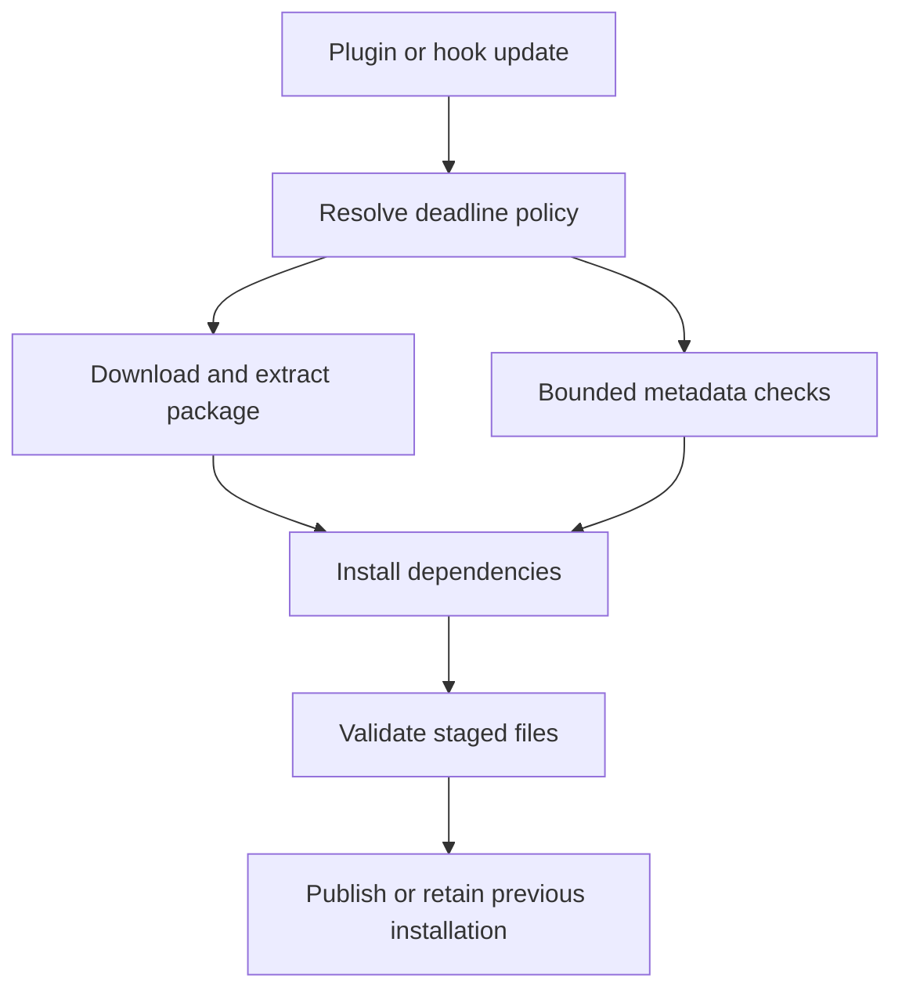

Codex review: blocked before merge. _Reviewed September 19, 2026, 1:09 PM ET / 17:09 UTC._

# ClawSweeper review

## What this changes

The PR separates plugin and hook installation work deadlines from metadata timeouts, allowing updates to finish without an implicit deadline while preserving ordinary installation defaults.

## Merge readiness

⛔ **Blocked before merge - 3 items remain**

The repair remains necessary: current main and the latest release retain the old deadline behavior. No blocking code defect was found, and this maintainer-authored PR remains a useful implementation candidate.

**Priority:** P2
**Reviewed head:** `3f7464f82b0e8062fd16b1bf83a36cdeb59a2b35`

## Review scores

| Measure | Result | What it means |
|---|---|---|
| **Overall readiness** | 🐚 platinum hermit **(4/6)** | A coherent shared-owner repair with useful regression coverage and reported runtime evidence; upgrade qualification is the remaining material readiness gap. |
| **Proof confidence** | 🌊 off-meta tidepool | Not applicable: This MEMBER-authored PR is exempt from the ordinary contributor-proof gate. Its body reports the real registry installer publishing after a 303,312 ms run plus deadline, cancellation, and failure controls; artifact inspection was blocked by reviewer infrastructure. Published-updater qualification remains a separate repository requirement. |
| **Patch quality** | 🐚 platinum hermit **(4/6)** | No actionable review findings were identified. |

## Verification

| Check | Result | Evidence |
|---|---|---|
| **Real behavior** | Not applicable | Not applicable: This MEMBER-authored PR is exempt from the ordinary contributor-proof gate. Its body reports the real registry installer publishing after a 303,312 ms run plus deadline, cancellation, and failure controls; artifact inspection was blocked by reviewer infrastructure. Published-updater qualification remains a separate repository requirement. |
| **Evidence reviewed** | 11 items | Introduced deadline policy: The pinned introduced diff separates workTimeoutMs from timeoutMs, preserves explicit work policy through nested installation, and leaves normal installation defaults intact. Current-main necessity: Current main still applies Math.max(timeoutMs, 300_000) to managed npm installation; the requested separation is absent. Latest-release check: The supplied latest release, v2026.9.5, also retains the five-minute minimum for npm packing. |
| **Findings** | None | None. |
| **Security** | None | None. |

## How this fits together

Plugin and hook installers acquire packages from npm, Git, or archives, validate them, and publish replacement files. Their shared deadline policy controls acquisition and dependency work before publication.

## Before merge

- [ ] **Resolve merge risk (P1)** - Published-updater compatibility remains unqualified: shared update defaults change, but the available evidence does not establish completion and preservation of existing operator state through the installed updater.
- [ ] **Resolve merge risk (P1)** - The reviewer could not independently inspect the linked runtime artifacts because video tooling and artifact-host access were unavailable.
- [ ] **Complete next step (P2)** - Record the pending published-updater × candidate compatibility result, including preservation of existing plugin and hook state.

<strong>Agent review details</strong>

### Security

None.

### PR surface

Source +94, Tests +431. Total +525 across 24 files.

View PR surface stats

| Area | Files | Added | Removed | Net |
|---|---:|---:|---:|---:|
| Source | 16 | 139 | 45 | +94 |
| Tests | 8 | 889 | 458 | +431 |
| Docs | 0 | 0 | 0 | 0 |
| Config | 0 | 0 | 0 | 0 |
| Generated | 0 | 0 | 0 | 0 |
| Other | 0 | 0 | 0 | 0 |
| **Total** | **24** | **1028** | **503** | **+525** |

### Review metrics

| Metric | Value | Why it matters |
|---|---|---|
| **Production versus test growth** | Production net +94 lines; tests net +431 lines | Production growth carries one policy through existing installers; test growth includes moved peer-repair coverage and deadline controls. |

### Merge-risk options

**Maintainer options:**
1. **Complete upgrade qualification (recommended)**  
   Record the published updater reaching this candidate with existing plugin and hook state preserved before landing the changed deadline defaults.

### Technical review

Best possible solution:

Keep one shared work-deadline policy, preserve bounded probes and safe publication, and establish compatibility with existing installations through the published updater.

Do we have a high-confidence way to reproduce the issue?

Yes, from source: current main supplies a five-minute work limit when none was requested and expands short explicit limits. The PR reports matching real-child controls; this read-only review did not execute them.

Is this the best way to solve the issue?

Yes. Separating work policy at the shared installer owner addresses the problem without adding user configuration or duplicating timeout decisions; upgrade qualification remains outstanding.

AGENTS.md: found and applied where relevant.

Codex review notes: model internal, reasoning medium; reviewed against [f2dff0dcf9cc](https://github.com/openclaw/openclaw/commit/f2dff0dcf9cca6e11aba8cbdf35a3005027894d3).

### Labels

Label changes:

- add `P2`: This repairs timeouts in a bounded plugin and hook update workflow without evidence of a broader emergency.
- add `merge-risk: 🚨 compatibility`: Shared update deadline defaults change while the repository-required published-updater compatibility qualification remains pending.
- add `rating: 🐚 platinum hermit`: Overall readiness is 🐚 platinum hermit; proof is 🌊 off-meta tidepool and patch quality is 🐚 platinum hermit.
- add `status: 👀 ready for maintainer look`: ClawSweeper has no concrete contributor-facing blocker left for this PR. Not applicable: This MEMBER-authored PR is exempt from the ordinary contributor-proof gate. Its body reports the real registry installer publishing after a 303,312 ms run plus deadline, cancellation, and failure controls; artifact inspection was blocked by reviewer infrastructure. Published-updater qualification remains a separate repository requirement.

Label justifications:

- `P2`: This repairs timeouts in a bounded plugin and hook update workflow without evidence of a broader emergency.
- `merge-risk: 🚨 compatibility`: Shared update deadline defaults change while the repository-required published-updater compatibility qualification remains pending.
- `rating: 🐚 platinum hermit`: Overall readiness is 🐚 platinum hermit; proof is 🌊 off-meta tidepool and patch quality is 🐚 platinum hermit.
- `status: 👀 ready for maintainer look`: ClawSweeper has no concrete contributor-facing blocker left for this PR. Not applicable: This MEMBER-authored PR is exempt from the ordinary contributor-proof gate. Its body reports the real registry installer publishing after a 303,312 ms run plus deadline, cancellation, and failure controls; artifact inspection was blocked by reviewer infrastructure. Published-updater qualification remains a separate repository requirement.

### Evidence

What I checked:

- **Introduced deadline policy:** The pinned introduced diff separates workTimeoutMs from timeoutMs, preserves explicit work policy through nested installation, and leaves normal installation defaults intact. ([`src/infra/install-mode-options.ts:40`](https://github.com/openclaw/openclaw/blob/3f7464f82b0e8062fd16b1bf83a36cdeb59a2b35/src/infra/install-mode-options.ts#L40), [3f7464f82b0e](https://github.com/openclaw/openclaw/commit/3f7464f82b0e8062fd16b1bf83a36cdeb59a2b35))
- **Current-main necessity:** Current main still applies Math.max(timeoutMs, 300_000) to managed npm installation; the requested separation is absent. ([`src/plugins/install-managed-npm.ts:259`](https://github.com/openclaw/openclaw/blob/f2dff0dcf9cca6e11aba8cbdf35a3005027894d3/src/plugins/install-managed-npm.ts#L259), [f2dff0dcf9cc](https://github.com/openclaw/openclaw/commit/f2dff0dcf9cca6e11aba8cbdf35a3005027894d3))
- **Latest-release check:** The supplied latest release, v2026.9.5, also retains the five-minute minimum for npm packing. ([`src/infra/install-source-utils.ts`](https://github.com/openclaw/openclaw/blob/ec9c1a13db8938e5a3eaa51fca2e981cde2395a9/src/infra/install-source-utils.ts), [ec9c1a13db89](https://github.com/openclaw/openclaw/commit/ec9c1a13db8938e5a3eaa51fca2e981cde2395a9))
- **Publication and cancellation remain owned:** Managed npm retries retain the resolved work policy and abort signal. Publication still checks cancellation and existing ownership callbacks; the diff does not alter consent, integrity checks, or rollback authority. ([`src/plugins/install-managed-npm.ts:260`](https://github.com/openclaw/openclaw/blob/3f7464f82b0e8062fd16b1bf83a36cdeb59a2b35/src/plugins/install-managed-npm.ts#L260), [3f7464f82b0e](https://github.com/openclaw/openclaw/commit/3f7464f82b0e8062fd16b1bf83a36cdeb59a2b35))
- **Archive dependency signal:** The changed extraction path maps unbounded work to timeoutMs: 0 and delegates through src/infra/archive.ts to @openclaw/fs-safe/archive, making that dependency's timeout contract directly relevant. ([`src/infra/install-flow.ts:61`](https://github.com/openclaw/openclaw/blob/3f7464f82b0e8062fd16b1bf83a36cdeb59a2b35/src/infra/install-flow.ts#L61), [3f7464f82b0e](https://github.com/openclaw/openclaw/commit/3f7464f82b0e8062fd16b1bf83a36cdeb59a2b35))
- **Published extraction contract verified:** Inspected the published @openclaw/fs-safe 0.13.1 package in memory. Its archive deadline owner disables the elapsed timer for timeoutMs &lt;= 0 and retains mutation settlement. npm metadata identifies openclaw/fs-safe as its repository; no source commit was supplied.

Likely related people:

- **steipete:** Suggested for follow-up; no historical authorship or introduction is verified. (role: unverified routing candidate; confidence: low)

### Rank-up moves

Optional improvements that raise the rating; they are not merge blockers.

- Add the acknowledged published-updater × candidate compatibility result using existing plugin and hook state.

### Rating scale

| Score | Internal tier | Crab rank | Meaning |
|---:|:---:|---|---|
| **6/6** | S | 🦀 challenger crab | Exceptional readiness |
| **5/6** | A | 🦞 diamond lobster | Very strong readiness |
| **4/6** | B | 🐚 platinum hermit | Good normal PR; ordinary maintainer review |
| **3/6** | C | 🦐 gold shrimp | Useful, but confidence is limited |
| **2/6** | D | 🦪 silver shellfish | Proof or implementation needs work |
| **1/6** | F | 🧂 unranked krab | Not merge-ready |
| N/A | NA | 🌊 off-meta tidepool | Rating does not apply |

Overall follows the weaker of proof and patch quality.
Shiny media proof means a screenshot, video, or linked artifact directly shows the changed behavior. Runtime, network, CSP, and security claims still need visible diagnostics.

### Workflow

- ClawSweeper keeps one durable marker-backed review comment per issue or PR.
- Re-runs edit this comment so the latest verdict, findings, and automation markers stay together instead of adding duplicate bot comments.
- A fresh review can be triggered by eligible `@clawsweeper re-review` comments, exact-item GitHub events, scheduled/background review runs, or manual workflow dispatch.
- PR/issue authors and users with repository write access can comment `@clawsweeper re-review` or `@clawsweeper re-run` on an open PR or issue to request a fresh review only.
- Maintainers can also comment `@clawsweeper review` to request a fresh review only.
- Fresh-review commands do not start repair, autofix, rebase, CI repair, or automerge.
- Maintainer-only repair and merge flows require explicit commands such as `@clawsweeper autofix`, `@clawsweeper automerge`, `@clawsweeper fix ci`, or `@clawsweeper address review`.
- Maintainers can comment `@clawsweeper explain` to ask for more context, or `@clawsweeper stop` to stop active automation.

<!-- clawsweeper-verdict:needs-human item=153043 sha=3f7464f82b0e8062fd16b1bf83a36cdeb59a2b35 confidence=high updated_at=2026-09-19T17:05:48Z reviewed_at=2026-09-19T17:09:40.498Z lease_owner=github-run-35456913827-1 lease_comment_id=5743757340 source_revision=9d7b904926bab4e027b45b32d14161484fa6bbad34de06723f54910ca46f5439 live_verification=absent -->
<!-- clawsweeper-review-state:blocked item=153043 sha=3f7464f82b0e8062fd16b1bf83a36cdeb59a2b35 v=1 -->

<!-- clawsweeper-review-version item=153043 reviewed_at=2026-09-19T17:09:40.498Z sha=3f7464f82b0e8062fd16b1bf83a36cdeb59a2b35 source_revision=9d7b904926bab4e027b45b32d14161484fa6bbad34de06723f54910ca46f5439 lease_owner=github-run-35456913827-1 lease_comment_id=5743757340 v=1 -->

<!-- clawsweeper-review item=153043 -->