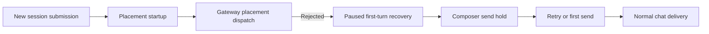

Codex review: needs changes before merge. _Reviewed August 28, 2026, 2:43 AM ET / 06:43 UTC._

# ClawSweeper review

## What this changes

The PR retains the initial prompt, attachments, target, and retry state after cloud placement startup failures instead of discarding them.

## Regression provenance

Possible regression — suspected (reviewed change). No predecessor PR is attributed.

## Merge readiness

⚠️ **Ready for maintainer review - 3 items remain**

Keep open: the introduced composer predicate can re-enable offline sending after a paused first-turn failure, allowing a later message to queue ahead of the retained initial turn.

**Priority:** P1
**Reviewed head:** `79b3a8671c94fc1fe424d003238bac2c9623994c`

## Review scores

| Measure | Result | What it means |
|---|---|---|
| **Overall readiness** | 🦐 gold shrimp **(3/6)** | The patch addresses the documented retention failure but has a reachable first-send ordering regression on reconnect. |
| **Proof confidence** | 🐚 platinum hermit **(4/6)** | Not applicable: This maintainer-authored PR supplies detailed isolated Gateway/browser evidence; its visual attachments could not be fetched during the review. |
| **Patch quality** | 🦐 gold shrimp **(3/6)** | 1 actionable review finding remain. |

## Verification

| Check | Result | Evidence |
|---|---|---|
| **Real behavior** | Not applicable | Not applicable: This maintainer-authored PR supplies detailed isolated Gateway/browser evidence; its visual attachments could not be fetched during the review. |
| **Evidence reviewed** | 7 items | Documented first-send contract: Control UI documentation says a rejected initial send retains the prompt and error for retry, and says normal sending remains disabled while the unresolved startup flow is active. Introduced trigger: The PR changes the composer gate to treat only a non-null exposed placement recovery as pending; recovery exposure becomes null after a connection or credential-scope change. Causal recovery boundary: The startup owner preserves a paused first turn but returns null when the active Gateway connection or scope is no longer current, so the changed composer condition loses its send hold after disconnect. |
| **Findings** | 1 actionable finding | [P1] Keep ordinary sending blocked while paused recovery is disconnected |
| **Security** | None | None. |

## How this fits together

The Control UI creates a session, dispatches its cloud placement through the Gateway, and sends the initial prompt only after placement is active. Placement recovery preserves that first turn on failure and controls when normal chat sending may resume.

## Before merge

- [ ] **Keep ordinary sending blocked while paused recovery is disconnected (P1)** - A paused first turn is hidden when the Gateway connection changes because recovery exposure becomes `null`, so this new predicate enables the offline composer. That composer can queue another normal message for reconnect before the retained first turn is resolved, violating the first-send hold and allowing delivery out of order. Preserve the unresolved-startup hold independently of exposing recovery content across credential changes, and cover disconnect → offline submit → reconnect.
- [ ] **Resolve merge risk (P1)** - If merged unchanged, disconnecting after a paused placement rejection permits a normal offline message to queue for reconnect before the retained first turn is retried or resolved.
- [ ] **Complete next step (P2)** - A narrow owner-boundary repair and regression test can resolve the blocking reconnect ordering defect.

## Findings

- [P1] Keep ordinary sending blocked while paused recovery is disconnected — `ui/src/pages/chat/chat-pane-render.ts:389`

<strong>Agent review details</strong>

### Security

None.

### PR surface

Source +259, Tests +620, Docs +4. Total +883 across 26 files.

View PR surface stats

| Area | Files | Added | Removed | Net |
|---|---:|---:|---:|---:|
| Source | 15 | 525 | 266 | +259 |
| Tests | 10 | 899 | 279 | +620 |
| Docs | 1 | 5 | 1 | +4 |
| Config | 0 | 0 | 0 | 0 |
| Generated | 0 | 0 | 0 | 0 |
| Other | 0 | 0 | 0 | 0 |
| **Total** | **26** | **1429** | **546** | **+883** |

### Review metrics

| Metric | Value | Why it matters |
|---|---|---|
| **Production versus test delta** | production +155 net; tests/test support +724 net; docs +4 net | The production growth is attributable to paused recovery and receipt reconciliation, but the new first-send ordering path needs correction before merge. |

### Stored data model

Persistent data-model change detected: `serialized state: ui/src/app/session-placement-startup.runtime.ts`, `serialized state: ui/src/app/session-placement-startup.test-support.ts`, `serialized state: ui/src/app/session-placement-startup.ts`, `serialized state: ui/src/lib/sessions/session-placement-recovery.ts`, `serialized state: ui/src/lib/sessions/session-placement-startup.ts`, `serialized state: ui/src/lib/sessions/session-placement-submit.ts`, and 7 more. Confirm migration or upgrade compatibility proof before merge.

### Root-cause cluster

Relationship: `fixed_by_candidate`
Canonical: https://github.com/openclaw/openclaw/issues/131452
Summary: This PR is the candidate repair for the reported loss of the initial cloud-session turn after placement rejection.

Members:
- `canonical`: https://github.com/openclaw/openclaw/issues/131452 - It reports the same loss of initial prompt and attachments on definitive startup rejection.

Proposal only: this assessment does not dispatch repair, suppress jobs, mutate sibling items, close, or merge anything.

### Merge-risk options

**Maintainer options:**
1. **Preserve the first-turn hold across disconnects (recommended)**  
   Repair the composer/startup boundary and add a paused-failure → offline-submit → reconnect regression before merge.

### Technical review

Best possible solution:

Keep an unresolved-first-turn send hold independent of whether credential-scoped recovery content may be exposed, and prove reconnect cannot queue or send later input first.

Do we have a high-confidence way to reproduce the issue?

Yes—source establishes the paused-recovery, disconnect, offline-submit, and reconnect path, although this read-only review did not execute it.

Is this the best way to solve the issue?

No—the paused-recovery approach addresses the reported loss, but the new gate breaks first-turn ordering when the connection changes.

Full review comments:

- [P1] Keep ordinary sending blocked while paused recovery is disconnected — `ui/src/pages/chat/chat-pane-render.ts:389`
  A paused first turn is hidden when the Gateway connection changes because recovery exposure becomes `null`, so this new predicate enables the offline composer. That composer can queue another normal message for reconnect before the retained first turn is resolved, violating the first-send hold and allowing delivery out of order. Preserve the unresolved-startup hold independently of exposing recovery content across credential changes, and cover disconnect → offline submit → reconnect.
  Confidence: 0.94

Overall correctness: patch is incorrect
Overall confidence: 0.94

AGENTS.md: found and applied where relevant.

Codex review notes: model internal, reasoning high; reviewed against [e171f2035bf2](https://github.com/openclaw/openclaw/commit/e171f2035bf2b84dd2ba6c57f06903f005484bc0).

### Labels

Label changes:

- add `P1`: A first-session message can be bypassed by a later queued message during a common disconnect-and-reconnect path.
- add `merge-risk: 🚨 message-delivery`: The introduced gate can let ordinary delivery resume while the retained initial submission remains unresolved.
- add `proof: 📸 screenshot`: Contributor real behavior proof includes screenshot evidence. This maintainer-authored PR supplies detailed isolated Gateway/browser evidence; its visual attachments could not be fetched during the review.
- add `rating: 🦐 gold shrimp`: Overall readiness is 🦐 gold shrimp; proof is 🐚 platinum hermit and patch quality is 🦐 gold shrimp.
- add `status: ⏳ waiting on author`: ClawSweeper has contributor-facing work open and is waiting for author action. Not applicable: This maintainer-authored PR supplies detailed isolated Gateway/browser evidence; its visual attachments could not be fetched during the review.

Label justifications:

- `P1`: A first-session message can be bypassed by a later queued message during a common disconnect-and-reconnect path.
- `merge-risk: 🚨 message-delivery`: The introduced gate can let ordinary delivery resume while the retained initial submission remains unresolved.
- `rating: 🦐 gold shrimp`: Overall readiness is 🦐 gold shrimp; proof is 🐚 platinum hermit and patch quality is 🦐 gold shrimp.
- `status: ⏳ waiting on author`: ClawSweeper has contributor-facing work open and is waiting for author action. Not applicable: This maintainer-authored PR supplies detailed isolated Gateway/browser evidence; its visual attachments could not be fetched during the review.
- `proof: 📸 screenshot`: Contributor real behavior proof includes screenshot evidence. This maintainer-authored PR supplies detailed isolated Gateway/browser evidence; its visual attachments could not be fetched during the review.

### Evidence

Acceptance criteria:

- [P1] Run focused session-placement delivery and recovery tests including disconnect → offline submit → reconnect.
- [P1] Run the mocked Gateway browser failure scenario and confirm the composer remains blocked until the retained first turn resolves.

What I checked:

- **Documented first-send contract:** Control UI documentation says a rejected initial send retains the prompt and error for retry, and says normal sending remains disabled while the unresolved startup flow is active. Public docs: [`docs/web/control-ui.md`](https://docs.openclaw.ai/web/control-ui). ([`docs/web/control-ui.md:277`](https://docs.openclaw.ai/web/control-ui), [79b3a8671c94](https://github.com/openclaw/openclaw/commit/79b3a8671c94))
- **Introduced trigger:** The PR changes the composer gate to treat only a non-null exposed placement recovery as pending; recovery exposure becomes null after a connection or credential-scope change. ([`ui/src/pages/chat/chat-pane-render.ts:389`](https://github.com/openclaw/openclaw/blob/d50dd4f71d83/ui/src/pages/chat/chat-pane-render.ts#L389), [d50dd4f71d83](https://github.com/openclaw/openclaw/commit/d50dd4f71d83))
- **Causal recovery boundary:** The startup owner preserves a paused first turn but returns null when the active Gateway connection or scope is no longer current, so the changed composer condition loses its send hold after disconnect. ([`ui/src/app/session-placement-startup.runtime.ts:341`](https://github.com/openclaw/openclaw/blob/d50dd4f71d83/ui/src/app/session-placement-startup.runtime.ts#L341), [d50dd4f71d83](https://github.com/openclaw/openclaw/commit/d50dd4f71d83))
- **Reachable later-send path:** The composer permits ordinary non-slash input while disconnected, and delivery queues it for reconnect; that later input can therefore bypass the unresolved first turn. ([`ui/src/pages/chat/components/chat-composer.ts:288`](https://github.com/openclaw/openclaw/blob/79b3a8671c94/ui/src/pages/chat/components/chat-composer.ts#L288), [79b3a8671c94](https://github.com/openclaw/openclaw/commit/79b3a8671c94))
- **Coverage gap:** Existing focused delivery and browser failure tests cover retained recovery and retry while connected, but not paused failure followed by disconnect, offline ordinary submit, and reconnect. ([`ui/src/app/session-placement-startup.delivery.test.ts:107`](https://github.com/openclaw/openclaw/blob/79b3a8671c94/ui/src/app/session-placement-startup.delivery.test.ts#L107), [79b3a8671c94](https://github.com/openclaw/openclaw/commit/79b3a8671c94))
- **History and current-main status:** The candidate functional commit is not an ancestor of fetched main, while the merged placement-lifecycle history identifies the same owner area; the requested repair is still unmerged. ([`ui/src/app/session-placement-startup.runtime.ts:1`](https://github.com/openclaw/openclaw/blob/d50dd4f71d83/ui/src/app/session-placement-startup.runtime.ts#L1), [d50dd4f71d83](https://github.com/openclaw/openclaw/commit/d50dd4f71d83))

Likely related people:

- **steipete:** Authored the current repair and the merged Cloud Worker and generalized placement-startup work that established this lifecycle. (role: feature owner and recent area contributor; confidence: high; commits: [d50dd4f71d83](https://github.com/openclaw/openclaw/commit/d50dd4f71d83b07bf25dd23b9081e956ece01fb4), [b81946d6af92](https://github.com/openclaw/openclaw/commit/b81946d6af92eaf98f213e369d8694b9fe9a767f), [a8bc60a119b8](https://github.com/openclaw/openclaw/commit/a8bc60a119b8e50e2a4228847e11a4460d34c01c); files: `ui/src/app/session-placement-startup.runtime.ts`, `ui/src/pages/chat/chat-pane-render.ts`)

### Rank-up moves

Optional improvements that raise the rating; they are not merge blockers.

- Preserve the initial-send hold across disconnection and add a paused-failure → offline-submit → reconnect regression.

### Rating scale

| Score | Internal tier | Crab rank | Meaning |
|---:|:---:|---|---|
| **6/6** | S | 🦀 challenger crab | Exceptional readiness |
| **5/6** | A | 🦞 diamond lobster | Very strong readiness |
| **4/6** | B | 🐚 platinum hermit | Good normal PR; ordinary maintainer review |
| **3/6** | C | 🦐 gold shrimp | Useful, but confidence is limited |
| **2/6** | D | 🦪 silver shellfish | Proof or implementation needs work |
| **1/6** | F | 🧂 unranked krab | Not merge-ready |
| N/A | NA | 🌊 off-meta tidepool | Rating does not apply |

Overall follows the weaker of proof and patch quality.
Shiny media proof means a screenshot, video, or linked artifact directly shows the changed behavior. Runtime, network, CSP, and security claims still need visible diagnostics.

### Workflow

- ClawSweeper keeps one durable marker-backed review comment per issue or PR.
- Re-runs edit this comment so the latest verdict, findings, and automation markers stay together instead of adding duplicate bot comments.
- A fresh review can be triggered by eligible `@clawsweeper re-review` comments, exact-item GitHub events, scheduled/background review runs, or manual workflow dispatch.
- PR/issue authors and users with repository write access can comment `@clawsweeper re-review` or `@clawsweeper re-run` on an open PR or issue to request a fresh review only.
- Maintainers can also comment `@clawsweeper review` to request a fresh review only.
- Fresh-review commands do not start repair, autofix, rebase, CI repair, or automerge.
- Maintainer-only repair and merge flows require explicit commands such as `@clawsweeper autofix`, `@clawsweeper automerge`, `@clawsweeper fix ci`, or `@clawsweeper address review`.
- Maintainers can comment `@clawsweeper explain` to ask for more context, or `@clawsweeper stop` to stop active automation.

<!-- clawsweeper-verdict:needs-human item=131594 sha=79b3a8671c94fc1fe424d003238bac2c9623994c confidence=high updated_at=2026-08-28T06:39:06Z reviewed_at=2026-08-28T06:43:24.860Z lease_owner=github-run-33148475668-1 lease_comment_id=5449308153 source_revision=9df475cf036369aebb782183767ef17f08f6f51035933e02b1a8f698c459b232 live_verification=absent -->

<!-- clawsweeper-review-version item=131594 reviewed_at=2026-08-28T06:43:24.860Z sha=79b3a8671c94fc1fe424d003238bac2c9623994c source_revision=9df475cf036369aebb782183767ef17f08f6f51035933e02b1a8f698c459b232 lease_owner=github-run-33148475668-1 lease_comment_id=5449308153 v=1 -->

<!-- clawsweeper-review item=131594 -->