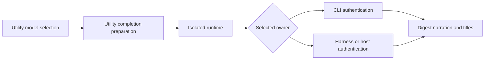

Codex review: needs maintainer review before merge. _Reviewed September 1, 2026, 9:10 PM ET / September 2, 2026, 01:10 UTC._

# ClawSweeper review

## What this changes

The PR routes session digests, progress narration, and tool-call titles through the selected isolated runtime instead of directly preparing provider HTTP credentials.

## Regression provenance

Possible regression — probable (reproduction; reviewed change). No predecessor PR is attributed.

## Merge readiness

⚠️ **Ready for maintainer review - 2 items remain**

No blocking correctness finding: the patch moves the affected callers onto the existing isolated-completion owner and preserves the observer’s two-attempt JSON recovery. This maintainer-authored PR remains open for normal exact-head CI completion.

**Priority:** P2
**Reviewed head:** `5ff350f21705deb1a8b1972a3420c5a15bb9a433`

## Review scores

| Measure | Result | What it means |
|---|---|---|
| **Overall readiness** | 🐚 platinum hermit **(4/6)** | The patch is a focused, net-negative owner-boundary repair with strong native CLI evidence and targeted regression coverage. |
| **Proof confidence** | 🦞 diamond lobster **(5/6)** | Not applicable: This maintainer-authored PR is exempt from the external-contributor proof gate; its supplied redacted terminal traces nevertheless show both legacy and canonical Claude selections reaching the CLI owner with zero direct Anthropic requests. |
| **Patch quality** | 🐚 platinum hermit **(4/6)** | No actionable review findings were identified. |

## Verification

| Check | Result | Evidence |
|---|---|---|
| **Real behavior** | Not applicable | Not applicable: This maintainer-authored PR is exempt from the external-contributor proof gate; its supplied redacted terminal traces nevertheless show both legacy and canonical Claude selections reaching the CLI owner with zero direct Anthropic requests. |
| **Evidence reviewed** | 6 items | Current-main behavior: Current main canonicalizes a CLI provider but does not preserve it as the isolated runtime override, while the session observer still constructs the old prepared direct-completion request. Canonical repair path: The new utility preparation retains model/profile identity and requests strict visible output; isolated completion preserves the explicit CLI owner after canonicalization before selecting CLI versus harness execution. Observer regression coverage: The introduced observer test covers legacy CLI and canonical Anthropic selections, verifies no direct completion call, retains the empty-output retry, and observes digest publication. |
| **Findings** | None | None. |
| **Security** | None | None. |

## How this fits together

Utility completions turn session activity into short model requests for Gateway digests, progress narration, and Control UI tool titles. Model selection feeds the isolated runtime, which selects CLI, harness, or host authentication before returning text to those callers.

## Before merge

- [ ] **Resolve merge risk (P1)** - Merging changes the authentication and execution owner for existing utility-model selections; exact-head CI should complete before landing to catch provider or harness integration regressions beyond the covered Claude CLI route.
- [ ] **Complete next step (P2)** - No discrete repair remains; this maintainer-owned PR should proceed through its normal exact-head CI gate.

<strong>Agent review details</strong>

### Security

None.

### PR surface

Source -76, Tests +139, Docs +2. Total +65 across 21 files.

View PR surface stats

| Area | Files | Added | Removed | Net |
|---|---:|---:|---:|---:|
| Source | 9 | 97 | 173 | -76 |
| Tests | 10 | 230 | 91 | +139 |
| Docs | 2 | 3 | 1 | +2 |
| Config | 0 | 0 | 0 | 0 |
| Generated | 0 | 0 | 0 | 0 |
| Other | 0 | 0 | 0 | 0 |
| **Total** | **21** | **330** | **265** | **+65** |

### Review metrics

| Metric | Value | Why it matters |
|---|---|---|
| **Production versus test LOC** | production +97/-173; tests +230/-91; docs +3/-1 | The repair is net-negative in production code while adding boundary coverage for the affected utility callers. |

### Merge-risk options

**Maintainer options:**
1. **Land with selected-runtime authentication (recommended)**  
   Accept the intentional utility-authentication boundary change after exact-head CI confirms the existing provider and harness matrix remains green.
2. **Keep direct-only utility transport**  
   Do not merge if maintainers instead want CLI-backed utility selections filtered rather than executed by their selected runtime.

### Technical review

Best possible solution:

Keep isolated completion as the single tool-free utility execution owner, retaining caller-owned output recovery and direct simple completion only for its non-runtime consumers.

Do we have a high-confidence way to reproduce the issue?

Yes—source reproducible: current main canonicalizes the CLI model provider without retaining its execution owner, and the supplied before/after native CLI trace covers both legacy and canonical selection forms.

Is this the best way to solve the issue?

Yes—the existing tool-free isolated runtime already owns CLI, harness, and host authentication, making it a cleaner repair than rejecting a selectable CLI utility model in the picker.

AGENTS.md: found and applied where relevant.

Codex review notes: model internal, reasoning high; reviewed against [76352df39304](https://github.com/openclaw/openclaw/commit/76352df3930424aac2dbdf55f03ba21f7eabe571).

### Labels

Label changes:

- add `rating: 🐚 platinum hermit`: Overall readiness is 🐚 platinum hermit; proof is 🦞 diamond lobster and patch quality is 🐚 platinum hermit.
- add `status: 👀 ready for maintainer look`: ClawSweeper has no concrete contributor-facing blocker left for this PR. Not applicable: This maintainer-authored PR is exempt from the external-contributor proof gate; its supplied redacted terminal traces nevertheless show both legacy and canonical Claude selections reaching the CLI owner with zero direct Anthropic requests.
- remove `rating: 🦐 gold shrimp`: Current PR rating is `rating: 🐚 platinum hermit`, so this older rating label is no longer current.
- remove `status: ⏳ waiting on author`: Current PR status label is `status: 👀 ready for maintainer look`.

Label justifications:

- `P2`: This is a bounded fix for utility-model routing and does not indicate an emergency runtime outage.
- `merge-risk: 🚨 auth-provider`: Existing utility selections now obtain authentication from the selected CLI or harness runtime rather than the direct transport.
- `rating: 🐚 platinum hermit`: Overall readiness is 🐚 platinum hermit; proof is 🦞 diamond lobster and patch quality is 🐚 platinum hermit.
- `status: 👀 ready for maintainer look`: ClawSweeper has no concrete contributor-facing blocker left for this PR. Not applicable: This maintainer-authored PR is exempt from the external-contributor proof gate; its supplied redacted terminal traces nevertheless show both legacy and canonical Claude selections reaching the CLI owner with zero direct Anthropic requests.

### Evidence

What I checked:

- **Current-main behavior:** Current main canonicalizes a CLI provider but does not preserve it as the isolated runtime override, while the session observer still constructs the old prepared direct-completion request. ([`src/agents/isolated-completion.ts:426`](https://github.com/openclaw/openclaw/blob/76352df3930424aac2dbdf55f03ba21f7eabe571/src/agents/isolated-completion.ts#L426), [76352df39304](https://github.com/openclaw/openclaw/commit/76352df3930424aac2dbdf55f03ba21f7eabe571))
- **Canonical repair path:** The new utility preparation retains model/profile identity and requests strict visible output; isolated completion preserves the explicit CLI owner after canonicalization before selecting CLI versus harness execution. ([`src/agents/utility-completion.ts:9`](https://github.com/openclaw/openclaw/blob/5ff350f21705deb1a8b1972a3420c5a15bb9a433/src/agents/utility-completion.ts#L9), [5ff350f21705](https://github.com/openclaw/openclaw/commit/5ff350f21705deb1a8b1972a3420c5a15bb9a433))
- **Observer regression coverage:** The introduced observer test covers legacy CLI and canonical Anthropic selections, verifies no direct completion call, retains the empty-output retry, and observes digest publication. ([`src/gateway/session-observer-preparation.test.ts:38`](https://github.com/openclaw/openclaw/blob/5ff350f21705deb1a8b1972a3420c5a15bb9a433/src/gateway/session-observer-preparation.test.ts#L38), [5ff350f21705](https://github.com/openclaw/openclaw/commit/5ff350f21705deb1a8b1972a3420c5a15bb9a433))
- **Prior finding addressed:** The current head supplies strict-visible output policy through utility preparation, and the observer still retries invalid or empty parsed output once before failing. ([`src/gateway/session-observer-completion.ts:63`](https://github.com/openclaw/openclaw/blob/5ff350f21705deb1a8b1972a3420c5a15bb9a433/src/gateway/session-observer-completion.ts#L63), [5ff350f21705](https://github.com/openclaw/openclaw/commit/5ff350f21705deb1a8b1972a3420c5a15bb9a433))
- **Codex contract inspection:** The directly inspected sibling Codex source accepts explicitly empty environments and dynamic tools, while the OpenClaw Codex bounded turn supplies both empty arrays for isolated completions. The sibling checkout is cache-backed, so its upstream repository ownership could not be independently verified. (`codex-rs/app-server/src/request_processors/thread_processor.rs:1402`, `78c290807ce710180111df227df3b7a4fe845452`)
- **Current-main and release check:** The PR head is not contained by local main or any local release tag; the reported defect is therefore not already fixed on current main or shipped by this branch. ([76352df39304](https://github.com/openclaw/openclaw/commit/76352df3930424aac2dbdf55f03ba21f7eabe571))

Likely related people:

- **steipete:** Suggested for follow-up; no historical authorship or introduction is verified. (role: unverified routing candidate; confidence: low)
- **Josh Avant:** Suggested for follow-up; no historical authorship or introduction is verified. (role: unverified routing candidate; confidence: low)
- **Vincent Koc:** Suggested for follow-up; no historical authorship or introduction is verified. (role: unverified routing candidate; confidence: low)

### Rank-up moves

Optional improvements that raise the rating; they are not merge blockers.

- Let exact-head CI finish green before landing.

### Rating scale

| Score | Internal tier | Crab rank | Meaning |
|---:|:---:|---|---|
| **6/6** | S | 🦀 challenger crab | Exceptional readiness |
| **5/6** | A | 🦞 diamond lobster | Very strong readiness |
| **4/6** | B | 🐚 platinum hermit | Good normal PR; ordinary maintainer review |
| **3/6** | C | 🦐 gold shrimp | Useful, but confidence is limited |
| **2/6** | D | 🦪 silver shellfish | Proof or implementation needs work |
| **1/6** | F | 🧂 unranked krab | Not merge-ready |
| N/A | NA | 🌊 off-meta tidepool | Rating does not apply |

Overall follows the weaker of proof and patch quality.
Shiny media proof means a screenshot, video, or linked artifact directly shows the changed behavior. Runtime, network, CSP, and security claims still need visible diagnostics.

### Workflow

- ClawSweeper keeps one durable marker-backed review comment per issue or PR.
- Re-runs edit this comment so the latest verdict, findings, and automation markers stay together instead of adding duplicate bot comments.
- A fresh review can be triggered by eligible `@clawsweeper re-review` comments, exact-item GitHub events, scheduled/background review runs, or manual workflow dispatch.
- PR/issue authors and users with repository write access can comment `@clawsweeper re-review` or `@clawsweeper re-run` on an open PR or issue to request a fresh review only.
- Maintainers can also comment `@clawsweeper review` to request a fresh review only.
- Fresh-review commands do not start repair, autofix, rebase, CI repair, or automerge.
- Maintainer-only repair and merge flows require explicit commands such as `@clawsweeper autofix`, `@clawsweeper automerge`, `@clawsweeper fix ci`, or `@clawsweeper address review`.
- Maintainers can comment `@clawsweeper explain` to ask for more context, or `@clawsweeper stop` to stop active automation.

### History

Review history (2 earlier review cycles)

<!-- clawsweeper-review-history v=1 total=2 -->
- reviewed 2026-09-02T00:33:06.847Z sha 27044006304e7a1bfd1ae2f12312c2baa1f13789 :: found issues before merge. :: [P2] Preserve the observer retry on empty completion output
- reviewed 2026-09-02T00:53:08.294Z sha fa9e3e9b91c8b8138a9f9c6e9f508c7b7a117f14 :: needs changes before merge. :: [P2] Preserve retry after empty isolated output

<!-- clawsweeper-verdict:needs-human item=135711 sha=5ff350f21705deb1a8b1972a3420c5a15bb9a433 confidence=high updated_at=2026-09-02T01:06:05Z reviewed_at=2026-09-02T01:10:00.114Z lease_owner=github-run-33577918309-1 lease_comment_id=5502786039 source_revision=26603160c6d2a75e03be4a4827da3309515a994a488a6ce44c1184a06b524bd6 live_verification=absent -->

<!-- clawsweeper-review-version item=135711 reviewed_at=2026-09-02T01:10:00.114Z sha=5ff350f21705deb1a8b1972a3420c5a15bb9a433 source_revision=26603160c6d2a75e03be4a4827da3309515a994a488a6ce44c1184a06b524bd6 lease_owner=github-run-33577918309-1 lease_comment_id=5502786039 v=1 -->

<!-- clawsweeper-review item=135711 -->