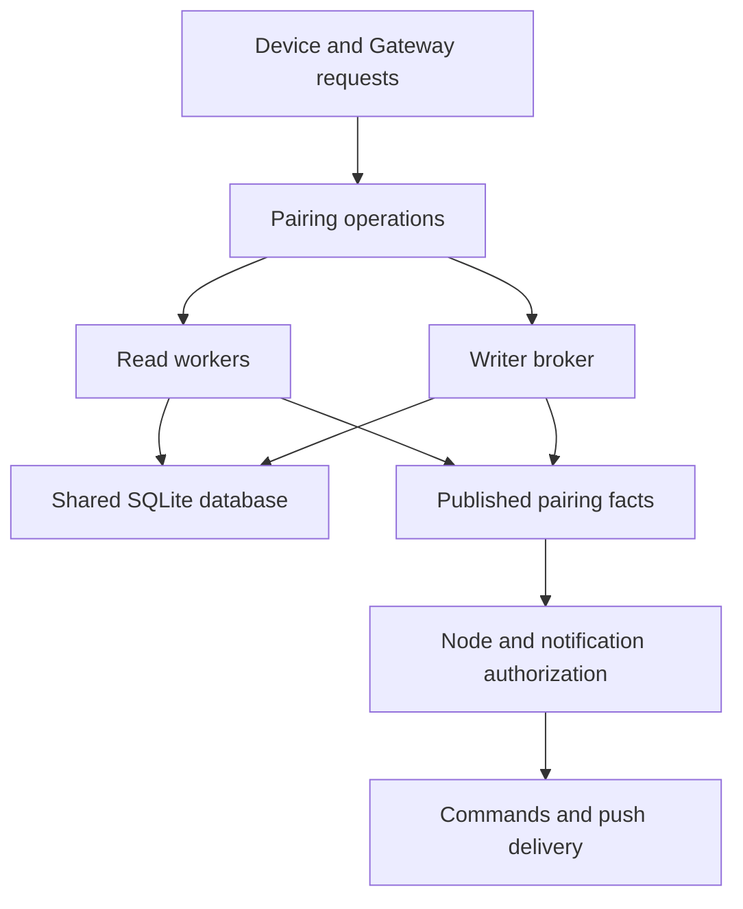

Codex review: blocked before merge. _Reviewed September 21, 2026, 8:38 AM ET / 12:38 UTC (Revision 8)._

# ClawSweeper review

## What this changes

Moves device-pairing database reads and writes into existing workers and updates node, notification, and prompt consumers to use asynchronously prepared pairing facts.

## Regression provenance

Possible regression — suspected (reviewed change). No predecessor PR is attributed.

## Merge readiness

⛔ **Blocked before merge - 5 items remain**

The worker migration remains useful and is not implemented on current main. The previously reported cancellation blocker remains in the pinned head, so this PR is not ready to merge.

**Priority:** P2
**Reviewed head:** `c702551d87dd9498b21a4e50497334bfee02ee80`

## Review scores

| Measure | Result | What it means |
|---|---|---|
| **Overall readiness** | 🦐 gold shrimp **(3/6)** | Substantial implementation and validation support the migration, but the unresolved cancellation regression blocks readiness. |
| **Proof confidence** | 🌊 off-meta tidepool | Not applicable: The ordinary contributor proof gate does not apply to this maintainer-authored PR. The matching full body reports real-worker Testbox database coverage and synthetic performance results, explicitly excludes live provider execution, and does not cover the outstanding cancellation race. |
| **Patch quality** | 🦐 gold shrimp **(3/6)** | 1 actionable review finding remain. |

## Verification

| Check | Result | Evidence |
|---|---|---|
| **Real behavior** | Not applicable | Not applicable: The ordinary contributor proof gate does not apply to this maintainer-authored PR. The matching full body reports real-worker Testbox database coverage and synthetic performance results, explicitly excludes live provider execution, and does not cover the outstanding cancellation race. |
| **Evidence reviewed** | 9 items | Introduced cancellation guard: The pinned introduction adds a publication-currentness check to both node event send paths. sendCancel still calls sendEventToSession, so cancellation also passes through this new guard. Unrelated writes temporarily suppress authority: executeDevicePairingMutation calls beginMutation before awaiting worker execution. beginMutation blocks the publication, and getPublishedPairedDeviceBinding throws while blocked; isPublishedPairingCurrent converts that exception to false. Bootstrap issuance and metadata writes use this same path even when the running node's binding does not change. Cancellation cannot recover after a suppressed send: Abort, hard timeout, and idle timeout take the pending invocation before sending cancellation. takePending deletes the entry and clears timers; sendCancel ignores the send result. Existing node-registry tests establish cancellation delivery as expected behavior, but their cancellation cases do not overlap a blocked pairing publication. |
| **Findings** | 1 actionable finding | [P1] [P1] Preserve cancellation while pairing publication is pending |
| **Security** | None | None. |

## How this fits together

Device pairing records determine which connected devices may execute node commands and receive notifications. The Gateway now obtains those records through database workers and uses published identity bindings to check subsequent operations.

## Before merge

- [ ] **\[P1\] Preserve cancellation while pairing publication is pending (P1)** - The previous blocker remains. Every pairing mutation blocks publication before awaiting its worker, including unrelated bootstrap and metadata writes. During that interval this guard rejects `node.invoke.cancel` from `sendCancel`. Abort and timeout have already deleted the pending invocation and cleared its timers, and the failed send is not retried, so remote work can continue after `ABORTED` or `TIMEOUT`. Preserve teardown delivery to the original pending connection without weakening admission for new work.
- [ ] **Resolve merge risk (P2)** - Remote commands can continue consuming resources or producing effects after the caller receives ABORTED or TIMEOUT when cancellation overlaps an unrelated pairing mutation.
- [ ] **Complete next step (P2)** - Repair the cancellation guard and add focused abort/timeout coverage during pending pairing publication, including replacement-connection exclusion.
- [ ] **Review config compatibility** - Confirm compatibility and upgrade impact for the changed config or default surface before merge.
- [ ] **Add data-model compatibility proof** - Confirm migration or upgrade compatibility proof before merge.

## Findings

- [P1] [P1] Preserve cancellation while pairing publication is pending — `src/gateway/node-registry.ts:1425-1430`

<strong>Agent review details</strong>

### Security

None.

### PR surface

PR surface statistics unavailable: the file list is incomplete.

### Review metrics

| Metric | Value | Why it matters |
|---|---|---|
| **Production versus test growth** | Production net +2,265 lines; tests and test support net +1,110 lines | The stated justification is the worker contract, transaction, and publication cutover; extracted code is included in these net totals. |
| **Reported calling-thread CPU** | Cached lists −71.6%; read-only lists −77.0% | The same-machine synthetic benchmark supports offloading list work, while keyed lookups incur additional worker overhead. |

### Stored data model

Persistent data-model change detected: `serialized state: src/skills/runtime/remote.ts`, `unknown-truncated-pull-files`. Confirm migration or upgrade compatibility proof before merge.

### Merge-risk options

**Maintainer options:**
1. **Preserve invocation teardown (recommended)**  
   Allow cancellation of the original pending invocation during publication gaps while preserving connection replacement checks and strict admission for new work.

### Technical review

Best possible solution:

Keep worker-backed pairing authority while giving invocation teardown a narrowly scoped path bound to the original pending connection.

Do we have a high-confidence way to reproduce the issue?

Yes, source establishes the patch regression: start an invocation, hold an unrelated pairing mutation before publication, then abort or expire the invocation. The cancellation send is rejected after pending state is removed; no runtime reproduction was executed in this read-only review.

Is this the best way to solve the issue?

The existing reader and writer owners are the appropriate migration path, but the blanket event-send guard must distinguish teardown from admission of new work.

Full review comments:

- [P1] [P1] Preserve cancellation while pairing publication is pending — `src/gateway/node-registry.ts:1425-1430`
  The previous blocker remains. Every pairing mutation blocks publication before awaiting its worker, including unrelated bootstrap and metadata writes. During that interval this guard rejects `node.invoke.cancel` from `sendCancel`. Abort and timeout have already deleted the pending invocation and cleared its timers, and the failed send is not retried, so remote work can continue after `ABORTED` or `TIMEOUT`. Preserve teardown delivery to the original pending connection without weakening admission for new work.
  Confidence: 0.99

Overall correctness: patch is incorrect
Overall confidence: 0.97

AGENTS.md: found and applied where relevant.

Codex review notes: model internal, reasoning medium; reviewed against [f914e0f5f86c](https://github.com/openclaw/openclaw/commit/f914e0f5f86cb783ba9a45e55f9d7edb82c082f5).

### Labels

Label justifications:

- `P2`: This is a useful internal performance improvement with a concrete pre-merge regression, not an established urgent production incident.
- `merge-risk: 🚨 availability`: The introduced publication guard can suppress cancellation and leave remote execution running after local settlement.
- `rating: 🦐 gold shrimp`: Overall readiness is 🦐 gold shrimp; proof is 🌊 off-meta tidepool and patch quality is 🦐 gold shrimp.
- `status: ⏳ waiting on author`: ClawSweeper has contributor-facing work open and is waiting for author action. Not applicable: The ordinary contributor proof gate does not apply to this maintainer-authored PR. The matching full body reports real-worker Testbox database coverage and synthetic performance results, explicitly excludes live provider execution, and does not cover the outstanding cancellation race.

### Evidence

What I checked:

- **Introduced cancellation guard:** The pinned introduction adds a publication-currentness check to both node event send paths. sendCancel still calls sendEventToSession, so cancellation also passes through this new guard. ([`src/gateway/node-registry.ts:1428`](https://github.com/openclaw/openclaw/blob/c702551d87dd9498b21a4e50497334bfee02ee80/src/gateway/node-registry.ts#L1428), [c702551d87dd](https://github.com/openclaw/openclaw/commit/c702551d87dd9498b21a4e50497334bfee02ee80))
- **Unrelated writes temporarily suppress authority:** executeDevicePairingMutation calls beginMutation before awaiting worker execution. beginMutation blocks the publication, and getPublishedPairedDeviceBinding throws while blocked; isPublishedPairingCurrent converts that exception to false. Bootstrap issuance and metadata writes use this same path even when the running node's binding does not change. ([`src/infra/device-pairing-publication.ts:127`](https://github.com/openclaw/openclaw/blob/c702551d87dd9498b21a4e50497334bfee02ee80/src/infra/device-pairing-publication.ts#L127), [c702551d87dd](https://github.com/openclaw/openclaw/commit/c702551d87dd9498b21a4e50497334bfee02ee80))
- **Cancellation cannot recover after a suppressed send:** Abort, hard timeout, and idle timeout take the pending invocation before sending cancellation. takePending deletes the entry and clears timers; sendCancel ignores the send result. Existing node-registry tests establish cancellation delivery as expected behavior, but their cancellation cases do not overlap a blocked pairing publication. ([`src/gateway/node-registry.invoke-stream.ts:397`](https://github.com/openclaw/openclaw/blob/c702551d87dd9498b21a4e50497334bfee02ee80/src/gateway/node-registry.invoke-stream.ts#L397), [c702551d87dd](https://github.com/openclaw/openclaw/commit/c702551d87dd9498b21a4e50497334bfee02ee80))
- **Verified merge result retains the defect:** The test merge's raw parents are the pinned base c47c7fb6341c2c6d1ddd653b83d2a4959b6add48 followed by the exact PR head. Comparing its result with that base retains the introduced event-send guard. ([`src/gateway/node-registry.ts:1428`](https://github.com/openclaw/openclaw/blob/f7377c19accac93afaffb083941a87db0a1f147d/src/gateway/node-registry.ts#L1428), [f7377c19acca](https://github.com/openclaw/openclaw/commit/f7377c19accac93afaffb083941a87db0a1f147d))
- **Current main still needs the migration:** Fetched main still resolves synchronous node-binding currentness through loadPairedDevicePairingStoreRecord. Inspection of v2026.9.5 shows that same synchronous path; neither inspected revision contains this worker publication cutover. ([`src/infra/device-pairing-node-state.ts:66`](https://github.com/openclaw/openclaw/blob/f914e0f5f86cb783ba9a45e55f9d7edb82c082f5/src/infra/device-pairing-node-state.ts#L66), [f914e0f5f86c](https://github.com/openclaw/openclaw/commit/f914e0f5f86cb783ba9a45e55f9d7edb82c082f5))
- **Complete captured proof body inspected:** Retrieved the omitted body remainder and verified SHA-256 eb5b7b6a803ddbce7330b23b5518f57bf105029c99c9c4680dce10526e2b1dc9, matching the supplied snapshot. It reports synthetic Testbox benchmarks, real-worker database regressions, mocked Gateway coverage, and subsequent integration repairs; it explicitly reports no live Gateway deployment or provider send. No cancellation-during-publication repair or proof is supplied. ([c702551d87dd](https://github.com/openclaw/openclaw/commit/c702551d87dd9498b21a4e50497334bfee02ee80))

Likely related people:

- **steipete:** Suggested for follow-up; no historical authorship or introduction is verified. (role: unverified routing candidate; confidence: low)
- **Vincent Koc:** Suggested for follow-up; no historical authorship or introduction is verified. (role: unverified routing candidate; confidence: low)

### Rank-up moves

Optional improvements that raise the rating; they are not merge blockers.

- Repair cancellation delivery and verify abort and timeout during an unrelated pairing mutation reach the original invocation while replacement connections remain excluded.

### Rating scale

| Score | Internal tier | Crab rank | Meaning |
|---:|:---:|---|---|
| **6/6** | S | 🦀 challenger crab | Exceptional readiness |
| **5/6** | A | 🦞 diamond lobster | Very strong readiness |
| **4/6** | B | 🐚 platinum hermit | Good normal PR; ordinary maintainer review |
| **3/6** | C | 🦐 gold shrimp | Useful, but confidence is limited |
| **2/6** | D | 🦪 silver shellfish | Proof or implementation needs work |
| **1/6** | F | 🧂 unranked krab | Not merge-ready |
| N/A | NA | 🌊 off-meta tidepool | Rating does not apply |

Overall follows the weaker of proof and patch quality.
Shiny media proof means a screenshot, video, or linked artifact directly shows the changed behavior. Runtime, network, CSP, and security claims still need visible diagnostics.

### Workflow

- ClawSweeper keeps one durable marker-backed review comment per issue or PR.
- Re-runs edit this comment so the latest verdict, findings, and automation markers stay together instead of adding duplicate bot comments.
- A fresh review can be triggered by eligible `@clawsweeper re-review` comments, exact-item GitHub events, scheduled/background review runs, or manual workflow dispatch.
- PR/issue authors and users with repository write access can comment `@clawsweeper re-review` or `@clawsweeper re-run` on an open PR or issue to request a fresh review only.
- Maintainers can also comment `@clawsweeper review` to request a fresh review only.
- Fresh-review commands do not start repair, autofix, rebase, CI repair, or automerge.
- Maintainer-only repair and merge flows require explicit commands such as `@clawsweeper autofix`, `@clawsweeper automerge`, `@clawsweeper fix ci`, or `@clawsweeper address review`.
- Maintainers can comment `@clawsweeper explain` to ask for more context, or `@clawsweeper stop` to stop active automation.

### History

Review history (7 earlier review cycles)

<!-- clawsweeper-review-history v=1 total=7 -->
- reviewed 2026-09-21T09:12:29.558Z sha 01d9cc6a9c2617b05b816ad509bf80e0c7956b9f :: needs real behavior proof before merge. :: none
- reviewed 2026-09-21T09:42:36.847Z sha 6c7bd52b06eebb42e097d1cedd8ef30d3785c64b :: blocked before merge. :: [P2] Give the extracted kernels distinct exported names
- reviewed 2026-09-21T10:31:09.161Z sha 4fa6f5aeedeebb937f5081d0246eb21b024a020d :: blocked before merge. :: [P1] Preserve cancellation while pairing publication is pending
- reviewed 2026-09-21T11:02:35.131Z sha 073f331888563230c53e1ea053113568ab24b526 :: blocked before merge. :: [P1] Preserve cancellation while pairing publication is pending
- reviewed 2026-09-21T11:35:49.075Z sha e212e1f8d6c75047861a4d3bd880d2af79a00c65 :: blocked before merge. :: [P1] Preserve cancellation while pairing publication is pending
- reviewed 2026-09-21T11:50:06.188Z sha 6b1fd3ed3bc0c1beb7349ab75c75141cf018852e :: blocked before merge. :: [P1] [P1] Preserve cancellation while pairing publication is pending
- reviewed 2026-09-21T12:18:38.830Z sha bdd90ae7892f96c6561244dea3e58913edac7891 :: blocked before merge. :: [P1] [P1] Preserve cancellation while pairing publication is pending

<!-- clawsweeper-verdict:needs-human item=154671 sha=c702551d87dd9498b21a4e50497334bfee02ee80 confidence=high updated_at=2026-09-21T12:34:24Z reviewed_at=2026-09-21T12:38:22.078Z lease_owner=github-run-35600044173-1 lease_comment_id=5760557595 source_revision=f21bcd785ecd3d451a413d4d48d1ef6d8d07190ca95c7437c321b2a03a457e4f live_verification=absent -->
<!-- clawsweeper-review-state:blocked item=154671 sha=c702551d87dd9498b21a4e50497334bfee02ee80 v=1 -->

<!-- clawsweeper-review-version item=154671 reviewed_at=2026-09-21T12:38:22.078Z sha=c702551d87dd9498b21a4e50497334bfee02ee80 source_revision=f21bcd785ecd3d451a413d4d48d1ef6d8d07190ca95c7437c321b2a03a457e4f lease_owner=github-run-35600044173-1 lease_comment_id=5760557595 v=1 -->

<!-- clawsweeper-review item=154671 -->