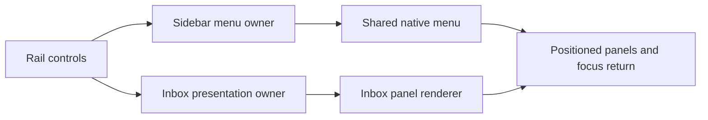

Codex review: needs maintainer review before merge.

## What this changes

This PR opens desktop rail agent, profile, and Inbox menus beside their controls with an eight-pixel gap.

**Example:** Open the agent menu in the 1280 × 900 desktop Control UI.
- **Before:** The menu starts at x=8 and covers nearby rail controls.
- **After:** The menu starts at x=60, eight pixels beyond the rail, leaving its controls visible.

## Review scores

| Measure | Result | What it means |
|---|---|---|
| **Overall readiness** | 🦐 gold shrimp **(3/6)** | Strong proof and a clean focused patch; the overall tier reflects partial delivery of the linked umbrella issue, whose remaining refinements are intentionally separate. |
| **Proof confidence** | 🦞 diamond lobster **(5/6)** ✨ media proof bonus | Sufficient (screenshot): Inspected before/after screenshots exercise the real Control UI's agent, profile, and Inbox presentation owners with synthetic Gateway data and show each panel clear of the desktop rail; browser coverage supports alignment and Escape focus return in Chromium and WebKit. |
| **Patch quality** | 🦞 diamond lobster **(5/6)** | No actionable review findings were identified. |

## Product

**Kind:** Bug fix · **Worth it:** Yes · **Fix scope:** Partial
**User problem:** Opening desktop rail menus obscures nearby navigation controls.
**Reason:** The maintainer-authored PR and linked issue authorize this independent placement refinement; the broader issue intentionally retains two other workstreams.

## Merge readiness

✅ **Ready for maintainer review**

Keep this PR open: it delivers a useful, maintainer-directed placement fix with convincing visual evidence, green exact-head checks, and no actionable findings.

**Priority:** P3
**Reviewed head:** `d13fad3f4981fa6ba820dea075a7c24c73904f77`

## Before merge

None.

## Findings

None.

<strong>Agent review details</strong>

### How this fits together

Sidebar presentation owners receive trigger geometry and layout context, then pass placement to the shared native menu primitive or the existing Inbox panel renderer.

### Technical review

Best possible solution:

Land the focused menu-placement change through the existing presentation owners while retaining the remaining navigation refinements in the linked issue.

Do we have a high-confidence way to reproduce the issue?

Current-main placement code and the inspected before screenshots establish the overlap path; the contributor also reports a browser regression failing on the base, which this read-only review did not rerun.

Is this the best way to solve the issue?

The change is appropriately small: existing owners select rail placement, the native primitive supplies positioning and focus behavior, and Inbox retains its viewport clamp.

AGENTS.md: found and applied where relevant.

Codex review notes: model internal, reasoning medium; reviewed against [aae640af4fdd](https://github.com/openclaw/openclaw/commit/aae640af4fdd84ed7533f8a1ffc4f24f807ef156).

### Provenance checked

- `Agent and profile positioning` changes intended behavior with a stated reason (12c556d669959c3fb5a5c0a0fd88c7ccb6f2badb: The Solid-state refactor carried forward vertical placement; https://github.com/openclaw/openclaw/pull/113719 documents the earlier purpose of keeping the agent card visible. This PR explains the rail-specific side placement and preserves the other layouts.)
- `Shared native menu adapter` keeps the original intent (f3e38df873ad6ea567c6cd2829ddb80a6b8b2b5e: https://github.com/openclaw/openclaw/pull/171463 centralized native positioning, dismissal, and return focus; this PR uses that same primitive's existing side placements.)
- `Inbox positioning` changes intended behavior with a stated reason (e80558a4da0f3577bc750c5994fdc9f66d35a773: The Solid sidebar migration preserved the existing Inbox presentation; this PR explains the desktop rail exception while retaining non-rail positioning, mobile styling, and viewport clamping.)
- `Existing mobile positioning expectations` keeps the original intent (6d1dd21f7668167c8fdd594b6bbd8872537d0f59: The earlier test consolidation preserved positioning contracts; this PR retains their expected coordinates and mounts the actual mobile layout class.)

### Testing

Proof path: shipped entry point.

### Security

None.

### Evidence

What I checked:

- **Verified PR scope:** The pinned introduction diff changes rail placement, carries placement through existing menu types, and adds browser regression coverage without introducing another menu owner. ([`ui/src/components/sidebar-menus.tsx:252`](https://github.com/openclaw/openclaw/blob/d13fad3f4981fa6ba820dea075a7c24c73904f77/ui/src/components/sidebar-menus.tsx#L252), [d13fad3f4981](https://github.com/openclaw/openclaw/commit/d13fad3f4981fa6ba820dea075a7c24c73904f77))
- **Current main still needs the placement change:** Fetched main still positions the agent menu below its trigger, the profile menu above it, and Inbox around its horizontal center. ([`ui/src/components/sidebar-menus.tsx:249`](https://github.com/openclaw/openclaw/blob/aae640af4fdd84ed7533f8a1ffc4f24f807ef156/ui/src/components/sidebar-menus.tsx#L249), [aae640af4fdd](https://github.com/openclaw/openclaw/commit/aae640af4fdd84ed7533f8a1ffc4f24f807ef156))
- **Inspected visual proof:** Inspected all three before/after pairs from the running Control UI with synthetic Gateway content: agent, profile, and Inbox move clear of the rail. The Inbox images omitted from local preparation were retrieved and inspected directly. See the [agent result](https://github.com/user-attachments/assets/406685ce-4742-4880-ac81-2d4582d3ba12), [profile result](https://github.com/user-attachments/assets/99b66a6b-adf4-47d6-ba2c-ac8951313c6c), and [Inbox result](https://github.com/user-attachments/assets/40b6d0b5-aa15-4ab0-833d-751264a5fa07). ([d13fad3f4981](https://github.com/openclaw/openclaw/commit/d13fad3f4981fa6ba820dea075a7c24c73904f77))
- **Consumer-level regression:** The browser test opens all three real sidebar surfaces, checks rail separation and alignment, and verifies Escape returns focus to each original trigger; the body reports failure on the unchanged base and passes in Chromium and WebKit. ([`ui/src/components/app-sidebar-rail-menus.browser.test.ts:19`](https://github.com/openclaw/openclaw/blob/d13fad3f4981fa6ba820dea075a7c24c73904f77/ui/src/components/app-sidebar-rail-menus.browser.test.ts#L19), [d13fad3f4981](https://github.com/openclaw/openclaw/commit/d13fad3f4981fa6ba820dea075a7c24c73904f77))
- **Exact-head checks and merge state:** Live REST reads confirm the reviewed head is open, ready for review, and mergeable with clean merge state; openclaw/ci-gate, UI shards, UI E2E, production types, test types, and status contexts passed. ([d13fad3f4981](https://github.com/openclaw/openclaw/commit/d13fad3f4981fa6ba820dea075a7c24c73904f77))
- **Approved scope and remaining umbrella work:** The maintainer-authored direction in https://github.com/openclaw/openclaw/issues/179107 explicitly splits menu placement from surface and control refinements; this PR correctly uses Related and implements the menu slice.

Likely related people:

- **Peter Steinberger:** Raw commit 12c556d669959c3fb5a5c0a0fd88c7ccb6f2badb adds ui/src/components/sidebar-menus.tsx:218 relative to its recorded parents. This identifies author metadata, not feature responsibility or a PR merger. (role: source-line author; confidence: high; commits: [12c556d66995](https://github.com/openclaw/openclaw/commit/12c556d669959c3fb5a5c0a0fd88c7ccb6f2badb); files: `ui/src/components/sidebar-menus.tsx`)

### PR surface

Source +47, Tests +82. Total +129 across 8 files. Added test files: 1.

View PR surface stats

| Area | Files | Added | Removed | Net |
|---|---:|---:|---:|---:|
| Source | 6 | 72 | 25 | +47 |
| Tests | 2 | 84 | 2 | +82 |
| Docs | 0 | 0 | 0 | 0 |
| Config | 0 | 0 | 0 | 0 |
| Generated | 0 | 0 | 0 | 0 |
| Other | 0 | 0 | 0 | 0 |
| **Total** | **8** | **156** | **27** | **+129** |

### Labels

Label changes:

- add `P3`: This improves menu ergonomics and control visibility without an established blocked navigation workflow.
- add `proof: sufficient`: Contributor real behavior proof is sufficient.
- add `proof: 📸 screenshot`: Contributor real behavior proof includes screenshot evidence.
- add `rating: 🦐 gold shrimp`: Overall readiness is 🦐 gold shrimp; proof is 🦞 diamond lobster and patch quality is 🦞 diamond lobster.
- add `status: 👀 ready for maintainer look`: ClawSweeper has no concrete contributor-facing blocker left for this PR.

Label justifications:

- `P3`: This improves menu ergonomics and control visibility without an established blocked navigation workflow.
- `rating: 🦐 gold shrimp`: Overall readiness is 🦐 gold shrimp; proof is 🦞 diamond lobster and patch quality is 🦞 diamond lobster.
- `status: 👀 ready for maintainer look`: ClawSweeper has no concrete contributor-facing blocker left for this PR.
- `proof: sufficient`: Contributor real behavior proof is sufficient.
- `proof: 📸 screenshot`: Contributor real behavior proof includes screenshot evidence.

### Rating scale

6/6 🦀 challenger crab · 5/6 🦞 diamond lobster · 4/6 🐚 platinum hermit · 3/6 🦐 gold shrimp · 2/6 🦪 silver shellfish · 1/6 🧂 unranked krab. Overall follows the weaker of proof and patch quality; ✨ marks media proof (a screenshot, video, or linked artifact) that directly shows the changed behavior.

### Workflow

ClawSweeper edits this one comment on every review. Comment `@clawsweeper re-review` for a fresh review only. Repair and merge execution lanes are retired.

_Reviewed October 21, 2026, 4:32 AM ET / 08:32 UTC._

<!-- clawsweeper-verdict:needs-human item=179218 sha=d13fad3f4981fa6ba820dea075a7c24c73904f77 confidence=high updated_at=2026-10-21T08:28:05Z reviewed_at=2026-10-21T08:32:20.265Z lease_owner=github-run-39569345797-1 lease_comment_id=6311548358 source_revision=6f3f3b81b43d838a8fc8d2b1578bcf7fa6ab5509994533825c4a3d857fefeabb hold=not_opted_in findings=0 -->
<!-- clawsweeper-review-state:ready item=179218 sha=d13fad3f4981fa6ba820dea075a7c24c73904f77 v=1 -->

<!-- clawsweeper-review-version item=179218 reviewed_at=2026-10-21T08:32:20.265Z sha=d13fad3f4981fa6ba820dea075a7c24c73904f77 source_revision=6f3f3b81b43d838a8fc8d2b1578bcf7fa6ab5509994533825c4a3d857fefeabb lease_owner=github-run-39569345797-1 lease_comment_id=6311548358 v=1 -->

<!-- clawsweeper-review item=179218 -->