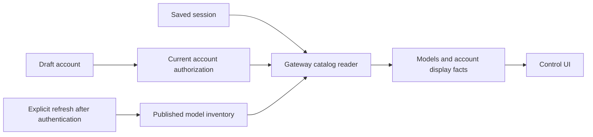

Codex review: blocked before merge. _Reviewed September 8, 2026, 11:34 AM ET / 15:34 UTC._

# ClawSweeper review

## What this changes

The Control UI reads model choices and account details directly from the Gateway for saved sessions and draft accounts, removes its model cache, and preserves refresh warnings and recovery.

## Merge readiness

⛔ **Blocked before merge - 3 items remain**

This protected PR remains useful: current main lacks the session-scoped catalog contract. The earlier findings are addressed, and no new blocking code defect was identified.

**Priority:** P2
**Reviewed head:** `7ad9837bcf4623470801d25bd968bcacd02be4db`

## Review scores

| Measure | Result | What it means |
|---|---|---|
| **Overall readiness** | 🐚 platinum hermit **(4/6)** | A coherent implementation with prior defects repaired and focused regression coverage; final browser acceptance remains outstanding. |
| **Proof confidence** | 🌊 off-meta tidepool | Not applicable: Repository State classifies this as a MEMBER PR, exempting ordinary contributor proof. Reported source-Gateway runs exercise scoped reads and recovery; the separately declared compiled-browser acceptance remains pending. |
| **Patch quality** | 🐚 platinum hermit **(4/6)** | No actionable review findings were identified. |

## Verification

| Check | Result | Evidence |
|---|---|---|
| **Real behavior** | Not applicable | Not applicable: Repository State classifies this as a MEMBER PR, exempting ordinary contributor proof. Reported source-Gateway runs exercise scoped reads and recovery; the separately declared compiled-browser acceptance remains pending. |
| **Evidence reviewed** | 10 items | Current main still needs this contract: The fetched main handler resolves agent-scoped requests without the session or draft-account resolution added by this branch. Latest release comparison: The supplied latest release, v2026.9.3, has neither sessionKey nor authProfileId in ModelsListParamsSchema. The release source was retrieved through the GitHub contents API after its local object proved unavailable. Related work is foundation and broader staging: GitHub confirms https://github.com/openclaw/openclaw/pull/142063 merged the published-inventory foundation. https://github.com/openclaw/openclaw/pull/136257 remains an open draft containing broader work; neither supersedes this focused consumer change. |
| **Findings** | None | None. |
| **Security** | None | None. |

## How this fits together

The Gateway combines published model inventory with session or account scope to determine available model choices. The Control UI consumes those results for pickers, commands, and diagnostics.

## Before merge

- [ ] **Resolve merge risk (P1)** - The captured evidence does not yet demonstrate final compiled-browser refresh ordering, warning display, and same-account retry recovery.
- [ ] **Complete next step (P2)** - Complete the declared compiled-browser acceptance of refresh ordering, warning display, and same-account retry recovery, and record redacted results in the PR body.
- [ ] **Add data-model compatibility proof** - Confirm migration or upgrade compatibility proof before merge.

<strong>Agent review details</strong>

### Security

None.

### PR surface

Source -4, Tests +343, Docs +19, Other +16. Total +374 across 75 files.

View PR surface stats

| Area | Files | Added | Removed | Net |
|---|---:|---:|---:|---:|
| Source | 26 | 574 | 578 | -4 |
| Tests | 46 | 1166 | 823 | +343 |
| Docs | 1 | 19 | 0 | +19 |
| Config | 0 | 0 | 0 | 0 |
| Generated | 0 | 0 | 0 | 0 |
| Other | 2 | 17 | 1 | +16 |
| **Total** | **75** | **1776** | **1402** | **+374** |

### Review metrics

| Metric | Value | Why it matters |
|---|---|---|
| **Catalog protocol additions** | 2 optional request selectors, 2 optional response fields, 1 capability | The additive contract carries session/account scope and refresh state without a protocol-version bump. |

### Stored data model

Persistent data-model change detected: `unknown-data-model-change: packages/gateway-protocol/src/schema/users.ts`. Confirm migration or upgrade compatibility proof before merge.

### Merge-risk options

**Maintainer options:**
1. **Decide the mitigation before merge**  
   Keep one Gateway-owned model inventory, preserve saved session pins and draft-account isolation, and expose recoverable refresh failures without blocking usable choices.
2. **Pause or close**  
   Do not merge this PR until maintainers decide whether the risk is worth taking.

### Technical review

Best possible solution:

Keep one Gateway-owned model inventory, preserve saved session pins and draft-account isolation, and expose recoverable refresh failures without blocking usable choices.

Do we have a high-confidence way to reproduce the issue?

Not applicable to the contract addition itself. The body reports a compiled-UI refresh-ordering failure and focused regression checks; this read-only review did not execute them.

Is this the best way to solve the issue?

Yes: extending the existing published catalog reader removes competing ownership while preserving legacy consumers and existing account authorization.

AGENTS.md: found and applied where relevant.

Codex review notes: model internal, reasoning medium; reviewed against [9165b329314a](https://github.com/openclaw/openclaw/commit/9165b329314a7a46916d71018b6d7042c2973685).

### Labels

Label justifications:

- `P2`: This improves model-picker consistency and recovery without evidence of an urgent production outage.
- `rating: 🐚 platinum hermit`: Overall readiness is 🐚 platinum hermit; proof is 🌊 off-meta tidepool and patch quality is 🐚 platinum hermit.
- `status: 👀 ready for maintainer look`: ClawSweeper has no concrete contributor-facing blocker left for this PR. Not applicable: Repository State classifies this as a MEMBER PR, exempting ordinary contributor proof. Reported source-Gateway runs exercise scoped reads and recovery; the separately declared compiled-browser acceptance remains pending.

### Evidence

What I checked:

- **Current main still needs this contract:** The fetched main handler resolves agent-scoped requests without the session or draft-account resolution added by this branch. ([`src/gateway/server-methods/models.ts:15`](https://github.com/openclaw/openclaw/blob/9165b329314a7a46916d71018b6d7042c2973685/src/gateway/server-methods/models.ts#L15), [9165b329314a](https://github.com/openclaw/openclaw/commit/9165b329314a7a46916d71018b6d7042c2973685))
- **Latest release comparison:** The supplied latest release, v2026.9.3, has neither sessionKey nor authProfileId in ModelsListParamsSchema. The release source was retrieved through the GitHub contents API after its local object proved unavailable. ([`packages/gateway-protocol/src/schema/agents-models-skills.ts`](https://github.com/openclaw/openclaw/blob/1391f7cd2d40ab5bbcf2f5f831d3a64f520e72d7/packages/gateway-protocol/src/schema/agents-models-skills.ts), [1391f7cd2d40](https://github.com/openclaw/openclaw/commit/1391f7cd2d40ab5bbcf2f5f831d3a64f520e72d7))
- **Related work is foundation and broader staging:** GitHub confirms https://github.com/openclaw/openclaw/pull/142063 merged the published-inventory foundation. https://github.com/openclaw/openclaw/pull/136257 remains an open draft containing broader work; neither supersedes this focused consumer change. ([89fcceb655c1](https://github.com/openclaw/openclaw/commit/89fcceb655c193604bfef0f73e5c23871ea0c3dd))
- **Session and account authorization:** The new handler reuses existing session/account resolution and checks draft authority before returning results. Catalog preparation also checks authority before private projection; existing dispatcher target resolution protects hidden session reads, and account display projection withholds foreign personal locators. ([`src/gateway/server-methods/models.ts:27`](https://github.com/openclaw/openclaw/blob/7ad9837bcf4623470801d25bd968bcacd02be4db/src/gateway/server-methods/models.ts#L27), [7ad9837bcf46](https://github.com/openclaw/openclaw/commit/7ad9837bcf4623470801d25bd968bcacd02be4db))
- **Earlier findings remain fixed:** The draft controller reuses the bound scope for same-account retries. Successful responses retain ready status independently of refresh warnings, while submission still requires the matching account and an available model. Focused tests cover failed retry followed by recovery and identity retirement. ([`ui/src/pages/new-session/model-control.ts:131`](https://github.com/openclaw/openclaw/blob/7ad9837bcf4623470801d25bd968bcacd02be4db/ui/src/pages/new-session/model-control.ts#L131), [7ad9837bcf46](https://github.com/openclaw/openclaw/commit/7ad9837bcf4623470801d25bd968bcacd02be4db))
- **Refresh sequencing and review continuity:** Explicit acquisition waits for authentication publication, and the reader rejects aborted requests before transport. GitHub's comparison against the previously reviewed head shows only two redundant deferred type arguments removed from load.test.ts; no production behavior changed in that follow-up. ([`ui/src/pages/model-providers/load.ts:87`](https://github.com/openclaw/openclaw/blob/7ad9837bcf4623470801d25bd968bcacd02be4db/ui/src/pages/model-providers/load.ts#L87), [7ad9837bcf46](https://github.com/openclaw/openclaw/commit/7ad9837bcf4623470801d25bd968bcacd02be4db))

Likely related people:

- **obviyus:** Suggested for follow-up; no historical authorship or introduction is verified. (role: unverified routing candidate; confidence: low)
- **steipete:** Suggested for follow-up; no historical authorship or introduction is verified. (role: unverified routing candidate; confidence: low)

### Rank-up moves

Optional improvements that raise the rating; they are not merge blockers.

- Complete the declared compiled-browser acceptance and record redacted refresh-ordering, warning-display, and same-account recovery results.

### Rating scale

| Score | Internal tier | Crab rank | Meaning |
|---:|:---:|---|---|
| **6/6** | S | 🦀 challenger crab | Exceptional readiness |
| **5/6** | A | 🦞 diamond lobster | Very strong readiness |
| **4/6** | B | 🐚 platinum hermit | Good normal PR; ordinary maintainer review |
| **3/6** | C | 🦐 gold shrimp | Useful, but confidence is limited |
| **2/6** | D | 🦪 silver shellfish | Proof or implementation needs work |
| **1/6** | F | 🧂 unranked krab | Not merge-ready |
| N/A | NA | 🌊 off-meta tidepool | Rating does not apply |

Overall follows the weaker of proof and patch quality.
Shiny media proof means a screenshot, video, or linked artifact directly shows the changed behavior. Runtime, network, CSP, and security claims still need visible diagnostics.

### Workflow

- ClawSweeper keeps one durable marker-backed review comment per issue or PR.
- Re-runs edit this comment so the latest verdict, findings, and automation markers stay together instead of adding duplicate bot comments.
- A fresh review can be triggered by eligible `@clawsweeper re-review` comments, exact-item GitHub events, scheduled/background review runs, or manual workflow dispatch.
- PR/issue authors and users with repository write access can comment `@clawsweeper re-review` or `@clawsweeper re-run` on an open PR or issue to request a fresh review only.
- Maintainers can also comment `@clawsweeper review` to request a fresh review only.
- Fresh-review commands do not start repair, autofix, rebase, CI repair, or automerge.
- Maintainer-only repair and merge flows require explicit commands such as `@clawsweeper autofix`, `@clawsweeper automerge`, `@clawsweeper fix ci`, or `@clawsweeper address review`.
- Maintainers can comment `@clawsweeper explain` to ask for more context, or `@clawsweeper stop` to stop active automation.

### History

Review history (4 earlier review cycles)

<!-- clawsweeper-review-history v=1 total=4 -->
- reviewed 2026-09-08T13:02:28.716Z sha aa7d4512ff1fd43fa9385e3181af7b684a55d62b :: blocked before merge. :: [P2] Keep refresh warnings from blocking usable draft accounts
- reviewed 2026-09-08T13:42:05.588Z sha 07e1b871e46056b4f7f928e0eb55409c2243771d :: blocked before merge. :: [P2] Reuse the bound scope when retrying the same draft account
- reviewed 2026-09-08T14:27:56.408Z sha 12d37af0c9b2e65f40e14aba4c2f4dfc1abb0095 :: blocked before merge. :: none
- reviewed 2026-09-08T15:11:16.262Z sha 7946e80ed75e1935df04cf286d36ad9bee59371c :: blocked before merge. :: none

<!-- clawsweeper-verdict:needs-human item=142165 sha=7ad9837bcf4623470801d25bd968bcacd02be4db confidence=high updated_at=2026-09-08T15:31:34Z reviewed_at=2026-09-08T15:34:42.375Z lease_owner=github-run-34245090404-1 lease_comment_id=5587685992 source_revision=4ece400fe1f2f6a71d57fdfd301ab167ad5f6de0f9f5eac4ce9fe2a8afe30b14 live_verification=absent -->
<!-- clawsweeper-review-state:blocked item=142165 sha=7ad9837bcf4623470801d25bd968bcacd02be4db v=1 -->

<!-- clawsweeper-review-version item=142165 reviewed_at=2026-09-08T15:34:42.375Z sha=7ad9837bcf4623470801d25bd968bcacd02be4db source_revision=4ece400fe1f2f6a71d57fdfd301ab167ad5f6de0f9f5eac4ce9fe2a8afe30b14 lease_owner=github-run-34245090404-1 lease_comment_id=5587685992 v=1 -->

<!-- clawsweeper-review item=142165 -->