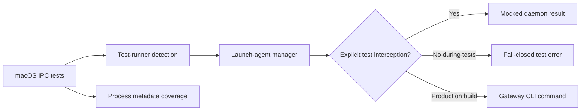

Codex review: needs maintainer review before merge. _Reviewed July 24, 2026, 10:08 AM ET / 14:08 UTC._

# ClawSweeper review

## What this changes

The PR prevents macOS tests from executing an unmocked real gateway daemon command, recognizes SwiftPM test helpers, serializes shared launch-agent tests, and replaces an SSH-orphan test with a current-process metadata probe.

## Merge readiness

⚠️ **Ready for maintainer review - 2 items remain**

This fresh, maintainer-labeled PR remains necessary as the landing vehicle for macOS test isolation. The patch appears correct: it keeps the production gateway path outside the DEBUG-only guard, blocks test fallthrough before command resolution, and replaces a real SSH child with deterministic process-metadata coverage; the remaining action is normal merge review after the active macOS checks finish.

**Priority:** P3
**Reviewed head:** `2c7ed371764602e7d873098582c8abb2e13c1c09`

## Review scores

| Measure | Result | What it means |
|---|---|---|
| **Overall readiness** | 🐚 platinum hermit **(4/6)** | A focused, well-scoped native-test hardening patch with direct after-fix behavior evidence and no supported correctness finding. |
| **Proof confidence** | 🐚 platinum hermit **(4/6)** | Sufficient (live_output): The PR records an after-fix focused native test run that observed the fail-closed daemon result and no SSH child, alongside a successful Xcode beta build; redact any local paths or identifiers if more terminal output is added. |
| **Patch quality** | 🐚 platinum hermit **(4/6)** | No actionable review findings were identified. |

## Verification

| Check | Result | Evidence |
|---|---|---|
| **Real behavior** | Verified | Sufficient (live_output): The PR records an after-fix focused native test run that observed the fail-closed daemon result and no SSH child, alongside a successful Xcode beta build; redact any local paths or identifiers if more terminal output is added. |
| **Evidence reviewed** | 5 items | Fail-closed command boundary: The proposed DEBUG-only branch returns an error before resolving or executing the gateway command when a test has not explicitly intercepted daemon calls. Test-runner contract coverage: The resolver treats XCTest bundles, XCTest environment variables, and both SwiftPM helper process names as tests; focused tests cover each positive case and a normal application negative case. Deterministic replacement for live SSH child: The PR removes the test that spawned an orphaned SSH process on a fixed port and retains process-info coverage through a local current-process probe plus the adjacent synthetic matrix described in the PR. |
| **Findings** | None | None. |
| **Security** | None | None. |

## How this fits together

The macOS app’s launch-agent manager invokes gateway lifecycle commands, while native IPC tests exercise those paths. Test-runner detection selects a DEBUG-only test safeguard so tests must explicitly intercept daemon commands instead of reaching the operator’s installed gateway CLI.

## Before merge

- [ ] **Resolve merge risk (P1)** - The PR is reported as mergeable but behind its base and the macOS Swift/dead-code checks are still in progress, so the exact head should receive a final mergeability and check refresh before landing.
- [ ] **Complete next step (P2)** - This active, maintainer-labeled implementation PR has no concrete repair finding for an automated fix lane; finish normal merge review after its active macOS checks and merge refresh.

<strong>Agent review details</strong>

### Security

None.

### PR surface

Other +22. Total +22 across 5 files.

View PR surface stats

| Area | Files | Added | Removed | Net |
|---|---:|---:|---:|---:|
| Source | 0 | 0 | 0 | 0 |
| Tests | 0 | 0 | 0 | 0 |
| Docs | 0 | 0 | 0 | 0 |
| Config | 0 | 0 | 0 | 0 |
| Generated | 0 | 0 | 0 | 0 |
| Other | 5 | 79 | 57 | +22 |
| **Total** | **5** | **79** | **57** | **+22** |

### Review metrics

None.

### Stored data model

Persistent data-model change detected: `serialized state: apps/macos/Tests/OpenClawIPCTests/GatewayLaunchAgentManagerTests.swift`. Confirm migration or upgrade compatibility proof before merge.

### Merge-risk options

**Maintainer options:**
1. **Decide the mitigation before merge**  
   Land the focused DEBUG-only isolation guard once the active macOS checks complete and the rebased merge result still proves that release builds retain the existing gateway-command path.
2. **Pause or close**  
   Do not merge this PR until maintainers decide whether the risk is worth taking.

### Technical review

Best possible solution:

Land the focused DEBUG-only isolation guard once the active macOS checks complete and the rebased merge result still proves that release builds retain the existing gateway-command path.

Do we have a high-confidence way to reproduce the issue?

Yes, from source and the PR’s focused test: disable interception in a DEBUG test process, invoke a gateway daemon action, and verify it returns the explicit fail-closed error instead of resolving the real CLI. The supplied proof reports that this path was observed after the change.

Is this the best way to solve the issue?

Yes. Guarding the single daemon-command execution boundary in DEBUG test processes is narrower and safer than relying on each test to install a hook, while replacing the live SSH child removes the fixed-port and orphan-process hazard without changing production behavior.

AGENTS.md: found and applied where relevant.

Codex review notes: model internal, reasoning high; reviewed against [7dfb660d1f80](https://github.com/openclaw/openclaw/commit/7dfb660d1f803f7ef0aeaee23775cb94f2d92920).

### Labels

Label changes:

- add `P3`: This is a focused native-test reliability and operator-safety cleanup rather than a production runtime regression.
- add `proof: sufficient`: Contributor real behavior proof is sufficient. The PR records an after-fix focused native test run that observed the fail-closed daemon result and no SSH child, alongside a successful Xcode beta build; redact any local paths or identifiers if more terminal output is added.
- add `rating: 🐚 platinum hermit`: Overall readiness is 🐚 platinum hermit; proof is 🐚 platinum hermit and patch quality is 🐚 platinum hermit.
- add `status: 👀 ready for maintainer look`: ClawSweeper has no concrete contributor-facing blocker left for this PR. Sufficient (live_output): The PR records an after-fix focused native test run that observed the fail-closed daemon result and no SSH child, alongside a successful Xcode beta build; redact any local paths or identifiers if more terminal output is added.

Label justifications:

- `P3`: This is a focused native-test reliability and operator-safety cleanup rather than a production runtime regression.
- `rating: 🐚 platinum hermit`: Overall readiness is 🐚 platinum hermit; proof is 🐚 platinum hermit and patch quality is 🐚 platinum hermit.
- `status: 👀 ready for maintainer look`: ClawSweeper has no concrete contributor-facing blocker left for this PR. Sufficient (live_output): The PR records an after-fix focused native test run that observed the fail-closed daemon result and no SSH child, alongside a successful Xcode beta build; redact any local paths or identifiers if more terminal output is added.
- `proof: sufficient`: Contributor real behavior proof is sufficient. The PR records an after-fix focused native test run that observed the fail-closed daemon result and no SSH child, alongside a successful Xcode beta build; redact any local paths or identifiers if more terminal output is added.

### Evidence

What I checked:

- **Fail-closed command boundary:** The proposed DEBUG-only branch returns an error before resolving or executing the gateway command when a test has not explicitly intercepted daemon calls. ([`apps/macos/Sources/OpenClaw/GatewayLaunchAgentManager.swift:270`](https://github.com/openclaw/openclaw/blob/2c7ed3717646/apps/macos/Sources/OpenClaw/GatewayLaunchAgentManager.swift#L270), [2c7ed3717646](https://github.com/openclaw/openclaw/commit/2c7ed3717646))
- **Test-runner contract coverage:** The resolver treats XCTest bundles, XCTest environment variables, and both SwiftPM helper process names as tests; focused tests cover each positive case and a normal application negative case. ([`apps/macos/Sources/OpenClaw/ProcessInfo+OpenClaw.swift:37`](https://github.com/openclaw/openclaw/blob/2c7ed3717646/apps/macos/Sources/OpenClaw/ProcessInfo%2BOpenClaw.swift#L37), [2c7ed3717646](https://github.com/openclaw/openclaw/commit/2c7ed3717646))
- **Deterministic replacement for live SSH child:** The PR removes the test that spawned an orphaned SSH process on a fixed port and retains process-info coverage through a local current-process probe plus the adjacent synthetic matrix described in the PR. ([`apps/macos/Tests/OpenClawIPCTests/LowCoverageHelperTests.swift:337`](https://github.com/openclaw/openclaw/blob/2c7ed3717646/apps/macos/Tests/OpenClawIPCTests/LowCoverageHelperTests.swift#L337), [2c7ed3717646](https://github.com/openclaw/openclaw/commit/2c7ed3717646))
- **After-fix native proof:** The PR body reports a successful full Xcode beta build and a focused Swift Testing run with 31 passing tests, the fail-closed error observed, and no SSH child launched; the supplied check context also shows the Real behavior proof check succeeded. ([2c7ed3717646](https://github.com/openclaw/openclaw/commit/2c7ed3717646))
- **Review limitation:** The read-only command sandbox failed before repository history and scoped-file inspection could run, so ownership routing is deliberately low-confidence and no close/implemented-on-main conclusion is proposed.

Likely related people:

- **steipete:** The supplied PR metadata identifies steipete as the author of the focused macOS launch-agent and test-isolation change; repository-history inspection was unavailable in the read-only sandbox. (role: recent area contributor; confidence: low; commits: [2c7ed3717646](https://github.com/openclaw/openclaw/commit/2c7ed371764602e7d873098582c8abb2e13c1c09); files: `apps/macos/Sources/OpenClaw/GatewayLaunchAgentManager.swift`, `apps/macos/Sources/OpenClaw/ProcessInfo+OpenClaw.swift`)

### Rating scale

| Score | Internal tier | Crab rank | Meaning |
|---:|:---:|---|---|
| **6/6** | S | 🦀 challenger crab | Exceptional readiness |
| **5/6** | A | 🦞 diamond lobster | Very strong readiness |
| **4/6** | B | 🐚 platinum hermit | Good normal PR; ordinary maintainer review |
| **3/6** | C | 🦐 gold shrimp | Useful, but confidence is limited |
| **2/6** | D | 🦪 silver shellfish | Proof or implementation needs work |
| **1/6** | F | 🧂 unranked krab | Not merge-ready |
| N/A | NA | 🌊 off-meta tidepool | Rating does not apply |

Overall follows the weaker of proof and patch quality.
Shiny media proof means a screenshot, video, or linked artifact directly shows the changed behavior. Runtime, network, CSP, and security claims still need visible diagnostics.

### Workflow

- ClawSweeper keeps one durable marker-backed review comment per issue or PR.
- Re-runs edit this comment so the latest verdict, findings, and automation markers stay together instead of adding duplicate bot comments.
- A fresh review can be triggered by eligible `@clawsweeper re-review` comments, exact-item GitHub events, scheduled/background review runs, or manual workflow dispatch.
- PR/issue authors and users with repository write access can comment `@clawsweeper re-review` or `@clawsweeper re-run` on an open PR or issue to request a fresh review only.
- Maintainers can also comment `@clawsweeper review` to request a fresh review only.
- Fresh-review commands do not start repair, autofix, rebase, CI repair, or automerge.
- Maintainer-only repair and merge flows require explicit commands such as `@clawsweeper autofix`, `@clawsweeper automerge`, `@clawsweeper fix ci`, or `@clawsweeper address review`.
- Maintainers can comment `@clawsweeper explain` to ask for more context, or `@clawsweeper stop` to stop active automation.

<!-- clawsweeper-verdict:needs-human item=113337 sha=2c7ed371764602e7d873098582c8abb2e13c1c09 confidence=high updated_at=2026-07-24T14:06:52Z reviewed_at=2026-07-24T14:08:23.867Z lease_owner=github-run-30099558003-1 lease_comment_id=5070734634 source_revision=5a9544849466ce9e627672ae774a542510a8f7c9ea67a0952c6c869b0f9bcf98 -->

<!-- clawsweeper-review-version item=113337 reviewed_at=2026-07-24T14:08:23.867Z sha=2c7ed371764602e7d873098582c8abb2e13c1c09 source_revision=5a9544849466ce9e627672ae774a542510a8f7c9ea67a0952c6c869b0f9bcf98 lease_owner=github-run-30099558003-1 lease_comment_id=5070734634 v=1 -->

<!-- clawsweeper-review item=113337 -->