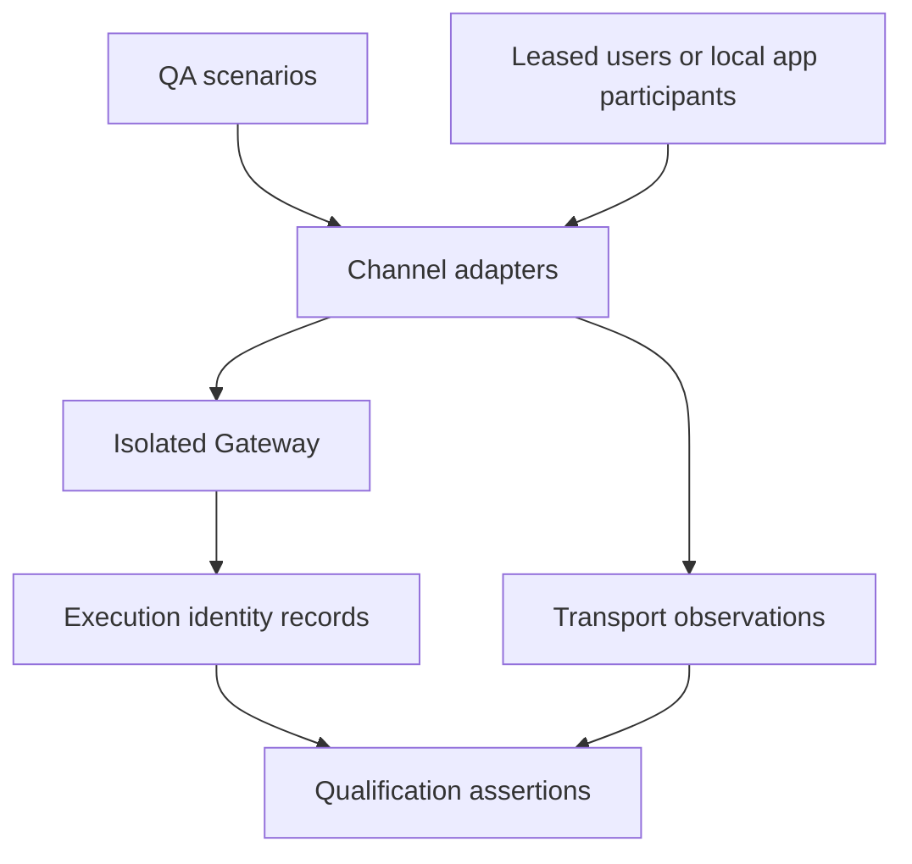

Codex review: blocked before merge. _Reviewed September 22, 2026, 9:07 PM ET / September 23, 2026, 01:07 UTC (Revision 3)._

# ClawSweeper review

## What this changes

Expands execution-identity QA across installed packages, Gateway restarts, and channel participants, including operator-assisted private Telegram testing.

## Merge readiness

⛔ **Blocked before merge - 3 items remain**

The qualification work remains useful and is not superseded. The prior private-topic validation defect remains unchanged and still blocks merge.

**Priority:** P2
**Reviewed head:** `6f6021717b9d5f4ad0e2e44ea1f8501b4d5576d6`

## Review scores

| Measure | Result | What it means |
|---|---|---|
| **Overall readiness** | 🦐 gold shrimp **(3/6)** | Useful qualification coverage remains limited by an unresolved false-positive path in the private Telegram adapter. |
| **Proof confidence** | 🌊 off-meta tidepool | Not applicable: Collaborator-authored QA work is exempt from the external-contributor proof gate. Reported live qualification covers installed audit inspection and private Telegram participants, with explicit unproven cells; it does not resolve the source-backed topic defect. Optional broker payload fields preserve legacy schema-version-1 inputs without rewriting existing credentials. |
| **Patch quality** | 🦐 gold shrimp **(3/6)** | 1 actionable review finding remain. |

## Verification

| Check | Result | Evidence |
|---|---|---|
| **Real behavior** | Not applicable | Not applicable: Collaborator-authored QA work is exempt from the external-contributor proof gate. Reported live qualification covers installed audit inspection and private Telegram participants, with explicit unproven cells; it does not resolve the source-backed topic defect. Optional broker payload fields preserve legacy schema-version-1 inputs without rewriting existing credentials. |
| **Evidence reviewed** | 11 items | Introduced defect: The introduced private-app guard checks only group conversations. Channel requests reach the forum handoff without validating the configured topic; subsequent send and reply observations copy the requested topic into synthetic receipts.<br>Re-review continuity: The earlier reviewed head contains the same group-only guard. Local comparison encountered an unavailable blob and HTTP 403; reading the pinned earlier source through GitHub and inspecting the latest commit recovered the relevant comparison. The latest commit changes imports, guarded fetching, CLI wording, and test placement, but does not resolve the prior finding.<br>Handoff evidence boundary: The private-app request names the descriptor's topic title. Its acknowledgement validates the token, text, destination category, and reply attestation, without independently returning the numeric topic used by the adapter's constructed observations. |
| **Findings** | 1 actionable finding | [P2] Validate private forum targets for channel conversations too |
| **Security** | None | None. |

## How this fits together

QA Lab drives isolated OpenClaw instances through scripted scenarios and channel adapters. It compares transport observations with audit inspection results to produce qualification evidence.



## Before merge

- [ ] **Validate private forum targets for channel conversations too (P2)** - The previous blocker remains. With descriptor topic 42 and a `channel` request for topic 43—or no topic—this guard is skipped. The operator handoff still names the descriptor's topic, while the synthesized send and reply observations use the requested topic; the receipt check then compares those constructed values against the same request and passes. Validate every non-direct request before issuing the handoff so the harness cannot certify routing it never exercised.
- [ ] **Resolve merge risk (P1)** - Private-app channel requests can produce passing topic-routing evidence for a mismatched or absent requested topic.
- [ ] **Complete next step (P2)** - Reject mismatched and missing private forum topics for channel requests before handoff, and verify the rejection cases in the adapter tests.

## Findings

- [P2] Validate private forum targets for channel conversations too — `extensions/qa-lab/src/live-transports/telegram/adapter.runtime.ts:473-478`


<details>
<summary><strong>Agent review details</strong></summary>

### Security

None.

### PR surface

Source +677, Tests +3305, Docs +30, Other +1426. Total +5438 across 49 files.

<details>
<summary>View PR surface stats</summary>

| Area | Files | Added | Removed | Net |
|---|---:|---:|---:|---:|
| Source | 8 | 819 | 142 | +677 |
| Tests | 22 | 3511 | 206 | +3305 |
| Docs | 2 | 31 | 1 | +30 |
| Config | 0 | 0 | 0 | 0 |
| Generated | 0 | 0 | 0 | 0 |
| Other | 17 | 1479 | 53 | +1426 |
| **Total** | **49** | **5840** | **402** | **+5438** |

</details>

### Review metrics

| Metric | Value | Why it matters |
|---|---|---|
| **Qualification controls** | 1 new audit environment switch; 1 private Telegram descriptor mode | The added controls affect opt-in QA execution rather than installed product defaults. |

### Stored data model

Persistent data-model change detected: `database schema: scripts/e2e/lib/codex-npm-plugin-live/audit-inspection.mjs`, `migration/backfill/repair: qa/scenarios/runtime/agent-run-identity-inspection.yaml`, `serialized state: extensions/qa-lab/src/live-transports/telegram/private-production.runtime.ts`, `serialized state: qa/scenarios/runtime/autonomous-task-lifecycle-receipts.yaml`, `serialized state: scripts/e2e/lib/npm-onboard-channel-agent/execution-identity.mjs`, `unknown-data-model-change: extensions/qa-lab/src/live-transports/telegram/private-production.runtime.ts`, and 2 more. Migration or upgrade compatibility proof is recorded; maintainers should verify it before merge.

### Merge-risk options

**Maintainer options:**
1. **Validate both forum conversation kinds (recommended)**  
   Reject mismatched or missing topics for every non-direct private-app request before any handoff or observation is created.

<details>
<summary>Copy recommended automerge instruction</summary>

```text
@clawsweeper automerge

Special instructions:
Extend private-app target validation to both group and channel conversations before handoff or observation mutation, and add adapter rejection cases for mismatched and absent topics while preserving valid DM and forum flows.
```

</details>

### Technical review

Best possible solution:

Bind every private-app forum request to the configured chat and topic before producing a handoff or recording observations.

Do we have a high-confidence way to reproduce the issue?

Yes, from the PR source: configure topic 42 and submit a channel request for topic 43 or without a topic; the guard is skipped and constructed observations pass their self-comparison. This was not executed.

Is this the best way to solve the issue?

The existing QA owners are the appropriate extension point, but the private-app path must validate its target before it can provide trustworthy routing evidence.

Full review comments:

- [P2] Validate private forum targets for channel conversations too — `extensions/qa-lab/src/live-transports/telegram/adapter.runtime.ts:473-478`
  The previous blocker remains. With descriptor topic 42 and a `channel` request for topic 43—or no topic—this guard is skipped. The operator handoff still names the descriptor's topic, while the synthesized send and reply observations use the requested topic; the receipt check then compares those constructed values against the same request and passes. Validate every non-direct request before issuing the handoff so the harness cannot certify routing it never exercised.
  Confidence: 0.99

Overall correctness: patch is incorrect
Overall confidence: 0.97

AGENTS.md: found and applied where relevant.

Codex review notes: model internal, reasoning medium; reviewed against [04f3f7db75a0](https://github.com/openclaw/openclaw/commit/04f3f7db75a0f389d70df5308314e44e2ea84569).

### Labels

Label changes:

No label changes.

Label justifications:

- `P2`: This improves maintainer qualification coverage, with a bounded harness correctness defect and no demonstrated product outage.
- `merge-risk: 🚨 automation`: The private-app adapter can certify topic-routing behavior that its handoff did not exercise.
- `rating: 🦐 gold shrimp`: Overall readiness is 🦐 gold shrimp; proof is 🌊 off-meta tidepool and patch quality is 🦐 gold shrimp.
- `status: ⏳ waiting on author`: ClawSweeper has contributor-facing work open and is waiting for author action. Not applicable: Collaborator-authored QA work is exempt from the external-contributor proof gate. Reported live qualification covers installed audit inspection and private Telegram participants, with explicit unproven cells; it does not resolve the source-backed topic defect. Optional broker payload fields preserve legacy schema-version-1 inputs without rewriting existing credentials.

### Evidence

Acceptance criteria:

- [P1] pnpm test extensions/qa-lab/src/live-transports/telegram/adapter.runtime.test.ts extensions/qa-lab/src/live-transports/telegram/private-production.runtime.test.ts --maxWorkers=1.
- [P1] pnpm check:changed.
- [P1] git diff --check.

What I checked:

- **Introduced defect:** The introduced private-app guard checks only group conversations. Channel requests reach the forum handoff without validating the configured topic; subsequent send and reply observations copy the requested topic into synthetic receipts. ([`extensions/qa-lab/src/live-transports/telegram/adapter.runtime.ts:473`](https://github.com/openclaw/openclaw/blob/6f6021717b9d5f4ad0e2e44ea1f8501b4d5576d6/extensions/qa-lab/src/live-transports/telegram/adapter.runtime.ts#L473), [6f6021717b9d](https://github.com/openclaw/openclaw/commit/6f6021717b9d5f4ad0e2e44ea1f8501b4d5576d6))
- **Re-review continuity:** The earlier reviewed head contains the same group-only guard. Local comparison encountered an unavailable blob and HTTP 403; reading the pinned earlier source through GitHub and inspecting the latest commit recovered the relevant comparison. The latest commit changes imports, guarded fetching, CLI wording, and test placement, but does not resolve the prior finding. ([`extensions/qa-lab/src/live-transports/telegram/adapter.runtime.ts:474`](https://github.com/openclaw/openclaw/blob/cecaae32074665682c53676f17f0e50784019d7a/extensions/qa-lab/src/live-transports/telegram/adapter.runtime.ts#L474), [cecaae320746](https://github.com/openclaw/openclaw/commit/cecaae32074665682c53676f17f0e50784019d7a))
- **Handoff evidence boundary:** The private-app request names the descriptor's topic title. Its acknowledgement validates the token, text, destination category, and reply attestation, without independently returning the numeric topic used by the adapter's constructed observations. ([`extensions/qa-lab/src/live-transports/telegram/private-production.runtime.ts:181`](https://github.com/openclaw/openclaw/blob/6f6021717b9d5f4ad0e2e44ea1f8501b4d5576d6/extensions/qa-lab/src/live-transports/telegram/private-production.runtime.ts#L181), [6f6021717b9d](https://github.com/openclaw/openclaw/commit/6f6021717b9d5f4ad0e2e44ea1f8501b4d5576d6))
- **Still necessary on main and latest release:** The private-production adapter module and live-frontier identity scenario are absent from both fetched main and the supplied latest-release commit. Current main's Telegram adapter still uses the earlier single-user lease path. ([`extensions/qa-lab/src/live-transports/telegram/adapter.runtime.ts:73`](https://github.com/openclaw/openclaw/blob/04f3f7db75a0f389d70df5308314e44e2ea84569/extensions/qa-lab/src/live-transports/telegram/adapter.runtime.ts#L73), [04f3f7db75a0](https://github.com/openclaw/openclaw/commit/04f3f7db75a0f389d70df5308314e44e2ea84569))
- **Release surface check:** Neither new qualification path exists in the supplied v2026.9.5 release tree; no merged replacement for this qualification work was established. ([ec9c1a13db89](https://github.com/openclaw/openclaw/commit/ec9c1a13db8938e5a3eaa51fca2e981cde2395a9))
- **Credential compatibility and authorization:** Broker additions remain optional within schema version 1, preserve the existing single-user payload projection, and enter through the existing maintainer-authenticated admin endpoint. Tests cover both legacy payloads and distinct participant fixtures; no existing credential rewrite or product database migration is introduced. ([`test/qa-convex-credential-payload-validation.test.ts:197`](https://github.com/openclaw/openclaw/blob/6f6021717b9d5f4ad0e2e44ea1f8501b4d5576d6/test/qa-convex-credential-payload-validation.test.ts#L197), [6f6021717b9d](https://github.com/openclaw/openclaw/commit/6f6021717b9d5f4ad0e2e44ea1f8501b4d5576d6))

Likely related people:

- **joshavant:** Suggested for follow-up; no historical authorship or introduction is verified. (role: unverified routing candidate; confidence: low)
- **obviyus:** Suggested for follow-up; no historical authorship or introduction is verified. (role: unverified routing candidate; confidence: low)
- **RomneyDa:** Suggested for follow-up; no historical authorship or introduction is verified. (role: unverified routing candidate; confidence: low)

### Rank-up moves

Optional improvements that raise the rating; they are not merge blockers.

- Repair the private-app topic guard and add rejection coverage for channel requests with mismatched or absent topics.

### Rating scale

| Score | Internal tier | Crab rank | Meaning |
|---:|:---:|---|---|
| **6/6** | S | 🦀 challenger crab | Exceptional readiness |
| **5/6** | A | 🦞 diamond lobster | Very strong readiness |
| **4/6** | B | 🐚 platinum hermit | Good normal PR; ordinary maintainer review |
| **3/6** | C | 🦐 gold shrimp | Useful, but confidence is limited |
| **2/6** | D | 🦪 silver shellfish | Proof or implementation needs work |
| **1/6** | F | 🧂 unranked krab | Not merge-ready |
| N/A | NA | 🌊 off-meta tidepool | Rating does not apply |

Overall follows the weaker of proof and patch quality.
Shiny media proof means a screenshot, video, or linked artifact directly shows the changed behavior. Runtime, network, CSP, and security claims still need visible diagnostics.

### Workflow

- ClawSweeper keeps one durable marker-backed review comment per issue or PR.
- Re-runs edit this comment so the latest verdict, findings, and automation markers stay together instead of adding duplicate bot comments.
- A fresh review can be triggered by eligible `@clawsweeper re-review` comments, exact-item GitHub events, scheduled/background review runs, or manual workflow dispatch.
- PR/issue authors and users with repository write access can comment `@clawsweeper re-review` or `@clawsweeper re-run` on an open PR or issue to request a fresh review only.
- Maintainers can also comment `@clawsweeper review` to request a fresh review only.
- Fresh-review commands do not start repair, autofix, rebase, CI repair, or automerge.
- Maintainer-only repair and merge flows require explicit commands such as `@clawsweeper autofix`, `@clawsweeper automerge`, `@clawsweeper fix ci`, or `@clawsweeper address review`.
- Maintainers can comment `@clawsweeper explain` to ask for more context, or `@clawsweeper stop` to stop active automation.

### History

<details>
<summary>Review history (2 earlier review cycles)</summary>

<!-- clawsweeper-review-history v=1 total=2 -->
- reviewed 2026-09-23T00:19:33.943Z sha 5ffff59b9e0b8e2ac7c4b1b3ec03fe2b7949b7e3 :: blocked before merge. :: [P2] Validate private forum targets for channel conversations too
- reviewed 2026-09-23T00:29:18.456Z sha cecaae32074665682c53676f17f0e50784019d7a :: blocked before merge. :: [P2] Validate private forum targets for channel conversations too

</details>

</details>

<!-- clawsweeper-verdict:needs-human item=156033 sha=6f6021717b9d5f4ad0e2e44ea1f8501b4d5576d6 confidence=high updated_at=2026-09-23T01:02:53Z reviewed_at=2026-09-23T01:07:09.400Z lease_owner=github-run-35804544700-1 lease_comment_id=5787173408 source_revision=4f4ceddce3d804490670d524ebed0630e3c80f35cd5cf71b264875ad3ae4512b live_verification=absent -->
<!-- clawsweeper-review-state:blocked item=156033 sha=6f6021717b9d5f4ad0e2e44ea1f8501b4d5576d6 v=1 -->

<!-- clawsweeper-review-version item=156033 reviewed_at=2026-09-23T01:07:09.400Z sha=6f6021717b9d5f4ad0e2e44ea1f8501b4d5576d6 source_revision=4f4ceddce3d804490670d524ebed0630e3c80f35cd5cf71b264875ad3ae4512b lease_owner=github-run-35804544700-1 lease_comment_id=5787173408 v=1 -->

<!-- clawsweeper-review item=156033 -->