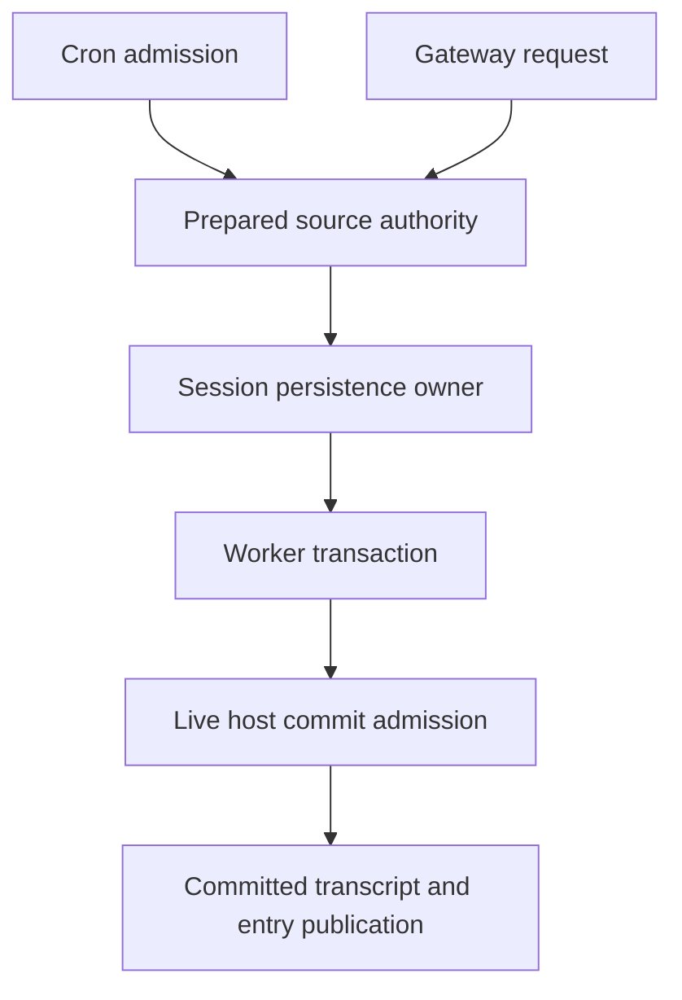

Codex review: needs real behavior proof before merge.

## What this changes

This PR preserves prepared session authority through scheduled delivery and moves manual transcript compaction onto the existing worker implementation.

**Example:** A scheduled WebChat reply loses delivery authority before its transcript commit.
- **Before:** Callback wrappers discard prepared source metadata and select native transcript persistence.
- **After:** Prepared predicates reach the worker transaction, whose final host admission rejects revoked delivery authority.

## Review scores

| Measure | Result | What it means |
|---|---|---|
| **Overall readiness** | 🦪 silver shellfish **(2/6)** | The ownership simplification is worthwhile, but diff-caused test failures and incomplete authority evidence prevent a passing review. |
| **Proof confidence** | 🦪 silver shellfish **(2/6)** | Real behavior proof is necessary before merge. See [Before merge](#before-merge). |
| **Patch quality** | 🦪 silver shellfish **(2/6)** | Security review found an item that needs attention. |

## Product

**Kind:** Refactor · **Worth it:** Yes · **Fix scope:** Complete
**User problem:** Scheduled reply persistence loses prepared authority metadata and manual compaction retains a competing native implementation.
**Reason:** The maintainer-authored direction follows the existing worker ownership contract and removes duplicate production code without adding configuration or public APIs.

## Merge readiness

⛔ **Blocked before merge - 5 items remain**

Keep this PR open: the maintainer-directed worker cutover is useful, but two test defects block validation of the changed persistence paths.

**Priority:** P2
**Reviewed head:** `ea8fd187b6693551de51f12ecd0512cd2d97e1cd`

## Before merge

- [ ] **Add real behavior proof** - Authority-chain proof required: the added production-path harnesses target live delivery/request revocation, but CI failures prevent completed persisted-result checks; the existing native revocation interception no longer reaches the changed worker owner. Show authorized commits and rejection of stale delivery attempts, revoked capabilities, and copied/profile-mismatched requests before durable effects, using the real owners; redact credentials and private endpoints from supplied output. After adding proof, update the PR body, then request a new review with `@clawsweeper re-review`. The PR author or someone with repository write access can request it.
- [ ] **Inject the accounting failure after worker schema admission (P2)** - Changing this fixture from a TEMP trigger on the retained native connection to a persistent trigger makes the worker reject the database as canonical schema drift. Exact-head CI receives 'Session canonical validation schema is missing or drifted: reject_manual_compact_metadata_update' instead of the intended accounting failure. Inject the write failure through the admitted worker boundary so this test actually exercises transcript-and-entry rollback without weakening schema validation.
- [ ] **Move the scheduled-reply revocation test to worker admission (P2)** - The new prepared-source routing bypasses this test's host-native append spy. Its owner.closeAdmission() callback therefore never runs, and CI observes zero interceptions plus a committed assistant message. Move the revocation injection to the worker's final commit admission and retain the assertion that no assistant message persists; the current test neither passes nor tests revocation after this cutover.
- [ ] **Resolve security concern: Fallback worker classification changes invocation custody** - Unbound request objects can now become worker-classified from callback metadata. Existing custody tests stop at the changed family assertion, so they do not establish whether copied requests preserve profile restrictions and reject revoked authority at the final write.
- [ ] **Resolve merge risk** - Before merge, establish that fallback worker classification cannot give copied request objects retained invocation authority or bypass expected-profile selection.

## Findings

- [P2] Inject the accounting failure after worker schema admission — `src/config/sessions/session-manual-compact.worker.test.ts:372-378`
- [P2] Move the scheduled-reply revocation test to worker admission — `src/agents/tools/message-tool.internal-source-reply.integration.test.ts:190-192`
- [medium] Fallback worker classification changes invocation custody — `src/gateway/server-methods/session-mutation-guards.ts:135`

### Tests

- Low-value test `src/gateway/server-plugin-in-process-dispatch.compaction.test.ts`: Remove the exact commitChecks count assertion; it pins composition details and currently rejects two valid checks before inspecting retained bytes.
- Low-value test `src/infra/outbound/message-action-source-authority.test.ts`: Remove the exact authority-callback count assertion and retain the independent committed-content and rollback assertions.
- Missing end-to-end proof: Completed final-effect proof is missing for allowed and revoked commits and copied-request profile rejection; a base-fail/head-pass regression run is also not supplied.

<strong>Agent review details</strong>

### How this fits together

Cron admission and Gateway requests supply live authority to session persistence; workers validate source facts, commit transcript and entry changes, and publish acknowledged results.

### Technical review

Best possible solution:

Complete the worker cutover with working rollback and revocation coverage while preserving invocation-bound authority and released synchronous SDK behavior.

Do we have a high-confidence way to reproduce the issue?

Source and exact-head CI establish the fixture failures; no local execution was performed, and the existing incognito complaint does not establish a newly introduced defect.

Is this the best way to solve the issue?

Preserving prepared predicates and reusing the existing worker owner is appropriate, but the tests must follow the new execution boundary and establish its authorization guarantees.

Full review comments:

- [P2] Inject the accounting failure after worker schema admission — `src/config/sessions/session-manual-compact.worker.test.ts:372-378`
  Changing this fixture from a TEMP trigger on the retained native connection to a persistent trigger makes the worker reject the database as canonical schema drift. Exact-head CI receives 'Session canonical validation schema is missing or drifted: reject_manual_compact_metadata_update' instead of the intended accounting failure. Inject the write failure through the admitted worker boundary so this test actually exercises transcript-and-entry rollback without weakening schema validation.
  Confidence: 0.99
- [P2] Move the scheduled-reply revocation test to worker admission — `src/agents/tools/message-tool.internal-source-reply.integration.test.ts:190-192`
  The new prepared-source routing bypasses this test's host-native append spy. Its owner.closeAdmission() callback therefore never runs, and CI observes zero interceptions plus a committed assistant message. Move the revocation injection to the worker's final commit admission and retain the assertion that no assistant message persists; the current test neither passes nor tests revocation after this cutover.
  Confidence: 0.99

Overall correctness: patch is incorrect
Overall confidence: 0.9

AGENTS.md: found and applied where relevant.

Codex review notes: model internal, reasoning medium; reviewed against [51172b633b9f](https://github.com/openclaw/openclaw/commit/51172b633b9f2997d1160f8946e54e30b89f245c).

### Merge-risk options

**Maintainer options:**
1. **Prove fallback authority remains invocation-bound (recommended)**  
   Exercise copied request objects through real mutation owners and show profile mismatch and revoked authority are rejected before commit.
2. **Limit worker classification to explicitly bound requests**  
   Retain the conservative fallback until the inferred classification has final-effect coverage.

### Provenance checked

- `Manual compaction worker ownership` keeps the original intent (6da98fbc03403ff260bc4151645ef1c0b67d19b4: Move durable manual trimming off the Gateway thread while preserving transcript comparison, atomic accounting updates, and commit receipts.)
- `Opaque manual-compaction adapter` changes intended behavior with a stated reason (8e9ae9f2453217075dda52b1bd2d892333ce5cac: Preserve native transaction fences for opaque callbacks during cold restoration and trimming; this PR explains that custom manual-compaction callbacks are internal and now rejected before mutation.)
- `Scheduled message and source authority` keeps the original intent (10169f0489e4f31e3af6ae4e3a48252f3c739095: Separate common message permission from authenticated-source permission and reject revoked occurrences before subsequent effects.)
- `Incognito SQLite fallback` keeps the original intent (3de654bfc84428cb3d15101433f5569f03a1163c: The memory-only ownership cutover prohibits SQLite fallback for incognito sessions; removing the residual SQLite lookup follows that contract.)

### Testing

Proof path: in-process harness.

### Security

Needs attention: No concrete authorization bypass was established, but inferred worker authority needs final-effect validation for copied invocations.

### Evidence

Security concerns:

- [medium] Fallback worker classification changes invocation custody — `src/gateway/server-methods/session-mutation-guards.ts:135`
  Unbound request objects can now become worker-classified from callback metadata. Existing custody tests stop at the changed family assertion, so they do not establish whether copied requests preserve profile restrictions and reject revoked authority at the final write.
  Confidence: 0.9

What I checked:

- **Introduced change:** The pinned introduction preserves prepared authority through cron and delivery wrappers, removes the native manual-compaction adapter, and retains the existing transaction mutation. ([`src/config/sessions/session-manual-compact.ts:50`](https://github.com/openclaw/openclaw/blob/ea8fd187b6693551de51f12ecd0512cd2d97e1cd/src/config/sessions/session-manual-compact.ts#L50), [ea8fd187b669](https://github.com/openclaw/openclaw/commit/ea8fd187b6693551de51f12ecd0512cd2d97e1cd))
- **Rollback fixture fails before mutation:** Exact-head CI rejects the newly persistent trigger as canonical schema drift, rather than reaching the intended accounting-write failure: https://github.com/openclaw/openclaw/actions/runs/38958733152/job/117168818247. ([`src/config/sessions/session-manual-compact.worker.test.ts:373`](https://github.com/openclaw/openclaw/blob/ea8fd187b6693551de51f12ecd0512cd2d97e1cd/src/config/sessions/session-manual-compact.worker.test.ts#L373), [ea8fd187b669](https://github.com/openclaw/openclaw/commit/ea8fd187b6693551de51f12ecd0512cd2d97e1cd))
- **Revocation test still intercepts native execution:** The existing scheduled-reply test spies on a host-native append function. After worker routing, its revocation callback never runs; CI reports zero interceptions and a committed assistant message: https://github.com/openclaw/openclaw/actions/runs/38958733152/job/117168817807. ([`src/agents/tools/message-tool.internal-source-reply.integration.test.ts:190`](https://github.com/openclaw/openclaw/blob/ea8fd187b6693551de51f12ecd0512cd2d97e1cd/src/agents/tools/message-tool.internal-source-reply.integration.test.ts#L190), [ea8fd187b669](https://github.com/openclaw/openclaw/commit/ea8fd187b6693551de51f12ecd0512cd2d97e1cd))
- **Authority tests do not complete persistence assertions:** All three new scheduled-source cases fail the zero-host-SQL assertion before inspecting persisted events; the new compaction happy path also fails an exact callback-count assertion. ([`src/infra/outbound/message-action-source-authority.test.ts:110`](https://github.com/openclaw/openclaw/blob/ea8fd187b6693551de51f12ecd0512cd2d97e1cd/src/infra/outbound/message-action-source-authority.test.ts#L110), [ea8fd187b669](https://github.com/openclaw/openclaw/commit/ea8fd187b6693551de51f12ecd0512cd2d97e1cd))
- **Fallback classification changes invocation expectations:** The fallback now infers worker compatibility from callback metadata; existing invocation-custody tests fail because copied request objects become worker-classified. Their final-effect behavior remains unestablished. ([`src/gateway/server-methods/session-mutation-guards.ts:135`](https://github.com/openclaw/openclaw/blob/ea8fd187b6693551de51f12ecd0512cd2d97e1cd/src/gateway/server-methods/session-mutation-guards.ts#L135), [ea8fd187b669](https://github.com/openclaw/openclaw/commit/ea8fd187b6693551de51f12ecd0512cd2d97e1cd))
- **Incognito review concern predates this patch:** The existing review discussion identifies missing active-path facts, but its claim that the removed fallback is actor-backed is unsupported: the barrel exports a SQLite reader, and the earlier memory-only cutover already refuses incognito SQLite opens. This is not reported as an introduced regression. ([`src/state/openclaw-agent-db.incognito.test.ts:72`](https://github.com/openclaw/openclaw/blob/3de654bfc84428cb3d15101433f5569f03a1163c/src/state/openclaw-agent-db.incognito.test.ts#L72), [3de654bfc844](https://github.com/openclaw/openclaw/commit/3de654bfc84428cb3d15101433f5569f03a1163c))

Likely related people:

- **Peter Steinberger:** Raw commit ca77256127e6ba13c00d68bca42194d1b9e2a780 adds src/config/sessions/session-turn.ts:31 relative to its recorded parents. This identifies author metadata, not feature responsibility or a PR merger. (role: source-line author; confidence: high; commits: [ca77256127e6](https://github.com/openclaw/openclaw/commit/ca77256127e6ba13c00d68bca42194d1b9e2a780); files: `src/config/sessions/session-turn.ts`)
- **Shakker:** Raw commit 10169f0489e4f31e3af6ae4e3a48252f3c739095 adds src/gateway/message-action-turn-capability.ts:240 relative to its recorded parents. This identifies author metadata, not feature responsibility or a PR merger. (role: source-line author; confidence: high; commits: [10169f0489e4](https://github.com/openclaw/openclaw/commit/10169f0489e4f31e3af6ae4e3a48252f3c739095); files: `src/gateway/message-action-turn-capability.ts`)

### PR surface

Source -116, Tests +193, Docs +8. Total +85 across 20 files. Added test files: 2.

View PR surface stats

| Area | Files | Added | Removed | Net |
|---|---:|---:|---:|---:|
| Source | 15 | 177 | 293 | -116 |
| Tests | 4 | 266 | 73 | +193 |
| Docs | 1 | 8 | 0 | +8 |
| Config | 0 | 0 | 0 | 0 |
| Generated | 0 | 0 | 0 | 0 |
| Other | 0 | 0 | 0 | 0 |
| **Total** | **20** | **451** | **366** | **+85** |

### Labels

Label changes:

- add `P2`: This is a useful internal persistence refactor with concrete validation defects, without a proven new urgent runtime failure.
- add `merge-risk: 🚨 security-boundary`: Fallback request classification changes how authority reaches worker mutations, and copied-invocation final-effect behavior is unresolved.
- add `rating: 🦪 silver shellfish`: Overall readiness is 🦪 silver shellfish; proof is 🦪 silver shellfish and patch quality is 🦪 silver shellfish.
- add `status: 📣 needs proof`: The PR needs real behavior proof before ClawSweeper can clear the contributor ask.

Label justifications:

- `P2`: This is a useful internal persistence refactor with concrete validation defects, without a proven new urgent runtime failure.
- `merge-risk: 🚨 security-boundary`: Fallback request classification changes how authority reaches worker mutations, and copied-invocation final-effect behavior is unresolved.
- `rating: 🦪 silver shellfish`: Overall readiness is 🦪 silver shellfish; proof is 🦪 silver shellfish and patch quality is 🦪 silver shellfish.
- `status: 📣 needs proof`: The PR needs real behavior proof before ClawSweeper can clear the contributor ask.

### Rating scale

6/6 🦀 challenger crab · 5/6 🦞 diamond lobster · 4/6 🐚 platinum hermit · 3/6 🦐 gold shrimp · 2/6 🦪 silver shellfish · 1/6 🧂 unranked krab. Overall follows the weaker of proof and patch quality; ✨ marks media proof (a screenshot, video, or linked artifact) that directly shows the changed behavior.

### Workflow

ClawSweeper edits this one comment on every review. Comment `@clawsweeper re-review` for a fresh review only. Repair and merge execution lanes are retired.

_Reviewed October 16, 2026, 4:13 PM ET / 20:13 UTC._

<!-- clawsweeper-security:security-sensitive item=174610 sha=ea8fd187b6693551de51f12ecd0512cd2d97e1cd confidence=high updated_at=2026-10-16T20:09:18Z reviewed_at=2026-10-16T20:13:55.351Z lease_owner=github-run-38959985529-1 lease_comment_id=6223760531 source_revision=bb28b9fab179e4b5e1acb60d66d012e6f5e8e80296315b0ffdc5aa4607eca995 -->
<!-- clawsweeper-verdict:needs-human item=174610 sha=ea8fd187b6693551de51f12ecd0512cd2d97e1cd confidence=high updated_at=2026-10-16T20:09:18Z reviewed_at=2026-10-16T20:13:55.351Z lease_owner=github-run-38959985529-1 lease_comment_id=6223760531 source_revision=bb28b9fab179e4b5e1acb60d66d012e6f5e8e80296315b0ffdc5aa4607eca995 hold=security findings=2 -->
<!-- clawsweeper-review-state:blocked item=174610 sha=ea8fd187b6693551de51f12ecd0512cd2d97e1cd v=1 -->

<!-- clawsweeper-review-version item=174610 reviewed_at=2026-10-16T20:13:55.351Z sha=ea8fd187b6693551de51f12ecd0512cd2d97e1cd source_revision=bb28b9fab179e4b5e1acb60d66d012e6f5e8e80296315b0ffdc5aa4607eca995 lease_owner=github-run-38959985529-1 lease_comment_id=6223760531 v=1 -->

<!-- clawsweeper-review item=174610 -->