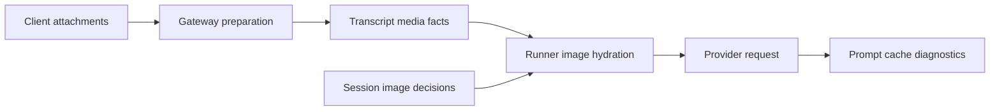

Codex review: blocked before merge.

## What this changes

This PR pins image inclusion across requests and separates upload metadata from model-facing image blocks.

**Example:** An attachment named late.png is unavailable on the first request and becomes readable before a follow-up.
- **Before:** The earlier user message gains an image on the follow-up, changing the cached conversation prefix.
- **After:** The earlier message keeps the image omitted; sending it in a new turn retries loading.

## Review scores

| Measure | Result | What it means |
|---|---|---|
| **Overall readiness** | 🦪 silver shellfish **(2/6)** | Focused synthetic regressions support the central fix, but two concrete introduced defects prevent a correctness pass. |
| **Proof confidence** | 🦐 gold shrimp **(3/6)** | The maintainer-authored PR is outside the ordinary contributor proof gate; its supplied evidence covers synthetic hydration and attachment serialization, explicitly without a live Gateway or provider request. |
| **Patch quality** | 🦪 silver shellfish **(2/6)** | Security review found an item that needs attention. |

## Product

**Kind:** Bug fix · **Worth it:** Yes · **Fix scope:** Complete
**User problem:** Follow-up requests can change earlier image inputs and unnecessarily invalidate the conversation prefix.
**Reason:** Stable conversation history is an explicit repository contract, and the maintainer-authored PR records the resend and restart tradeoffs.

## Merge readiness

⛔ **Blocked before merge - 5 items remain**

Keep this useful maintainer-authored PR open, but fix the retained-session memory leak and diagnostic privacy regression before merging.

**Priority:** P2
**Reviewed head:** `b93540cfbd58c5381aedf68f35aad0c9ec908d42`

## Before merge

- [ ] **Release image decisions when their session retires (P2)** - Every image-bearing session adds a strongly retained map, and every image-bearing turn adds media facts and hashes, but this module never deletes either. Resetting or deleting sessions invokes cleanupSessionResources, yet this memo registers no cleanup callback, so repeated image conversations retain all retired entries until the process exits. Connect this state to the existing session-resource cleanup owner, preserving decisions for active sessions and clearing all scopes belonging to a retired session.
- [ ] **Keep arbitrary extension keys out of diagnostic logs (P2)** - An added, removed, or changed extension property now places its key verbatim into the history-rewrite warning. For example, a property named alice@example.test appears in envelope.other even though its value remains hashed. sanitizeForLog only strips terminal controls, so truncation does not preserve the previous privacy contract. Restore the static other label or explicitly approved static names, and retain a regression with private text in the key itself.
- [ ] **Resolve security concern: Conversation metadata names can contain private data** - The previous contract explicitly treated dynamic keys as potentially sensitive; the replacement tests use innocuous names and no longer protect that case.
- [ ] **Complete next step** - Resolve GitHub's reported merge conflict on this PR.
- [ ] **Explain or restore the original intent of Unknown diagnostic field names** - 7fc9770d4618e9abec9863613b7e3fe23c6ab934: Dynamic extension keys were deliberately excluded because their names can contain user data; the current body announces key naming without explaining why that privacy protection may be removed.

## Findings

- [P2] Release image decisions when their session retires — `src/agents/embedded-agent-runner/run/prompt-image-decisions.ts:54-55`
- [P2] Keep arbitrary extension keys out of diagnostic logs — `src/agents/embedded-agent-runner/prompt-cache-observability.ts:172-173`
- [medium] Conversation metadata names can contain private data — `src/agents/embedded-agent-runner/prompt-cache-observability.ts:173`

### Provenance

- `Unknown diagnostic field names` changes intended behavior without addressing why it exists (7fc9770d4618e9abec9863613b7e3fe23c6ab934: Dynamic extension keys were deliberately excluded because their names can contain user data; the current body announces key naming without explaining why that privacy protection may be removed.)

### Tests

- Missing end-to-end proof: The supplied evidence does not exercise consecutive image-bearing requests through a shipped Gateway and model transport.

<strong>Agent review details</strong>

### How this fits together

Gateway attachment preparation supplies image bytes and durable media facts; the embedded runner hydrates those facts into provider requests and observes changes to conversation history.

### Technical review

Best possible solution:

Keep the shared image projection and session-scoped decisions, connect their retirement to existing session cleanup, and retain static diagnostic field labels.

Do we have a high-confidence way to reproduce the issue?

Current main reloads historical image facts on each request and carries upload metadata on inline image objects; the supplied regressions report both mismatches failing on the pinned base, but this review executed no target code.

Is this the best way to solve the issue?

The shared three-field image projection and session-scoped omission decision fit the existing owners; the new retained state needs lifecycle cleanup, and exposing diagnostic extension keys is unnecessary for the image repair.

Full review comments:

- [P2] Release image decisions when their session retires — `src/agents/embedded-agent-runner/run/prompt-image-decisions.ts:54-55`
  Every image-bearing session adds a strongly retained map, and every image-bearing turn adds media facts and hashes, but this module never deletes either. Resetting or deleting sessions invokes cleanupSessionResources, yet this memo registers no cleanup callback, so repeated image conversations retain all retired entries until the process exits. Connect this state to the existing session-resource cleanup owner, preserving decisions for active sessions and clearing all scopes belonging to a retired session.
  Confidence: 0.99
- [P2] Keep arbitrary extension keys out of diagnostic logs — `src/agents/embedded-agent-runner/prompt-cache-observability.ts:172-173`
  An added, removed, or changed extension property now places its key verbatim into the history-rewrite warning. For example, a property named alice@example.test appears in envelope.other even though its value remains hashed. sanitizeForLog only strips terminal controls, so truncation does not preserve the previous privacy contract. Restore the static other label or explicitly approved static names, and retain a regression with private text in the key itself.
  Confidence: 0.98

Overall correctness: patch is incorrect
Overall confidence: 0.97

AGENTS.md: found and applied where relevant.

Codex review notes: model internal, reasoning medium; reviewed against [4d8806c8c2e2](https://github.com/openclaw/openclaw/commit/4d8806c8c2e297af9bc06f5cc73d4b0a3a8f949b).

### Provenance checked

- `Structured image hydration and omission` keeps the original intent (f6818ae5eabc3bf1d44b47ac46e7b57eb8d70f2c: Structured media facts replaced marker parsing and made fact indexes authoritative for hydration and ordering.)
- `Later-turn retry after unreadable images` changes intended behavior with a stated reason (15a5706c75941bb1cbd67e5202c3ea549456879b: Channel pre-read failures should remain retryable instead of becoming permanent transcript suppression; this PR explicitly prioritizes stable request history after prompt hydration.)
- `Upload metadata ownership` keeps the original intent (85feffec940b4778a2f038f114514265caed7210: Measured image geometry must survive persistence to prevent saved-history previews from shifting neighboring messages.)
- `Sandbox rejection diagnostics` keeps the original intent (590cd468e1fc88799773690aa6a2ba509b65acf4: Ordinary logs retain classifications instead of arbitrary media paths or content; the new reason and path classes preserve that constraint.)

### Testing

Proof path: in-process harness.

### Security

Needs attention: The diagnostic change exposes arbitrary extension-key text through warning logs.

### Evidence

Security concerns:

- [medium] Conversation metadata names can contain private data — `src/agents/embedded-agent-runner/prompt-cache-observability.ts:173`
  The previous contract explicitly treated dynamic keys as potentially sensitive; the replacement tests use innocuous names and no longer protect that case.
  Confidence: 0.98

What I checked:

- **Pinned introduced changes:** Reviewed the merge-base-to-head hunks, separately from base movement; fetched main retains the prior behavior in the central production files. ([`src/agents/embedded-agent-runner/run/images.ts:542`](https://github.com/openclaw/openclaw/blob/b93540cfbd58c5381aedf68f35aad0c9ec908d42/src/agents/embedded-agent-runner/run/images.ts#L542), [b93540cfbd58](https://github.com/openclaw/openclaw/commit/b93540cfbd58c5381aedf68f35aad0c9ec908d42))
- **Image memo has no retirement operation:** The new module retains session maps, media facts, and hashes indefinitely; its callers only construct keys and resolve decisions. ([`src/agents/embedded-agent-runner/run/prompt-image-decisions.ts:19`](https://github.com/openclaw/openclaw/blob/b93540cfbd58c5381aedf68f35aad0c9ec908d42/src/agents/embedded-agent-runner/run/prompt-image-decisions.ts#L19), [b93540cfbd58](https://github.com/openclaw/openclaw/commit/b93540cfbd58c5381aedf68f35aad0c9ec908d42))
- **Existing session cleanup owner:** Session retirement already invokes cleanupSessionResources, and prompt diagnostics register their cleanup with that owner; https://github.com/openclaw/openclaw/pull/177614 explains the observed retention problem this mechanism fixes. ([`src/agents/embedded-agent-runner/prompt-cache-observability.ts:129`](https://github.com/openclaw/openclaw/blob/b93540cfbd58c5381aedf68f35aad0c9ec908d42/src/agents/embedded-agent-runner/prompt-cache-observability.ts#L129), [b93540cfbd58](https://github.com/openclaw/openclaw/commit/b93540cfbd58c5381aedf68f35aad0c9ec908d42))
- **Extension-key privacy contract:** https://github.com/openclaw/openclaw/pull/171614 deliberately restricted diagnostics to static field names because extension keys can contain user data; this PR replaces that redaction with the key text. ([`src/agents/embedded-agent-runner/prompt-cache-observability.ts:173`](https://github.com/openclaw/openclaw/blob/b93540cfbd58c5381aedf68f35aad0c9ec908d42/src/agents/embedded-agent-runner/prompt-cache-observability.ts#L173), [b93540cfbd58](https://github.com/openclaw/openclaw/commit/b93540cfbd58c5381aedf68f35aad0c9ec908d42))
- **Log sanitization does not redact data:** sanitizeForLog removes ANSI and control characters; ordinary private text in an extension key survives and reaches the history-rewrite warning. ([`packages/terminal-core/src/ansi.ts:148`](https://github.com/openclaw/openclaw/blob/b93540cfbd58c5381aedf68f35aad0c9ec908d42/packages/terminal-core/src/ansi.ts#L148), [b93540cfbd58](https://github.com/openclaw/openclaw/commit/b93540cfbd58c5381aedf68f35aad0c9ec908d42))
- **Supplied validation and merge state:** The complete body reports synthetic red/green regressions and explicitly says no live Gateway or provider request ran; GitHub reports the reviewed head as draft and mergeable_state dirty, and its check runs contain no completed broad CI gate. ([b93540cfbd58](https://github.com/openclaw/openclaw/commit/b93540cfbd58c5381aedf68f35aad0c9ec908d42))

Likely related people:

- **Peter Steinberger:** Raw commit b61b0809c63792c23df5ef68bc303882e146c134 adds src/agents/embedded-agent-runner/prompt-cache-observability.ts:103 relative to its recorded parents. This identifies author metadata, not feature responsibility or a PR merger. (role: source-line author; confidence: high; commits: [b61b0809c637](https://github.com/openclaw/openclaw/commit/b61b0809c63792c23df5ef68bc303882e146c134); files: `src/agents/embedded-agent-runner/prompt-cache-observability.ts`)
- **Vincent Koc:** Raw commit c76646adb1352990834c1afa3731617e89f7514e adds src/agents/pi-embedded-runner/prompt-cache-observability.ts:49 relative to its recorded parents. This identifies author metadata, not feature responsibility or a PR merger. (role: source-line author; confidence: medium; commits: [c76646adb135](https://github.com/openclaw/openclaw/commit/c76646adb1352990834c1afa3731617e89f7514e); files: `src/agents/pi-embedded-runner/prompt-cache-observability.ts`)

### PR surface

Source +157, Tests +85, Docs +1. Total +243 across 19 files. Added test files: 0.

View PR surface stats

| Area | Files | Added | Removed | Net |
|---|---:|---:|---:|---:|
| Source | 7 | 196 | 39 | +157 |
| Tests | 11 | 151 | 66 | +85 |
| Docs | 1 | 1 | 0 | +1 |
| Config | 0 | 0 | 0 | 0 |
| Generated | 0 | 0 | 0 | 0 |
| Other | 0 | 0 | 0 | 0 |
| **Total** | **19** | **348** | **105** | **+243** |

### Labels

Label changes:

- add `P2`: The image replay fix has clear value, but the introduced retention and diagnostic defects need focused corrections.
- add `merge-risk: 🚨 security-boundary`: Arbitrary extension-key text crosses from conversation metadata into ordinary warning logs.
- add `rating: 🦪 silver shellfish`: Overall readiness is 🦪 silver shellfish; proof is 🦐 gold shrimp and patch quality is 🦪 silver shellfish.
- add `status: ⏳ waiting on author`: ClawSweeper has contributor-facing work open and is waiting for author action.

Label justifications:

- `P2`: The image replay fix has clear value, but the introduced retention and diagnostic defects need focused corrections.
- `merge-risk: 🚨 security-boundary`: Arbitrary extension-key text crosses from conversation metadata into ordinary warning logs.
- `rating: 🦪 silver shellfish`: Overall readiness is 🦪 silver shellfish; proof is 🦐 gold shrimp and patch quality is 🦪 silver shellfish.
- `status: ⏳ waiting on author`: ClawSweeper has contributor-facing work open and is waiting for author action.

### Rating scale

6/6 🦀 challenger crab · 5/6 🦞 diamond lobster · 4/6 🐚 platinum hermit · 3/6 🦐 gold shrimp · 2/6 🦪 silver shellfish · 1/6 🧂 unranked krab. Overall follows the weaker of proof and patch quality; ✨ marks media proof (a screenshot, video, or linked artifact) that directly shows the changed behavior.

### Workflow

ClawSweeper edits this one comment on every review. Comment `@clawsweeper re-review` for a fresh review only. Repair and merge execution lanes are retired.

_Reviewed October 27, 2026, 2:41 AM ET / 06:41 UTC._

<!-- clawsweeper-security:security-sensitive item=185567 sha=b93540cfbd58c5381aedf68f35aad0c9ec908d42 confidence=high updated_at=2026-10-27T06:37:28Z reviewed_at=2026-10-27T06:41:44.074Z lease_owner=github-run-40462100480-1 lease_comment_id=6435479749 source_revision=d6d18a9a5c19ab527dce25f147177999f2fbb7a86e13c8566a6dbf5020c4b224 -->
<!-- clawsweeper-verdict:needs-human item=185567 sha=b93540cfbd58c5381aedf68f35aad0c9ec908d42 confidence=high updated_at=2026-10-27T06:37:28Z reviewed_at=2026-10-27T06:41:44.074Z lease_owner=github-run-40462100480-1 lease_comment_id=6435479749 source_revision=d6d18a9a5c19ab527dce25f147177999f2fbb7a86e13c8566a6dbf5020c4b224 hold=security findings=2 -->
<!-- clawsweeper-review-state:blocked item=185567 sha=b93540cfbd58c5381aedf68f35aad0c9ec908d42 v=1 -->

<!-- clawsweeper-review-version item=185567 reviewed_at=2026-10-27T06:41:44.074Z sha=b93540cfbd58c5381aedf68f35aad0c9ec908d42 source_revision=d6d18a9a5c19ab527dce25f147177999f2fbb7a86e13c8566a6dbf5020c4b224 lease_owner=github-run-40462100480-1 lease_comment_id=6435479749 v=1 -->

<!-- clawsweeper-review item=185567 -->