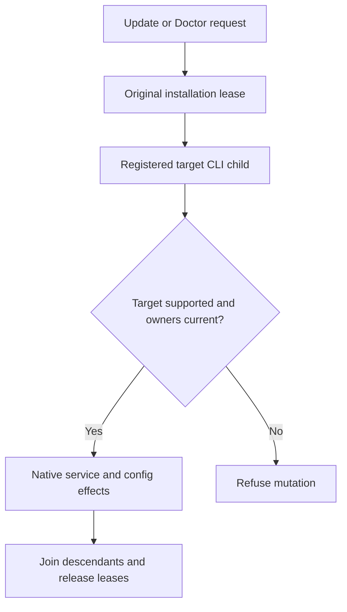

Codex review: blocked before merge. _Reviewed September 11, 2026, 1:09 PM ET / 17:09 UTC (Revision 13)._

# ClawSweeper review

## What this changes

Bind updater-launched native service commands and configuration writes to live update ownership, preserve older finalizer completion, and accept successfully settled cooperative capability probes.

## Merge readiness

⛔ **Blocked before merge - 2 items remain**

This PR remains necessary: current main lacks the native-child authority handoff. Earlier compatibility findings are repaired, and the latest cooperative-cleanup correction preserves the rejection safeguards. No blocking correctness finding remains.

**Priority:** P2
**Reviewed head:** `4255c6b1d18e8fe21570182375a9d3b344b83b54`

## Review scores

| Measure | Result | What it means |
|---|---|---|
| **Overall readiness** | 🐚 platinum hermit **(4/6)** | A coherent ownership repair with strong component proof, resolved prior findings, and an explicitly accepted compatibility tradeoff. |
| **Proof confidence** | 🦞 diamond lobster **(5/6)** | Sufficient (terminal): Recorded real-process proof exercises the original executor, delegated receiver, native process/file/configuration effects, revoked or substituted authority, and descendant settlement in disposable environments. Latest-head cooperative and forced probe controls preserve the earlier sufficient authority and legacy-completion evidence; installed-service recovery outside this component is not claimed. |
| **Patch quality** | 🐚 platinum hermit **(4/6)** | No actionable review findings were identified. |

## Verification

| Check | Result | Evidence |
|---|---|---|
| **Real behavior** | Verified | Sufficient (terminal): Recorded real-process proof exercises the original executor, delegated receiver, native process/file/configuration effects, revoked or substituted authority, and descendant settlement in disposable environments. Latest-head cooperative and forced probe controls preserve the earlier sufficient authority and legacy-completion evidence; installed-service recovery outside this component is not claimed. |
| **Evidence reviewed** | 8 items | Pinned correction verified: GitHub’s exact-head commit patch changes the capability predicate and adds cooperative/forced settlement controls. The local historical diff failed because a required promisor object returned HTTP 403; the exact commit API supplied the correction instead. No merge-removal claim relies on the stale test merge. Current main still needs the change: The fetched-main native caller launches service commands without the new private executor grant; its delegated executor also lacks the new original/spawner lineage checks. The merged generation repair does not replace this native-child protection. Latest release boundary: The v2026.9.4 native caller likewise lacks the new grant handoff and retains the old-runtime installer fallback; this protection is not already supplied by the latest release. |
| **Findings** | None | None. |
| **Security** | None | None. |

## How this fits together

OpenClaw’s updater launches the target installation’s CLI to manage Gateway services. Installation leases and registered child processes determine whether those commands may change service files, processes, or configuration.

## Before merge

- [ ] **Resolve merge risk (P1)** - Updates targeting unsupported runtimes or relying on detached, unmanaged, or Windows Startup-folder fallbacks can now refuse and require operator action; the maintainer explicitly accepts this documented compatibility boundary.
- [ ] **Add data-model compatibility proof** - Confirm migration or upgrade compatibility proof before merge.

<strong>Agent review details</strong>

### Security

None.

### PR surface

Source +807, Tests +2632, Docs +21. Total +3460 across 55 files.

View PR surface stats

| Area | Files | Added | Removed | Net |
|---|---:|---:|---:|---:|
| Source | 29 | 1209 | 402 | +807 |
| Tests | 25 | 2695 | 63 | +2632 |
| Docs | 1 | 21 | 0 | +21 |
| Config | 0 | 0 | 0 | 0 |
| Generated | 0 | 0 | 0 | 0 |
| Other | 0 | 0 | 0 | 0 |
| **Total** | **55** | **3925** | **465** | **+3460** |

### Review metrics

| Metric | Value | Why it matters |
|---|---|---|
| **Production and regression coverage growth** | Production net +807 lines; tests and test support net +2,632 lines | The stated growth supports shared child ownership, Doctor integration, shipped-format compatibility, and real-process refusal controls. |

### Stored data model

Persistent data-model change detected: `migration/backfill/repair: src/commands/doctor-update.ts`, `unknown-data-model-change: src/commands/doctor-update.ts`, `unknown-data-model-change: src/daemon/launchd-service-files.ts`, `unknown-data-model-change: src/daemon/schtasks-install.ts`, `unknown-data-model-change: src/daemon/systemd-definition-mutation.ts`. Confirm migration or upgrade compatibility proof before merge.

### Merge-risk options

**Maintainer options:**
1. **Retain the documented updater boundary (recommended)**  
   Accept the explicitly documented unsupported-target and fallback refusals while retaining ordinary Gateway commands and the repaired legacy-finalizer paths.

### Technical review

Best possible solution:

Keep the maintainer-accepted updater-only refusal boundary, with one live ownership chain through native effects and proven completion for shipped legacy finalizers.

Do we have a high-confidence way to reproduce the issue?

Yes: current-main source exposes the unbound native-child path, and recorded real-process controls demonstrate stale-owner effects and their refusal after repair. This read-only review did not execute those controls.

Is this the best way to solve the issue?

Yes: extending the existing installation lease owner avoids competing authority stores, and accepting cooperative cleanup matches the runner’s joined-extinction contract without accepting forced or uncertain cleanup.

AGENTS.md: found and applied where relevant.

Codex review notes: model internal, reasoning medium; reviewed against [7af0464ba960](https://github.com/openclaw/openclaw/commit/7af0464ba9605aba84db3fbdfaa12e5751da9797).

### Labels

Label justifications:

- `P2`: This is bounded update-reliability work with concrete stale-child and compatibility controls.
- `merge-risk: 🚨 compatibility`: Updater-owned operations intentionally stop accepting unsupported target runtimes and unowned fallback paths.
- `rating: 🐚 platinum hermit`: Overall readiness is 🐚 platinum hermit; proof is 🦞 diamond lobster and patch quality is 🐚 platinum hermit.
- `status: 👀 ready for maintainer look`: ClawSweeper has no concrete contributor-facing blocker left for this PR. Sufficient (terminal): Recorded real-process proof exercises the original executor, delegated receiver, native process/file/configuration effects, revoked or substituted authority, and descendant settlement in disposable environments. Latest-head cooperative and forced probe controls preserve the earlier sufficient authority and legacy-completion evidence; installed-service recovery outside this component is not claimed.
- `proof: sufficient`: Contributor real behavior proof is sufficient. Recorded real-process proof exercises the original executor, delegated receiver, native process/file/configuration effects, revoked or substituted authority, and descendant settlement in disposable environments. Latest-head cooperative and forced probe controls preserve the earlier sufficient authority and legacy-completion evidence; installed-service recovery outside this component is not claimed.

### Evidence

What I checked:

- **Pinned correction verified:** GitHub’s exact-head commit patch changes the capability predicate and adds cooperative/forced settlement controls. The local historical diff failed because a required promisor object returned HTTP 403; the exact commit API supplied the correction instead. No merge-removal claim relies on the stale test merge. ([`src/cli/update-cli/update-command-service-command.ts:89`](https://github.com/openclaw/openclaw/blob/4255c6b1d18e8fe21570182375a9d3b344b83b54/src/cli/update-cli/update-command-service-command.ts#L89), [4255c6b1d18e](https://github.com/openclaw/openclaw/commit/4255c6b1d18e8fe21570182375a9d3b344b83b54))
- **Current main still needs the change:** The fetched-main native caller launches service commands without the new private executor grant; its delegated executor also lacks the new original/spawner lineage checks. The merged generation repair does not replace this native-child protection. ([`src/cli/update-cli/update-command-service-command.ts`](https://github.com/openclaw/openclaw/blob/7af0464ba9605aba84db3fbdfaa12e5751da9797/src/cli/update-cli/update-command-service-command.ts), [7af0464ba960](https://github.com/openclaw/openclaw/commit/7af0464ba9605aba84db3fbdfaa12e5751da9797))
- **Latest release boundary:** The v2026.9.4 native caller likewise lacks the new grant handoff and retains the old-runtime installer fallback; this protection is not already supplied by the latest release. ([`src/cli/update-cli/update-command-service-command.ts`](https://github.com/openclaw/openclaw/blob/3a9d69db306cd7f081e06254cb89c4bcc14a7107/src/cli/update-cli/update-command-service-command.ts), [3a9d69db306c](https://github.com/openclaw/openclaw/commit/3a9d69db306cd7f081e06254cb89c4bcc14a7107))
- **Cooperative cleanup remains bounded:** The probe requests process-tree extinction, rechecks cancellation and original authority after settlement, and requires successful exit, no signal, no killed flag, complete output, and the supported capability. The termination controller joins group extinction and distinguishes forced or uncertain cleanup. ([`src/cli/update-cli/update-command-service-command.ts:79`](https://github.com/openclaw/openclaw/blob/4255c6b1d18e8fe21570182375a9d3b344b83b54/src/cli/update-cli/update-command-service-command.ts#L79), [4255c6b1d18e](https://github.com/openclaw/openclaw/commit/4255c6b1d18e8fe21570182375a9d3b344b83b54))
- **Earlier findings remain repaired:** The executor recognizes the exact shipped UUID-only grant and pins its existing database before issuing modern descendants. Grantless finalization restores the retained producer’s temporary-directory selectors before acquiring the normal installation lease. Real-worker controls cover successful completion and incumbent refusal. ([`src/infra/update-migrated-finalize.worker.ts:68`](https://github.com/openclaw/openclaw/blob/4255c6b1d18e8fe21570182375a9d3b344b83b54/src/infra/update-migrated-finalize.worker.ts#L68), [4255c6b1d18e](https://github.com/openclaw/openclaw/commit/4255c6b1d18e8fe21570182375a9d3b344b83b54))
- **Complete captured proof inspected:** The full API body matched captured SHA-256 e3757a993e5a9c7c362976788cdeb324d38bc259d62b71716ef73d693fb925a9 and all 22,231 UTF-16 units were read. Its composed proof uses real leases, intermediate and receiver processes, native execution, plist publication, and config commits; replaced owners, dead spawners, substituted lineage, and copied databases refuse effects. The latest report records both settlement controls passing on final source: https://github.com/openclaw/openclaw/pull/143905#issuecomment-5637901483. ([`src/cli/update-cli/update-command-executor-native.test.ts:167`](https://github.com/openclaw/openclaw/blob/4255c6b1d18e8fe21570182375a9d3b344b83b54/src/cli/update-cli/update-command-executor-native.test.ts#L167), [4255c6b1d18e](https://github.com/openclaw/openclaw/commit/4255c6b1d18e8fe21570182375a9d3b344b83b54))

Likely related people:

- **fuller-stack-dev:** Suggested for follow-up; no historical authorship or introduction is verified. (role: unverified routing candidate; confidence: low)
- **vincentkoc:** Suggested for follow-up; no historical authorship or introduction is verified. (role: unverified routing candidate; confidence: low)
- **obviyus:** Suggested for follow-up; no historical authorship or introduction is verified. (role: unverified routing candidate; confidence: low)

### Rating scale

| Score | Internal tier | Crab rank | Meaning |
|---:|:---:|---|---|
| **6/6** | S | 🦀 challenger crab | Exceptional readiness |
| **5/6** | A | 🦞 diamond lobster | Very strong readiness |
| **4/6** | B | 🐚 platinum hermit | Good normal PR; ordinary maintainer review |
| **3/6** | C | 🦐 gold shrimp | Useful, but confidence is limited |
| **2/6** | D | 🦪 silver shellfish | Proof or implementation needs work |
| **1/6** | F | 🧂 unranked krab | Not merge-ready |
| N/A | NA | 🌊 off-meta tidepool | Rating does not apply |

Overall follows the weaker of proof and patch quality.
Shiny media proof means a screenshot, video, or linked artifact directly shows the changed behavior. Runtime, network, CSP, and security claims still need visible diagnostics.

### Workflow

- ClawSweeper keeps one durable marker-backed review comment per issue or PR.
- Re-runs edit this comment so the latest verdict, findings, and automation markers stay together instead of adding duplicate bot comments.
- A fresh review can be triggered by eligible `@clawsweeper re-review` comments, exact-item GitHub events, scheduled/background review runs, or manual workflow dispatch.
- PR/issue authors and users with repository write access can comment `@clawsweeper re-review` or `@clawsweeper re-run` on an open PR or issue to request a fresh review only.
- Maintainers can also comment `@clawsweeper review` to request a fresh review only.
- Fresh-review commands do not start repair, autofix, rebase, CI repair, or automerge.
- Maintainer-only repair and merge flows require explicit commands such as `@clawsweeper autofix`, `@clawsweeper automerge`, `@clawsweeper fix ci`, or `@clawsweeper address review`.
- Maintainers can comment `@clawsweeper explain` to ask for more context, or `@clawsweeper stop` to stop active automation.

### History

Review history (12 earlier review cycles; latest 8 shown)

<!-- clawsweeper-review-history v=1 total=12 -->
- reviewed 2026-09-10T12:33:38.073Z sha 1e68cdd8899f2992a5cfef58cb629b079a3b3a60 :: needs real behavior proof before merge. :: none
- reviewed 2026-09-10T15:33:16.609Z sha 2fbc1a5b20cbd761c1cffc157559fb3f246c76ca :: needs real behavior proof before merge. :: none
- reviewed 2026-09-10T15:57:12.849Z sha 5690dd25a9a9f44812b3af894c113b4b6a1d266f :: needs real behavior proof before merge. :: none
- reviewed 2026-09-10T16:18:10.815Z sha 5690dd25a9a9f44812b3af894c113b4b6a1d266f :: needs real behavior proof before merge. :: none
- reviewed 2026-09-11T10:12:49.123Z sha 5690dd25a9a9f44812b3af894c113b4b6a1d266f :: needs real behavior proof before merge. :: none
- reviewed 2026-09-11T15:59:26.606Z sha 7793e227da75cba8352506a683b1470e8ad786a9 :: blocked before merge. :: [P1] [P1] Preserve native completion for accepted legacy finalizer grants
- reviewed 2026-09-11T16:24:50.673Z sha facc8ca79c3dbec6e71972d0a6e103db484be500 :: needs real behavior proof before merge. :: [P1] [P1] Acquire grantless ownership outside the worker scratch directory
- reviewed 2026-09-11T16:46:24.597Z sha 231835929f940faaac8d273a8fcd441a2e6798a6 :: blocked before merge. :: none

<!-- clawsweeper-verdict:needs-human item=143905 sha=4255c6b1d18e8fe21570182375a9d3b344b83b54 confidence=high updated_at=2026-09-11T17:06:40Z reviewed_at=2026-09-11T17:09:55.815Z lease_owner=github-run-34625619119-1 lease_comment_id=5637939278 source_revision=c516adeb3190ceac6c2fe7cc16590a30c1651c85b33628f03184cb9e3199fcca live_verification=absent -->
<!-- clawsweeper-review-state:blocked item=143905 sha=4255c6b1d18e8fe21570182375a9d3b344b83b54 v=1 -->

<!-- clawsweeper-review-version item=143905 reviewed_at=2026-09-11T17:09:55.815Z sha=4255c6b1d18e8fe21570182375a9d3b344b83b54 source_revision=c516adeb3190ceac6c2fe7cc16590a30c1651c85b33628f03184cb9e3199fcca lease_owner=github-run-34625619119-1 lease_comment_id=5637939278 v=1 -->

<!-- clawsweeper-review item=143905 -->