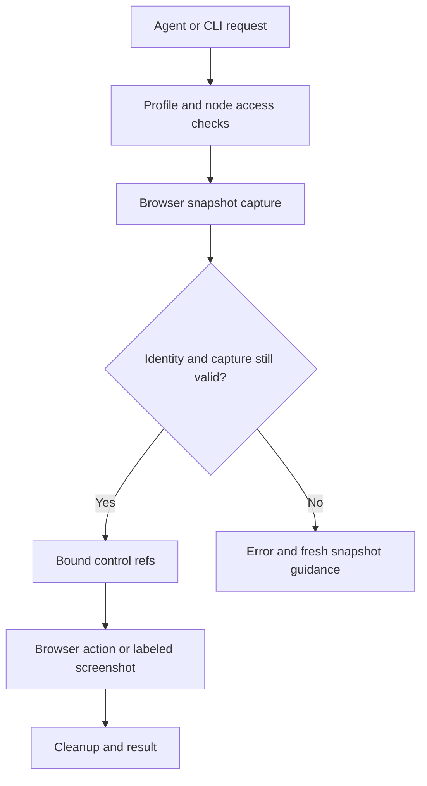

Codex review: blocked before merge. _Reviewed September 20, 2026, 12:59 PM ET / 16:59 UTC (Revision 2)._

# ClawSweeper review

## What this changes

The browser plugin preserves captured control identities, prevents canceled snapshots from replacing newer refs, cleans up iframe labels, preserves healthy tab connections, and improves timeout diagnostics and node-access checks.

## Merge readiness

⛔ **Blocked before merge - 2 items remain**

The PR remains useful and has no identified blocking code findings. The maintainer’s explicit acceptance resolves the previous compatibility decision; the unchanged head does not need another approval of those same tradeoffs.

**Priority:** P2
**Reviewed head:** `2d674c57c1d9e5e174c0cecc6961763cf4230157`

## Review scores

| Measure | Result | What it means |
|---|---|---|
| **Overall readiness** | 🐚 platinum hermit **(4/6)** | A solid repair with meaningful browser coverage, directly visible cleanup proof, no blocking findings, and resolved compatibility choices. |
| **Proof confidence** | 🦞 diamond lobster **(5/6)** ✨ media proof bonus | Sufficient (screenshot): Inspected before/after images directly demonstrate iframe overlay cleanup through the changed MCP label owner; the captured body additionally reports real Chromium identity/cancellation runs and CLI-to-node timeout recovery. Screenshots are credited only for visible cleanup, with test and runtime claims assessed separately. |
| **Patch quality** | 🐚 platinum hermit **(4/6)** | No actionable review findings were identified. |

## Verification

| Check | Result | Evidence |
|---|---|---|
| **Real behavior** | Verified | Sufficient (screenshot): Inspected before/after images directly demonstrate iframe overlay cleanup through the changed MCP label owner; the captured body additionally reports real Chromium identity/cancellation runs and CLI-to-node timeout recovery. Screenshots are credited only for visible cleanup, with test and runtime claims assessed separately. |
| **Evidence reviewed** | 11 items | Re-review continuity and accepted compatibility decisions: The supplied completed review covers the same head and contains no findings or published rank-up moves. The captured PR body and maintainer comment explicitly accept collision rejection and ref retirement after failed or internal snapshot refreshes: https://github.com/openclaw/openclaw/pull/153597#issuecomment-5751205608. Comparing the earlier reviewed SHA with HEAD produced no changes. Ref identity and lifetime: Snapshot and document refreshes clear the selected target’s previous aliases before calling Chrome MCP. Cross-document duplicate UIDs are rejected before new aliases are published; sibling-target aliases remain separate. Dependency contract applies: The browser launcher pins chrome-devtools-mcp@1.8.0, and the changed adapter invokes its UID-based actions. This is the affirmative dependency signal for inspecting Chrome MCP’s contract. |
| **Findings** | None | None. |
| **Security** | None | None. |

## How this fits together

OpenClaw’s browser plugin turns agent and CLI requests into browser snapshots, screenshots, and actions through Playwright or Chrome MCP. Snapshot refs connect subsequent actions to the controls captured on a particular tab.

## Before merge

- [ ] **Resolve merge risk (P1)** - Existing-session ref workflows will stop on pages with cross-document MCP UID collisions, whose real-site prevalence remains unmeasured; the maintainer explicitly accepted this limitation and the managed-profile alternative.
- [ ] **Resolve merge risk (P1)** - Scripts reusing refs after condition waits or failed snapshot refreshes must capture fresh refs; this intentional compatibility correction is documented and accepted.

<strong>Agent review details</strong>

### Security

None.

### PR surface

Source +237, Tests +1403, Docs +12. Total +1652 across 46 files.

View PR surface stats

| Area | Files | Added | Removed | Net |
|---|---:|---:|---:|---:|
| Source | 18 | 586 | 349 | +237 |
| Tests | 24 | 1752 | 349 | +1403 |
| Docs | 4 | 12 | 0 | +12 |
| Config | 0 | 0 | 0 | 0 |
| Generated | 0 | 0 | 0 | 0 |
| Other | 0 | 0 | 0 | 0 |
| **Total** | **46** | **2350** | **698** | **+1652** |

### Review metrics

| Metric | Value | Why it matters |
|---|---|---|
| **Production versus regression coverage** | Production +237 net lines; tests and test support +1,403 net lines | Production growth implements capture lifetime and document ownership, with most added code devoted to regression coverage. |
| **CLI transport allowance** | 10,000 ms beyond the browser request budget | Reuses the existing timeout owner so detailed browser errors can arrive before the outer watchdog. |

### Merge-risk options

**Maintainer options:**
1. **Retain the recorded compatibility decision (recommended)**  
   Accept explicit collision rejection and fresh-ref requirements as documented, preserving the maintainer’s existing decision without reopening it.

### Technical review

Best possible solution:

Retain the accepted identity-preserving behavior, target-scoped ref retirement, and documented recovery paths under the existing browser owners.

Do we have a high-confidence way to reproduce the issue?

Yes: current-main fallback and timeout paths establish concrete failure mechanisms, and the branch supplies focused Chromium regressions and reported before/after observations. This read-only review did not execute them.

Is this the best way to solve the issue?

Yes: the patch repairs the existing capture and routing owners, removes the parallel AI snapshot helper, and follows the maintainer-approved response to the dependency’s UID limitation.

AGENTS.md: found and applied where relevant.

Codex review notes: model internal, reasoning medium; reviewed against [ff004d36052c](https://github.com/openclaw/openclaw/commit/ff004d36052c208567271263099ccb1f2dc48bf1).

### Labels

Label justifications:

- `P2`: This repairs bounded browser automation identity, cleanup, and timeout failures.
- `merge-risk: 🚨 compatibility`: Existing-session scripts can require fresh snapshots or a managed profile under the explicitly accepted compatibility changes.
- `rating: 🐚 platinum hermit`: Overall readiness is 🐚 platinum hermit; proof is 🦞 diamond lobster and patch quality is 🐚 platinum hermit.
- `status: 👀 ready for maintainer look`: ClawSweeper has no concrete contributor-facing blocker left for this PR. Sufficient (screenshot): Inspected before/after images directly demonstrate iframe overlay cleanup through the changed MCP label owner; the captured body additionally reports real Chromium identity/cancellation runs and CLI-to-node timeout recovery. Screenshots are credited only for visible cleanup, with test and runtime claims assessed separately.
- `proof: sufficient`: Contributor real behavior proof is sufficient. Inspected before/after images directly demonstrate iframe overlay cleanup through the changed MCP label owner; the captured body additionally reports real Chromium identity/cancellation runs and CLI-to-node timeout recovery. Screenshots are credited only for visible cleanup, with test and runtime claims assessed separately.
- `proof: 📸 screenshot`: Contributor real behavior proof includes screenshot evidence. Inspected before/after images directly demonstrate iframe overlay cleanup through the changed MCP label owner; the captured body additionally reports real Chromium identity/cancellation runs and CLI-to-node timeout recovery. Screenshots are credited only for visible cleanup, with test and runtime claims assessed separately.

### Evidence

What I checked:

- **Re-review continuity and accepted compatibility decisions:** The supplied completed review covers the same head and contains no findings or published rank-up moves. The captured PR body and maintainer comment explicitly accept collision rejection and ref retirement after failed or internal snapshot refreshes: https://github.com/openclaw/openclaw/pull/153597#issuecomment-5751205608. Comparing the earlier reviewed SHA with HEAD produced no changes. ([2d674c57c1d9](https://github.com/openclaw/openclaw/commit/2d674c57c1d9e5e174c0cecc6961763cf4230157))
- **Ref identity and lifetime:** Snapshot and document refreshes clear the selected target’s previous aliases before calling Chrome MCP. Cross-document duplicate UIDs are rejected before new aliases are published; sibling-target aliases remain separate. ([`extensions/browser/src/browser/chrome-mcp-actions.ts:133`](https://github.com/openclaw/openclaw/blob/2d674c57c1d9e5e174c0cecc6961763cf4230157/extensions/browser/src/browser/chrome-mcp-actions.ts#L133), [2d674c57c1d9](https://github.com/openclaw/openclaw/commit/2d674c57c1d9e5e174c0cecc6961763cf4230157))
- **Dependency contract applies:** The browser launcher pins chrome-devtools-mcp@1.8.0, and the changed adapter invokes its UID-based actions. This is the affirmative dependency signal for inspecting Chrome MCP’s contract. ([`extensions/browser/src/browser/chrome-mcp-options.ts:14`](https://github.com/openclaw/openclaw/blob/2d674c57c1d9e5e174c0cecc6961763cf4230157/extensions/browser/src/browser/chrome-mcp-options.ts#L14), [2d674c57c1d9](https://github.com/openclaw/openclaw/commit/2d674c57c1d9e5e174c0cecc6961763cf4230157))
- **Pinned dependency identity and UID-only actions:** npm metadata identifies ChromeDevTools/chrome-devtools-mcp and source commit 45f187b1e3202c9f32ddba913be5d68751c3caa3 for version 1.8.0. Its click handler resolves request.params.uid through getElementByUid; the action schema supplies no document qualifier. ([`src/tools/input.ts:92`](https://github.com/chromedevtools/chrome-devtools-mcp/blob/45f187b1e3202c9f32ddba913be5d68751c3caa3/src/tools/input.ts#L92), [45f187b1e320](https://github.com/chromedevtools/chrome-devtools-mcp/commit/45f187b1e3202c9f32ddba913be5d68751c3caa3))
- **Capture cancellation and original-control binding:** The capture owner checks cancellation, frame lifetime, and deadline around marker mutation and publication. Stored native refs retain marker-only resolution even when binding fails, preventing fallback to a different control with the same role and name. ([`extensions/browser/src/browser/pw-tools-core.snapshot.ts:147`](https://github.com/openclaw/openclaw/blob/2d674c57c1d9e5e174c0cecc6961763cf4230157/extensions/browser/src/browser/pw-tools-core.snapshot.ts#L147), [2d674c57c1d9](https://github.com/openclaw/openclaw/commit/2d674c57c1d9e5e174c0cecc6961763cf4230157))
- **Authority checks reach the existing side-effect owner:** Node requests pin the selected profile, reread proxy policy after startup and upload preparation, and pass current-access checks into route dispatch. Owned-tab closure rechecks through shouldClose immediately before Target.closeTarget. The admission regression uses the real CDP close owner and a WebSocket fixture to assert that revocation prevents that command. ([`extensions/browser/src/node-host/invoke-browser.ts:386`](https://github.com/openclaw/openclaw/blob/2d674c57c1d9e5e174c0cecc6961763cf4230157/extensions/browser/src/node-host/invoke-browser.ts#L386), [2d674c57c1d9](https://github.com/openclaw/openclaw/commit/2d674c57c1d9e5e174c0cecc6961763cf4230157))

Likely related people:

- **steipete:** Suggested for follow-up; no historical authorship or introduction is verified. (role: unverified routing candidate; confidence: low)

### Rating scale

| Score | Internal tier | Crab rank | Meaning |
|---:|:---:|---|---|
| **6/6** | S | 🦀 challenger crab | Exceptional readiness |
| **5/6** | A | 🦞 diamond lobster | Very strong readiness |
| **4/6** | B | 🐚 platinum hermit | Good normal PR; ordinary maintainer review |
| **3/6** | C | 🦐 gold shrimp | Useful, but confidence is limited |
| **2/6** | D | 🦪 silver shellfish | Proof or implementation needs work |
| **1/6** | F | 🧂 unranked krab | Not merge-ready |
| N/A | NA | 🌊 off-meta tidepool | Rating does not apply |

Overall follows the weaker of proof and patch quality.
Shiny media proof means a screenshot, video, or linked artifact directly shows the changed behavior. Runtime, network, CSP, and security claims still need visible diagnostics.

### Workflow

- ClawSweeper keeps one durable marker-backed review comment per issue or PR.
- Re-runs edit this comment so the latest verdict, findings, and automation markers stay together instead of adding duplicate bot comments.
- A fresh review can be triggered by eligible `@clawsweeper re-review` comments, exact-item GitHub events, scheduled/background review runs, or manual workflow dispatch.
- PR/issue authors and users with repository write access can comment `@clawsweeper re-review` or `@clawsweeper re-run` on an open PR or issue to request a fresh review only.
- Maintainers can also comment `@clawsweeper review` to request a fresh review only.
- Fresh-review commands do not start repair, autofix, rebase, CI repair, or automerge.
- Maintainer-only repair and merge flows require explicit commands such as `@clawsweeper autofix`, `@clawsweeper automerge`, `@clawsweeper fix ci`, or `@clawsweeper address review`.
- Maintainers can comment `@clawsweeper explain` to ask for more context, or `@clawsweeper stop` to stop active automation.

### History

Review history (1 earlier review cycle)

<!-- clawsweeper-review-history v=1 total=1 -->
- reviewed 2026-09-20T16:43:43.242Z sha 2d674c57c1d9e5e174c0cecc6961763cf4230157 :: blocked before merge. :: none

<!-- clawsweeper-verdict:needs-human item=153597 sha=2d674c57c1d9e5e174c0cecc6961763cf4230157 confidence=high updated_at=2026-09-20T16:55:07Z reviewed_at=2026-09-20T16:59:45.065Z lease_owner=github-run-35524122111-1 lease_comment_id=5751232215 source_revision=746e5baa43412812a868df648125145b4206a4012b40409d0e7d8df576b4baac live_verification=absent -->
<!-- clawsweeper-review-state:blocked item=153597 sha=2d674c57c1d9e5e174c0cecc6961763cf4230157 v=1 -->

<!-- clawsweeper-review-version item=153597 reviewed_at=2026-09-20T16:59:45.065Z sha=2d674c57c1d9e5e174c0cecc6961763cf4230157 source_revision=746e5baa43412812a868df648125145b4206a4012b40409d0e7d8df576b4baac lease_owner=github-run-35524122111-1 lease_comment_id=5751232215 v=1 -->

<!-- clawsweeper-review item=153597 -->