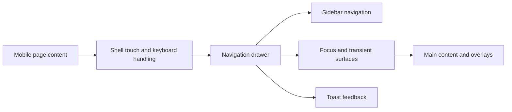

Codex review: needs maintainer review before merge. _Reviewed August 27, 2026, 5:49 AM ET / 09:49 UTC._

# ClawSweeper review

## What this changes

The PR moves mobile navigation from a generic modal to a shell-owned drawer that opens by controls or a deliberate rightward touch drag, with accompanying focus, overlay, toast, and responsive-layout handling.

## Merge readiness

⚠️ **Ready for maintainer review - 3 items remain**

Keep open for maintainer review: this MEMBER-authored, maintainer-labeled PR is a stacked mobile-navigation feature, and current main still uses the modal presentation it replaces.

**Priority:** P2
**Reviewed head:** `43494ef6ac55c95f9e09dcdafbc154ce27cb1dfb`
**Owner decision:** Required. See [Decision needed](#decision-needed).

## Review scores

| Measure | Result | What it means |
|---|---|---|
| **Overall readiness** | 🦐 gold shrimp **(3/6)** | The implementation and focused browser coverage are coherent, but the stacked branch still needs exact-head browser and CI confirmation before it is ready to land. |
| **Proof confidence** | 🦐 gold shrimp **(3/6)** | Not applicable: Not applicable to the contributor-proof gate because the author association is MEMBER; the PR body supplies screenshot evidence, while exact-head browser validation remains part of merge readiness. |
| **Patch quality** | 🐚 platinum hermit **(4/6)** | No actionable review findings were identified. |

## Verification

| Check | Result | Evidence |
|---|---|---|
| **Real behavior** | Not applicable | Not applicable: Not applicable to the contributor-proof gate because the author association is MEMBER; the PR body supplies screenshot evidence, while exact-head browser validation remains part of merge readiness. |
| **Evidence reviewed** | 6 items | Current-main baseline: Current main still renders mobile navigation through an openclaw modal dialog, so the central drawer behavior is not already implemented there.<br>Changed owner boundary: The PR centralizes mobile drawer open/close, responsive handoff, focus restoration, and keyboard routing in the application-shell owner.<br>Gesture implementation: The lazy swipe runtime direction-locks a single touch, excludes interactive and horizontally scrollable content, then opens only after its reveal threshold. |
| **Findings** | None | None. |
| **Security** | None | None. |


### Live Verification

**Command:** `pnpm test:ui:e2e -- ui/src/e2e/native-nav-sidebar-toggle.e2e.test.ts`

**Result:** FAIL (failed) — step 1 `expect_output` `opens the mobile drawer by swipe across the full mobile-layout range`: `expected terminal output was not visible within 30 seconds: "opens the mobile drawer by swipe across the full mobile-layout range"`

```text
$ node --import tsx scripts/ensure-playwright-chromium.mts && node scripts/run-vitest.mjs run --config test/vitest/vitest.ui-e2e.config.ts --configLoader runner
 -- ui/src/e2e/native-nav-sidebar-toggle.e2e.test.ts
[ui-e2e] Using system Chromium at /usr/bin/chromium-browser.
Downloading FFmpeg (playwright ffmpeg v1011) from https://cdn.playwright.dev/dbazure/download/playwright/builds/ffmpeg/1011/ffmpeg-linux.zip
2.3 MiB [====================] 100% 0.0s
FFmpeg (playwright ffmpeg v1011) downloaded to /tmp/clawsweeper-live-proof-130319-PmYXdu/profile/cache/ms-playwright/ffmpeg-1011

 RUN  v4.1.11 /tmp/clawsweeper-live-proof-130319-PmYXdu/target
```

**Assertions:**

- FAIL `expect_output`: opens the mobile drawer by swipe across the full mobile-layout range

## How this fits together

The Control UI shell hosts navigation alongside chat, overlays, and utility panels. On mobile, the shell decides when navigation becomes a modal drawer and must keep touch input, keyboard focus, background interactivity, and transient UI surfaces coordinated.



## Decision needed

| Question | Recommendation |
|---|---|
| After the stacked mobile-topbar base lands, should OpenClaw adopt this shell-owned draggable drawer as the mobile navigation interaction model? | **Accept the drawer model:** Land the rebased PR after exact-head UI checks and browser evidence confirm gestures, focus, overlays, and responsive handoff. |

Why: The patch adds a product-visible interaction model rather than repairing an established defect, and its acceptance requires maintainer judgment after the stacked UI settles.

## Before merge

- [ ] **Resolve merge risk (P1)** - This PR is stacked on the open base at https://github.com/openclaw/openclaw/pull/130318; it needs an exact-head rebase and UI validation after that base lands.
- [ ] **Resolve merge risk (P1)** - The custom drawer now owns interactions formerly provided by the modal component, so the exact merged head needs browser confirmation of touch, focus, nested-overlay, and breakpoint behavior before landing.


<details>
<summary><strong>Agent review details</strong></summary>

### Security

None.

### PR surface

Source +503, Tests +62, Other 0. Total +565 across 31 files.

<details>
<summary>View PR surface stats</summary>

| Area | Files | Added | Removed | Net |
|---|---:|---:|---:|---:|
| Source | 24 | 669 | 166 | +503 |
| Tests | 5 | 128 | 66 | +62 |
| Docs | 0 | 0 | 0 | 0 |
| Config | 0 | 0 | 0 | 0 |
| Generated | 0 | 0 | 0 | 0 |
| Other | 2 | 3 | 3 | 0 |
| **Total** | **31** | **800** | **235** | **+565** |

</details>

### Review metrics

| Metric | Value | Why it matters |
|---|---|---|
| **Production versus test delta** | production +669/-166, tests +128/-66, baselines +3/-3 | The feature introduces a substantial shell-owned interaction path while adding focused browser coverage for its touch, focus, overlay, and responsive behaviors. |

### Merge-risk options

**Maintainer options:**
1. **Validate the rebased stack (recommended)**  
   Land the base first, rebase this PR, and require its exact head to pass the focused mobile drawer browser flow before merge.
2. **Accept the interaction risk**  
   A maintainer may accept the custom drawer contract without fresh exact-head browser evidence if it is intentionally preferred over modal behavior.

### Technical review

Best possible solution:

Retain one shell-owned mobile drawer using the existing navigation content, then land the stack in order after exact-head browser evidence confirms the interaction contract.

Do we have a high-confidence way to reproduce the issue?

Not applicable as a bug reproduction: this PR proposes a new mobile navigation interaction, while its browser E2E test provides a concrete validation path for the proposed behavior.

Is this the best way to solve the issue?

Likely yes: current main’s modal wrapper cannot provide a continuous finger-tracked drawer, and the shell is the shared owner of navigation, focus, overlays, and responsive handoff; final browser confirmation remains necessary.

AGENTS.md: found and applied where relevant.

Codex review notes: model internal, reasoning high; reviewed against [46ca7d1f2791](https://github.com/openclaw/openclaw/commit/46ca7d1f279192b9b547f861a0c1c990a9982d86).

### Labels

Label justifications:

- `P2`: This is a bounded, user-visible mobile Control UI feature rather than an urgent runtime regression.
- `merge-risk: 🚨 other`: Replacing modal behavior with custom shell touch, focus, inertness, and overlay coordination has user-interaction risk not settled by static review alone.
- `rating: 🦐 gold shrimp`: Overall readiness is 🦐 gold shrimp; proof is 🦐 gold shrimp and patch quality is 🐚 platinum hermit.
- `status: 👀 ready for maintainer look`: ClawSweeper has no concrete contributor-facing blocker left for this PR. Not applicable: Not applicable to the contributor-proof gate because the author association is MEMBER; the PR body supplies screenshot evidence, while exact-head browser validation remains part of merge readiness.
- `proof: 📸 screenshot`: Contributor real behavior proof includes screenshot evidence. Not applicable to the contributor-proof gate because the author association is MEMBER; the PR body supplies screenshot evidence, while exact-head browser validation remains part of merge readiness.

### Evidence

What I checked:

- **Current-main baseline:** Current main still renders mobile navigation through an openclaw modal dialog, so the central drawer behavior is not already implemented there. ([`ui/src/app/app-shell-view.ts:563`](https://github.com/openclaw/openclaw/blob/46ca7d1f2791/ui/src/app/app-shell-view.ts#L563), [46ca7d1f2791](https://github.com/openclaw/openclaw/commit/46ca7d1f2791))
- **Changed owner boundary:** The PR centralizes mobile drawer open/close, responsive handoff, focus restoration, and keyboard routing in the application-shell owner. ([`ui/src/app/app-shell-chrome.ts:194`](https://github.com/openclaw/openclaw/blob/43494ef6ac55/ui/src/app/app-shell-chrome.ts#L194), [43494ef6ac55](https://github.com/openclaw/openclaw/commit/43494ef6ac55))
- **Gesture implementation:** The lazy swipe runtime direction-locks a single touch, excludes interactive and horizontally scrollable content, then opens only after its reveal threshold. ([`ui/src/app/nav-drawer-swipe.runtime.ts:117`](https://github.com/openclaw/openclaw/blob/43494ef6ac55/ui/src/app/nav-drawer-swipe.runtime.ts#L117), [43494ef6ac55](https://github.com/openclaw/openclaw/commit/43494ef6ac55))
- **Behavior coverage:** The browser E2E coverage exercises mobile swipe opening, focus containment, nested Inbox and debug overlays, Escape, backdrop dismissal, breakpoint handoff, and toast ownership. ([`ui/src/e2e/native-nav-sidebar-toggle.e2e.test.ts:528`](https://github.com/openclaw/openclaw/blob/43494ef6ac55/ui/src/e2e/native-nav-sidebar-toggle.e2e.test.ts#L528), [43494ef6ac55](https://github.com/openclaw/openclaw/commit/43494ef6ac55))
- **Feature history:** Mobile chat navigation originated in the current-main history with the mobile-title-bar feature, while recent shell and modal work is also concentrated in this area. ([`ui/src/app/mobile-nav-layout.ts:5`](https://github.com/openclaw/openclaw/blob/9ce8ac94b97e/ui/src/app/mobile-nav-layout.ts#L5), [9ce8ac94b97e](https://github.com/openclaw/openclaw/commit/9ce8ac94b97e))
- **Stack dependency:** The supplied PR context identifies the still-open mobile-topbar PR as this branch’s base; the two PRs address adjacent, not duplicate, mobile shell behavior. ([04bd1af3b2b7](https://github.com/openclaw/openclaw/commit/04bd1af3b2b7))

Likely related people:

- **Peter Steinberger:** Introduced the mobile navigation/title-bar direction and has recent main-history ownership of the application shell and modal keyboard behavior. (role: mobile navigation feature-history owner; confidence: high; commits: [9ce8ac94b97e](https://github.com/openclaw/openclaw/commit/9ce8ac94b97eea44c840fc8b3551cc4cd0157051), [e4b36f2e971c](https://github.com/openclaw/openclaw/commit/e4b36f2e971ca50ec95f6d5102a6488da1e31431), [72adefbca06c](https://github.com/openclaw/openclaw/commit/72adefbca06c6eea7a17ed03373e4747c4420d79); files: `ui/src/app/mobile-nav-layout.ts`, `ui/src/app/app-shell-chrome.ts`, `ui/src/app/app-shell-view.ts`)
- **vyctorbrzezowski:** Current history attributes adjacent shell/sidebar work to this author, including the stacked mobile-topbar base and prior sidebar-structure work. (role: recent adjacent Control UI contributor; confidence: medium; commits: [04bd1af3b2b7](https://github.com/openclaw/openclaw/commit/04bd1af3b2b7862531778564eef25ab5e565ee27), [aed4510bd094](https://github.com/openclaw/openclaw/commit/aed4510bd0943d847031c20a7c0bb4f399b250bd); files: `ui/src/app/app-shell-chrome.ts`, `ui/src/app/app-shell-view.ts`, `ui/src/e2e/native-nav-sidebar-toggle.e2e.test.ts`)

### Rank-up moves

Optional improvements that raise the rating; they are not merge blockers.

- After https://github.com/openclaw/openclaw/pull/130318 lands, rebase and run the focused mobile drawer browser flow on this exact head.
- Attach or retain a redacted exact-head mobile interaction capture if available, showing the drawer opening and settling.

### Rating scale

| Score | Internal tier | Crab rank | Meaning |
|---:|:---:|---|---|
| **6/6** | S | 🦀 challenger crab | Exceptional readiness |
| **5/6** | A | 🦞 diamond lobster | Very strong readiness |
| **4/6** | B | 🐚 platinum hermit | Good normal PR; ordinary maintainer review |
| **3/6** | C | 🦐 gold shrimp | Useful, but confidence is limited |
| **2/6** | D | 🦪 silver shellfish | Proof or implementation needs work |
| **1/6** | F | 🧂 unranked krab | Not merge-ready |
| N/A | NA | 🌊 off-meta tidepool | Rating does not apply |

Overall follows the weaker of proof and patch quality.
Shiny media proof means a screenshot, video, or linked artifact directly shows the changed behavior. Runtime, network, CSP, and security claims still need visible diagnostics.

### Workflow

- ClawSweeper keeps one durable marker-backed review comment per issue or PR.
- Re-runs edit this comment so the latest verdict, findings, and automation markers stay together instead of adding duplicate bot comments.
- A fresh review can be triggered by eligible `@clawsweeper re-review` comments, exact-item GitHub events, scheduled/background review runs, or manual workflow dispatch.
- PR/issue authors and users with repository write access can comment `@clawsweeper re-review` or `@clawsweeper re-run` on an open PR or issue to request a fresh review only.
- Maintainers can also comment `@clawsweeper review` to request a fresh review only.
- Fresh-review commands do not start repair, autofix, rebase, CI repair, or automerge.
- Maintainer-only repair and merge flows require explicit commands such as `@clawsweeper autofix`, `@clawsweeper automerge`, `@clawsweeper fix ci`, or `@clawsweeper address review`.
- Maintainers can comment `@clawsweeper explain` to ask for more context, or `@clawsweeper stop` to stop active automation.

### History

<details>
<summary>Review history (7 earlier review cycles)</summary>

<!-- clawsweeper-review-history v=1 total=7 -->
- reviewed 2026-08-26T19:41:59.892Z sha 4e907f5f9a6259cc678dede9ac806aebef947110 :: found issues before merge. :: [P2] Use the drawer breakpoint for swipe eligibility
- reviewed 2026-08-27T00:27:59.937Z sha 88fde00b73db4ad34e1317d98e4b069d66cca643 :: needs maintainer review before merge. :: none
- reviewed 2026-08-27T01:40:41.794Z sha bb179c2e3cffeb1af9e4c2bff85ffe8e04e76af4 :: found issues before merge. :: [P1] Isolate every root panel while the drawer is open | [P3] Use a runtime suffix for the lazy drawer module
- reviewed 2026-08-27T03:57:59.363Z sha 56dde0168d9355352d8b9a2738b254f85c1dd4fa :: found issues before merge. :: [P1] Close the drawer before opening the Debug overlay | [P3] Use a runtime-suffixed module for the lazy drawer
- reviewed 2026-08-27T07:29:14.917Z sha b1ef9735015d6af06ef596d871d7148515198389 :: found issues before merge. :: [P2] Remove the capturing keydown listener on teardown | [P3] Rename the lazy swipe module as a runtime boundary
- reviewed 2026-08-27T09:05:39.078Z sha 703bb9b56331a213e3756227893f937a6bf1ad12 :: needs maintainer review before merge. :: none
- reviewed 2026-08-27T09:29:49.167Z sha b98a8cb6288d06087972289702193886580b9ad3 :: needs maintainer review before merge. :: none

</details>

</details>

<!-- clawsweeper-verdict:needs-human item=130319 sha=43494ef6ac55c95f9e09dcdafbc154ce27cb1dfb confidence=high updated_at=2026-08-27T09:46:33Z reviewed_at=2026-08-27T09:49:48.488Z lease_owner=github-run-33059964321-1 lease_comment_id=5437262050 source_revision=1653d1f9aa4ff781de0bb34a7d2740ca7739741e644bab9a244188beac9ed52e -->

<!-- clawsweeper-review-version item=130319 reviewed_at=2026-08-27T09:49:48.488Z sha=43494ef6ac55c95f9e09dcdafbc154ce27cb1dfb source_revision=1653d1f9aa4ff781de0bb34a7d2740ca7739741e644bab9a244188beac9ed52e lease_owner=github-run-33059964321-1 lease_comment_id=5437262050 v=1 -->

<!-- clawsweeper-review item=130319 -->