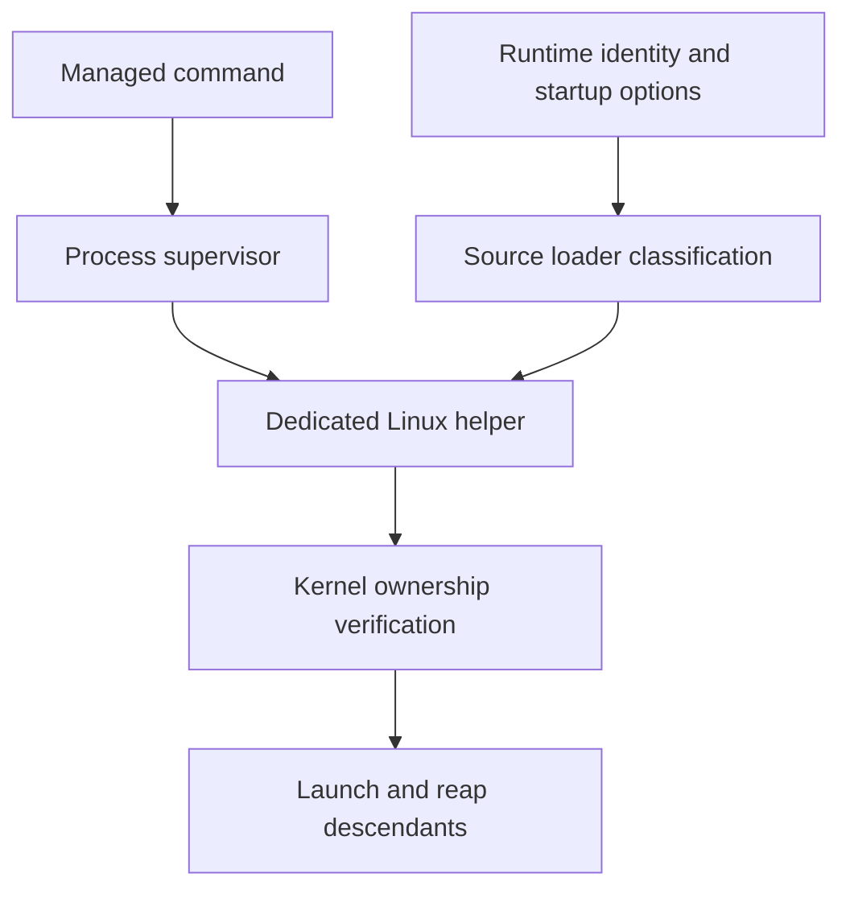

Codex review: needs maintainer review before merge.

## What this changes

This PR replaces filename-based Linux process-owner admission with runtime identity and startup-hook detection, sharing the existing Node option parser.

**Example:** A Linux Bun process executes a TypeScript process helper without startup hooks.
- **Before:** Admission rejects the helper because its source URL ends in .ts.
- **After:** Admission proceeds to kernel ownership verification and the existing child checks.

## Review scores

| Measure | Result | What it means |
|---|---|---|
| **Overall readiness** | 🦐 gold shrimp **(3/6)** | The focused patch has no actionable findings and passing exact-head CI; behavioral evidence remains limited to admission tests and a classification probe. |
| **Proof confidence** | 🦐 gold shrimp **(3/6)** | This maintainer-authored PR is outside the ordinary contributor proof gate; its supplied evidence covers mocked admission and a Node/Bun/AOT classification probe, rather than a shipped managed-command run. |
| **Patch quality** | 🐚 platinum hermit **(4/6)** | No actionable review findings were identified. |

## Product

**Kind:** Bug fix · **Worth it:** Yes · **Fix scope:** Complete
**User problem:** Managed Linux commands can reject a helper that executes TypeScript natively or retains TypeScript source identity after compilation.
**Reason:** Runtime capability is a more accurate admission criterion than source filenames, and the maintainer-authored direction preserves the independent-reaper restriction.

## Merge readiness

✅ **Ready for maintainer review**

Keep this PR open: current main still rejects loader-free TypeScript helpers, and the focused change preserves kernel ownership checks without introducing a concrete correctness defect.

**Priority:** P2
**Reviewed head:** `d74819bd3ef35c61611c5e786d386261bec97d54`

## Before merge

None.

## Findings

None.

### Tests

- Missing end-to-end proof: The supplied classification probe does not demonstrate managed-command launch and descendant reaping through the shipped helper.

<strong>Agent review details</strong>

### How this fits together

The process supervisor admits a dedicated Linux helper before launching managed commands; runtime identity and startup options determine admission, while kernel wait ownership controls descendant signaling and reaping.

### Technical review

Best possible solution:

Use the existing runtime identity owner and shared startup-hook parser while retaining dedicated kernel wait ownership.

Do we have a high-confidence way to reproduce the issue?

Current main's unconditional TypeScript-extension guard establishes the rejection path; the supplied regression reports red on the original guard and green after replacement, but no target code was executed during this review.

Is this the best way to solve the issue?

The change uses existing owners, preserves the parser's behavior, removes the superseded implementation, and retains the kernel checks that motivated the original restriction.

AGENTS.md: found and applied where relevant.

Codex review notes: model internal, reasoning medium; reviewed against [f6ded3229891](https://github.com/openclaw/openclaw/commit/f6ded3229891a04a1e31d949da9a51bf8f03449b).

### Provenance checked

- `Linux process-owner admission` changes intended behavior with a stated reason (2aed86671065f0f73cf78032dcecc95e287dda09: Dedicated child-wait ownership prevents an independent loader reaper from invalidating PID pinning before signals.)
- `Node option parsing` keeps the original intent (88c684c13efebb6106f75ddee18a3103921d86c9: Preserve Node's quoting grammar so resolver hooks and managed-service heap options are interpreted correctly.)
- `Vitest worker-cache loader exclusion` keeps the original intent (8b2c9fbcc8bff20a9ed9e87d020eaa7639a56a84: Custom loaders can alter emitted code independently of cached source bytes.)

### Testing

Proof path: unit tests only.

### Security

None.

### Evidence

What I checked:

- **Current main retains the reported failure:** The fetched main revision still rejects every .ts, .cts, or .mts source URL before attempting kernel admission. ([`src/process/supervisor/linux-child-subreaper.ts:37`](https://github.com/openclaw/openclaw/blob/f6ded3229891a04a1e31d949da9a51bf8f03449b/src/process/supervisor/linux-child-subreaper.ts#L37), [f6ded3229891](https://github.com/openclaw/openclaw/commit/f6ded3229891a04a1e31d949da9a51bf8f03449b))
- **Introduced change and retained safeguards:** The pinned introduction replaces the filename guard; platform admission, subreaper verification, existing-child rejection, synchronous wait ownership before signaling, and ECHILD-based extinction remain intact. ([`src/process/supervisor/linux-child-subreaper.ts:38`](https://github.com/openclaw/openclaw/blob/d74819bd3ef35c61611c5e786d386261bec97d54/src/process/supervisor/linux-child-subreaper.ts#L38), [d74819bd3ef3](https://github.com/openclaw/openclaw/commit/d74819bd3ef35c61611c5e786d386261bec97d54))
- **Original ownership rationale:** https://github.com/openclaw/openclaw/pull/160465 established dedicated wait ownership because a loader's independent reaper can invalidate PID pinning; this PR retains that restriction while replacing its filename proxy. ([`src/process/supervisor/linux-child-subreaper.ts:64`](https://github.com/openclaw/openclaw/blob/2aed86671065f0f73cf78032dcecc95e287dda09/src/process/supervisor/linux-child-subreaper.ts#L64), [2aed86671065](https://github.com/openclaw/openclaw/commit/2aed86671065f0f73cf78032dcecc95e287dda09))
- **Parser provenance and complete cutover:** The parser introduced by https://github.com/openclaw/openclaw/pull/128663 moves without algorithm changes; daemon, diagnostic, and worker-cache callers use the shared module, and the obsolete module and wrapper entry are removed. ([`node-runtime-env.mjs:5`](https://github.com/openclaw/openclaw/blob/d74819bd3ef35c61611c5e786d386261bec97d54/node-runtime-env.mjs#L5), [d74819bd3ef3](https://github.com/openclaw/openclaw/commit/d74819bd3ef35c61611c5e786d386261bec97d54))
- **Accepted startup-hook restriction:** The maintainer-authored direction explicitly excludes startup hooks that can install a separate compiler or reaper; the implementation also rejects such hooks for loose built helpers that previously passed the filename guard. ([`cli-invocation.mjs:109`](https://github.com/openclaw/openclaw/blob/d74819bd3ef35c61611c5e786d386261bec97d54/cli-invocation.mjs#L109), [d74819bd3ef3](https://github.com/openclaw/openclaw/commit/d74819bd3ef35c61611c5e786d386261bec97d54))
- **Exact-head CI:** The current-head openclaw/ci-gate succeeded; paginated checks showed cancelled automation jobs but no failing product checks. ([d74819bd3ef3](https://github.com/openclaw/openclaw/commit/d74819bd3ef35c61611c5e786d386261bec97d54))

Likely related people:

- **Peter Steinberger:** Raw commit 3bfccdb9bd3df459931e9d6f8751acfc9f147dfa adds cli-invocation.mjs:62 relative to its recorded parents. This identifies author metadata, not feature responsibility or a PR merger. (role: source-line author; confidence: high; commits: [3bfccdb9bd3d](https://github.com/openclaw/openclaw/commit/3bfccdb9bd3df459931e9d6f8751acfc9f147dfa); files: `cli-invocation.mjs`)
- **Leon-SK668:** Raw commit 88c684c13efebb6106f75ddee18a3103921d86c9 adds src/infra/node-options.test.ts:4 relative to its recorded parents. This identifies author metadata, not feature responsibility or a PR merger. (role: source-line author; confidence: high; commits: [88c684c13efe](https://github.com/openclaw/openclaw/commit/88c684c13efebb6106f75ddee18a3103921d86c9); files: `src/infra/node-options.test.ts`)

### PR surface

Source -39, Tests +72, Docs +4, Other +63. Total +100 across 15 files. Added test files: 1.

View PR surface stats

| Area | Files | Added | Removed | Net |
|---|---:|---:|---:|---:|
| Source | 5 | 6 | 45 | -39 |
| Tests | 3 | 74 | 2 | +72 |
| Docs | 1 | 6 | 2 | +4 |
| Config | 0 | 0 | 0 | 0 |
| Generated | 0 | 0 | 0 | 0 |
| Other | 6 | 71 | 8 | +63 |
| **Total** | **15** | **157** | **57** | **+100** |

### Labels

Label changes:

- add `P2`: This repairs a bounded Linux process-helper admission failure without evidence of a widespread urgent regression.
- add `merge-risk: 🚨 compatibility`: Loose built helpers launched with --import, --require, or loader hooks now fail admission; the maintainer-authored PR explicitly accepts startup-hook incompatibility to preserve exclusive child reaping.
- add `rating: 🦐 gold shrimp`: Overall readiness is 🦐 gold shrimp; proof is 🦐 gold shrimp and patch quality is 🐚 platinum hermit.
- add `status: 👀 ready for maintainer look`: ClawSweeper has no concrete contributor-facing blocker left for this PR.

Label justifications:

- `P2`: This repairs a bounded Linux process-helper admission failure without evidence of a widespread urgent regression.
- `merge-risk: 🚨 compatibility`: Loose built helpers launched with --import, --require, or loader hooks now fail admission; the maintainer-authored PR explicitly accepts startup-hook incompatibility to preserve exclusive child reaping.
- `rating: 🦐 gold shrimp`: Overall readiness is 🦐 gold shrimp; proof is 🦐 gold shrimp and patch quality is 🐚 platinum hermit.
- `status: 👀 ready for maintainer look`: ClawSweeper has no concrete contributor-facing blocker left for this PR.

### Rating scale

6/6 🦀 challenger crab · 5/6 🦞 diamond lobster · 4/6 🐚 platinum hermit · 3/6 🦐 gold shrimp · 2/6 🦪 silver shellfish · 1/6 🧂 unranked krab. Overall follows the weaker of proof and patch quality; ✨ marks media proof (a screenshot, video, or linked artifact) that directly shows the changed behavior.

### Workflow

ClawSweeper edits this one comment on every review. Comment `@clawsweeper re-review` for a fresh review only. Repair and merge execution lanes are retired.

_Reviewed October 24, 2026, 2:48 AM ET / 06:48 UTC._

<!-- clawsweeper-verdict:needs-human item=182306 sha=d74819bd3ef35c61611c5e786d386261bec97d54 confidence=high updated_at=2026-10-24T06:45:10Z reviewed_at=2026-10-24T06:48:23.449Z lease_owner=github-run-40071367534-1 lease_comment_id=6381056476 source_revision=060ffdb4530d3ffd388d0c05d1dd43fc48304ef88e7bc726839bfc2c3cbbaa09 hold=not_opted_in findings=0 -->
<!-- clawsweeper-review-state:ready item=182306 sha=d74819bd3ef35c61611c5e786d386261bec97d54 v=1 -->

<!-- clawsweeper-review-version item=182306 reviewed_at=2026-10-24T06:48:23.449Z sha=d74819bd3ef35c61611c5e786d386261bec97d54 source_revision=060ffdb4530d3ffd388d0c05d1dd43fc48304ef88e7bc726839bfc2c3cbbaa09 lease_owner=github-run-40071367534-1 lease_comment_id=6381056476 v=1 -->

<!-- clawsweeper-review item=182306 -->