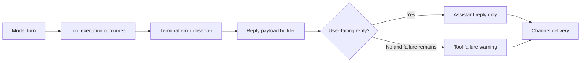

Codex review: needs maintainer review before merge. _Reviewed August 20, 2026, 4:00 AM ET / 08:00 UTC._

# ClawSweeper review

## What this changes

This PR replaces heuristic tool-failure warning and recovery tracking with a reply-authoritative policy that warns only when a run ends without a user-facing reply and retains a tool failure.

## Merge readiness

⚠️ **Ready for maintainer review - 3 items remain**

Keep open for maintainer product review: the implementation cleanly removes the heuristic stack, but it deliberately changes the default channel outcome after a failed write/send/persistence action from a terminal warning to trusting any assistant reply.

**Priority:** P2
**Reviewed head:** `ec1a5b67b4e2bf77c2881440d4efe6f0b0b91763`
**Owner decision:** Required. See [Decision needed](#decision-needed).

## Review scores

| Measure | Result | What it means |
|---|---|---|
| **Overall readiness** | 🐚 platinum hermit **(4/6)** | The implementation is a coherent, net-negative refactor with focused coverage; the remaining blocker is deliberate product-policy acceptance, not a patch defect. |
| **Proof confidence** | 🌊 off-meta tidepool | Not applicable: This is maintainer-authored work; the external-contributor proof gate does not apply, though the PR body supplies focused test claims rather than independently inspected after-fix live evidence. |
| **Patch quality** | 🐚 platinum hermit **(4/6)** | No actionable review findings were identified. |

## Verification

| Check | Result | Evidence |
|---|---|---|
| **Real behavior** | Not applicable | Not applicable: This is maintainer-authored work; the external-contributor proof gate does not apply, though the PR body supplies focused test claims rather than independently inspected after-fix live evidence. |
| **Evidence reviewed** | 7 items | Current-main behavior: Current main still keeps unresolved mutating failures and recovery receipts, so the central policy change is not already implemented.<br>Owner-boundary change: The PR reduces the terminal state to the latest failure, clearing it only after a same-tool success.<br>Channel-output policy: The payload boundary suppresses every terminal tool warning once any user-facing reply was produced. |
| **Findings** | None | None. |
| **Security** | None | None. |


### Live Verification

**Command:** `node scripts/run-vitest.mjs src/agents/tool-terminal-outcome.test.ts src/agents/embedded-agent-runner/run/tool-error-warning.test.ts`

**Result:** FAIL (partial) — step 2 `expect_output` `tool terminal outcome observer`: `expected terminal output was not visible within 30 seconds: "tool terminal outcome observer"`

```text
node scripts/run-vitest.mjs src/agents/tool-terminal-outcome.test.ts src/agents/embedded-agent-runner/run/tool-error-warning.test.ts
runner@runnervmzvulz:/tmp/clawsweeper-live-proof-126542-BONsYu/target$ node scripts/run-vitest.mjs src/agents/tool-terminal-outcome.test.ts src/agents/embedded-
agent-runner/run/tool-error-warning.test.ts
node scripts/run-vitest.mjs src/agents/tool-terminal-outcome.test.ts src/agents/embedded-agent-runner/run/tool-error-warning.test.ts
[test] starting test/vitest/vitest.unit-fast.config.ts

 RUN  v4.1.10 /tmp/clawsweeper-live-proof-126542-BONsYu/target

 ✓  unit-fast  src/agents/embedded-agent-runner/run/tool-error-warning.test.ts (36 tests) 29ms
 ✓  unit-fast  src/agents/tool-terminal-outcome.test.ts (10 tests) 24ms

 Test Files  2 passed (2)
      Tests  46 passed (46)
   Start at  08:01:47
   Duration  5.16s (transform 7.41s, setup 206ms, import 9.71s, tests 53ms, environment 0ms)

[test] passed 1 Vitest shard in 15.84s
runner@runnervmzvulz:/tmp/clawsweeper-live-proof-126542-BONsYu/target$ node scripts/run-vitest.mjs src/agents/tool-terminal-outcome.test.ts src/agents/embedded-
agent-runner/run/tool-error-warning.test.ts
[test] starting test/vitest/vitest.unit-fast.config.ts

 RUN  v4.1.10 /tmp/clawsweeper-live-proof-126542-BONsYu/target

 ✓  unit-fast  src/agents/tool-terminal-outcome.test.ts (10 tests) 22ms
 ✓  unit-fast  src/agents/embedded-agent-runner/run/tool-error-warning.test.ts (36 tests) 28ms

 Test Files  2 passed (2)
      Tests  46 passed (46)
   Start at  08:02:03
   Duration  2.94s (transform 3.21s, setup 92ms, import 5.43s, tests 50ms, environment 0ms)

[test] passed 1 Vitest shard in 13.42s
runner@runnervmzvulz:/tmp/clawsweeper-live-proof-126542-BONsYu/target$


```

**Assertions:**

- FAIL `expect_output`: tool terminal outcome observer
- FAIL `expect_output`: buildEmbeddedRunPayloads tool warnings

## How this fits together

The embedded agent runner collects each tool’s terminal outcome, then turns the completed attempt into channel reply payloads. This change alters the final warning decision that follows model output and affects what channel users see after tool failures.



## Decision needed

| Question | Recommendation |
|---|---|
| Should the default channel policy treat every user-facing assistant reply as authoritative after a failed write, send, or persistence operation? | **Adopt reply-authoritative warnings:** Merge the two-rule policy, accepting that terminal warnings are reserved for runs with no user-facing reply. |

Why: This is an intentional default-product tradeoff between eliminating stale false-positive warnings and retaining a final corrective signal when model text incorrectly claims a side effect succeeded.

## Before merge

- [ ] **Resolve merge risk (P1)** - Merging intentionally removes the terminal warning after a user-facing reply even when a write, send, or persistence operation failed; a misleading reply can therefore be the only channel-visible outcome while failure details remain in progress and Control UI.
- [ ] **Complete next step (P2)** - A maintainer must choose the intended default warning semantics before this policy-changing refactor can land.


<details>
<summary><strong>Agent review details</strong></summary>

### Security

None.

### PR surface

Source -707, Tests -1429, Other -141. Total -2277 across 64 files.

<details>
<summary>View PR surface stats</summary>

| Area | Files | Added | Removed | Net |
|---|---:|---:|---:|---:|
| Source | 33 | 59 | 766 | -707 |
| Tests | 30 | 105 | 1534 | -1429 |
| Docs | 0 | 0 | 0 | 0 |
| Config | 0 | 0 | 0 | 0 |
| Generated | 0 | 0 | 0 | 0 |
| Other | 1 | 0 | 141 | -141 |
| **Total** | **64** | **164** | **2441** | **-2277** |

</details>

### Review metrics

| Metric | Value | Why it matters |
|---|---|---|
| **Production versus test delta** | production +55/-735; tests/test support +109/-1706 | The branch is strongly net-negative and removes the old warning/recovery machinery, but its behavior change spans core, Codex, Copilot, and channel delivery tests. |

### Stored data model

Persistent data-model change detected: `serialized state: extensions/codex/src/app-server/event-projector-tool-items.ts`, `serialized state: extensions/codex/src/app-server/event-projector.command-output.test.ts`, `serialized state: scripts/e2e/mock-openai-server.mjs`, `serialized state: test/scripts/e2e-mock-config-limits.test.ts`, `vector/embedding metadata: extensions/memory-lancedb/index.test.ts`. Confirm migration or upgrade compatibility proof before merge.

### Root-cause cluster

Relationship: `canonical`
Canonical: https://github.com/openclaw/openclaw/pull/126542
Summary: This PR generalizes and replaces the narrow merged spawn-retry warning fix with a single terminal-warning policy.

Members:
- `superseded`: https://github.com/openclaw/openclaw/pull/126218 - The merged PR fixed the reported spawn-retry fingerprint case; this PR removes that special-case recovery model as part of the broader policy replacement.

Proposal only: this assessment does not dispatch repair, suppress jobs, mutate sibling items, close, or merge anything.

### Merge-risk options

**Maintainer options:**
1. **Adopt reply-authoritative warnings (recommended)**  
   Accept the default behavior change after confirming that progress and Control UI are the intended remaining visibility for failed side effects.
2. **Preserve a narrow side-effect signal**  
   Require a recorded-fact terminal warning for failed sends and durable writes when a reply does not explicitly establish the outcome.

### Technical review

Best possible solution:

Adopt one canonical reply-authoritative policy only if maintainers accept that channel users should rely on the assistant reply after failed side-effecting tools; otherwise retain a recorded side-effect failure signal for that narrow class rather than reviving heuristic text scanning.

Do we have a high-confidence way to reproduce the issue?

No live current-head reproduction was run in this read-only review; source and focused tests clearly model the reported failed-tool-then-reply sequence.

Is this the best way to solve the issue?

Unclear: the deletion is a coherent owner-boundary simplification if the new default is accepted, but whether a reply may replace a failed side-effect warning requires maintainer product judgment.

AGENTS.md: found and applied where relevant.

Codex review notes: model internal, reasoning high; reviewed against [5066bd782e65](https://github.com/openclaw/openclaw/commit/5066bd782e656837a0a0a91969a47109b8469451).

### Labels

Label changes:

- add `rating: 🐚 platinum hermit`: Overall readiness is 🐚 platinum hermit; proof is 🌊 off-meta tidepool and patch quality is 🐚 platinum hermit.
- remove `rating: 🦐 gold shrimp`: Current PR rating is `rating: 🐚 platinum hermit`, so this older rating label is no longer current.

Label justifications:

- `P2`: This is a deliberate default change for channel-visible tool-failure outcomes with meaningful but bounded user impact.
- `merge-risk: 🚨 message-delivery`: A failed messaging or side-effecting tool may no longer append a terminal warning when the model emits a reply.
- `rating: 🐚 platinum hermit`: Overall readiness is 🐚 platinum hermit; proof is 🌊 off-meta tidepool and patch quality is 🐚 platinum hermit.
- `status: 👀 ready for maintainer look`: ClawSweeper has no concrete contributor-facing blocker left for this PR. Not applicable: This is maintainer-authored work; the external-contributor proof gate does not apply, though the PR body supplies focused test claims rather than independently inspected after-fix live evidence.

### Evidence

What I checked:

- **Current-main behavior:** Current main still keeps unresolved mutating failures and recovery receipts, so the central policy change is not already implemented. ([`src/agents/tool-error-state.ts:24`](https://github.com/openclaw/openclaw/blob/5066bd782e65/src/agents/tool-error-state.ts#L24), [5066bd782e65](https://github.com/openclaw/openclaw/commit/5066bd782e65))
- **Owner-boundary change:** The PR reduces the terminal state to the latest failure, clearing it only after a same-tool success. ([`src/agents/tool-error-state.ts:13`](https://github.com/openclaw/openclaw/blob/ec1a5b67b4e2/src/agents/tool-error-state.ts#L13), [ec1a5b67b4e2](https://github.com/openclaw/openclaw/commit/ec1a5b67b4e2))
- **Channel-output policy:** The payload boundary suppresses every terminal tool warning once any user-facing reply was produced. ([`src/agents/embedded-agent-runner/run/tool-error-warning.ts:289`](https://github.com/openclaw/openclaw/blob/ec1a5b67b4e2/src/agents/embedded-agent-runner/run/tool-error-warning.ts#L289), [ec1a5b67b4e2](https://github.com/openclaw/openclaw/commit/ec1a5b67b4e2))
- **Caller and regression coverage:** Terminal preparation passes the attempt’s final tool error into the payload builder, and focused tests cover both no-reply warning and reply-authoritative cases. ([`src/agents/embedded-agent-runner/run/terminal-preparation.ts:185`](https://github.com/openclaw/openclaw/blob/ec1a5b67b4e2/src/agents/embedded-agent-runner/run/terminal-preparation.ts#L185), [ec1a5b67b4e2](https://github.com/openclaw/openclaw/commit/ec1a5b67b4e2))
- **Related fix provenance:** The earlier narrow spawn-retry fix was merged as the related PR; this branch explicitly replaces that special-case recovery model with a general policy. ([`src/agents/tool-terminal-outcome.test.ts:118`](https://github.com/openclaw/openclaw/blob/617bc7ebdd81/src/agents/tool-terminal-outcome.test.ts#L118), [617bc7ebdd81](https://github.com/openclaw/openclaw/commit/617bc7ebdd81))
- **Current-head comparison:** Comparing current main to the PR head shows the central terminal-warning files remain different; the work is neither obsolete nor already on main. ([`src/agents/embedded-agent-runner/run/payloads.ts:404`](https://github.com/openclaw/openclaw/blob/ec1a5b67b4e2/src/agents/embedded-agent-runner/run/payloads.ts#L404), [ec1a5b67b4e2](https://github.com/openclaw/openclaw/commit/ec1a5b67b4e2))

Likely related people:

- **steipete:** Current-main blame attributes the terminal-state and warning-policy lines to Peter Steinberger, who also authored the related merged spawn-retry fix and this branch. (role: recent area contributor; confidence: high; commits: [4118f31d8949](https://github.com/openclaw/openclaw/commit/4118f31d8949909049fafb72ab1da6c6967c194c), [617bc7ebdd81](https://github.com/openclaw/openclaw/commit/617bc7ebdd8159940f72ec2c19268b8311e82c3b), [ec1a5b67b4e2](https://github.com/openclaw/openclaw/commit/ec1a5b67b4e2bf77c2881440d4efe6f0b0b91763); files: `src/agents/tool-error-state.ts`, `src/agents/embedded-agent-runner/run/tool-error-warning.ts`, `src/agents/tool-terminal-outcome.ts`)
- **Josh Avant:** Authored the earlier heartbeat terminal-failure work that touched the same tool-mutation and terminal-outcome neighborhood. (role: adjacent owner; confidence: medium; commits: [aaf5d23883a1](https://github.com/openclaw/openclaw/commit/aaf5d23883a14f7224b4e9e2ddb513038716bad7); files: `src/agents/tool-mutation.ts`, `src/agents/tool-terminal-outcome.ts`)

### Rank-up moves

Optional improvements that raise the rating; they are not merge blockers.

- Record a maintainer decision on whether replies may suppress terminal side-effect failure warnings.
- Verify the upstream Codex comparison from the required sibling source before treating that rationale as evidence.

### Rating scale

| Score | Internal tier | Crab rank | Meaning |
|---:|:---:|---|---|
| **6/6** | S | 🦀 challenger crab | Exceptional readiness |
| **5/6** | A | 🦞 diamond lobster | Very strong readiness |
| **4/6** | B | 🐚 platinum hermit | Good normal PR; ordinary maintainer review |
| **3/6** | C | 🦐 gold shrimp | Useful, but confidence is limited |
| **2/6** | D | 🦪 silver shellfish | Proof or implementation needs work |
| **1/6** | F | 🧂 unranked krab | Not merge-ready |
| N/A | NA | 🌊 off-meta tidepool | Rating does not apply |

Overall follows the weaker of proof and patch quality.
Shiny media proof means a screenshot, video, or linked artifact directly shows the changed behavior. Runtime, network, CSP, and security claims still need visible diagnostics.

### Workflow

- ClawSweeper keeps one durable marker-backed review comment per issue or PR.
- Re-runs edit this comment so the latest verdict, findings, and automation markers stay together instead of adding duplicate bot comments.
- A fresh review can be triggered by eligible `@clawsweeper re-review` comments, exact-item GitHub events, scheduled/background review runs, or manual workflow dispatch.
- PR/issue authors and users with repository write access can comment `@clawsweeper re-review` or `@clawsweeper re-run` on an open PR or issue to request a fresh review only.
- Maintainers can also comment `@clawsweeper review` to request a fresh review only.
- Fresh-review commands do not start repair, autofix, rebase, CI repair, or automerge.
- Maintainer-only repair and merge flows require explicit commands such as `@clawsweeper autofix`, `@clawsweeper automerge`, `@clawsweeper fix ci`, or `@clawsweeper address review`.
- Maintainers can comment `@clawsweeper explain` to ask for more context, or `@clawsweeper stop` to stop active automation.

### History

<details>
<summary>Review history (2 earlier review cycles)</summary>

<!-- clawsweeper-review-history v=1 total=2 -->
- reviewed 2026-08-20T06:01:32.656Z sha bce2960bb4a06b130f9fa6061ff2c9ad1f72bd93 :: needs maintainer review before merge. :: none
- reviewed 2026-08-20T07:10:07.763Z sha bd65c30e202206144bf598a402a51fa65c82d3a8 :: needs maintainer review before merge. :: none

</details>

</details>

<!-- clawsweeper-verdict:needs-human item=126542 sha=ec1a5b67b4e2bf77c2881440d4efe6f0b0b91763 confidence=medium updated_at=2026-08-20T07:57:54Z reviewed_at=2026-08-20T08:00:53.145Z lease_owner=github-run-32346364539-1 lease_comment_id=5353074237 source_revision=d418c49c1e50fae517a03d5a2c2c6c8b2bb0adce3b676f307a647924b55a019b -->

<!-- clawsweeper-review-version item=126542 reviewed_at=2026-08-20T08:00:53.145Z sha=ec1a5b67b4e2bf77c2881440d4efe6f0b0b91763 source_revision=d418c49c1e50fae517a03d5a2c2c6c8b2bb0adce3b676f307a647924b55a019b lease_owner=github-run-32346364539-1 lease_comment_id=5353074237 v=1 -->

<!-- clawsweeper-review item=126542 -->