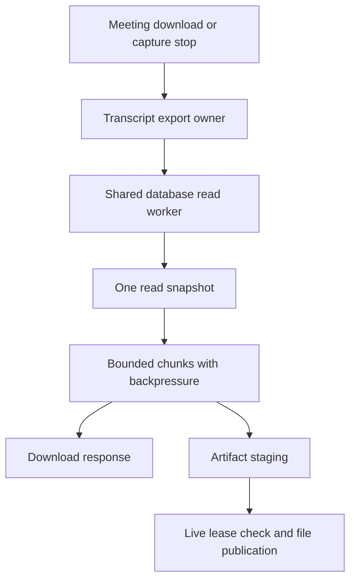

Codex review: needs maintainer review before merge.

## What this changes

Stream meeting downloads and artifact exports through the shared database read worker while retaining snapshot consistency, cancellation cleanup, and guarded file publication.

**Example:** Export a meeting while its saved utterances are reset
- **Before:** The artifact export can stop early because it rereads rows in separate batches.
- **After:** The export retains the original snapshot, and the next export observes the reset.

## Review scores

| Measure | Result | What it means |
|---|---|---|
| **Overall readiness** | 🦐 gold shrimp **(3/6)** | Useful, coherent implementation with substantive native boundary evidence, while export proof remains an in-process campaign. |
| **Proof confidence** | 🦐 gold shrimp **(3/6)** | Sufficient (live_output): The isolated Linux campaign exercised actual export workers, the Gateway request dispatcher, and the stop handler with identical after-fix output. Reported production-boundary fault runs cover reset consistency, cancellation, and foreign lease reassignment preventing artifact replacement; integrated checks cover the resolved head. Formats and schema remain unchanged, with preserved-state update evidence supplied. |
| **Patch quality** | 🐚 platinum hermit **(4/6)** | No actionable review findings were identified. |

## Product

**Kind:** Refactor · **Worth it:** Yes
**User problem:** Meeting artifact exports can become incomplete during concurrent resets, and export database work can delay other Gateway activity.
**Reason:** The established transcript and reader owner proposes a bounded worker cutover with concrete snapshot benefits and explicitly measured engineering costs.

## Merge readiness

✅ **Ready for maintainer review**

This PR retains useful work absent from current main. The earlier integration blocker is resolved, and the reviewed patch has no actionable code findings.

**Priority:** P2
**Reviewed head:** `7071c869be9c986239521d6682a1067695a7bde6`

## Before merge

None.

## Findings

None.

### Tests

- Missing end-to-end proof: The changed download and stop-time export scenarios were exercised through the in-process Gateway dispatcher and production owners, rather than a compiled Gateway's external client entry point.

<strong>Agent review details</strong>

### How this fits together

Meeting transcripts live in the shared SQLite state database. Download requests and capture-stop operations read those records to produce JSONL, Markdown, and explicit artifact files.

### Technical review

Best possible solution:

Keep export snapshots in the shared read worker and retain current durable lease checks at final artifact publication.

Do we have a high-confidence way to reproduce the issue?

Yes, source establishes caller-thread export queries and separate artifact batch reads; the supplied campaign also reports baseline failures for reset truncation and stale publication. This review did not execute them.

Is this the best way to solve the issue?

Yes, the patch extends the existing read owner, removes the obsolete native export route, and preserves the filesystem and writer owners rather than introducing competing persistence.

AGENTS.md: found and applied where relevant.

Codex review notes: model internal, reasoning medium; reviewed against [d5becdb65bbc](https://github.com/openclaw/openclaw/commit/d5becdb65bbc98ec142b183d71ec7414eb0c5855).

### Provenance checked

- `src/transcripts/store.ts and src/transcripts/library.ts export consumption` keeps the original intent (https://github.com/openclaw/openclaw/pull/145031: Await complete transcript reads and retain a private snapshot until iteration and cleanup finish; worker cutover remained separate.)
- `src/transcripts/store-export-jsonl.ts` keeps the original intent (https://github.com/openclaw/openclaw/pull/112910: Make SQLite canonical while preserving explicit export formats, ordering, ownership, and recoverability.)
- `src/transcripts/store-artifacts.ts publication` keeps the original intent (https://github.com/openclaw/openclaw/pull/112910: Materialize named export artifacts while preserving canonical transactional storage and ownership.)
- `src/state/openclaw-state-read-worker.ts and streaming dispatch` keeps the original intent (https://github.com/openclaw/openclaw/pull/165942: Stream one consistent snapshot with bounded backpressure, current host authority, and cleanup before publication.)
- `src/state/openclaw-state-db-read-connection.ts retired iterator` keeps the original intent (https://github.com/openclaw/openclaw/pull/145031: Finalize iteration and end the read transaction before tracked connection close, retaining failed-cleanup custody.)

### Testing

Proof path: in-process harness.

### Security

None.

### Evidence

What I checked:

- **Current main still uses the old artifact reader:** Fetched main retains caller-thread SQLite and repeated 64-row artifact queries; the central worker cutover is not already implemented. ([`src/transcripts/store-export-jsonl.ts:26`](https://github.com/openclaw/openclaw/blob/d5becdb65bbc98ec142b183d71ec7414eb0c5855/src/transcripts/store-export-jsonl.ts#L26), [d5becdb65bbc](https://github.com/openclaw/openclaw/commit/d5becdb65bbc98ec142b183d71ec7414eb0c5855))
- **Snapshot and cleanup ownership:** The introduced worker holds one read transaction across backpressured chunks, finalizes the iterator, rolls back, and closes the tracked connection. ([`src/transcripts/store-export.worker.ts:73`](https://github.com/openclaw/openclaw/blob/7071c869be9c986239521d6682a1067695a7bde6/src/transcripts/store-export.worker.ts#L73), [7071c869be9c](https://github.com/openclaw/openclaw/commit/7071c869be9c986239521d6682a1067695a7bde6))
- **Revoked-owner final-effect coverage:** The production artifact path is exercised with a foreign connection changing the durable lease owner to foreign-export-owner after staging begins; it rejects with OPENCLAW_STATE_LEASE_LOST and preserves the prior artifact, manifest, and directory contents. The PR reports this regression passing and its baseline negative control failing. ([`src/infra/sqlite-worker-transcript-export.test.ts:188`](https://github.com/openclaw/openclaw/blob/7071c869be9c986239521d6682a1067695a7bde6/src/infra/sqlite-worker-transcript-export.test.ts#L188), [7071c869be9c](https://github.com/openclaw/openclaw/commit/7071c869be9c986239521d6682a1067695a7bde6))
- **Verified filesystem dependency contract:** The new root/copyIn and tempFile imports establish the dependency signal. The verified 0.24.2 source forwards cancellation and assertBeforeMutation into publication; its native Windows path checks the callback immediately before publishing, and tempFile retains compatible staging cleanup. ([`src/root-impl.ts:1235`](https://github.com/openclaw/fs-safe/blob/64b21b49a2c06884fde5624cc0ffdbbd8da1d3dd/src/root-impl.ts#L1235), [64b21b49a2c0](https://github.com/openclaw/fs-safe/commit/64b21b49a2c06884fde5624cc0ffdbbd8da1d3dd))
- **Complete proof and accepted engineering costs:** The complete REST body matches captured SHA-256 aab17f97b09f19ed8f829eebb692bf3cc85cc0210bed29f4106567446339fca5. It reports identical export bytes across six Linux baseline/candidate pairs, zero failed SQL executions, five intended negative-control failures, and an updater-to-candidate check preserving sessions. The area owner explicitly retains final native authority guards, slower source-worker export timings, best-effort synchronization, and one additional artifact-sized temporary copy. ([845baa7234ac](https://github.com/openclaw/openclaw/commit/845baa7234ac8688929342b2d7db3163e1802ff1))
- **Earlier integration request addressed:** The exact head records the previous reviewed head and c881d464aafee4b07a80d34ae7c357a94b161690 as raw parents. GitHub reports mergeable=true, and the body reports 114 passing integrated tests covering repaired fixtures, shared readers, exports, and cancellation. The stale test-merge object was not used to infer merge behavior. ([7071c869be9c](https://github.com/openclaw/openclaw/commit/7071c869be9c986239521d6682a1067695a7bde6))

### PR surface

Source +279, Tests +256, Docs +22, Other +4. Total +561 across 28 files. Added test files: 0.

View PR surface stats

| Area | Files | Added | Removed | Net |
|---|---:|---:|---:|---:|
| Source | 16 | 434 | 155 | +279 |
| Tests | 9 | 432 | 176 | +256 |
| Docs | 2 | 24 | 2 | +22 |
| Config | 0 | 0 | 0 | 0 |
| Generated | 0 | 0 | 0 | 0 |
| Other | 1 | 6 | 2 | +4 |
| **Total** | **28** | **896** | **335** | **+561** |

### Review metrics

| Metric | Value | Why it matters |
|---|---|---|
| **Artifact payload queries** | 257-row artifact: 6 → 2 | The fixed-head cursor removes repeated batch reads independently of moving their execution into a worker. |

### Labels

Label changes:

- add `status: 👀 ready for maintainer look`: ClawSweeper has no concrete contributor-facing blocker left for this PR.
- remove `status: ⏳ waiting on author`: Current PR status label is `status: 👀 ready for maintainer look`.

Label justifications:

- `P2`: This improves meeting-export consistency and database placement without evidence of an urgent widespread outage.
- `rating: 🦐 gold shrimp`: Overall readiness is 🦐 gold shrimp; proof is 🦐 gold shrimp and patch quality is 🐚 platinum hermit.
- `status: 👀 ready for maintainer look`: ClawSweeper has no concrete contributor-facing blocker left for this PR.
- `proof: sufficient`: Contributor real behavior proof is sufficient.

### Rating scale

6/6 🦀 challenger crab · 5/6 🦞 diamond lobster · 4/6 🐚 platinum hermit · 3/6 🦐 gold shrimp · 2/6 🦪 silver shellfish · 1/6 🧂 unranked krab. Overall follows the weaker of proof and patch quality; ✨ marks media proof (a screenshot, video, or linked artifact) that directly shows the changed behavior.

### Workflow

ClawSweeper edits this one comment on every review. Comment `@clawsweeper re-review` for a fresh review only; repair and merge need explicit maintainer commands such as `@clawsweeper autofix` or `@clawsweeper automerge`.

### History

Review history (1 earlier review cycle)

<!-- clawsweeper-review-history v=1 total=1 -->
- reviewed 2026-10-09T00:00:03.258Z sha 845baa7234ac8688929342b2d7db3163e1802ff1 :: needs changes before merge. :: none

_Reviewed October 8, 2026, 8:32 PM ET / October 9, 2026, 00:32 UTC (Revision 2)._

<!-- clawsweeper-verdict:needs-human item=167532 sha=7071c869be9c986239521d6682a1067695a7bde6 confidence=high updated_at=2026-10-09T00:29:13Z reviewed_at=2026-10-09T00:32:54.623Z lease_owner=github-run-37864952578-1 lease_comment_id=6071759555 source_revision=a459189ab05dbdfd87c0f3f71a82cb058ac958ac8fa7764ca96c41bbaf3c7517 live_verification=absent hold=not_opted_in findings=0 -->
<!-- clawsweeper-review-state:ready item=167532 sha=7071c869be9c986239521d6682a1067695a7bde6 v=1 -->

<!-- clawsweeper-review-version item=167532 reviewed_at=2026-10-09T00:32:54.623Z sha=7071c869be9c986239521d6682a1067695a7bde6 source_revision=a459189ab05dbdfd87c0f3f71a82cb058ac958ac8fa7764ca96c41bbaf3c7517 lease_owner=github-run-37864952578-1 lease_comment_id=6071759555 v=1 -->

<!-- clawsweeper-review item=167532 -->