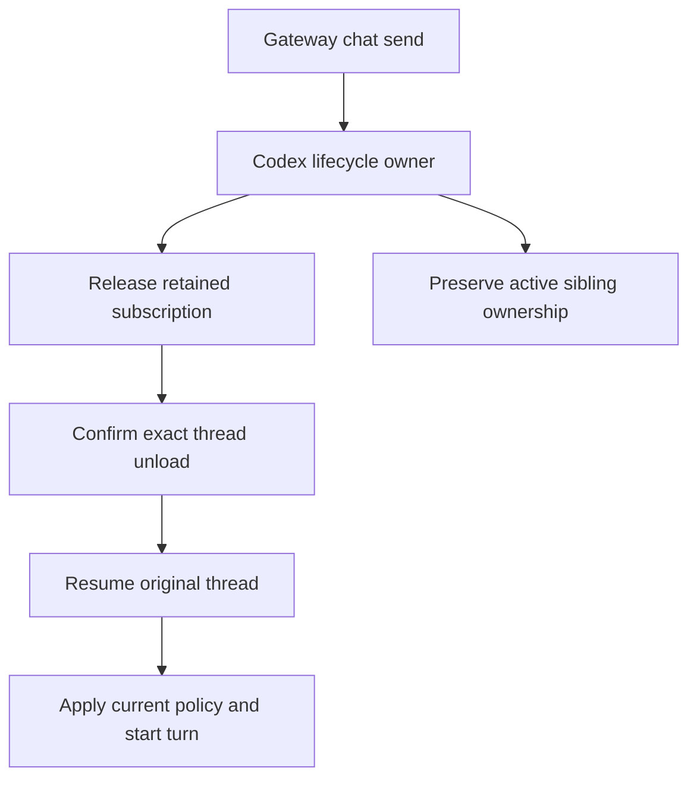

Codex review: needs real behavior proof before merge.

## What this changes

This PR waits for managed Codex threads to unload before resuming their history with refreshed instructions while sibling work continues.

**Example:** Conversation A fails with HTTP 400 while conversation B remains active, then A receives NEW_POLICY_BETA.
- **Before:** A repeatedly refuses configuration reload because replacing the shared client would interrupt B.
- **After:** A waits for its own unload notification and resumes the same thread with its history and new instructions while B continues.

## Review scores

| Measure | Result | What it means |
|---|---|---|
| **Overall readiness** | 🧂 unranked krab **(1/6)** | The focused patch resolves the earlier defects and has passing exact-head CI, but this external PR has not supplied the required real-behavior evidence; persisted formats and schemas are unchanged. |
| **Proof confidence** | 🧂 unranked krab **(1/6)** | Real behavior proof is necessary before merge. See [Before merge](#before-merge). |
| **Patch quality** | 🐚 platinum hermit **(4/6)** | No actionable review findings were identified. |

## Product

**Kind:** Bug fix · **Worth it:** Yes · **Fix scope:** Complete
**User problem:** A failed Codex conversation cannot continue with changed instructions while another conversation keeps its shared app-server active.
**Reason:** The source establishes a real remaining defect, and the area owner's cleanup adopts a focused repair while preserving external ownership and sibling protections.

## Merge readiness

⛔ **Blocked before merge - 1 item remains**

This PR addresses a concrete recovery failure still present on main, and both previous findings are resolved; exact-head CI now passes.

**Priority:** P1
**Reviewed head:** `76dca1a1833811b94c600216cd1176347523c256`

## Before merge

- [ ] **Add real behavior proof** - The supplied evidence consists of lifecycle tests, native Gateway test results, and CI; dedicated live proof was explicitly skipped. Attach redacted terminal output or logs from a shipped Gateway showing a settled failure, changed instructions, preserved history, same-client recovery, and sibling completion, plus fresh-install and latest-stable upgrade behavior with existing settings and history intact; redact IPs, API keys, phone numbers, and non-public endpoints. After adding proof, update the PR body, then request a new review with `@clawsweeper re-review`. The PR author or someone with repository write access can request it.

## Findings

None.

### Tests

- Missing end-to-end proof: Supply the shipped recovery and fresh-install/latest-stable upgrade captures described below; a regression failing on the base and passing on the head has not been demonstrated.

<strong>Agent review details</strong>

### How this fits together

Gateway chat sends enter the Codex plugin's thread lifecycle owner, which coordinates subscriptions, native configuration, and persisted bindings before admitting the next native turn.

### Technical review

Best possible solution:

Recover through the existing per-thread lifecycle owner, preserving native history and active siblings while retaining guarded whole-client replacement as fallback.

Do we have a high-confidence way to reproduce the issue?

Current-main sibling vetoes, the existing Gateway refusal scenario, and the personally inspected pinned Codex reload contract establish the failure path; no target code was executed during this review.

Is this the best way to solve the issue?

The revised implementation fixes the owning lifecycle boundary with an exact-thread unload receipt, bounded cancellation-aware waiting, and existing authority checks rather than interrupting the shared process.

AGENTS.md: found and applied where relevant.

Codex review notes: model internal, reasoning medium; reviewed against [520302d8ee63](https://github.com/openclaw/openclaw/commit/520302d8ee63fd254e88042e96c393d8dc3ec461).

### Provenance checked

- `Settled-failure recovery` changes intended behavior with a stated reason (6d410b5f92261e947ed8d9b99b8aeb0a5ed71a2d: Recover on a fresh client only after confirmed physical exit, with active and Incognito siblings vetoing replacement.)
- `Configuration teardown observation` keeps the original intent (f5f44faeca4e68b178712152e059436f98888e50: Native resume can acknowledge ignored overrides, so exact-thread unload confirmation must precede acceptance of changed configuration.)
- `Native launch override handling` changes intended behavior with a stated reason (c85129f85507b5f2e6c3bd0ce4ede29e1420195a: Preserve native override bytes and precedence through one argument-normalization owner while enforcing OpenClaw-owned launch settings.)

### Testing

Proof path: in-process harness.

### Security

None.

### Evidence

What I checked:

- **Current-main failure remains:** Fetched main retains settled-failure client replacement with active-sibling vetoes and lacks the managed per-thread unload handoff; the relevant production files match the introduction base. ([`extensions/codex/src/app-server/thread-lifecycle-io.ts:143`](https://github.com/openclaw/openclaw/blob/520302d8ee63fd254e88042e96c393d8dc3ec461/extensions/codex/src/app-server/thread-lifecycle-io.ts#L143), [520302d8ee63](https://github.com/openclaw/openclaw/commit/520302d8ee63fd254e88042e96c393d8dc3ec461))
- **Previous findings resolved:** The introduced changes await unloading for healthy and failed managed threads, preserve bindings on unconfirmed teardown, update Gateway expectations to same-client recovery, and explicitly retain native caching in replacement controls. ([`extensions/codex/src/app-server/thread-lifecycle-io.ts:145`](https://github.com/openclaw/openclaw/blob/76dca1a1833811b94c600216cd1176347523c256/extensions/codex/src/app-server/thread-lifecycle-io.ts#L145), [76dca1a18338](https://github.com/openclaw/openclaw/commit/76dca1a1833811b94c600216cd1176347523c256))
- **Owner-directed cleanup:** The area's established contributor steipete authored cleanup commit 6af92c4, explicitly retaining external/user-home behavior and guarded client replacement while coordinating healthy and failed teardown; it credits zhuyankarl's original fix. ([`extensions/codex/src/app-server/auth-start-options.ts:58`](https://github.com/openclaw/openclaw/blob/6af92c4649ea4822cf52e86dcecad525c5f39178/extensions/codex/src/app-server/auth-start-options.ts#L58), [6af92c4649ea](https://github.com/openclaw/openclaw/commit/6af92c4649ea4822cf52e86dcecad525c5f39178))
- **Predecessor deliberately deferred sibling recovery:** The merged predecessor https://github.com/openclaw/openclaw/pull/149000 explicitly preserved refusal with active and Incognito siblings; obviyus's landing discussion confirms those protection controls. ([`extensions/codex/src/app-server/thread-lifecycle-io.ts:143`](https://github.com/openclaw/openclaw/blob/6d410b5f92261e947ed8d9b99b8aeb0a5ed71a2d/extensions/codex/src/app-server/thread-lifecycle-io.ts#L143), [6d410b5f9226](https://github.com/openclaw/openclaw/commit/6d410b5f92261e947ed8d9b99b8aeb0a5ed71a2d))
- **Exact-head CI supersedes stale body status:** CI run 38684859899 attempt 3 completed successfully at the reviewed head, including the previously blocked changed-test shards and aggregate gate; current commit statuses also report success. ([76dca1a18338](https://github.com/openclaw/openclaw/commit/76dca1a1833811b94c600216cd1176347523c256))
- **Dependency contract applies:** The plugin pins and executes @openai/codex 0.160.0, and the changed behavior depends directly on its unsubscribe, resume, configuration, and status-notification contracts. ([`extensions/codex/package.json:11`](https://github.com/openclaw/openclaw/blob/76dca1a1833811b94c600216cd1176347523c256/extensions/codex/package.json#L11), [76dca1a18338](https://github.com/openclaw/openclaw/commit/76dca1a1833811b94c600216cd1176347523c256))

Likely related people:

- **Peter Steinberger:** Raw commit f5f44faeca4e68b178712152e059436f98888e50 adds extensions/codex/src/app-server/thread-lifecycle-adoption.ts:268 relative to its recorded parents. This identifies author metadata, not feature responsibility or a PR merger. (role: source-line author; confidence: high; commits: [f5f44faeca4e](https://github.com/openclaw/openclaw/commit/f5f44faeca4e68b178712152e059436f98888e50); files: `extensions/codex/src/app-server/thread-lifecycle-adoption.ts`)
- **Mert Başar:** Raw commit 6d410b5f92261e947ed8d9b99b8aeb0a5ed71a2d adds extensions/codex/src/app-server/thread-lifecycle-io.ts:121 relative to its recorded parents. This identifies author metadata, not feature responsibility or a PR merger. (role: source-line author; confidence: high; commits: [6d410b5f9226](https://github.com/openclaw/openclaw/commit/6d410b5f92261e947ed8d9b99b8aeb0a5ed71a2d); files: `extensions/codex/src/app-server/thread-lifecycle-io.ts`)
- **Ayaan Zaidi:** Raw commit 64c543a78b7fe2497bb40e5b73c47483e900ff06 adds extensions/codex/src/app-server/thread-lifecycle-adoption.ts:311 relative to its recorded parents. This identifies author metadata, not feature responsibility or a PR merger. (role: source-line author; confidence: high; commits: [64c543a78b7f](https://github.com/openclaw/openclaw/commit/64c543a78b7fe2497bb40e5b73c47483e900ff06); files: `extensions/codex/src/app-server/thread-lifecycle-adoption.ts`)

### PR surface

Source +57, Tests +154, Docs +10. Total +221 across 13 files. Added test files: 0.

View PR surface stats

| Area | Files | Added | Removed | Net |
|---|---:|---:|---:|---:|
| Source | 5 | 60 | 3 | +57 |
| Tests | 7 | 239 | 85 | +154 |
| Docs | 1 | 10 | 0 | +10 |
| Config | 0 | 0 | 0 | 0 |
| Generated | 0 | 0 | 0 | 0 |
| Other | 0 | 0 | 0 | 0 |
| **Total** | **13** | **309** | **88** | **+221** |

### Review metrics

| Metric | Value | Why it matters |
|---|---|---|
| **Native retention policy** | Managed default: 60 seconds → 0; no new OpenClaw option | The owner-directed launch override changes effective native retention only for local agent-home servers; user-home and external transports are excluded. |

### Root-cause cluster

Relationship: `same_root_cause`
Canonical: https://github.com/openclaw/openclaw/issues/172279
Summary: This PR implements the canonical active-sibling recovery report; the merged predecessor handled only eligible whole-client replacement.

Members:
- `canonical`: https://github.com/openclaw/openclaw/issues/172279 - It describes the same settled-systemError configuration handoff blocked by an active sibling.
- `partial_overlap`: https://github.com/openclaw/openclaw/pull/149000 - Merged recovery for otherwise idle clients explicitly deferred the active-sibling case.

Proposal only: this assessment does not dispatch repair, suppress jobs, mutate sibling items, close, or merge anything.

### Labels

Label changes:

- remove `merge-risk: 🚨 session-state`: Current PR review merge-risk labels are `merge-risk: 🚨 compatibility`.

Label justifications:

- `P1`: A settled provider failure can repeatedly block an existing conversation while unrelated sibling work continues.
- `merge-risk: 🚨 compatibility`: The launch override takes precedence over configured native retention for managed local agent-home servers; the area owner's cleanup explicitly retains this scoped tradeoff.
- `rating: 🧂 unranked krab`: Overall readiness is 🧂 unranked krab; proof is 🧂 unranked krab and patch quality is 🐚 platinum hermit.
- `status: 📣 needs proof`: The PR needs real behavior proof before ClawSweeper can clear the contributor ask.

### Rank-up moves

Optional improvements that raise the rating; they are not merge blockers.

- Attach the redacted recovery and upgrade captures specified in the proof assessment.

### Rating scale

6/6 🦀 challenger crab · 5/6 🦞 diamond lobster · 4/6 🐚 platinum hermit · 3/6 🦐 gold shrimp · 2/6 🦪 silver shellfish · 1/6 🧂 unranked krab. Overall follows the weaker of proof and patch quality; ✨ marks media proof (a screenshot, video, or linked artifact) that directly shows the changed behavior.

### Workflow

ClawSweeper edits this one comment on every review. Comment `@clawsweeper re-review` for a fresh review only. Repair and merge execution lanes are retired.

### History

Review history (1 earlier review cycle)

<!-- clawsweeper-review-history v=1 total=1 -->
- reviewed 2026-10-14T16:12:30.325Z sha 2016abdee706fa93e8437263da2118b7e0b22b70 :: needs real behavior proof before merge. :: [P1] Await teardown for healthy threads before resuming | [P2] Update the Gateway recovery controls for per-thread unloading

_Reviewed October 15, 2026, 2:14 AM ET / 06:14 UTC (Revision 2)._

<!-- clawsweeper-verdict:needs-human item=172287 sha=76dca1a1833811b94c600216cd1176347523c256 confidence=high updated_at=2026-10-15T06:09:13Z reviewed_at=2026-10-15T06:14:09.504Z lease_owner=github-run-38690639166-1 lease_comment_id=6185691589 source_revision=bb5fb64792177e1cd8179df868c5fa9f039775ae737f7642b24e60d24c135b6e hold=proof findings=0 -->
<!-- clawsweeper-review-state:blocked item=172287 sha=76dca1a1833811b94c600216cd1176347523c256 v=1 -->

<!-- clawsweeper-review-version item=172287 reviewed_at=2026-10-15T06:14:09.504Z sha=76dca1a1833811b94c600216cd1176347523c256 source_revision=bb5fb64792177e1cd8179df868c5fa9f039775ae737f7642b24e60d24c135b6e lease_owner=github-run-38690639166-1 lease_comment_id=6185691589 v=1 -->

<!-- clawsweeper-review item=172287 -->