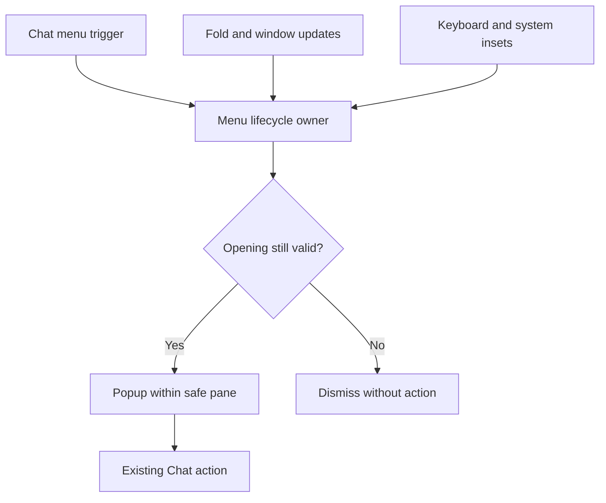

Codex review: blocked before merge. _Reviewed September 7, 2026, 1:47 AM ET / 05:47 UTC._

# ClawSweeper review

## What this changes

Constrain Android Chat actions and attachment menus to their trigger’s fold-safe pane, preserve keyboard visibility, and dismiss invalidated openings without selecting an action.

## Merge readiness

⛔ **Blocked before merge - 2 items remain**

This remains a useful, distinct fix: current main still uses ordinary dropdowns for both Chat menus. No actionable introduced defect was found, and the related umbrella issue retains broader unfinished work.

**Priority:** P2
**Reviewed head:** `7ace48f63fed14ef34feb7c8c80958bfcfd785af`

## Review scores

| Measure | Result | What it means |
|---|---|---|
| **Overall readiness** | 🐚 platinum hermit **(4/6)** | A focused owner-boundary repair with meaningful regression coverage and no concrete blocking code finding; supplied visual evidence still needs reviewer inspection. |
| **Proof confidence** | 🌊 off-meta tidepool | Not applicable: The ordinary contributor-proof gate is exempt for this MEMBER-authored PR. Its captured body nevertheless describes the changed menu owner running on an API 36 emulator with Gboard, picker cancellation, and fold transitions; linked visual artifacts could not be inspected here. |
| **Patch quality** | 🐚 platinum hermit **(4/6)** | No actionable review findings were identified. |

## Verification

| Check | Result | Evidence |
|---|---|---|
| **Real behavior** | Not applicable | Not applicable: The ordinary contributor-proof gate is exempt for this MEMBER-authored PR. Its captured body nevertheless describes the changed menu owner running on an API 36 emulator with Gboard, picker cancellation, and fold transitions; linked visual artifacts could not be inspected here. |
| **Evidence reviewed** | 7 items | Current main still needs the menu repair: At the supplied current-main revision, Chat actions and attachment controls still use ordinary DropdownMenu calls without the new pane-aware owner. Introduced patch and action boundary: The complete local introduced diff preserves existing Chat callbacks and enabled conditions. The new owner latches cancellation immediately and checks current geometry, item enablement, attachment, and actual popup bounds before invoking a callback. Focused regression coverage: Read the complete new suite: it exercises native popup rectangles, unsafe-then-safe publications before held-key release, stale touch release, secure and IME flags, wrapped scrolling rows, translated hosts, and lifecycle cleanup. Changed integration tests cover Chat popup placement and draft retention across restoration. Tests were inspected, not executed. |
| **Findings** | None | None. |
| **Security** | None | None. |

## How this fits together

Android Chat presents menus in separate native popup windows, outside the layout that confines the conversation to safe fold regions. The new menu owner combines trigger coordinates, fold observations, and keyboard insets before displaying a popup or invoking existing Chat actions.

## Before merge

- [ ] **Resolve merge risk (P1)** - The supplied before/after emulator captures could not be visually inspected here; repository-required visual verification remains incomplete for this review.
- [ ] **Complete next step (P2)** - Complete the required visual inspection of the already-linked before/after emulator captures before landing.

<strong>Agent review details</strong>

### Security

None.

### PR surface

Tests +815, Docs +8, Other +475. Total +1298 across 7 files.

View PR surface stats

| Area | Files | Added | Removed | Net |
|---|---:|---:|---:|---:|
| Source | 0 | 0 | 0 | 0 |
| Tests | 3 | 825 | 10 | +815 |
| Docs | 1 | 9 | 1 | +8 |
| Config | 0 | 0 | 0 | 0 |
| Generated | 0 | 0 | 0 | 0 |
| Other | 3 | 550 | 75 | +475 |
| **Total** | **7** | **1384** | **86** | **+1298** |

### Review metrics

| Metric | Value | Why it matters |
|---|---|---|
| **Production versus regression coverage** | production +475 net lines; tests +815 net lines | The production growth has a stated purpose: owning native popup geometry and invalidation, with substantial boundary-focused regression coverage. |

### Merge-risk options

**Maintainer options:**
1. **Decide the mitigation before merge**  
   Retain a single pane-aware menu lifecycle that rejects invalidated input while leaving draft, reader, picker, and business-action ownership intact.
2. **Pause or close**  
   Do not merge this PR until maintainers decide whether the risk is worth taking.

### Technical review

Best possible solution:

Retain a single pane-aware menu lifecycle that rejects invalidated input while leaving draft, reader, picker, and business-action ownership intact.

Do we have a high-confidence way to reproduce the issue?

Yes at the source level: current main opens separate dropdown windows without applying the trigger’s fold-safe region. This review did not execute a current-main emulator reproduction.

Is this the best way to solve the issue?

Yes: reusing the existing fold-region calculation and retaining existing action callbacks addresses the separate-window boundary without remounting Chat or changing persistent state.

AGENTS.md: found and applied where relevant.

Codex review notes: model internal, reasoning medium; reviewed against [44dbc50d172e](https://github.com/openclaw/openclaw/commit/44dbc50d172e9e7ec407b8e21e26aefa430cc933).

### Labels

Label justifications:

- `P2`: This repairs menu placement and keyboard interaction for Android foldable layouts with a bounded user impact.
- `rating: 🐚 platinum hermit`: Overall readiness is 🐚 platinum hermit; proof is 🌊 off-meta tidepool and patch quality is 🐚 platinum hermit.
- `status: 👀 ready for maintainer look`: ClawSweeper has no concrete contributor-facing blocker left for this PR. Not applicable: The ordinary contributor-proof gate is exempt for this MEMBER-authored PR. Its captured body nevertheless describes the changed menu owner running on an API 36 emulator with Gboard, picker cancellation, and fold transitions; linked visual artifacts could not be inspected here.

### Evidence

What I checked:

- **Current main still needs the menu repair:** At the supplied current-main revision, Chat actions and attachment controls still use ordinary DropdownMenu calls without the new pane-aware owner. ([`apps/android/app/src/main/java/ai/openclaw/app/ui/chat/ChatScreen.kt:1285`](https://github.com/openclaw/openclaw/blob/44dbc50d172e9e7ec407b8e21e26aefa430cc933/apps/android/app/src/main/java/ai/openclaw/app/ui/chat/ChatScreen.kt#L1285), [44dbc50d172e](https://github.com/openclaw/openclaw/commit/44dbc50d172e9e7ec407b8e21e26aefa430cc933))
- **Introduced patch and action boundary:** The complete local introduced diff preserves existing Chat callbacks and enabled conditions. The new owner latches cancellation immediately and checks current geometry, item enablement, attachment, and actual popup bounds before invoking a callback. ([`apps/android/app/src/main/java/ai/openclaw/app/ui/FoldAwareDropdownMenu.kt:372`](https://github.com/openclaw/openclaw/blob/7ace48f63fed14ef34feb7c8c80958bfcfd785af/apps/android/app/src/main/java/ai/openclaw/app/ui/FoldAwareDropdownMenu.kt#L372), [7ace48f63fed](https://github.com/openclaw/openclaw/commit/7ace48f63fed14ef34feb7c8c80958bfcfd785af))
- **Focused regression coverage:** Read the complete new suite: it exercises native popup rectangles, unsafe-then-safe publications before held-key release, stale touch release, secure and IME flags, wrapped scrolling rows, translated hosts, and lifecycle cleanup. Changed integration tests cover Chat popup placement and draft retention across restoration. Tests were inspected, not executed. ([`apps/android/app/src/test/java/ai/openclaw/app/ui/FoldAwareDropdownMenuTest.kt:146`](https://github.com/openclaw/openclaw/blob/7ace48f63fed14ef34feb7c8c80958bfcfd785af/apps/android/app/src/test/java/ai/openclaw/app/ui/FoldAwareDropdownMenuTest.kt#L146), [7ace48f63fed](https://github.com/openclaw/openclaw/commit/7ace48f63fed14ef34feb7c8c80958bfcfd785af))
- **Prior fold-layout history:** Current-main history identifies Vincent Koc’s earlier fold-layout and tabletop work. The raw recorded parent of the earlier fold-layout commit was inspected, and comparison against that parent shows WindowLayout.kt being added; current checkout line 75 retains its region initialization. ([`apps/android/app/src/main/java/ai/openclaw/app/ui/WindowLayout.kt:75`](https://github.com/openclaw/openclaw/blob/8bd02ac5a391cffe60c224e9e5a0c8bbbab05e49/apps/android/app/src/main/java/ai/openclaw/app/ui/WindowLayout.kt#L75), [8bd02ac5a391](https://github.com/openclaw/openclaw/commit/8bd02ac5a391cffe60c224e9e5a0c8bbbab05e49))
- **Related work remains broader:** The supplied body of https://github.com/openclaw/openclaw/issues/140708 explicitly leaves separate-window sheets and anchored menus unfinished alongside iOS work. This PR addresses two anchored menus and does not complete or supersede that tracker.
- **Captured native evidence and inspection limitation:** The supplied PR snapshot, sourceRevision fcc5f4619e7b42aff9e97b1439832552c86d4ded990f9882bc143918515cbd45, reports API 36 emulator results for book/tabletop placement, real Gboard, Files-picker cancellation, and rotation. It links before/after captures, including https://github.com/user-attachments/assets/a5a7cadd-bc94-4663-8383-e72e9333deb0. Attempts to open the original, keyboard, and tabletop captures failed in this reviewer environment; their pixels were not inspected.

Likely related people:

- **Vincent Koc:** Raw commit 8bd02ac5a391cffe60c224e9e5a0c8bbbab05e49 adds apps/android/app/src/main/java/ai/openclaw/app/ui/WindowLayout.kt:43 relative to its recorded parents. This identifies author metadata, not feature responsibility or a PR merger. (role: source-line author; confidence: high; commits: [8bd02ac5a391](https://github.com/openclaw/openclaw/commit/8bd02ac5a391cffe60c224e9e5a0c8bbbab05e49); files: `apps/android/app/src/main/java/ai/openclaw/app/ui/WindowLayout.kt`)

### Rating scale

| Score | Internal tier | Crab rank | Meaning |
|---:|:---:|---|---|
| **6/6** | S | 🦀 challenger crab | Exceptional readiness |
| **5/6** | A | 🦞 diamond lobster | Very strong readiness |
| **4/6** | B | 🐚 platinum hermit | Good normal PR; ordinary maintainer review |
| **3/6** | C | 🦐 gold shrimp | Useful, but confidence is limited |
| **2/6** | D | 🦪 silver shellfish | Proof or implementation needs work |
| **1/6** | F | 🧂 unranked krab | Not merge-ready |
| N/A | NA | 🌊 off-meta tidepool | Rating does not apply |

Overall follows the weaker of proof and patch quality.
Shiny media proof means a screenshot, video, or linked artifact directly shows the changed behavior. Runtime, network, CSP, and security claims still need visible diagnostics.

### Workflow

- ClawSweeper keeps one durable marker-backed review comment per issue or PR.
- Re-runs edit this comment so the latest verdict, findings, and automation markers stay together instead of adding duplicate bot comments.
- A fresh review can be triggered by eligible `@clawsweeper re-review` comments, exact-item GitHub events, scheduled/background review runs, or manual workflow dispatch.
- PR/issue authors and users with repository write access can comment `@clawsweeper re-review` or `@clawsweeper re-run` on an open PR or issue to request a fresh review only.
- Maintainers can also comment `@clawsweeper review` to request a fresh review only.
- Fresh-review commands do not start repair, autofix, rebase, CI repair, or automerge.
- Maintainer-only repair and merge flows require explicit commands such as `@clawsweeper autofix`, `@clawsweeper automerge`, `@clawsweeper fix ci`, or `@clawsweeper address review`.
- Maintainers can comment `@clawsweeper explain` to ask for more context, or `@clawsweeper stop` to stop active automation.

<!-- clawsweeper-verdict:needs-human item=140884 sha=7ace48f63fed14ef34feb7c8c80958bfcfd785af confidence=high updated_at=2026-09-07T05:45:05Z reviewed_at=2026-09-07T05:47:09.669Z lease_owner=github-run-34087890529-1 lease_comment_id=5565644948 source_revision=fcc5f4619e7b42aff9e97b1439832552c86d4ded990f9882bc143918515cbd45 live_verification=absent -->
<!-- clawsweeper-review-state:blocked item=140884 sha=7ace48f63fed14ef34feb7c8c80958bfcfd785af v=1 -->

<!-- clawsweeper-review-version item=140884 reviewed_at=2026-09-07T05:47:09.669Z sha=7ace48f63fed14ef34feb7c8c80958bfcfd785af source_revision=fcc5f4619e7b42aff9e97b1439832552c86d4ded990f9882bc143918515cbd45 lease_owner=github-run-34087890529-1 lease_comment_id=5565644948 v=1 -->

<!-- clawsweeper-review item=140884 -->