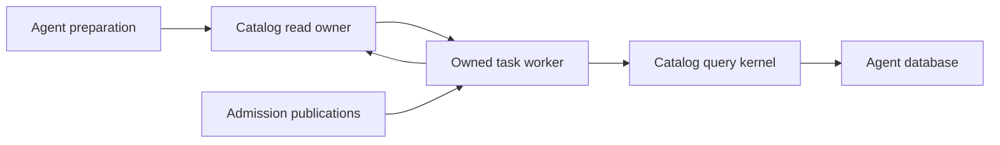

Codex review: needs changes before merge.

## What this changes

This PR moves asynchronous model-catalog reads to an owned worker that retains physical database admission facts between requests.

**Example:** Repeatedly load persisted catalogs for agent main.
- **Before:** The generic child discards admission facts when its native reader closes.
- **After:** The task worker retains admission facts while querying catalog rows on every request.

## Review scores

| Measure | Result | What it means |
|---|---|---|
| **Overall readiness** | 🦐 gold shrimp **(3/6)** | Useful performance work with real worker integration coverage, but the introduced reader-cleanup defect prevents merge. |
| **Proof confidence** | 🦐 gold shrimp **(3/6)** | This maintainer-authored PR is outside the ordinary contributor-proof gate; supplied evidence exercises real catalog workers in integration tests, while Gateway benchmark measurements remain pending. |
| **Patch quality** | 🦐 gold shrimp **(3/6)** | 1 actionable review finding remain. |

## Product

**Kind:** Performance · **Worth it:** Yes · **Fix scope:** Complete
**User problem:** Model discovery repeatedly pays physical database admission cost when loading persisted provider catalogs.
**Reason:** The maintainer-authored direction reuses existing admission ownership without adding configuration, stored formats, or a public API.

## Regression provenance

Possible regression — suspected (reviewed change). No predecessor PR is attributed.

## Merge readiness

⛔ **Needs changes before merge - 1 item remains**

Keep open: this maintainer-directed optimization is useful, but a P2 scope-matching defect leaves native readers open for noncanonical agent IDs.

**Priority:** P2
**Reviewed head:** `20dfa3519a8341a47446b1df1be5142183263803`

## Before merge

- [ ] **Normalize the agent ID before entering the read scope (P2)** - For a custom directory such as /tmp/catalog-owner/Foo/agent, resolveAuthProfileDatabaseOwnerId can return Foo. scope.run records that raw ID, but withOpenClawAgentDatabaseReadOnly normalizes it to foo before exact scope matching. The read consequently uses cachedScope rather than this local scope, so the finally block closes an unused scope and leaves the actual native reader open through result transfer and until later cleanup. This breaks the close-before-transfer contract and can interfere with database replacement, especially on Windows. Restore the removed operation’s normalization and use the same normalized options for both calls.

## Findings

- [P2] Normalize the agent ID before entering the read scope — `src/agents/plugin-model-catalog-read.worker.ts:32-33`

### Tests

- Missing end-to-end proof: No shipped Gateway workload trace or base-to-head admission-count measurement is supplied.

<strong>Agent review details</strong>

### How this fits together

Agent preparation and model registries request persisted catalogs from per-agent databases; the worker returns catalog rows while the host retains lifecycle and disclosure authority.

### Technical review

Best possible solution:

Keep the owned-worker transport and normalize the worker’s agent ID once before supplying identical options to the scope and query kernel.

Do we have a high-confidence way to reproduce the issue?

At the reviewed head, an unregistered custom directory ending in Foo/agent produces scope ID Foo while the reader requests foo, selecting an unclosed cached scope; this was verified from source without executing target code.

Is this the best way to solve the issue?

Reusing the existing admission relay is a coherent optimization with a complete transport cutover, but the replacement must preserve the former operation’s normalized scope target.

Full review comments:

- [P2] Normalize the agent ID before entering the read scope — `src/agents/plugin-model-catalog-read.worker.ts:32-33`
  For a custom directory such as /tmp/catalog-owner/Foo/agent, resolveAuthProfileDatabaseOwnerId can return Foo. scope.run records that raw ID, but withOpenClawAgentDatabaseReadOnly normalizes it to foo before exact scope matching. The read consequently uses cachedScope rather than this local scope, so the finally block closes an unused scope and leaves the actual native reader open through result transfer and until later cleanup. This breaks the close-before-transfer contract and can interfere with database replacement, especially on Windows. Restore the removed operation’s normalization and use the same normalized options for both calls.
  Confidence: 0.99
  Late finding: first raised on code an earlier review cycle already covered.

Overall correctness: patch is incorrect
Overall confidence: 0.96

AGENTS.md: found and applied where relevant.

Codex review notes: model internal, reasoning medium; reviewed against [9acdc3c8aa2f](https://github.com/openclaw/openclaw/commit/9acdc3c8aa2f54ffb02f263e1ee0cb31bd30582e).

### Provenance checked

- `Asynchronous catalog transport and native reader cleanup` changes intended behavior with a stated reason (93625aa3d10dcea99ead6a2e5b58be2e71f646ad: https://github.com/openclaw/openclaw/pull/163425 moved catalog preparation off the calling thread and required native scope closure before replies.)
- `Generic child admission lifetime` changes intended behavior with a stated reason (eda90d6cf9451b01b7ca7ba61892f90482663ac3: https://github.com/openclaw/openclaw/pull/171299 reused child processes while retiring reader facts because those processes lacked writer invalidation delivery; this PR supplies the existing task-worker relay instead.)
- `Early catalog authority assertion` changes intended behavior with a stated reason (93625aa3d10dcea99ead6a2e5b58be2e71f646ad: The earlier implementation retained authority through asynchronous preparation; this PR explains removal of the redundant immediate assertion and preserves the final disclosure checks.)
- `Credential-cleanup worker operation` keeps the original intent (fc17c21ad7d4039bcee593552eb83b86b1ea2cb2: https://github.com/openclaw/openclaw/pull/163451 consolidated credential scrubbing through existing owners; that exported operation remains intact beside the new task server.)

### Testing

Proof path: in-process harness.

### Security

None.

### Evidence

Acceptance criteria:

- pnpm test src/agents/plugin-model-catalog-read.test.ts src/agents/prepared-model-runtime.sources.test.ts --maxWorkers=1
- node scripts/check-changed.mjs --base 20dfa3519a8341a47446b1df1be5142183263803

What I checked:

- **Pinned introduced change:** The introduced diff replaces the generic catalog operation with an owned read-only task worker and removes the retired operation, registration, and wrapper inventory entry. ([`src/agents/plugin-model-catalog-read.ts:17`](https://github.com/openclaw/openclaw/blob/20dfa3519a8341a47446b1df1be5142183263803/src/agents/plugin-model-catalog-read.ts#L17), [20dfa3519a83](https://github.com/openclaw/openclaw/commit/20dfa3519a8341a47446b1df1be5142183263803))
- **Verified scope mismatch:** The worker supplies the raw agent ID to scope.run, but withOpenClawAgentDatabaseReadOnly normalizes it before exact scope matching; a mismatched read therefore uses the cached scope that this finally does not close. ([`src/agents/plugin-model-catalog-read.worker.ts:32`](https://github.com/openclaw/openclaw/blob/20dfa3519a8341a47446b1df1be5142183263803/src/agents/plugin-model-catalog-read.worker.ts#L32), [20dfa3519a83](https://github.com/openclaw/openclaw/commit/20dfa3519a8341a47446b1df1be5142183263803))
- **Existing discussion corroborated:** The existing Codex connector review identified the same custom-agent-ID defect; independent source inspection confirms it remains at the reviewed head: https://github.com/openclaw/openclaw/pull/175347#discussion_r4302067198. ([`src/agents/plugin-model-catalog-read.worker.ts:33`](https://github.com/openclaw/openclaw/blob/20dfa3519a8341a47446b1df1be5142183263803/src/agents/plugin-model-catalog-read.worker.ts#L33), [20dfa3519a83](https://github.com/openclaw/openclaw/commit/20dfa3519a8341a47446b1df1be5142183263803))
- **Final authority retained:** The host still checks cancellation, current root admission, maintenance admission, and physical source identity after awaiting the worker and before returning catalogs; the PR explicitly accepts wasted internal work after queued-read revocation. ([`src/agents/plugin-model-catalog-execution.ts:133`](https://github.com/openclaw/openclaw/blob/20dfa3519a8341a47446b1df1be5142183263803/src/agents/plugin-model-catalog-execution.ts#L133), [20dfa3519a83](https://github.com/openclaw/openclaw/commit/20dfa3519a8341a47446b1df1be5142183263803))
- **Current main still uses the previous transport:** Fetched main routes asynchronous catalog reads through runSqliteReadOnlyOperation and retains normalization in the generic catalog operation. ([`src/agents/plugin-model-catalog-execution.ts:152`](https://github.com/openclaw/openclaw/blob/9acdc3c8aa2f54ffb02f263e1ee0cb31bd30582e/src/agents/plugin-model-catalog-execution.ts#L152), [9acdc3c8aa2f](https://github.com/openclaw/openclaw/commit/9acdc3c8aa2f54ffb02f263e1ee0cb31bd30582e))
- **Compatibility contract preserved:** The documented synchronous ModelRegistry compatibility remains through December 31, 2026; this PR preserves those methods and the shared native kernel. Documentation: https://docs.openclaw.ai/plugins/sdk-migration/how-to-migrate. ([`docs/plugins/sdk-migration/how-to-migrate.md:1762`](https://docs.openclaw.ai/plugins/sdk-migration/how-to-migrate), [20dfa3519a83](https://github.com/openclaw/openclaw/commit/20dfa3519a8341a47446b1df1be5142183263803))

Likely related people:

- **Peter Steinberger:** Raw commit 93625aa3d10dcea99ead6a2e5b58be2e71f646ad adds src/agents/plugin-model-catalog.kernel.ts:20 relative to its recorded parents. This identifies author metadata, not feature responsibility or a PR merger. (role: source-line author; confidence: high; commits: [93625aa3d10d](https://github.com/openclaw/openclaw/commit/93625aa3d10dcea99ead6a2e5b58be2e71f646ad); files: `src/agents/plugin-model-catalog.kernel.ts`)
- **Vincent Koc:** Raw commit 54644eab32b26de36a6668fad06493bb5d1513b9 adds src/agents/plugin-model-catalog.kernel.ts:34 relative to its recorded parents. This identifies author metadata, not feature responsibility or a PR merger. (role: source-line author; confidence: medium; commits: [54644eab32b2](https://github.com/openclaw/openclaw/commit/54644eab32b26de36a6668fad06493bb5d1513b9); files: `src/agents/plugin-model-catalog.kernel.ts`)

### PR surface

Source +93, Tests +122, Docs +6, Other -1. Total +220 across 17 files. Added test files: 1.

View PR surface stats

| Area | Files | Added | Removed | Net |
|---|---:|---:|---:|---:|
| Source | 9 | 141 | 48 | +93 |
| Tests | 6 | 343 | 221 | +122 |
| Docs | 1 | 6 | 0 | +6 |
| Config | 0 | 0 | 0 | 0 |
| Generated | 0 | 0 | 0 | 0 |
| Other | 1 | 0 | 1 | -1 |
| **Total** | **17** | **490** | **270** | **+220** |

### Review metrics

| Metric | Value | Why it matters |
|---|---|---|
| **Production versus test LOC** | Production +141/-48; tests +343/-221 | Production growth supplies the owned-worker adapter and bounded transfer channel; most test churn replaces fixtures for the retired generic operation. |

### Labels

Label changes:

- add `P2`: A supported custom agent-directory spelling can retain a native reader beyond task completion and interfere with database replacement or cleanup.
- add `rating: 🦐 gold shrimp`: Overall readiness is 🦐 gold shrimp; proof is 🦐 gold shrimp and patch quality is 🦐 gold shrimp.
- add `status: ⏳ waiting on author`: ClawSweeper has contributor-facing work open and is waiting for author action.

Label justifications:

- `P2`: A supported custom agent-directory spelling can retain a native reader beyond task completion and interfere with database replacement or cleanup.
- `rating: 🦐 gold shrimp`: Overall readiness is 🦐 gold shrimp; proof is 🦐 gold shrimp and patch quality is 🦐 gold shrimp.
- `status: ⏳ waiting on author`: ClawSweeper has contributor-facing work open and is waiting for author action.

### Rating scale

6/6 🦀 challenger crab · 5/6 🦞 diamond lobster · 4/6 🐚 platinum hermit · 3/6 🦐 gold shrimp · 2/6 🦪 silver shellfish · 1/6 🧂 unranked krab. Overall follows the weaker of proof and patch quality; ✨ marks media proof (a screenshot, video, or linked artifact) that directly shows the changed behavior.

### Workflow

ClawSweeper edits this one comment on every review. Comment `@clawsweeper re-review` for a fresh review only. Repair and merge execution lanes are retired.

_Reviewed October 17, 2026, 5:00 AM ET / 09:00 UTC._

<!-- clawsweeper-verdict:needs-changes item=175347 sha=20dfa3519a8341a47446b1df1be5142183263803 confidence=high updated_at=2026-10-17T08:55:33Z reviewed_at=2026-10-17T09:00:21.062Z lease_owner=github-run-39019125279-1 lease_comment_id=6231993478 source_revision=5e7066444d44e0193561daef3041b8041a63003647b397074a8e6d7328e32d89 -->
<!-- clawsweeper-review-state:needs-changes item=175347 sha=20dfa3519a8341a47446b1df1be5142183263803 v=1 -->

<!-- clawsweeper-review-version item=175347 reviewed_at=2026-10-17T09:00:21.062Z sha=20dfa3519a8341a47446b1df1be5142183263803 source_revision=5e7066444d44e0193561daef3041b8041a63003647b397074a8e6d7328e32d89 lease_owner=github-run-39019125279-1 lease_comment_id=6231993478 v=1 -->

<!-- clawsweeper-review item=175347 -->