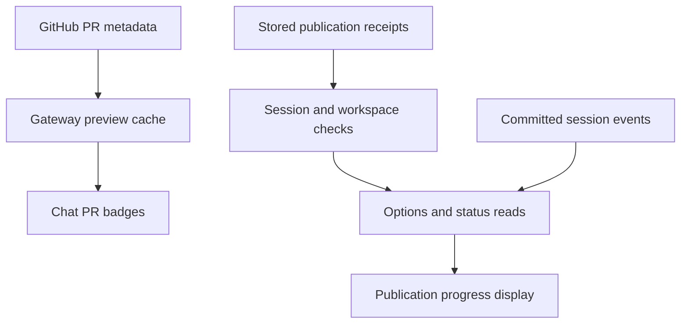

Codex review: needs maintainer review before merge. _Reviewed September 14, 2026, 1:13 AM ET / 05:13 UTC (Revision 4)._

# ClawSweeper review

## What this changes

Updates Control UI PR badges and publication progress to reflect fetched state, distinguish loading from publishing, and recover shared publication receipts without replaying writes.

## Merge readiness

✅ **Ready for maintainer review**

This remains a useful repair absent from current main. The prior legacy-receipt compatibility finding is resolved, and the latest test-only follow-up preserves the protocol assertions. No blocking introduced defect was found.

**Priority:** P2
**Reviewed head:** `496aefc06a93067ff6699a3981abc73f55a8ab7a`

## Review scores

| Measure | Result | What it means |
|---|---|---|
| **Overall readiness** | 🐚 platinum hermit **(4/6)** | A coherent repair with useful inspected visual evidence, focused regression coverage, and the prior compatibility blocker addressed. |
| **Proof confidence** | 🐚 platinum hermit **(4/6)** | Not applicable: The bot-authored PR is exempt from the external-contributor proof gate. Inspected captures demonstrate the visual correction, while synthetic browser tests cover controller reconnect and zero-write observation; deployed Gateway or live GitHub proof is not claimed. |
| **Patch quality** | 🐚 platinum hermit **(4/6)** | No actionable review findings were identified. |

## Verification

| Check | Result | Evidence |
|---|---|---|
| **Real behavior** | Not applicable | Not applicable: The bot-authored PR is exempt from the external-contributor proof gate. Inspected captures demonstrate the visual correction, while synthetic browser tests cover controller reconnect and zero-write observation; deployed Gateway or live GitHub proof is not claimed. |
| **Evidence reviewed** | 8 items | Pinned changes and review continuity: The checkout matches the supplied original PR head. Comparing the previous reviewed head f20a17bc4191ef41b680dc9c705386981b3df827 with HEAD shows only the protocol test update; the production compatibility repair remains unchanged. The supplied test merge is stale and was not used to attribute base-branch changes to this PR. Current main still needs the repair: Inspected fetched-main sessions.github.options and sessions.github.status: options exposes only pendingPersonal recovery, while status requires personal authorization. Its publication component still routes shared Check status through onPublish. Inspection of the supplied latest release v2026.9.4 also found the personal-only status path. No merged replacement for the central request was established. Legacy compatibility finding resolved: Completed receipts without lifecycle bindings are excluded from current-workspace discovery but remain available through explicit historical lookup. Added retained-state tests cover absent lifecycle tables and rows, unchanged cold database bytes and sidecars, account discovery, and personal confirmation recovery. |
| **Findings** | None | None. |
| **Security** | None | None. |

## How this fits together

The Control UI displays GitHub metadata and publication outcomes supplied by the Gateway. The Gateway owns publication receipts and session access; browser controllers observe those records and render scoped status.

## Before merge

None.

<strong>Agent review details</strong>

### Security

None.

### PR surface

Source +734, Tests +2494, Docs +2, Other +8. Total +3238 across 47 files.

View PR surface stats

| Area | Files | Added | Removed | Net |
|---|---:|---:|---:|---:|
| Source | 23 | 886 | 152 | +734 |
| Tests | 20 | 2642 | 148 | +2494 |
| Docs | 3 | 6 | 4 | +2 |
| Config | 0 | 0 | 0 | 0 |
| Generated | 0 | 0 | 0 | 0 |
| Other | 1 | 10 | 2 | +8 |
| **Total** | **47** | **3544** | **306** | **+3238** |

### Review metrics

| Metric | Value | Why it matters |
|---|---|---|
| **Production and regression coverage** | Production net +742 lines; tests and support net +2494 lines | The body justifies production growth through scoped receipt discovery and observation at existing owners, without a new durable store or polling service. |
| **Protocol additions** | 1 optional request field; 1 required response field | The invocation selector and shared recovery descriptor are reflected in the generated Swift model and repaired protocol fixture. |

### Technical review

Best possible solution:

Keep publication execution with the Gateway and derive UI progress from qualified receipts, committed invalidations, and the existing preview cache.

Do we have a high-confidence way to reproduce the issue?

Yes, from source: current main labels reads as publishing and routes shared status checks through publication; the supplied browser and receipt regressions cover those triggers. This review did not execute them.

Is this the best way to solve the issue?

Yes. The patch extends the existing receipt, event, preview-cache, and browser-controller owners while preserving explicit publication writes and legacy terminal history.

AGENTS.md: found and applied where relevant.

Codex review notes: model internal, reasoning medium; reviewed against [e9a1e2fce8ca](https://github.com/openclaw/openclaw/commit/e9a1e2fce8ca6e51787408eb99a0615ab4138c43).

### Labels

Label justifications:

- `P2`: Repairs misleading PR/publication status and reconnect recovery in a bounded Control UI workflow.
- `rating: 🐚 platinum hermit`: Overall readiness is 🐚 platinum hermit; proof is 🐚 platinum hermit and patch quality is 🐚 platinum hermit.
- `status: 👀 ready for maintainer look`: ClawSweeper has no concrete contributor-facing blocker left for this PR. Not applicable: The bot-authored PR is exempt from the external-contributor proof gate. Inspected captures demonstrate the visual correction, while synthetic browser tests cover controller reconnect and zero-write observation; deployed Gateway or live GitHub proof is not claimed.
- `proof: 📸 screenshot`: Contributor real behavior proof includes screenshot evidence. The bot-authored PR is exempt from the external-contributor proof gate. Inspected captures demonstrate the visual correction, while synthetic browser tests cover controller reconnect and zero-write observation; deployed Gateway or live GitHub proof is not claimed.

### Evidence

What I checked:

- **Pinned changes and review continuity:** The checkout matches the supplied original PR head. Comparing the previous reviewed head f20a17bc4191ef41b680dc9c705386981b3df827 with HEAD shows only the protocol test update; the production compatibility repair remains unchanged. The supplied test merge is stale and was not used to attribute base-branch changes to this PR. ([`packages/gateway-protocol/src/schema/session-github-publication.test.ts:39`](https://github.com/openclaw/openclaw/blob/496aefc06a93067ff6699a3981abc73f55a8ab7a/packages/gateway-protocol/src/schema/session-github-publication.test.ts#L39), [496aefc06a93](https://github.com/openclaw/openclaw/commit/496aefc06a93067ff6699a3981abc73f55a8ab7a))
- **Current main still needs the repair:** Inspected fetched-main sessions.github.options and sessions.github.status: options exposes only pendingPersonal recovery, while status requires personal authorization. Its publication component still routes shared Check status through onPublish. Inspection of the supplied latest release v2026.9.4 also found the personal-only status path. No merged replacement for the central request was established. ([`src/gateway/server-methods/sessions-github.ts:186`](https://github.com/openclaw/openclaw/blob/e9a1e2fce8ca6e51787408eb99a0615ab4138c43/src/gateway/server-methods/sessions-github.ts#L186), [e9a1e2fce8ca](https://github.com/openclaw/openclaw/commit/e9a1e2fce8ca6e51787408eb99a0615ab4138c43))
- **Legacy compatibility finding resolved:** Completed receipts without lifecycle bindings are excluded from current-workspace discovery but remain available through explicit historical lookup. Added retained-state tests cover absent lifecycle tables and rows, unchanged cold database bytes and sidecars, account discovery, and personal confirmation recovery. ([`src/gateway/github-publication-store.ts:119`](https://github.com/openclaw/openclaw/blob/496aefc06a93067ff6699a3981abc73f55a8ab7a/src/gateway/github-publication-store.ts#L119), [496aefc06a93](https://github.com/openclaw/openclaw/commit/496aefc06a93067ff6699a3981abc73f55a8ab7a))
- **Read authorization and private receipt separation:** The handlers use the existing live connection, scope, profile, and session-access checks, rechecking before returning results. Repository shared reads filter personal rows before decoding; shared status returns no confirmation authority. Publication and confirmation remain separate write handlers. ([`src/gateway/server-methods/sessions-github.ts:180`](https://github.com/openclaw/openclaw/blob/496aefc06a93067ff6699a3981abc73f55a8ab7a/src/gateway/server-methods/sessions-github.ts#L180), [496aefc06a93](https://github.com/openclaw/openclaw/commit/496aefc06a93067ff6699a3981abc73f55a8ab7a))
- **Observation and recovery ownership:** The browser controller distinguishes read, publish, and confirm activity, retains the original invocation key after an unknown outcome, and coalesces invalidations. Store notifications use the existing post-commit owner; rollback tests cover outer transactions and savepoints. Recovery preserves ordering within a blocked worktree while allowing independent workspaces to settle. ([`ui/src/lib/sessions/github-publication-controller.ts:303`](https://github.com/openclaw/openclaw/blob/496aefc06a93067ff6699a3981abc73f55a8ab7a/ui/src/lib/sessions/github-publication-controller.ts#L303), [496aefc06a93](https://github.com/openclaw/openclaw/commit/496aefc06a93067ff6699a3981abc73f55a8ab7a))
- **Inspected visual evidence and its limits:** Inspected the three downloaded target screenshots: the reported stale badge/Publishing row, the synthetic merged badge beside an idle workspace, and the synthetic recovered shared result. The supplied body explicitly identifies mocked Gateway/GitHub responses. The browser test checks reconnect, coalesced reads, and zero publication or confirmation calls; screenshots alone do not establish backend authorization or live GitHub behavior. ([`ui/src/e2e/chat-pr-publication-state.e2e.test.ts:154`](https://github.com/openclaw/openclaw/blob/496aefc06a93067ff6699a3981abc73f55a8ab7a/ui/src/e2e/chat-pr-publication-state.e2e.test.ts#L154), [496aefc06a93](https://github.com/openclaw/openclaw/commit/496aefc06a93067ff6699a3981abc73f55a8ab7a))

Likely related people:

- **steipete:** Suggested for follow-up; no historical authorship or introduction is verified. (role: unverified routing candidate; confidence: low)
- **vincentkoc:** Suggested for follow-up; no historical authorship or introduction is verified. (role: unverified routing candidate; confidence: low)

### Rating scale

| Score | Internal tier | Crab rank | Meaning |
|---:|:---:|---|---|
| **6/6** | S | 🦀 challenger crab | Exceptional readiness |
| **5/6** | A | 🦞 diamond lobster | Very strong readiness |
| **4/6** | B | 🐚 platinum hermit | Good normal PR; ordinary maintainer review |
| **3/6** | C | 🦐 gold shrimp | Useful, but confidence is limited |
| **2/6** | D | 🦪 silver shellfish | Proof or implementation needs work |
| **1/6** | F | 🧂 unranked krab | Not merge-ready |
| N/A | NA | 🌊 off-meta tidepool | Rating does not apply |

Overall follows the weaker of proof and patch quality.
Shiny media proof means a screenshot, video, or linked artifact directly shows the changed behavior. Runtime, network, CSP, and security claims still need visible diagnostics.

### Workflow

- ClawSweeper keeps one durable marker-backed review comment per issue or PR.
- Re-runs edit this comment so the latest verdict, findings, and automation markers stay together instead of adding duplicate bot comments.
- A fresh review can be triggered by eligible `@clawsweeper re-review` comments, exact-item GitHub events, scheduled/background review runs, or manual workflow dispatch.
- PR/issue authors and users with repository write access can comment `@clawsweeper re-review` or `@clawsweeper re-run` on an open PR or issue to request a fresh review only.
- Maintainers can also comment `@clawsweeper review` to request a fresh review only.
- Fresh-review commands do not start repair, autofix, rebase, CI repair, or automerge.
- Maintainer-only repair and merge flows require explicit commands such as `@clawsweeper autofix`, `@clawsweeper automerge`, `@clawsweeper fix ci`, or `@clawsweeper address review`.
- Maintainers can comment `@clawsweeper explain` to ask for more context, or `@clawsweeper stop` to stop active automation.

### History

Review history (3 earlier review cycles)

<!-- clawsweeper-review-history v=1 total=3 -->
- reviewed 2026-09-13T16:54:04.265Z sha 7cf89217941ea677981dc00a0345ee04242f2cb6 :: blocked before merge. :: none
- reviewed 2026-09-14T02:16:41.551Z sha dac3dabb1297aec3ce2c6220d8d2bbe9a8ab5a32 :: blocked before merge. :: [P1] [P1] Preserve options discovery for legacy terminal receipts
- reviewed 2026-09-14T04:08:56.714Z sha f20a17bc4191ef41b680dc9c705386981b3df827 :: needs maintainer review before merge. :: none

<!-- clawsweeper-verdict:needs-human item=147195 sha=496aefc06a93067ff6699a3981abc73f55a8ab7a confidence=high updated_at=2026-09-14T05:09:51Z reviewed_at=2026-09-14T05:13:48.314Z lease_owner=github-run-34808471323-1 lease_comment_id=5659310915 source_revision=2c1fa5b3c877914374a5afeaeeedbb79b75067e18e74286e6dafb3edfa4265ca live_verification=absent -->
<!-- clawsweeper-review-state:ready item=147195 sha=496aefc06a93067ff6699a3981abc73f55a8ab7a v=1 -->

<!-- clawsweeper-review-version item=147195 reviewed_at=2026-09-14T05:13:48.314Z sha=496aefc06a93067ff6699a3981abc73f55a8ab7a source_revision=2c1fa5b3c877914374a5afeaeeedbb79b75067e18e74286e6dafb3edfa4265ca lease_owner=github-run-34808471323-1 lease_comment_id=5659310915 v=1 -->

<!-- clawsweeper-review item=147195 -->