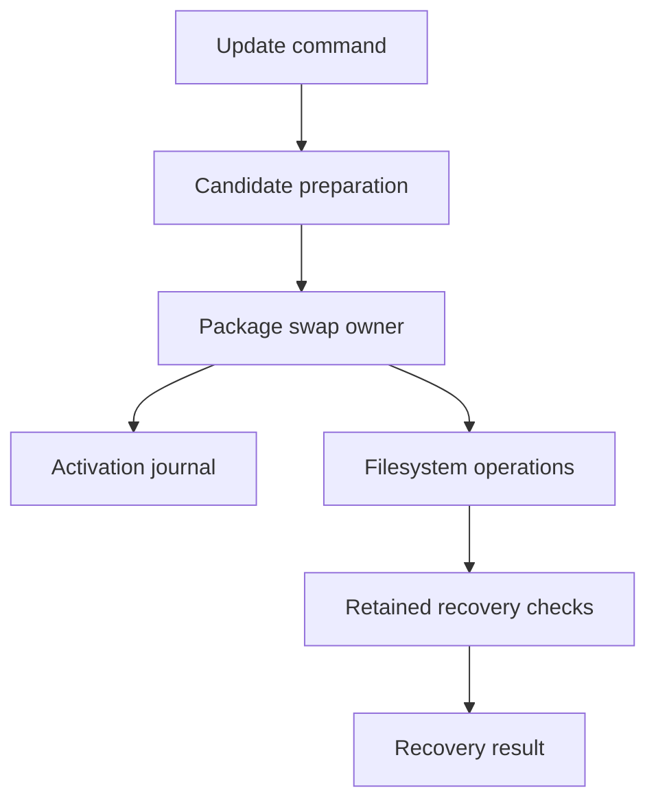

Codex review: needs maintainer review before merge.

## What this changes

This PR removes immediate verification of successful private update writes while retaining recovery-input checks and operation-error handling.

**Example:** An update fails verification and restores the retained 1.0.0 package.
- **Before:** Rollback checks the retained package, restores it, then scans the restored tree again.
- **After:** Rollback checks the retained package and trusts successful restoration, while restore errors still prevent certification.

## Review scores

| Measure | Result | What it means |
|---|---|---|
| **Overall readiness** | 🧂 unranked krab **(1/6)** | The patch is focused and has no identified correctness defect, but supplied validation does not satisfy the repository's installed update and recovery proof requirement; schemas and serialized formats are unchanged. |
| **Proof confidence** | 🧂 unranked krab **(1/6)** | Real behavior proof is not required for maintainer- or bot-authored pull requests. |
| **Patch quality** | 🐚 platinum hermit **(4/6)** | No actionable review findings were identified. |

## Product

**Kind:** Refactor · **Worth it:** Yes · **Fix scope:** Complete
**User problem:** Updates repeat filesystem scans and journal reads after successful operations have already established their results.
**Reason:** The maintainer-authored direction explicitly accepts the narrow private-output tradeoff, reduces redundant work and preserves incident-backed safeguards.

## Merge readiness

✅ **Ready for maintainer review**

Keep open: this maintainer-authored PR makes a coherent simplification with explicitly accepted tradeoffs, and source review found no actionable correctness defect.

**Priority:** P3
**Reviewed head:** `a093c8085b43a3158c8d27697696707910f254a6`

## Before merge

None.

## Findings

None.

### Tests

- Missing end-to-end proof: Supply an installed latest-stable-to-candidate upgrade and candidate-driver rollback/recovery run showing intact settings and data, working launchers and restart, with sensitive values redacted.

<strong>Agent review details</strong>

### How this fits together

The package updater prepares candidate packages and plugins, journals publication, and restores retained packages and launchers after failure; its results determine whether recovery and restart are safe.

### Technical review

Best possible solution:

Retain this focused removal of redundant reads while preserving the existing integrity, authority, durability and recovery owners.

Do we have a high-confidence way to reproduce the issue?

This is a refactor rather than a reported bug; source inspection confirms the duplicate reads, and the body reports reduced restored-root lstat work in a production-owner fixture.

Is this the best way to solve the issue?

The change follows existing ownership boundaries, removes superseded callers and helpers, and preserves real operation failures; no additional architecture is needed.

AGENTS.md: found and applied where relevant.

Codex review notes: model internal, reasoning medium; reviewed against [15c4064f72d8](https://github.com/openclaw/openclaw/commit/15c4064f72d8934f75429dbea75713ae135bf9a8).

### Provenance checked

- `Retained and restored package verification` changes intended behavior with a stated reason (000af986dc991e9cef3d10663c121503606f25cc: https://github.com/openclaw/openclaw/pull/140339 retained compatible rollback and safe recovery admission; restored-tree verification also traces to https://github.com/openclaw/openclaw/pull/136329.)
- `Private launcher copy comparison` changes intended behavior with a stated reason (83d73f3fbf1dd2bece75c853163c57ca33312b52: https://github.com/openclaw/openclaw/pull/153081 distinguished real launcher-copy mismatches from unsupported metadata; this PR explicitly retires immediate output comparison while retaining metadata preservation and retained-backup checks.)
- `Journal creation and transition rereads` changes intended behavior with a stated reason (b107d4af14d7d3d190fd8310c41b95142a5414c5: https://github.com/openclaw/openclaw/pull/158491 introduced durable interrupted-update recovery; transition code was subsequently shared by https://github.com/openclaw/openclaw/pull/167660.)
- `Disposable plugin copy output hash` changes intended behavior with a stated reason (a2e44be9f830e0c63f5904a50f1956b43aa0114c: https://github.com/openclaw/openclaw/pull/166317 introduced bounded worker copying with source fingerprints and output hashes; this PR deliberately removes only the immediate destination hash.)

### Testing

Proof path: in-process harness.

### Security

None.

### Evidence

What I checked:

- **Pinned introduced change:** The introduced diff removes output rereads and their obsolete helpers and tests; fetched main retains the original production behavior. ([`src/infra/package-update-swap.ts:125`](https://github.com/openclaw/openclaw/blob/a093c8085b43a3158c8d27697696707910f254a6/src/infra/package-update-swap.ts#L125), [a093c8085b43](https://github.com/openclaw/openclaw/commit/a093c8085b43a3158c8d27697696707910f254a6))
- **Restore failures remain unverified:** Retained-input refusal and restore-operation errors clear packageRollbackVerified; external Git runtime verification and partial native-backup inspection remain. ([`src/infra/package-update-swap.ts:153`](https://github.com/openclaw/openclaw/blob/a093c8085b43a3158c8d27697696707910f254a6/src/infra/package-update-swap.ts#L153), [a093c8085b43](https://github.com/openclaw/openclaw/commit/a093c8085b43a3158c8d27697696707910f254a6))
- **Committed journal facts:** Transitions retain authoritative preimage comparison, revision-qualified UPDATE, identity checks and live authority at COMMIT; the transaction owner returns the prepared result only after successful commit. ([`src/infra/package-update-activation-journal.ts:317`](https://github.com/openclaw/openclaw/blob/a093c8085b43a3158c8d27697696707910f254a6/src/infra/package-update-activation-journal.ts#L317), [a093c8085b43](https://github.com/openclaw/openclaw/commit/a093c8085b43a3158c8d27697696707910f254a6))
- **Accepted tradeoffs and supplied validation:** The maintainer-authored body explicitly accepts successful private-output corruption checks becoming best effort, reports focused tests and a retained rollback fixture, and supplies no installed upgrade or recovery run. ([a093c8085b43](https://github.com/openclaw/openclaw/commit/a093c8085b43a3158c8d27697696707910f254a6))
- **Human incident safeguards preserved:** The symlink metadata repair in https://github.com/openclaw/openclaw/pull/153081 remains in the copy owner, and the OverlayFS fallback from https://github.com/openclaw/openclaw/pull/164769 remains outside the removed checks. ([`src/infra/package-update-filesystem.ts:264`](https://github.com/openclaw/openclaw/blob/a093c8085b43a3158c8d27697696707910f254a6/src/infra/package-update-filesystem.ts#L264), [a093c8085b43](https://github.com/openclaw/openclaw/commit/a093c8085b43a3158c8d27697696707910f254a6))
- **Repository policy applied:** Read the complete root AGENTS.md; no src or src/infra ancestor AGENTS.md or maintainer-notes directory exists. The update contract requires published-driver and candidate proof: https://docs.openclaw.ai/install/updating. ([`docs/install/updating.md:41`](https://docs.openclaw.ai/install/updating), [a093c8085b43](https://github.com/openclaw/openclaw/commit/a093c8085b43a3158c8d27697696707910f254a6))

Likely related people:

- **Peter Steinberger:** Raw commit b107d4af14d7d3d190fd8310c41b95142a5414c5 adds src/infra/package-update-activation-journal.ts:259 relative to its recorded parents. This identifies author metadata, not feature responsibility or a PR merger. (role: source-line author; confidence: high; commits: [b107d4af14d7](https://github.com/openclaw/openclaw/commit/b107d4af14d7d3d190fd8310c41b95142a5414c5); files: `src/infra/package-update-activation-journal.ts`)

### PR surface

Source -103, Tests -69. Total -172 across 7 files. Added test files: 0.

View PR surface stats

| Area | Files | Added | Removed | Net |
|---|---:|---:|---:|---:|
| Source | 5 | 35 | 138 | -103 |
| Tests | 2 | 0 | 69 | -69 |
| Docs | 0 | 0 | 0 | 0 |
| Config | 0 | 0 | 0 | 0 |
| Generated | 0 | 0 | 0 | 0 |
| Other | 0 | 0 | 0 | 0 |
| **Total** | **7** | **35** | **207** | **-172** |

### Review metrics

| Metric | Value | Why it matters |
|---|---|---|
| **Production versus test LOC** | Production +35/-138; tests +0/-69 | The reduction removes immediate output verification, its unused helper and tests specific to the explicitly retired guarantees. |

### Labels

Label changes:

- add `P3`: This is an internal simplification with no claimed user-visible behavior or latency change.
- add `rating: 🧂 unranked krab`: Overall readiness is 🧂 unranked krab; proof is 🧂 unranked krab and patch quality is 🐚 platinum hermit.
- add `status: 👀 ready for maintainer look`: ClawSweeper has no concrete contributor-facing blocker left for this PR.

Label justifications:

- `P3`: This is an internal simplification with no claimed user-visible behavior or latency change.
- `rating: 🧂 unranked krab`: Overall readiness is 🧂 unranked krab; proof is 🧂 unranked krab and patch quality is 🐚 platinum hermit.
- `status: 👀 ready for maintainer look`: ClawSweeper has no concrete contributor-facing blocker left for this PR.

### Rank-up moves

Optional improvements that raise the rating; they are not merge blockers.

- Provide installed upgrade and rollback/recovery output for the changed updater paths.

### Rating scale

6/6 🦀 challenger crab · 5/6 🦞 diamond lobster · 4/6 🐚 platinum hermit · 3/6 🦐 gold shrimp · 2/6 🦪 silver shellfish · 1/6 🧂 unranked krab. Overall follows the weaker of proof and patch quality; ✨ marks media proof (a screenshot, video, or linked artifact) that directly shows the changed behavior.

### Workflow

ClawSweeper edits this one comment on every review. Comment `@clawsweeper re-review` for a fresh review only. Repair and merge execution lanes are retired.

_Reviewed October 19, 2026, 10:01 PM ET / October 20, 2026, 02:01 UTC._

<!-- clawsweeper-verdict:needs-human item=177926 sha=a093c8085b43a3158c8d27697696707910f254a6 confidence=high updated_at=2026-10-20T01:57:55Z reviewed_at=2026-10-20T02:01:08.014Z lease_owner=github-run-39356212766-1 lease_comment_id=6281527916 source_revision=7b2ad1ed73882dcfde45ab240ce1b36caccab6b04c09835c855db4c162bef73f hold=not_opted_in findings=0 -->
<!-- clawsweeper-review-state:ready item=177926 sha=a093c8085b43a3158c8d27697696707910f254a6 v=1 -->

<!-- clawsweeper-review-version item=177926 reviewed_at=2026-10-20T02:01:08.014Z sha=a093c8085b43a3158c8d27697696707910f254a6 source_revision=7b2ad1ed73882dcfde45ab240ce1b36caccab6b04c09835c855db4c162bef73f lease_owner=github-run-39356212766-1 lease_comment_id=6281527916 v=1 -->

<!-- clawsweeper-review item=177926 -->