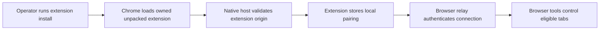

Codex review: needs maintainer review before merge. _Reviewed August 10, 2026, 10:05 PM ET / August 11, 2026, 02:05 UTC._

# ClawSweeper review

## What this changes

The PR adds automatic local Chrome extension pairing through an origin-locked native host, simplifies the extension UI, and retires the tab-copilot and page-share workflows.

## Merge readiness

⚠️ **Ready for maintainer review - 6 items remain**

Keep open for maintainer handling. The browser-plugin ownership and intentional workflow retirement are coherent, but the exact PR tree is unavailable in this blobless checkout, so the new native-host trust boundary cannot be independently cleared.

**Priority:** P1
**Reviewed head:** `4a75bd8bde0514a87fe2ca918fea9e20e94a5a76`
**Owner decision:** Required. See [Decision needed](#decision-needed).

## Review scores

| Measure | Result | What it means |
|---|---|---|
| **Overall readiness** | 🦐 gold shrimp **(3/6)** | The patch has substantial maintainer-provided validation, but exact-head implementation review is unavailable in this environment. |
| **Proof confidence** | 🌊 off-meta tidepool | Not applicable: Not applicable to this maintainer-authored PR; the supplied discussion nevertheless records after-fix Chromium and signed-in Chrome evidence. |
| **Patch quality** | 🦐 gold shrimp **(3/6)** | Security review found an item that needs attention. |

## Verification

| Check | Result | Evidence |
|---|---|---|
| **Real behavior** | Not applicable | Not applicable: Not applicable to this maintainer-authored PR; the supplied discussion nevertheless records after-fix Chromium and signed-in Chrome evidence. |
| **Evidence reviewed** | 7 items | Current manual-pairing contract: Current main documents Load unpacked followed by a pairing string pasted into the extension popup; this is the established workflow the PR replaces. Current custody owner: The existing copilot registry is extension-owned durable local storage, while the background worker waits for custody initialization before debugger attachment. Removal boundary: Current page sharing is contained in the browser plugin: relay lifecycle wires delivery and popup messages invoke it, so the supplied removal does not show a remaining core or channel caller needing compatibility. |
| **Findings** | None | None. |
| **Security** | Needs attention | Inspect the exact native-host trust boundary: The exact installer and native-host entrypoint are absent from this blobless checkout, so origin, path, framing, and secret-handling claims cannot be independently verified before merge. |

## How this fits together

The browser plugin links an unpacked Chrome extension to OpenClaw’s local relay so browser tools can automate eligible signed-in tabs. CLI setup, extension storage, relay authentication, and Chrome native messaging feed that connection and its access controls.

## Decision needed

| Question | Recommendation |
|---|---|
| Should this PR’s origin-locked native-host boundary and the intentional retirement of existing copilot/page-share workflows be accepted after exact-head source inspection? | **Verify then accept the new boundary:** Inspect the exact installer, native-host entrypoint, tests, and Chrome contract, then land if the documented origin and recovery invariants hold. |

Why: The supplied feature-owner decision establishes intent, but this review environment cannot inspect the exact privileged implementation or validate its Chrome native-messaging contract.

## Before merge

- [ ] **Resolve security concern: Inspect the exact native-host trust boundary** - The exact installer and native-host entrypoint are absent from this blobless checkout, so origin, path, framing, and secret-handling claims cannot be independently verified before merge.
- [ ] **Resolve merge risk (P1)** - Merging intentionally removes the previously documented tab-copilot and page-share actions, so existing users lose those workflows and must follow the documented upgrade path.
- [ ] **Resolve merge risk (P1)** - The new native host crosses the Chrome/OpenClaw trust boundary; the exact installer, host entrypoint, tests, and Chrome contract could not be inspected from this checkout.
- [ ] **Resolve merge risk (P1)** - The exact PR tree is unavailable locally, preventing an independent production-versus-test LOC classification and exact-head security review.
- [ ] **Complete next step (P2)** - A protected maintainer/security PR needs human exact-head and product-scope validation; no narrow repair is source-proven.

## Findings

- [medium] Inspect the exact native-host trust boundary

<strong>Agent review details</strong>

### Security

Needs attention: The privileged native-host boundary cannot be security-cleared without access to the exact implementation and Chrome protocol contract.

### Review metrics

| Metric | Value | Why it matters |
|---|---|---|
| **Public setup surface** | 3 new CLI actions: install, status, uninstall-host | The supplied diff adds operator-facing installation and repair commands, which need fresh-install and upgrade scrutiny. |
| **Dependency graph** | 3 dependencies removed | The supplied dependency guard identifies removal of the prior copilot runtime, gateway-client, and build dependencies; removal is coherent only if their deleted runtime paths are absent on the exact head. |
| **Production versus test LOC** | Not independently classifiable from this checkout | The supplied aggregate is +5,593/-12,015, but the blobless checkout lacks the PR head needed to separate production from tests accurately. |

### Stored data model

Persistent data-model change detected: `durable storage schema: extensions/browser/chrome-extension/modules/copilot-gateway-lifecycle.js`, `durable storage schema: extensions/browser/chrome-extension/modules/copilot-session-registry.js`, `migration/backfill/repair: docs/gateway/doctor.md`, `migration/backfill/repair: extensions/browser/src/doctor-browser.ts`, `migration/backfill/repair: src/commands/doctor-browser.facade.test.ts`, `migration/backfill/repair: src/commands/doctor-browser.ts`, and 13 more. Confirm migration or upgrade compatibility proof before merge.

### Merge-risk options

**Maintainer options:**
1. **Inspect the exact native bootstrap before merge (recommended)**  
   Review the exact installer and one-shot host against Chrome’s native-messaging contract, then require the pending exact-head gates before landing.
2. **Accept the retired extension workflows**  
   Land with the documented upgrade guidance if maintainers intentionally accept that page sharing and tab copilot are no longer supported.
3. **Pause for a narrower security review**  
   Hold the PR if exact-head inspection of the privileged host cannot be performed before release.

### Technical review

Best possible solution:

Land only after a maintainer verifies the exact native-host implementation and Chrome contract, accepts the documented retirement of the old workflows, and confirms the upgrade recovery remains visible and safe.

Do we have a high-confidence way to reproduce the issue?

Not applicable to a feature PR; the supplied discussion describes signed-in Chrome and Chromium runs, but this reviewer could not execute or inspect the exact head.

Is this the best way to solve the issue?

Unclear. The browser-plugin ownership is the right layer for pairing and retired custody, but the exact native-host implementation is unavailable for a best-fix comparison.

AGENTS.md: found and applied where relevant.

Codex review notes: model internal, reasoning high; reviewed against [e9b687a6287c](https://github.com/openclaw/openclaw/commit/e9b687a6287cae6e2c49843036a09bf73bf40644).

### Labels

Label changes:

- add `status: ⏳ waiting on author`: ClawSweeper has contributor-facing work open and is waiting for author action. Not applicable: Not applicable to this maintainer-authored PR; the supplied discussion nevertheless records after-fix Chromium and signed-in Chrome evidence.
- remove `status: 👀 ready for maintainer look`: Current PR status label is `status: ⏳ waiting on author`.

Label justifications:

- `P1`: This changes the browser extension’s setup and automation path for existing operators.
- `merge-risk: 🚨 compatibility`: The PR replaces manual pairing and removes previously documented extension workflows.
- `merge-risk: 🚨 message-delivery`: Removing page sharing intentionally suppresses an existing path that enqueues page content to the main session.
- `merge-risk: 🚨 security-boundary`: The PR introduces a privileged Chrome native-messaging host that releases local pairing material only after origin validation.
- `rating: 🦐 gold shrimp`: Overall readiness is 🦐 gold shrimp; proof is 🌊 off-meta tidepool and patch quality is 🦐 gold shrimp.
- `status: ⏳ waiting on author`: ClawSweeper has contributor-facing work open and is waiting for author action. Not applicable: Not applicable to this maintainer-authored PR; the supplied discussion nevertheless records after-fix Chromium and signed-in Chrome evidence.

### Evidence

Security concerns:

- [medium] Inspect the exact native-host trust boundary
  The exact installer and native-host entrypoint are absent from this blobless checkout, so origin, path, framing, and secret-handling claims cannot be independently verified before merge.
  Confidence: 0.97

What I checked:

- **Current manual-pairing contract:** Current main documents Load unpacked followed by a pairing string pasted into the extension popup; this is the established workflow the PR replaces. Public docs: [`docs/tools/chrome-extension.md`](https://docs.openclaw.ai/tools/chrome-extension). ([`docs/tools/chrome-extension.md:47`](https://docs.openclaw.ai/tools/chrome-extension), [a381aa3e8b7d](https://github.com/openclaw/openclaw/commit/a381aa3e8b7d))
- **Current custody owner:** The existing copilot registry is extension-owned durable local storage, while the background worker waits for custody initialization before debugger attachment. ([`extensions/browser/chrome-extension/modules/copilot-session-registry.js:102`](https://github.com/openclaw/openclaw/blob/a381aa3e8b7d/extensions/browser/chrome-extension/modules/copilot-session-registry.js#L102), [a381aa3e8b7d](https://github.com/openclaw/openclaw/commit/a381aa3e8b7d))
- **Removal boundary:** Current page sharing is contained in the browser plugin: relay lifecycle wires delivery and popup messages invoke it, so the supplied removal does not show a remaining core or channel caller needing compatibility. ([`extensions/browser/src/browser/extension-relay/page-share.ts:28`](https://github.com/openclaw/openclaw/blob/a381aa3e8b7d/extensions/browser/src/browser/extension-relay/page-share.ts#L28), [a381aa3e8b7d](https://github.com/openclaw/openclaw/commit/a381aa3e8b7d))
- **Current-main check:** The checked-out main is one commit behind origin/main, but the current-main delta changes only agent files, not the browser paths reviewed here. ([`src/agents/agent-command.ts`](https://github.com/openclaw/openclaw/blob/e9b687a6287c/src/agents/agent-command.ts), [e9b687a6287c](https://github.com/openclaw/openclaw/commit/e9b687a6287c))
- **Feature history:** Blame attributes the current copilot initialization and pairing hint to Peter Steinberger in the recent browser work, supporting steipete as the routing owner. ([`extensions/browser/chrome-extension/background.js:589`](https://github.com/openclaw/openclaw/blob/2132c15bd65b/extensions/browser/chrome-extension/background.js#L589), [2132c15bd65b](https://github.com/openclaw/openclaw/commit/2132c15bd65b))
- **Exact-head inspection gap:** The PR head and base are absent from this promisor checkout; resolving the head attempted a network fetch that failed DNS, so new native-host source and tests were not independently inspected. ([4a75bd8bde05](https://github.com/openclaw/openclaw/commit/4a75bd8bde05))

Likely related people:

- **steipete:** The supplied discussion records an explicit feature-owner decision, all listed PR commits are authored by steipete, and current browser custody initialization blames to Peter Steinberger. (role: feature owner and recent area contributor; confidence: high; commits: [2132c15bd65b](https://github.com/openclaw/openclaw/commit/2132c15bd65b6b5a18b0f5380f8cb85f80a0756e), [4a75bd8bde05](https://github.com/openclaw/openclaw/commit/4a75bd8bde0514a87fe2ca918fea9e20e94a5a76); files: `extensions/browser/chrome-extension/background.js`, `extensions/browser/src/browser/extension-relay/relay-lifecycle.ts`, `docs/tools/chrome-extension.md`)

### Rank-up moves

Optional improvements that raise the rating; they are not merge blockers.

- Review the exact native-host source and its Chrome protocol contract.
- Complete the pending exact-head merge gates.

### Rating scale

| Score | Internal tier | Crab rank | Meaning |
|---:|:---:|---|---|
| **6/6** | S | 🦀 challenger crab | Exceptional readiness |
| **5/6** | A | 🦞 diamond lobster | Very strong readiness |
| **4/6** | B | 🐚 platinum hermit | Good normal PR; ordinary maintainer review |
| **3/6** | C | 🦐 gold shrimp | Useful, but confidence is limited |
| **2/6** | D | 🦪 silver shellfish | Proof or implementation needs work |
| **1/6** | F | 🧂 unranked krab | Not merge-ready |
| N/A | NA | 🌊 off-meta tidepool | Rating does not apply |

Overall follows the weaker of proof and patch quality.
Shiny media proof means a screenshot, video, or linked artifact directly shows the changed behavior. Runtime, network, CSP, and security claims still need visible diagnostics.

### Workflow

- ClawSweeper keeps one durable marker-backed review comment per issue or PR.
- Re-runs edit this comment so the latest verdict, findings, and automation markers stay together instead of adding duplicate bot comments.
- A fresh review can be triggered by eligible `@clawsweeper re-review` comments, exact-item GitHub events, scheduled/background review runs, or manual workflow dispatch.
- PR/issue authors and users with repository write access can comment `@clawsweeper re-review` or `@clawsweeper re-run` on an open PR or issue to request a fresh review only.
- Maintainers can also comment `@clawsweeper review` to request a fresh review only.
- Fresh-review commands do not start repair, autofix, rebase, CI repair, or automerge.
- Maintainer-only repair and merge flows require explicit commands such as `@clawsweeper autofix`, `@clawsweeper automerge`, `@clawsweeper fix ci`, or `@clawsweeper address review`.
- Maintainers can comment `@clawsweeper explain` to ask for more context, or `@clawsweeper stop` to stop active automation.

### History

Review history (9 earlier review cycles; latest 8 shown)

<!-- clawsweeper-review-history v=1 total=9 -->
- reviewed 2026-08-10T12:52:47.875Z sha 0740a4d279c191959c3eb5bedb6a0adb65624e07 :: found issues before merge. :: [P1] Preserve or explicitly retire existing extension workflows
- reviewed 2026-08-10T13:01:46.471Z sha 0740a4d279c191959c3eb5bedb6a0adb65624e07 :: found issues before merge. :: [P1] Preserve or explicitly retire current extension workflows
- reviewed 2026-08-10T13:54:41.731Z sha b764094c069d32acf2e68fd311e07542e2969fe7 :: found issues before merge. :: [P1] Preserve or explicitly retire current browser workflows | [P2] Leave release-owned changelog generation to the release flow
- reviewed 2026-08-10T14:56:53.702Z sha 4a02c15ce13af382cc7d2cdac2abeaa39e64b714 :: found issues before merge. :: [P1] Preserve or explicitly retire current browser workflows | [P2] Remove the release-owned changelog edit
- reviewed 2026-08-10T15:55:22.924Z sha 3e6a34d831a9e03672ccb7dca950944c09d1272b :: found issues before merge. :: [P1] Preserve or explicitly retire current browser workflows | [P2] Remove the release-owned changelog entry
- reviewed 2026-08-10T16:55:39.375Z sha 3e6a34d831a9e03672ccb7dca950944c09d1272b :: needs maintainer review before merge. :: none
- reviewed 2026-08-10T17:54:32.934Z sha 103534de53ed7ada01cda4569f353adff6b1040f :: found issues before merge. :: [P2] Remove the release-owned changelog entry
- reviewed 2026-08-11T00:52:31.249Z sha d44096e0d6c9bbd347b1b3190dd5a1b55475f963 :: needs maintainer review before merge. :: none

<!-- clawsweeper-security:security-sensitive item=121586 sha=4a75bd8bde0514a87fe2ca918fea9e20e94a5a76 confidence=medium updated_at=2026-08-11T02:01:32Z reviewed_at=2026-08-11T02:05:27.348Z lease_owner=github-run-31451037254-1 lease_comment_id=5248173106 source_revision=717ca27119c04ceb6a12b3099dbbf3118f4ee2f98efd774cbfb4d02590a87c9c -->
<!-- clawsweeper-verdict:needs-human item=121586 sha=4a75bd8bde0514a87fe2ca918fea9e20e94a5a76 confidence=medium updated_at=2026-08-11T02:01:32Z reviewed_at=2026-08-11T02:05:27.348Z lease_owner=github-run-31451037254-1 lease_comment_id=5248173106 source_revision=717ca27119c04ceb6a12b3099dbbf3118f4ee2f98efd774cbfb4d02590a87c9c -->

<!-- clawsweeper-review-version item=121586 reviewed_at=2026-08-11T02:05:27.348Z sha=4a75bd8bde0514a87fe2ca918fea9e20e94a5a76 source_revision=717ca27119c04ceb6a12b3099dbbf3118f4ee2f98efd774cbfb4d02590a87c9c lease_owner=github-run-31451037254-1 lease_comment_id=5248173106 v=1 -->

<!-- clawsweeper-review item=121586 -->