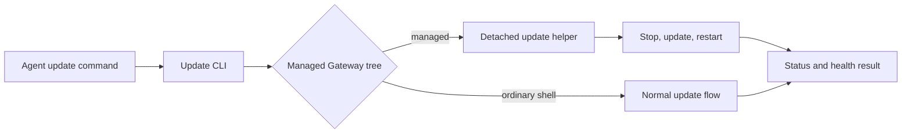

Codex review: found issues before merge. _Reviewed September 1, 2026, 9:24 PM ET / September 2, 2026, 01:24 UTC._

# ClawSweeper review

## What this changes

The PR transfers agent-launched updates from a managed Gateway process tree to the existing detached update helper before the service is stopped, preserving update inputs and returning status guidance.

## Regression provenance

Possible regression — probable (reviewed change; failure trace). No predecessor PR is attributed.

## Merge readiness

⚠️ **Ready for maintainer review - 4 items remain**

Keep open. The PR correctly reuses the existing managed helper and includes strong Linux user-systemd evidence, but it newly documents and enables the analogous macOS LaunchAgent path without a real managed-macOS completion trace; exact-head CI is also still incomplete.

**Priority:** P2
**Reviewed head:** `1820fbc040b95091a983154881486e48c906afb0`

## Review scores

| Measure | Result | What it means |
|---|---|---|
| **Overall readiness** | 🦐 gold shrimp **(3/6)** | The implementation is focused and the Linux proof is strong, but the documented macOS path still lacks real behavior evidence. |
| **Proof confidence** | 🦐 gold shrimp **(3/6)** | Not applicable: Real behavior proof is not required for maintainer- or bot-authored pull requests. |
| **Patch quality** | 🦐 gold shrimp **(3/6)** | 1 actionable review finding remain. |

## Verification

| Check | Result | Evidence |
|---|---|---|
| **Real behavior** | Not applicable | Not applicable: Real behavior proof is not required for maintainer- or bot-authored pull requests. |
| **Evidence reviewed** | 7 items | Current-main gap: Current main calls managed-service preparation without a CLI-to-helper handoff callback, so it does not contain this PR's transfer path. Introduced handoff boundary: The PR starts the existing managed-service handoff, records an accepted handoff result, transfers ownership only after the helper is ready, and emits operator follow-up commands. Helper lifecycle invariant: The helper commits only after an acknowledged transfer and CLI control-channel disconnect; it then verifies the managed service has stopped before executing the update. |
| **Findings** | 1 actionable finding | [P2] Prove the LaunchAgent handoff on a real managed Gateway |
| **Security** | None | None. |

## How this fits together

OpenClaw's update CLI must stop and restart managed Gateways around package or Git updates. The new handoff lets an agent-run CLI return an accepted result before the detached helper stops the parent service, performs the update, and records recovery.

## Before merge

- [ ] **Prove the LaunchAgent handoff on a real managed Gateway (P2)** - The introduced Linux/macOS branch promises the LaunchAgent path, but the supplied evidence calls the macOS checks synthetic rather than a completed packaged update. Add a redacted managed-LaunchAgent trace showing transfer, helper survival, update completion, and healthy Gateway recovery, or explicitly narrow the supported claim. This path was unchanged since the prior reviewed head, so this is a late evidence finding.
- [ ] **Resolve merge risk (P1)** - The macOS LaunchAgent behavior is a user-visible claimed path, but the supplied evidence covers it only with synthetic helper checks rather than a real managed Gateway update and recovery.
- [ ] **Resolve merge risk (P1)** - Exact-head CI remains incomplete, so the existing process-lifecycle evidence is not yet accompanied by the required green merge gate.
- [ ] **Complete next step (P2)** - A real managed macOS proof and exact-head CI are required before a maintainer can safely accept this availability-sensitive lifecycle change.

## Findings

- [P2] Prove the LaunchAgent handoff on a real managed Gateway — `src/cli/update-cli/update-command-handoff.ts:64-79`

<strong>Agent review details</strong>

### Security

None.

### PR surface

Source +231, Tests +230, Docs +11. Total +472 across 9 files.

View PR surface stats

| Area | Files | Added | Removed | Net |
|---|---:|---:|---:|---:|
| Source | 4 | 273 | 42 | +231 |
| Tests | 4 | 287 | 57 | +230 |
| Docs | 1 | 11 | 0 | +11 |
| Config | 0 | 0 | 0 | 0 |
| Generated | 0 | 0 | 0 | 0 |
| Other | 0 | 0 | 0 | 0 |
| **Total** | **9** | **571** | **99** | **+472** |

### Review metrics

| Metric | Value | Why it matters |
|---|---|---|
| **Production versus test delta** | production +231 net; tests +230 net; docs +11 | The bug fix adds a CLI-to-existing-helper ownership adapter; the substantial lifecycle growth makes cross-platform behavior proof particularly important. |

### Stored data model

Persistent data-model change detected: `serialized state: src/infra/update-managed-service-handoff.ts`, `unknown-data-model-change: src/infra/update-managed-service-handoff.ts`. Confirm migration or upgrade compatibility proof before merge.

### Root-cause cluster

Relationship: `fixed_by_candidate`
Canonical: https://github.com/openclaw/openclaw/issues/135655
Summary: This PR explicitly implements the canonical report's managed-Gateway self-stop failure.

Members:
- `canonical`: https://github.com/openclaw/openclaw/issues/135655 - The PR formally identifies the issue as the bug addressed; it remains open until this candidate is landed.

Proposal only: this assessment does not dispatch repair, suppress jobs, mutate sibling items, close, or merge anything.

### Merge-risk options

**Maintainer options:**
1. **Add managed macOS proof (recommended)**  
   Attach a redacted LaunchAgent run showing accepted handoff, helper survival after service stop, completed update, and a healthy restarted Gateway.
2. **Accept the platform-proof gap**  
   A maintainer may explicitly accept the synthetic launchd coverage as sufficient for this release, retaining ownership of the unproven packaged macOS path.

### Technical review

Best possible solution:

Keep the existing helper as the sole stop/update/recovery owner, add one redacted real LaunchAgent after-fix trace showing transfer through healthy recovery, then land only after exact-head CI is green.

Do we have a high-confidence way to reproduce the issue?

Yes for the Linux path: current main lacks the callback and the supplied real user-systemd trace plus focused regression coverage describe a concrete failure and after-fix recovery. The analogous macOS path has not been demonstrated in a real managed installation.

Is this the best way to solve the issue?

Yes structurally: the branch extends the established detached-helper owner rather than creating another updater. It is not merge-complete until the promised LaunchAgent behavior has equivalent real-flow proof or is explicitly narrowed.

Full review comments:

- [P2] Prove the LaunchAgent handoff on a real managed Gateway — `src/cli/update-cli/update-command-handoff.ts:64-79`
  The introduced Linux/macOS branch promises the LaunchAgent path, but the supplied evidence calls the macOS checks synthetic rather than a completed packaged update. Add a redacted managed-LaunchAgent trace showing transfer, helper survival, update completion, and healthy Gateway recovery, or explicitly narrow the supported claim. This path was unchanged since the prior reviewed head, so this is a late evidence finding.
  Confidence: 0.91
  Late finding: first raised on code an earlier review cycle already covered.

Overall correctness: patch is incorrect
Overall confidence: 0.9

AGENTS.md: found and applied where relevant.

Codex review notes: model internal, reasoning high; reviewed against [51b0b0380211](https://github.com/openclaw/openclaw/commit/51b0b0380211c5cf44ea8d81ae4d1ca31fbfdac8).

### Labels

Label changes:

- add `status: ⏳ waiting on author`: ClawSweeper has contributor-facing work open and is waiting for author action. Not applicable: Real behavior proof is not required for maintainer- or bot-authored pull requests.
- remove `status: 👀 ready for maintainer look`: Current PR status label is `status: ⏳ waiting on author`.

Label justifications:

- `P2`: This fixes an agent-initiated managed-update path that can leave a Gateway unavailable, with bounded platform scope.
- `merge-risk: 🚨 availability`: The PR changes the owner and sequencing of managed Gateway stop, update, and restart operations.
- `rating: 🦐 gold shrimp`: Overall readiness is 🦐 gold shrimp; proof is 🦐 gold shrimp and patch quality is 🦐 gold shrimp.
- `status: ⏳ waiting on author`: ClawSweeper has contributor-facing work open and is waiting for author action. Not applicable: Real behavior proof is not required for maintainer- or bot-authored pull requests.

### Evidence

What I checked:

- **Current-main gap:** Current main calls managed-service preparation without a CLI-to-helper handoff callback, so it does not contain this PR's transfer path. ([`src/cli/update-cli/update-command-execution.ts:109`](https://github.com/openclaw/openclaw/blob/51b0b0380211c5cf44ea8d81ae4d1ca31fbfdac8/src/cli/update-cli/update-command-execution.ts#L109), [51b0b0380211](https://github.com/openclaw/openclaw/commit/51b0b0380211c5cf44ea8d81ae4d1ca31fbfdac8))
- **Introduced handoff boundary:** The PR starts the existing managed-service handoff, records an accepted handoff result, transfers ownership only after the helper is ready, and emits operator follow-up commands. ([`src/cli/update-cli/update-command-handoff.ts:63`](https://github.com/openclaw/openclaw/blob/1820fbc040b95091a983154881486e48c906afb0/src/cli/update-cli/update-command-handoff.ts#L63), [1820fbc040b9](https://github.com/openclaw/openclaw/commit/1820fbc040b95091a983154881486e48c906afb0))
- **Helper lifecycle invariant:** The helper commits only after an acknowledged transfer and CLI control-channel disconnect; it then verifies the managed service has stopped before executing the update. ([`src/infra/update-managed-service-handoff.ts:1165`](https://github.com/openclaw/openclaw/blob/1820fbc040b95091a983154881486e48c906afb0/src/infra/update-managed-service-handoff.ts#L1165), [1820fbc040b9](https://github.com/openclaw/openclaw/commit/1820fbc040b95091a983154881486e48c906afb0))
- **Boundary coverage:** Executable helper tests exercise transferred versus unarmed/dead-parent disconnects for both systemd and launchd, including recovery and vanished invocation-directory cases. ([`src/infra/update-managed-service-handoff-lifecycle.test.ts:511`](https://github.com/openclaw/openclaw/blob/1820fbc040b95091a983154881486e48c906afb0/src/infra/update-managed-service-handoff-lifecycle.test.ts#L511), [1820fbc040b9](https://github.com/openclaw/openclaw/commit/1820fbc040b95091a983154881486e48c906afb0))
- **Linux real-behavior evidence:** The supplied PR comment reports a real user-systemd Gateway agent/exec run with a separate helper scope, changed Gateway PID, successful package/Doctor work, and a final healthy update sentinel. ([1820fbc040b9](https://github.com/openclaw/openclaw/commit/1820fbc040b95091a983154881486e48c906afb0))
- **Mac proof gap:** The documentation promises the LaunchAgent path, while the PR evidence expressly characterizes its macOS checks as synthetic lifecycle checks rather than a completed packaged update. Public docs: [`docs/cli/update.md`](https://docs.openclaw.ai/cli/update). ([`docs/cli/update.md:318`](https://docs.openclaw.ai/cli/update), [1820fbc040b9](https://github.com/openclaw/openclaw/commit/1820fbc040b95091a983154881486e48c906afb0))

Likely related people:

- **steipete:** Suggested for follow-up; no historical authorship or introduction is verified. (role: unverified routing candidate; confidence: low)
- **sinner:** Suggested for follow-up; no historical authorship or introduction is verified. (role: unverified routing candidate; confidence: low)

### Rank-up moves

Optional improvements that raise the rating; they are not merge blockers.

- Add a redacted real macOS LaunchAgent handoff-and-recovery trace.
- Let exact-head CI complete successfully.

### Rating scale

| Score | Internal tier | Crab rank | Meaning |
|---:|:---:|---|---|
| **6/6** | S | 🦀 challenger crab | Exceptional readiness |
| **5/6** | A | 🦞 diamond lobster | Very strong readiness |
| **4/6** | B | 🐚 platinum hermit | Good normal PR; ordinary maintainer review |
| **3/6** | C | 🦐 gold shrimp | Useful, but confidence is limited |
| **2/6** | D | 🦪 silver shellfish | Proof or implementation needs work |
| **1/6** | F | 🧂 unranked krab | Not merge-ready |
| N/A | NA | 🌊 off-meta tidepool | Rating does not apply |

Overall follows the weaker of proof and patch quality.
Shiny media proof means a screenshot, video, or linked artifact directly shows the changed behavior. Runtime, network, CSP, and security claims still need visible diagnostics.

### Workflow

- ClawSweeper keeps one durable marker-backed review comment per issue or PR.
- Re-runs edit this comment so the latest verdict, findings, and automation markers stay together instead of adding duplicate bot comments.
- A fresh review can be triggered by eligible `@clawsweeper re-review` comments, exact-item GitHub events, scheduled/background review runs, or manual workflow dispatch.
- PR/issue authors and users with repository write access can comment `@clawsweeper re-review` or `@clawsweeper re-run` on an open PR or issue to request a fresh review only.
- Maintainers can also comment `@clawsweeper review` to request a fresh review only.
- Fresh-review commands do not start repair, autofix, rebase, CI repair, or automerge.
- Maintainer-only repair and merge flows require explicit commands such as `@clawsweeper autofix`, `@clawsweeper automerge`, `@clawsweeper fix ci`, or `@clawsweeper address review`.
- Maintainers can comment `@clawsweeper explain` to ask for more context, or `@clawsweeper stop` to stop active automation.

### History

Review history (3 earlier review cycles)

<!-- clawsweeper-review-history v=1 total=3 -->
- reviewed 2026-09-02T00:23:10.855Z sha eb66c05d03fef26479230916595a385438406541 :: needs maintainer review before merge. :: none
- reviewed 2026-09-02T00:49:08.690Z sha 2df4c5b453be2a9a03c31e626001dbdf0bd1cb0f :: needs maintainer review before merge. :: none
- reviewed 2026-09-02T01:07:39.297Z sha 5713896ef062a41c1a251b9c3c2427e713e70715 :: needs maintainer review before merge. :: none

<!-- clawsweeper-verdict:needs-human item=135701 sha=1820fbc040b95091a983154881486e48c906afb0 confidence=high updated_at=2026-09-02T01:20:15Z reviewed_at=2026-09-02T01:24:20.027Z lease_owner=github-run-33578860454-1 lease_comment_id=5502898634 source_revision=aa50d3012ae9ad3cd14b2d6f023ddb0f29c544e014a1dec5da122fb9d7aebfdd live_verification=absent -->

<!-- clawsweeper-review-version item=135701 reviewed_at=2026-09-02T01:24:20.027Z sha=1820fbc040b95091a983154881486e48c906afb0 source_revision=aa50d3012ae9ad3cd14b2d6f023ddb0f29c544e014a1dec5da122fb9d7aebfdd lease_owner=github-run-33578860454-1 lease_comment_id=5502898634 v=1 -->

<!-- clawsweeper-review item=135701 -->