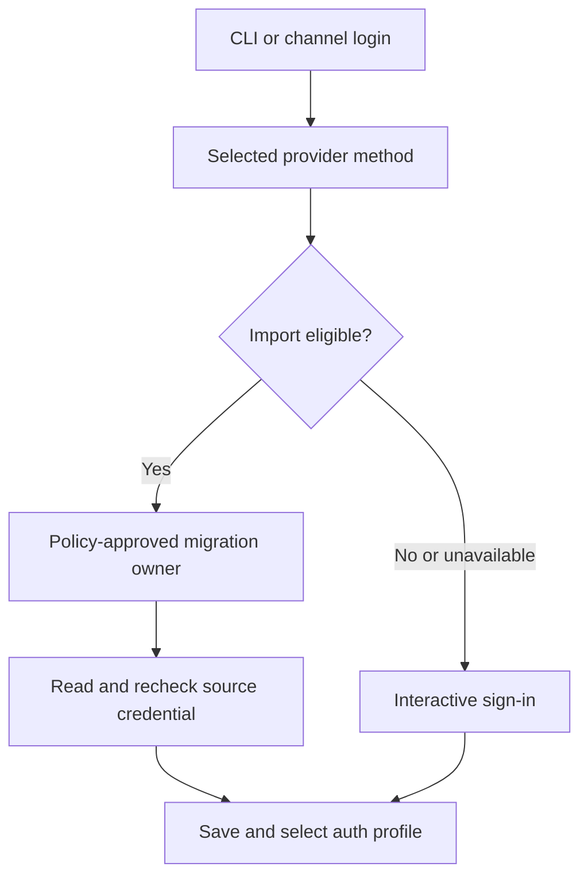

Codex review: blocked before merge. _Reviewed September 9, 2026, 6:48 AM ET / 10:48 UTC (Revision 5)._

# ClawSweeper review

## What this changes

Provider login can import an existing credential through a plugin-declared migration owner while preserving model settings and explicit login options.

> [!WARNING]
> **SQLite table change**
>
> This PR modifies persisted SQLite tables in `extensions/codex/src/migration/auth.ts`, `extensions/codex/src/migration/cli-credentials.ts`, `extensions/codex/src/migration/source.ts`, `src/plugins/migration-provider-public-artifacts.ts`, and 1 more. Prefer a design that avoids changing persisted SQLite tables. Migration or upgrade compatibility proof is recorded, but maintainers should still confirm that the schema change is necessary.

## Merge readiness

⛔ **Blocked before merge - 4 items remain**

This remains useful, protected work absent from inspected main. Earlier defects are addressed, but the prior channel account-selection decision remains unresolved; the latest commit changes only a test fixture.

**Priority:** P2
**Reviewed head:** `d74df581a8dc8863c428b213c8582b5f348b5e3e`
**Owner decision:** Required. See [Decision needed](#decision-needed).

## Review scores

| Measure | Result | What it means |
|---|---|---|
| **Overall readiness** | 🐚 platinum hermit **(4/6)** | A coherent implementation with useful CLI proof and no new concrete correctness finding; account-selection intent remains unresolved. |
| **Proof confidence** | 🐚 platinum hermit **(4/6)** | Sufficient (terminal): The supplied compiled-CLI before/after observations support file-key import, persisted-profile readback, owner-policy rejection, and preservation of existing settings and credentials. That accepted CLI evidence remains valid; channel account-selection behavior is a separate unresolved product and validation question. |
| **Patch quality** | 🐚 platinum hermit **(4/6)** | No actionable review findings were identified. |

## Verification

| Check | Result | Evidence |
|---|---|---|
| **Real behavior** | Verified | Sufficient (terminal): The supplied compiled-CLI before/after observations support file-key import, persisted-profile readback, owner-policy rejection, and preservation of existing settings and credentials. That accepted CLI evidence remains valid; channel account-selection behavior is a separate unresolved product and validation question. |
| **Evidence reviewed** | 10 items | Introduced login shortcut: The pinned introduced diff adds import before interactive authentication, bypassed by force, profileId, and setDefault. Successful import promotes the saved profile and returns immediately. Channel account selection remains affected: The device-code method declares credential import. The channel runtime invokes that method without an import-bypass option, and commands-login.ts selects the returned profile for the session. The existing owner/admin and private-context checks remain in place. Channel caller and final session selection: runCodexDeviceLoginFlow passes method, agent, config, signal, and isRemote, with no force or profileId for this caller; the channel handler then switches to the returned profile. This supports the previous review's account-selection concern without establishing an authorization bypass. |
| **Findings** | None | None. |
| **Security** | None | None. |

## How this fits together

Provider authentication serves both CLI sign-in and channel login commands. The new import path reads the selected credential source, saves an agent auth profile, and returns that profile to callers that may select it for subsequent requests.

## Decision needed

| Question | Recommendation |
|---|---|
| Should channel device-code login automatically reuse the host's stored Codex account, or continue requiring device pairing? | **Preserve device pairing:** Keep automatic import for appropriate CLI methods while ensuring channel device-code login continues to offer explicit account selection. |

Why: The shared login shortcut changes which account a channel session selects, and neither the supplied discussion nor the latest test-only commit establishes the intended behavior.

## Before merge

- [ ] **Resolve merge risk (P1)** - An existing channel owner requesting device-code login can receive immediate success and switch the session to the host's stored account, without choosing an account through device pairing.
- [ ] **Resolve merge risk (P1)** - The optional provider-auth declaration and public migration artifact introduce a plugin contract whose automatic account-selection semantics need an explicit maintainer decision.
- [ ] **Complete next step (P2)** - Decide whether channel device-code login may reuse host credentials, then document and demonstrate the selected behavior before merge.
- [ ] **Resolve maintainer decision** - Resolve the maintainer decision shown above before merge.

<strong>Agent review details</strong>

### Security

None.

### PR surface

Source +713, Tests +664, Docs +25. Total +1402 across 20 files.

View PR surface stats

| Area | Files | Added | Removed | Net |
|---|---:|---:|---:|---:|
| Source | 15 | 804 | 91 | +713 |
| Tests | 4 | 770 | 106 | +664 |
| Docs | 1 | 25 | 0 | +25 |
| Config | 0 | 0 | 0 | 0 |
| Generated | 0 | 0 | 0 | 0 |
| Other | 0 | 0 | 0 | 0 |
| **Total** | **20** | **1599** | **197** | **+1402** |

### Review metrics

| Metric | Value | Why it matters |
|---|---|---|
| **Provider contract expansion** | 1 optional import declaration and 1 public artifact convention; 3 OpenAI auth methods opt in | The contract affects plugin authors and extends automatic reuse to device-code login. |
| **Production versus test growth** | Net production +713 lines; tests +664 lines | Production growth implements native storage selection, credential fencing, and generic migration dispatch; tests cover preservation and rejection behavior. |

### Stored data model

Persistent data-model change detected: `migration/backfill/repair: extensions/codex/migration-provider-api.ts`, `migration/backfill/repair: extensions/codex/src/migration/cli-credentials.ts`, `migration/backfill/repair: extensions/codex/src/migration/plan.ts`, `migration/backfill/repair: extensions/codex/src/migration/provider.ts`, `migration/backfill/repair: extensions/codex/src/migration/source.ts`, `migration/backfill/repair: src/commands/models/auth-credential-import.ts`, and 10 more. Migration or upgrade compatibility proof is recorded; maintainers should verify it before merge.

### Merge-risk options

**Maintainer options:**
1. **Retain explicit channel account selection (recommended)**  
   After the product decision, narrow the import shortcut so channel device-code login cannot silently select the host account.
2. **Approve and demonstrate reuse**  
   Accept the changed account-selection behavior only after documenting it and demonstrating a clear channel account choice.

### Technical review

Best possible solution:

Keep plugin-owned CLI credential reuse while preserving explicit account choice for channel device-code login, with documented behavior for existing installations.

Do we have a high-confidence way to reproduce the issue?

Not applicable as a feature proposal; source inspection establishes the changed channel path, but this review did not execute a channel login.

Is this the best way to solve the issue?

Unclear overall: reusing the migration owner is coherent, but extending automatic import to device-code callers needs an explicit account-selection decision.

AGENTS.md: found and applied where relevant.

Codex review notes: model internal, reasoning medium; reviewed against [056d14028ff1](https://github.com/openclaw/openclaw/commit/056d14028ff128218ab98e1558832ba627bad146).

### Labels

Label justifications:

- `P2`: This is a bounded provider-login improvement with an unresolved account-selection choice.
- `merge-risk: 🚨 compatibility`: Existing device-code callers can bypass pairing, and the PR expands the provider plugin contract.
- `merge-risk: 🚨 auth-provider`: Channel login can select the host's stored account instead of an account chosen through device pairing.
- `rating: 🐚 platinum hermit`: Overall readiness is 🐚 platinum hermit; proof is 🐚 platinum hermit and patch quality is 🐚 platinum hermit.
- `status: 👀 ready for maintainer look`: ClawSweeper has no concrete contributor-facing blocker left for this PR. Sufficient (terminal): The supplied compiled-CLI before/after observations support file-key import, persisted-profile readback, owner-policy rejection, and preservation of existing settings and credentials. That accepted CLI evidence remains valid; channel account-selection behavior is a separate unresolved product and validation question.
- `proof: sufficient`: Contributor real behavior proof is sufficient. The supplied compiled-CLI before/after observations support file-key import, persisted-profile readback, owner-policy rejection, and preservation of existing settings and credentials. That accepted CLI evidence remains valid; channel account-selection behavior is a separate unresolved product and validation question.
- `proof: telegram-e2e`: This PR needs Telegram Test Server proof with the repository E2E skill. The shared shortcut can change Telegram /login from device pairing to immediate success and session account selection.

### Evidence

What I checked:

- **Introduced login shortcut:** The pinned introduced diff adds import before interactive authentication, bypassed by force, profileId, and setDefault. Successful import promotes the saved profile and returns immediately. ([`src/commands/models/auth.ts:1054`](https://github.com/openclaw/openclaw/blob/d74df581a8dc8863c428b213c8582b5f348b5e3e/src/commands/models/auth.ts#L1054), [d74df581a8dc](https://github.com/openclaw/openclaw/commit/d74df581a8dc8863c428b213c8582b5f348b5e3e))
- **Channel account selection remains affected:** The device-code method declares credential import. The channel runtime invokes that method without an import-bypass option, and commands-login.ts selects the returned profile for the session. The existing owner/admin and private-context checks remain in place. ([`extensions/openai/provider-contract-api.ts:94`](https://github.com/openclaw/openclaw/blob/d74df581a8dc8863c428b213c8582b5f348b5e3e/extensions/openai/provider-contract-api.ts#L94), [d74df581a8dc](https://github.com/openclaw/openclaw/commit/d74df581a8dc8863c428b213c8582b5f348b5e3e))
- **Channel caller and final session selection:** runCodexDeviceLoginFlow passes method, agent, config, signal, and isRemote, with no force or profileId for this caller; the channel handler then switches to the returned profile. This supports the previous review's account-selection concern without establishing an authorization bypass. ([`src/auto-reply/reply/commands-login.ts:246`](https://github.com/openclaw/openclaw/blob/d74df581a8dc8863c428b213c8582b5f348b5e3e/src/auto-reply/reply/commands-login.ts#L246), [d74df581a8dc](https://github.com/openclaw/openclaw/commit/d74df581a8dc8863c428b213c8582b5f348b5e3e))
- **Re-review continuity:** The supplied previous review requested a decision about channel reuse of host credentials. REST inspection confirms the newest commit only changes provider.test.ts to seed the selected local store explicitly; it does not resolve that product choice. The live PR remains open and has no submitted reviews. ([`extensions/codex/src/migration/provider.test.ts:1085`](https://github.com/openclaw/openclaw/blob/d74df581a8dc8863c428b213c8582b5f348b5e3e/extensions/codex/src/migration/provider.test.ts#L1085), [d74df581a8dc](https://github.com/openclaw/openclaw/commit/d74df581a8dc8863c428b213c8582b5f348b5e3e))
- **Import safeguards and regression coverage:** The importer validates the declared item, provider, and credential kind. The migration owner rereads credential bytes, rejects changed fingerprints, checks cancellation before the store update, and preserves existing matching profiles. Added coverage includes denied owners, explicit login options, changed sources, uncertain reader cleanup, and expired existing OAuth profiles. ([`extensions/codex/src/migration/auth.ts:593`](https://github.com/openclaw/openclaw/blob/d74df581a8dc8863c428b213c8582b5f348b5e3e/extensions/codex/src/migration/auth.ts#L593), [d74df581a8dc](https://github.com/openclaw/openclaw/commit/d74df581a8dc8863c428b213c8582b5f348b5e3e))
- **Supplied real CLI proof:** The captured PR body reports compiled-CLI before/after import, fresh auth-list readback, unchanged source/config observations, enabled/disabled/denied owner controls, explicit default selection, and preservation of an existing OAuth profile. It identifies executed package 3cc281be93b891adadd725557671126d9d07d3ad and limits its claims to synthetic file credentials with an offline Gateway. It does not claim channel account-selection proof. Captured context identity: 708e57cca60d02a314e1e82c5432d49bb64b4fb14661d413aee892b0c47e6a38. ([3cc281be93b8](https://github.com/openclaw/openclaw/commit/3cc281be93b891adadd725557671126d9d07d3ad))

Likely related people:

- **steipete:** Suggested for follow-up; no historical authorship or introduction is verified. (role: unverified routing candidate; confidence: low)
- **vincentkoc:** Suggested for follow-up; no historical authorship or introduction is verified. (role: unverified routing candidate; confidence: low)

### Rank-up moves

Optional improvements that raise the rating; they are not merge blockers.

- Resolve the channel device-code account-selection policy and demonstrate the chosen behavior.

### Rating scale

| Score | Internal tier | Crab rank | Meaning |
|---:|:---:|---|---|
| **6/6** | S | 🦀 challenger crab | Exceptional readiness |
| **5/6** | A | 🦞 diamond lobster | Very strong readiness |
| **4/6** | B | 🐚 platinum hermit | Good normal PR; ordinary maintainer review |
| **3/6** | C | 🦐 gold shrimp | Useful, but confidence is limited |
| **2/6** | D | 🦪 silver shellfish | Proof or implementation needs work |
| **1/6** | F | 🧂 unranked krab | Not merge-ready |
| N/A | NA | 🌊 off-meta tidepool | Rating does not apply |

Overall follows the weaker of proof and patch quality.
Shiny media proof means a screenshot, video, or linked artifact directly shows the changed behavior. Runtime, network, CSP, and security claims still need visible diagnostics.

### Workflow

- ClawSweeper keeps one durable marker-backed review comment per issue or PR.
- Re-runs edit this comment so the latest verdict, findings, and automation markers stay together instead of adding duplicate bot comments.
- A fresh review can be triggered by eligible `@clawsweeper re-review` comments, exact-item GitHub events, scheduled/background review runs, or manual workflow dispatch.
- PR/issue authors and users with repository write access can comment `@clawsweeper re-review` or `@clawsweeper re-run` on an open PR or issue to request a fresh review only.
- Maintainers can also comment `@clawsweeper review` to request a fresh review only.
- Fresh-review commands do not start repair, autofix, rebase, CI repair, or automerge.
- Maintainer-only repair and merge flows require explicit commands such as `@clawsweeper autofix`, `@clawsweeper automerge`, `@clawsweeper fix ci`, or `@clawsweeper address review`.
- Maintainers can comment `@clawsweeper explain` to ask for more context, or `@clawsweeper stop` to stop active automation.

### History

Review history (4 earlier review cycles)

<!-- clawsweeper-review-history v=1 total=4 -->
- reviewed 2026-09-09T07:43:01.915Z sha 7191e7860d37dded169c080c8d16e02d68d183cc :: needs real behavior proof before merge. :: [P1] Enforce plugin policy before loading bundled migration artifacts | [P2] Honor --set-default when credential import succeeds
- reviewed 2026-09-09T08:37:06.669Z sha 9a7bbc11be789ec5db9a452828c5fc83b6891784 :: needs real behavior proof before merge. :: none
- reviewed 2026-09-09T09:48:07.178Z sha 9a7bbc11be789ec5db9a452828c5fc83b6891784 :: needs maintainer review before merge. :: none
- reviewed 2026-09-09T10:27:06.494Z sha aa1e10ab4ea1778b0ec77bf497d4abc734e718d2 :: blocked before merge. :: none

<!-- clawsweeper-verdict:needs-human item=142933 sha=d74df581a8dc8863c428b213c8582b5f348b5e3e confidence=high updated_at=2026-09-09T10:45:03Z reviewed_at=2026-09-09T10:48:20.378Z lease_owner=github-run-34341773053-1 lease_comment_id=5600571913 source_revision=708e57cca60d02a314e1e82c5432d49bb64b4fb14661d413aee892b0c47e6a38 live_verification=absent -->
<!-- clawsweeper-review-state:blocked item=142933 sha=d74df581a8dc8863c428b213c8582b5f348b5e3e v=1 -->

<!-- clawsweeper-review-version item=142933 reviewed_at=2026-09-09T10:48:20.378Z sha=d74df581a8dc8863c428b213c8582b5f348b5e3e source_revision=708e57cca60d02a314e1e82c5432d49bb64b4fb14661d413aee892b0c47e6a38 lease_owner=github-run-34341773053-1 lease_comment_id=5600571913 v=1 -->

<!-- clawsweeper-review item=142933 -->