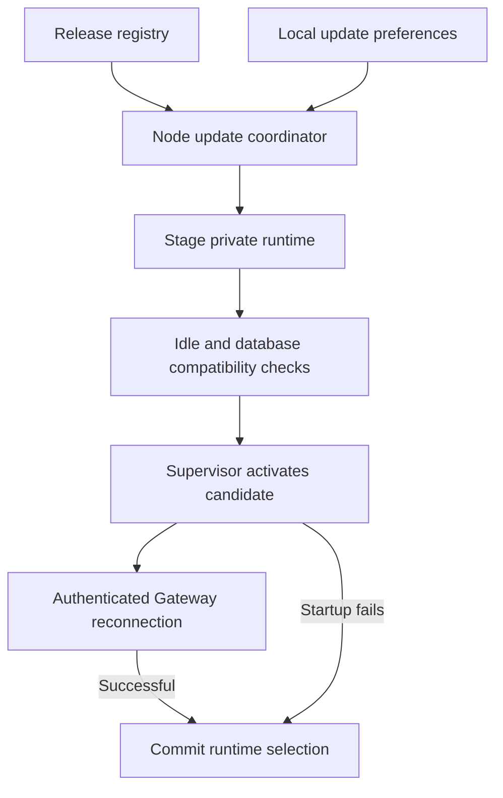

Codex review: blocked before merge. _Reviewed September 18, 2026, 8:53 AM ET / 12:53 UTC (Revision 10)._

# ClawSweeper review

## What this changes

Adds default-on automatic updates for idle headless nodes through a separate supervised runtime, with rollback, preserved pairing, plugin-work tracking, and operator opt-outs.

> [!WARNING]
> **SQLite table change**
>
> This PR modifies persisted SQLite tables in `src/state/openclaw-state-db-schema-policy.ts`. Prefer a design that avoids changing persisted SQLite tables. Migration or upgrade compatibility proof is recorded, but maintainers should still confirm that the schema change is necessary.

## Merge readiness

⛔ **Blocked before merge - 5 items remain**

Keep open: this remains a distinct, maintainer-sponsored implementation of the linked feature request. The earlier plugin-idle blocker is resolved, and this review found no new blocking code defect.

**Priority:** P2
**Reviewed head:** `e72335236a521e44954e7207a1661c2dbe335de9`

## Review scores

| Measure | Result | What it means |
|---|---|---|
| **Overall readiness** | 🐚 platinum hermit **(4/6)** | A coherent implementation with substantial real-process evidence and the prior defect repaired; integration proof freshness remains the material validation follow-up. |
| **Proof confidence** | 🦞 diamond lobster **(5/6)** ✨ media proof bonus | Sufficient (linked_artifact): The recorded Linux installed-package scenario exercises the production updater and supervisor through busy deferral, authenticated activation, retained pairing, fallback, shared-Gateway isolation, and the published 2026.9.4 updater. Inspected screenshots separately establish settings presentation; refreshed integration proof is still pending and native Windows coverage remains explicitly limited. |
| **Patch quality** | 🐚 platinum hermit **(4/6)** | No actionable review findings were identified. |

## Verification

| Check | Result | Evidence |
|---|---|---|
| **Real behavior** | Verified | Sufficient (linked_artifact): The recorded Linux installed-package scenario exercises the production updater and supervisor through busy deferral, authenticated activation, retained pairing, fallback, shared-Gateway isolation, and the published 2026.9.4 updater. Inspected screenshots separately establish settings presentation; refreshed integration proof is still pending and native Windows coverage remains explicitly limited. |
| **Evidence reviewed** | 10 items | Pinned change ownership: Reviewed merge-base 6c6dc44250d66eb8ec84f949c4a433c2dfcd8059 through the pinned head. Raw records confirm the original head parent is 5abe9f3bd45a1fb6756b4db52c1f9a6b757c8222; the supplied test merge separately has the pinned base followed by this head. Base-only changes were not treated as PR introductions. Still-needed feature: Fetched main has neither the new update coordinator nor the package-root node launcher. The provided open request https://github.com/openclaw/openclaw/issues/151462 explicitly requests this behavior and is paired with this implementation; no merged replacement was established. Previous finding resolved: Every registered plugin command must explicitly return false from its idle callback; missing, throwing, and undefined results defer activation, including unavailable commands. Runtime regressions cover these cases and retained work after invocation settlement. |
| **Findings** | None | None. |
| **Security** | None | None. |

## How this fits together

Headless nodes execute commands and host workers for a paired Gateway. The updater stages a private package and hands it to a launcher after node-owned work settles, leaving the Gateway installation and shared-state migration owner intact.

## Before merge

- [ ] **Resolve merge risk (P1)** - Older co-located Gateways reject independently updated local nodes until a normal Gateway upgrade; legacy plugins without idle callbacks defer automatic activation and require plugin updates or manual node updates.
- [ ] **Resolve merge risk (P1)** - Native Windows junction metadata, open-handle behavior, and successive activation remain unverified; the PR explicitly accepts this residual platform risk.
- [ ] **Resolve merge risk (P1)** - The successful Linux package proof predates the latest native-close and SQLite lifecycle integration; its announced rerun has no completed result in the reviewed evidence.
- [ ] **Complete next step (P2)** - Record the completed Linux installed-package rerun after main integration, including published-updater compatibility and shared-Gateway isolation.
- [ ] **Review config compatibility** - Confirm compatibility and upgrade impact for the changed config or default surface before merge.

<strong>Agent review details</strong>

### Security

None.

### PR surface

PR surface statistics unavailable: the file list is incomplete.

### Review metrics

| Metric | Value | Why it matters |
|---|---|---|
| **Public control surface** | 1 configuration switch, 1 CLI flag, 1 plugin idle callback | The default-on updater, foreground worker-hosting choice, and plugin deferral contract are documented operator and SDK behavior. |
| **Production versus validation growth** | Production +3,314/-832; tests and proof +5,198/-590; tooling +39/-1 | Production growth is justified by the separate supervisor, private installation, and shared-state admission safeguards; validation includes the installed-package proof harness. |

### Stored data model

Persistent data-model change detected: `database schema: src/state/openclaw-state-db-existing-schema.ts`, `migration/backfill/repair: src/state/openclaw-state-db-existing-schema.ts`, `migration/backfill/repair: src/state/openclaw-state-db-repair.ts`, `migration/backfill/repair: src/state/openclaw-state-db-schema-discovery.ts`, `migration/backfill/repair: src/state/openclaw-state-db-schema-repair.ts`, `migration/backfill/repair: src/state/openclaw-state-db.ts`, and 2 more. Migration or upgrade compatibility proof is recorded; maintainers should verify it before merge.

### Root-cause cluster

Relationship: `fixed_by_candidate`
Canonical: https://github.com/openclaw/openclaw/issues/151462
Summary: This PR implements the paired open feature request; the other supplied merged PRs address distinct CI or UI problems.

Members:
- `canonical`: https://github.com/openclaw/openclaw/issues/151462 - The request specifies idle-only private node updates, preserved identity, opt-outs, and shared-Gateway isolation.

Proposal only: this assessment does not dispatch repair, suppress jobs, mutate sibling items, close, or merge anything.

### Merge-risk options

**Maintainer options:**
1. **Complete the existing integration proof (recommended)**  
   Record the announced Linux package rerun after main integration, including shared-Gateway isolation and the published updater path.
2. **Retain the disclosed Windows scope**  
   Carry forward the PR's explicit acceptance of the native Windows validation gap without presenting simulated junction coverage as native proof.

### Technical review

Best possible solution:

Retain the isolated runtime owner and conservative idle admission, backed by refreshed published-driver upgrade proof and the documented one-time Gateway upgrade.

Do we have a high-confidence way to reproduce the issue?

Not applicable as a bug reproduction: this adds a sponsored capability. Existing Linux evidence exercises the real update flow; this read-only review executed no target code.

Is this the best way to solve the issue?

Yes: a private supervised runtime preserves the global installation and existing migration owner, while explicit plugin idle reporting avoids interrupting retained work.

AGENTS.md: found and applied where relevant.

Codex review notes: model internal, reasoning medium; reviewed against [c4cc9fb44d15](https://github.com/openclaw/openclaw/commit/c4cc9fb44d15db3c5205f27d9ac6522904baee91).

### Labels

Label justifications:

- `P2`: This is a sponsored operational improvement with bounded scope and no demonstrated urgent user regression.
- `merge-risk: 🚨 compatibility`: Default-on node updates introduce documented compatibility requirements for older Gateways and plugin idle reporting.
- `merge-risk: 🚨 availability`: Automatic process replacement depends on platform-specific selector recovery, with native Windows activation still unverified.
- `rating: 🐚 platinum hermit`: Overall readiness is 🐚 platinum hermit; proof is 🦞 diamond lobster and patch quality is 🐚 platinum hermit.
- `status: 👀 ready for maintainer look`: ClawSweeper has no concrete contributor-facing blocker left for this PR. Sufficient (linked_artifact): The recorded Linux installed-package scenario exercises the production updater and supervisor through busy deferral, authenticated activation, retained pairing, fallback, shared-Gateway isolation, and the published 2026.9.4 updater. Inspected screenshots separately establish settings presentation; refreshed integration proof is still pending and native Windows coverage remains explicitly limited.
- `proof: sufficient`: Contributor real behavior proof is sufficient. The recorded Linux installed-package scenario exercises the production updater and supervisor through busy deferral, authenticated activation, retained pairing, fallback, shared-Gateway isolation, and the published 2026.9.4 updater. Inspected screenshots separately establish settings presentation; refreshed integration proof is still pending and native Windows coverage remains explicitly limited.

### Evidence

What I checked:

- **Pinned change ownership:** Reviewed merge-base 6c6dc44250d66eb8ec84f949c4a433c2dfcd8059 through the pinned head. Raw records confirm the original head parent is 5abe9f3bd45a1fb6756b4db52c1f9a6b757c8222; the supplied test merge separately has the pinned base followed by this head. Base-only changes were not treated as PR introductions. ([e72335236a52](https://github.com/openclaw/openclaw/commit/e72335236a521e44954e7207a1661c2dbe335de9))
- **Still-needed feature:** Fetched main has neither the new update coordinator nor the package-root node launcher. The provided open request https://github.com/openclaw/openclaw/issues/151462 explicitly requests this behavior and is paired with this implementation; no merged replacement was established. ([`src/node-host/runner.ts:166`](https://github.com/openclaw/openclaw/blob/c4cc9fb44d15db3c5205f27d9ac6522904baee91/src/node-host/runner.ts#L166), [c4cc9fb44d15](https://github.com/openclaw/openclaw/commit/c4cc9fb44d15db3c5205f27d9ac6522904baee91))
- **Previous finding resolved:** Every registered plugin command must explicitly return false from its idle callback; missing, throwing, and undefined results defer activation, including unavailable commands. Runtime regressions cover these cases and retained work after invocation settlement. ([`src/node-host/plugin-node-host.ts:187`](https://github.com/openclaw/openclaw/blob/e72335236a521e44954e7207a1661c2dbe335de9/src/node-host/plugin-node-host.ts#L187), [e72335236a52](https://github.com/openclaw/openclaw/commit/e72335236a521e44954e7207a1661c2dbe335de9))
- **Activation and shared-state safeguards:** Activation pauses command admission, checks candidate database compatibility, and rereads policy after awaited preparation. Managed state scopes reject wrong database paths, maintenance entrypoints, escaped handles, and expired asynchronous descendants; focused tests inspect unchanged stored metadata and rejected late writes. ([`src/node-host/auto-update.ts:107`](https://github.com/openclaw/openclaw/blob/e72335236a521e44954e7207a1661c2dbe335de9/src/node-host/auto-update.ts#L107), [e72335236a52](https://github.com/openclaw/openclaw/commit/e72335236a521e44954e7207a1661c2dbe335de9))
- **Codex dependency signal:** The changed catalog disconnect path invokes the shared Codex app-server teardown owner, and node execution now reports retained native-process work. These changes depend on Codex transport lifetime semantics, so the sibling dependency source was inspected directly. ([`extensions/codex/src/session-catalog-control.ts:503`](https://github.com/openclaw/openclaw/blob/e72335236a521e44954e7207a1661c2dbe335de9/extensions/codex/src/session-catalog-control.ts#L503), [e72335236a52](https://github.com/openclaw/openclaw/commit/e72335236a521e44954e7207a1661c2dbe335de9))
- **Dependency shutdown contract:** Verified repository ownership through the sibling checkout's backing cache origin. The inspected app server closes connection RPC admission and drains connection cleanup, background tasks, and threads during ordinary shutdown; this supports waiting for transport cleanup rather than treating request return as process settlement. ([`codex-rs/app-server/src/lib.rs:1205`](https://github.com/openai/codex/blob/6b9826e3aa83b1a5947db50f4332cb9c65f1b340/codex-rs/app-server/src/lib.rs#L1205), [6b9826e3aa83](https://github.com/openai/codex/commit/6b9826e3aa83b1a5947db50f4332cb9c65f1b340))

Likely related people:

- **steipete:** Suggested for follow-up; no historical authorship or introduction is verified. (role: unverified routing candidate; confidence: low)

### Rank-up moves

Optional improvements that raise the rating; they are not merge blockers.

- Add the completed result of the already-running Linux installed-package rerun for the integrated head.

### Rating scale

| Score | Internal tier | Crab rank | Meaning |
|---:|:---:|---|---|
| **6/6** | S | 🦀 challenger crab | Exceptional readiness |
| **5/6** | A | 🦞 diamond lobster | Very strong readiness |
| **4/6** | B | 🐚 platinum hermit | Good normal PR; ordinary maintainer review |
| **3/6** | C | 🦐 gold shrimp | Useful, but confidence is limited |
| **2/6** | D | 🦪 silver shellfish | Proof or implementation needs work |
| **1/6** | F | 🧂 unranked krab | Not merge-ready |
| N/A | NA | 🌊 off-meta tidepool | Rating does not apply |

Overall follows the weaker of proof and patch quality.
Shiny media proof means a screenshot, video, or linked artifact directly shows the changed behavior. Runtime, network, CSP, and security claims still need visible diagnostics.

### Workflow

- ClawSweeper keeps one durable marker-backed review comment per issue or PR.
- Re-runs edit this comment so the latest verdict, findings, and automation markers stay together instead of adding duplicate bot comments.
- A fresh review can be triggered by eligible `@clawsweeper re-review` comments, exact-item GitHub events, scheduled/background review runs, or manual workflow dispatch.
- PR/issue authors and users with repository write access can comment `@clawsweeper re-review` or `@clawsweeper re-run` on an open PR or issue to request a fresh review only.
- Maintainers can also comment `@clawsweeper review` to request a fresh review only.
- Fresh-review commands do not start repair, autofix, rebase, CI repair, or automerge.
- Maintainer-only repair and merge flows require explicit commands such as `@clawsweeper autofix`, `@clawsweeper automerge`, `@clawsweeper fix ci`, or `@clawsweeper address review`.
- Maintainers can comment `@clawsweeper explain` to ask for more context, or `@clawsweeper stop` to stop active automation.

### History

Review history (9 earlier review cycles; latest 8 shown)

<!-- clawsweeper-review-history v=1 total=9 -->
- reviewed 2026-09-18T07:47:35.344Z sha 40a3fa2f9c97e51fe155dd759fa218e997867cd3 :: blocked before merge. :: [P1] Preserve retained work for plugins without the new idle callback
- reviewed 2026-09-18T08:23:58.141Z sha 22f7d3ee29202b954eef5d6d59a2d340b114c539 :: blocked before merge. :: [P1] [P1] Preserve retained work for plugins without the new idle callback
- reviewed 2026-09-18T08:40:16.727Z sha 0691195786b7535b2b44a59f8c007433850e5f5a :: blocked before merge. :: [P1] Preserve retained work for plugins without the new idle callback
- reviewed 2026-09-18T10:28:53.903Z sha ace74431d2babf4f989dbb6d53794f009af759f6 :: blocked before merge. :: none
- reviewed 2026-09-18T11:03:37.805Z sha cb8e3794cafc5b60edcada9f042b9f4cdd8b268f :: blocked before merge. :: none
- reviewed 2026-09-18T11:22:31.331Z sha e5720a3b387607a0ef24ca3196e64553d7328d4c :: blocked before merge. :: none
- reviewed 2026-09-18T11:54:45.809Z sha e5720a3b387607a0ef24ca3196e64553d7328d4c :: blocked before merge. :: none
- reviewed 2026-09-18T12:19:51.416Z sha e5720a3b387607a0ef24ca3196e64553d7328d4c :: blocked before merge. :: none

<!-- clawsweeper-verdict:needs-human item=151545 sha=e72335236a521e44954e7207a1661c2dbe335de9 confidence=high updated_at=2026-09-18T12:48:20Z reviewed_at=2026-09-18T12:53:15.127Z lease_owner=github-run-35346502435-1 lease_comment_id=5730209076 source_revision=0fed2932125fb80ce93516cb37d92ea8fa2a36a4ecf1ce818ef8f4e0053c9ec1 live_verification=absent -->
<!-- clawsweeper-review-state:blocked item=151545 sha=e72335236a521e44954e7207a1661c2dbe335de9 v=1 -->

<!-- clawsweeper-review-version item=151545 reviewed_at=2026-09-18T12:53:15.127Z sha=e72335236a521e44954e7207a1661c2dbe335de9 source_revision=0fed2932125fb80ce93516cb37d92ea8fa2a36a4ecf1ce818ef8f4e0053c9ec1 lease_owner=github-run-35346502435-1 lease_comment_id=5730209076 v=1 -->

<!-- clawsweeper-review item=151545 -->