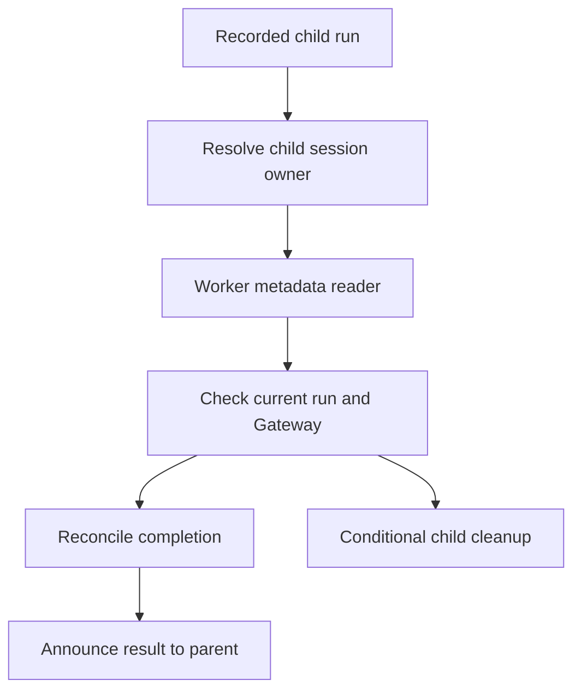

Codex review: needs changes before merge. _Reviewed October 8, 2026, 12:22 AM ET / 04:22 UTC (Revision 3)._

# ClawSweeper review

## What this changes

The branch carries recorded child-agent ownership through session reconciliation, announcement metadata reads, and conditional cleanup while retaining asynchronous owner guards.

**Example:** Cleanup runs for a recorded research child using global
- **Before:** Reconciliation cannot resolve global without an encoded agent owner.
- **After:** Cleanup selects research/global and preserves the unrelated main/global session.

## Review scores

| Measure | Result | What it means |
|---|---|---|
| **Overall readiness** | 🦐 gold shrimp **(3/6)** | Useful owner-aware reconciliation and cleanup have meaningful boundary coverage, but the claimed announcement repair remains partial. |
| **Proof confidence** | 🦐 gold shrimp **(3/6)** | Not applicable: The supplied maintainer-authored classification exempts ordinary contributor proof. Recorded Linux validation and inspected production-boundary cases cover real SQLite restoration and Gateway deletion preserving the unrelated main session; they do not establish ordinary raw-key announcement delivery. No stored-data format or migration contract changes. |
| **Patch quality** | 🦐 gold shrimp **(3/6)** | No actionable review findings were identified. |

## Product

**Kind:** Bug fix · **Worth it:** Yes · **Fix scope:** Partial
**User problem:** A delegated child using global can be reconciled against the wrong agent's session or fail to report its result.
**Reason:** Correct recorded ownership is an established session contract, and the area owner's prior merged work supports this repair direction. Ordinary raw-key announcements still encounter an unscoped statistics read.

## Merge readiness

⛔ **Needs changes before merge - 1 item remains**

Keep open: this PR addresses a real ownership defect, but its claimed raw-key announcement repair remains incomplete.

**Priority:** P2
**Reviewed head:** `7400b120685482836190d9e1676ac3311840d24d`

## Before merge

- [ ] **Complete next step (P2)** - Finish the claimed ordinary raw-key announcement repair by carrying childAgentId into statistics resolution and exercising the real resolver.

## Findings

None.

### Provenance

- `Restored requester wake bookkeeping`: original intent not found (unknown: Targeted base-line blame could not retrieve a required historical blob because the promisor remote returned HTTP 403.)

### Tests

- Missing end-to-end proof: The ordinary raw-key announcement case needs the real agent-key resolver and statistics reader; its current resolver mock hides the remaining failure, so successful base-failing/head-passing delivery is not established.

<strong>Agent review details</strong>

### How this fits together

The subagent registry tracks delegated work across completion and Gateway restarts. It reads child session metadata, reports results to the parent, and conditionally removes expired child sessions.

### Technical review

Best possible solution:

Carry recorded ownership through the remaining announcement statistics read using the existing worker reader, preserving encoded-key precedence and conditional deletion.

Do we have a high-confidence way to reproduce the issue?

Yes, source establishes both the base reconciliation defect and the remaining announcement failure: global lacks an encoded agent ID, and the statistics reader supplies no recorded owner. No runtime reproduction was executed here.

Is this the best way to solve the issue?

Partly: reusing worker readers and existing conditional cleanup is appropriate, but ownership must also reach the statistics reader to deliver the claimed ordinary raw-key announcement behavior.

AGENTS.md: found and applied where relevant.

Codex review notes: model internal, reasoning medium; reviewed against [ba5b60b0bc45](https://github.com/openclaw/openclaw/commit/ba5b60b0bc452e70876088bf7b5b667f2005c8f9).

### Provenance checked

- `src/agents/subagents/registry/subagent-session-reconciliation.ts` keeps the original intent (https://github.com/openclaw/openclaw/pull/146542: Use scoped child-session reads and current completion facts instead of whole-store snapshots.)
- `Reconciliation metadata projection` keeps the original intent (https://github.com/openclaw/openclaw/pull/164125: Read lifecycle metadata without loading unrelated saved prompts or diff baselines.)
- `src/agents/subagents/registry/subagent-registry-sweeper.ts` keeps the original intent (https://github.com/openclaw/openclaw/pull/146542: Capture exact cleanup identities and group members before yielding so replacements wait for another pass.)
- `src/agents/subagents/registry/subagent-registry-restore.ts` keeps the original intent (https://github.com/openclaw/openclaw/pull/165684: Move bulk registry storage work into workers and recheck activation ownership after yields.)
- `Resume and completion continuation` keeps the original intent (https://github.com/openclaw/openclaw/pull/160203: Retain admitted completion ownership through worker reads, cancellation settlement, and Gateway drain.)
- `Announcement and session cleanup` keeps the original intent (https://github.com/openclaw/openclaw/pull/166691: Consolidate lifecycle owners while preserving authority checks and leaving raw-key reconciliation and cleanup to a separate follow-up.)

### Testing

Proof path: in-process harness. Added test files: 16.

### Security

None.

### Evidence

Acceptance criteria:

- [P1] pnpm test src/agents/subagents/announce/subagent-announce.test.ts src/agents/subagents/announce/subagent-announce-output.test.ts --maxWorkers=1.
- [P1] pnpm test src/gateway/server-methods/sessions-lifecycle-agent-scope.test.ts --maxWorkers=1.
- [P1] node scripts/check-changed.mjs.
- [P1] git diff --check.

What I checked:

- **Introduced changes:** Reviewed the pinned merge-base-to-head delta, separating it from base-branch drift. ([7400b1206854](https://github.com/openclaw/openclaw/commit/7400b120685482836190d9e1676ac3311840d24d))
- **Recorded-owner reconciliation:** The metadata reader passes childAgentId as the raw-key fallback and uses the existing worker reader; encoded keys retain precedence. ([`src/agents/subagents/registry/subagent-session-reconciliation.ts:75`](https://github.com/openclaw/openclaw/blob/7400b120685482836190d9e1676ac3311840d24d/src/agents/subagents/registry/subagent-session-reconciliation.ts#L75), [7400b1206854](https://github.com/openclaw/openclaw/commit/7400b120685482836190d9e1676ac3311840d24d))
- **Incomplete announcement path:** Ordinary announcement still calls buildCompactAnnounceStatsLine with only the raw key. Its resolver throws for global without an explicit owner; the enclosing announcement catch returns retryable and disables cleanup. This limitation also exists on the base and is an incomplete repair, not an introduced regression. ([`src/agents/subagents/announce/subagent-announce-output.ts:378`](https://github.com/openclaw/openclaw/blob/7400b120685482836190d9e1676ac3311840d24d/src/agents/subagents/announce/subagent-announce-output.ts#L378), [7400b1206854](https://github.com/openclaw/openclaw/commit/7400b120685482836190d9e1676ac3311840d24d))
- **Announcement regression coverage limitation:** The new raw-child announcement case runs with resolveAgentIdFromSessionKey mocked to return main, masking the actual statistics-resolution failure. ([`src/agents/subagents/announce/subagent-announce.test.ts:219`](https://github.com/openclaw/openclaw/blob/7400b120685482836190d9e1676ac3311840d24d/src/agents/subagents/announce/subagent-announce.test.ts#L219), [7400b1206854](https://github.com/openclaw/openclaw/commit/7400b120685482836190d9e1676ac3311840d24d))
- **Conditional cleanup boundary:** The added cases drive the real Gateway request handler and SQLite session deletion, asserting that research/global disappears while main/global remains unchanged. ([`src/gateway/server-methods/sessions-lifecycle-agent-scope.test.ts:36`](https://github.com/openclaw/openclaw/blob/7400b120685482836190d9e1676ac3311840d24d/src/gateway/server-methods/sessions-lifecycle-agent-scope.test.ts#L36), [7400b1206854](https://github.com/openclaw/openclaw/commit/7400b120685482836190d9e1676ac3311840d24d))
- **Authority and upgrade safeguards:** Resume reads retain state, Gateway, lifecycle, and exact-run authority. Conditional deletion retains session ID and lifecycle revision checks. Existing fields and storage codecs remain unchanged; real-store restoration exercises retained records. ([`src/agents/subagents/registry/subagent-registry-completion-runtime.ts:481`](https://github.com/openclaw/openclaw/blob/7400b120685482836190d9e1676ac3311840d24d/src/agents/subagents/registry/subagent-registry-completion-runtime.ts#L481), [7400b1206854](https://github.com/openclaw/openclaw/commit/7400b120685482836190d9e1676ac3311840d24d))

Likely related people:

- **Peter Steinberger:** Raw commit 9a94a2356a4fd35c5c464c04559878a41ed67520 adds src/agents/subagents/registry/subagent-session-reconciliation.ts:153 relative to its recorded parents. This identifies author metadata, not feature responsibility or a PR merger. (role: source-line author; confidence: high; commits: [9a94a2356a4f](https://github.com/openclaw/openclaw/commit/9a94a2356a4fd35c5c464c04559878a41ed67520); files: `src/agents/subagents/registry/subagent-session-reconciliation.ts`)

### PR surface

Source +361, Tests +980, Other -1. Total +1340 across 27 files.

View PR surface stats

| Area | Files | Added | Removed | Net |
|---|---:|---:|---:|---:|
| Source | 10 | 434 | 73 | +361 |
| Tests | 16 | 1030 | 50 | +980 |
| Docs | 0 | 0 | 0 | 0 |
| Config | 0 | 0 | 0 | 0 |
| Generated | 0 | 0 | 0 | 0 |
| Other | 1 | 0 | 1 | -1 |
| **Total** | **27** | **1464** | **124** | **+1340** |

### Labels

Label changes:

No label changes.

Label justifications:

- `P2`: Recorded raw-key child ownership is a bounded correctness repair affecting subagent recovery and cleanup.
- `rating: 🦐 gold shrimp`: Overall readiness is 🦐 gold shrimp; proof is 🦐 gold shrimp and patch quality is 🦐 gold shrimp.
- `status: 👀 ready for maintainer look`: ClawSweeper has no concrete contributor-facing blocker left for this PR.

### Rank-up moves

Optional improvements that raise the rating; they are not merge blockers.

- Complete recorded-owner propagation into announcement statistics and verify ordinary global-child delivery with the real resolver.

### Rating scale

6/6 🦀 challenger crab · 5/6 🦞 diamond lobster · 4/6 🐚 platinum hermit · 3/6 🦐 gold shrimp · 2/6 🦪 silver shellfish · 1/6 🧂 unranked krab. Overall follows the weaker of proof and patch quality; ✨ marks media proof (a screenshot, video, or linked artifact) that directly shows the changed behavior.

### Workflow

ClawSweeper edits this one comment on every review. Comment `@clawsweeper re-review` for a fresh review only; repair and merge need explicit maintainer commands such as `@clawsweeper autofix` or `@clawsweeper automerge`.

### History

Review history (2 earlier review cycles)

<!-- clawsweeper-review-history v=1 total=2 -->
- reviewed 2026-10-08T00:33:20.345Z sha 5c968063e6f33ec75db233f520a7b8086c3f3879 :: needs maintainer review before merge. :: none
- reviewed 2026-10-08T00:45:43.473Z sha 5c968063e6f33ec75db233f520a7b8086c3f3879 :: needs maintainer review before merge. :: none

<!-- clawsweeper-verdict:needs-changes item=166845 sha=7400b120685482836190d9e1676ac3311840d24d confidence=high updated_at=2026-10-08T04:17:07Z reviewed_at=2026-10-08T04:22:08.493Z lease_owner=github-run-37726675819-1 lease_comment_id=6052100433 source_revision=3ba6de5f8e5ac0a437ebcdfe2321416e856c3724648f9c5fbee03052b07c083d live_verification=absent -->
<!-- clawsweeper-action:fix-required item=166845 sha=7400b120685482836190d9e1676ac3311840d24d confidence=high updated_at=2026-10-08T04:17:07Z reviewed_at=2026-10-08T04:22:08.493Z lease_owner=github-run-37726675819-1 lease_comment_id=6052100433 source_revision=3ba6de5f8e5ac0a437ebcdfe2321416e856c3724648f9c5fbee03052b07c083d live_verification=absent finding=review-feedback -->
<!-- clawsweeper-review-state:needs-changes item=166845 sha=7400b120685482836190d9e1676ac3311840d24d v=1 -->

<!-- clawsweeper-review-version item=166845 reviewed_at=2026-10-08T04:22:08.493Z sha=7400b120685482836190d9e1676ac3311840d24d source_revision=3ba6de5f8e5ac0a437ebcdfe2321416e856c3724648f9c5fbee03052b07c083d lease_owner=github-run-37726675819-1 lease_comment_id=6052100433 v=1 -->

<!-- clawsweeper-review item=166845 -->