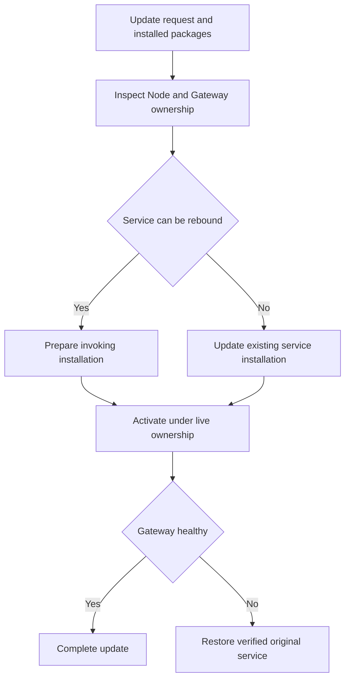

Codex review: blocked before merge. _Reviewed September 19, 2026, 6:22 PM ET / 22:22 UTC (Revision 40)._

# ClawSweeper review

## What this changes

The PR selects compatible Node runtimes during updates, rebinds eligible Gateway services to the invoking installation, and restores the original service after failed activation.

## Merge readiness

⛔ **Blocked before merge - 7 items remain**

The PR remains useful, but a source-proven Linux planning defect prevents ordinary systemd installations from receiving the intended prefix reconciliation. Earlier recovery repairs and their bounded native proof remain valid.

**Priority:** P1
**Reviewed head:** `47aa7daa495e526b9cbef71d77ab77f105b44fa2`
**Owner decision:** Required. See [Decision needed](#decision-needed).

## Review scores

| Measure | Result | What it means |
|---|---|---|
| **Overall readiness** | 🦐 gold shrimp **(3/6)** | Useful recovery work has meaningful native evidence, but a concrete Linux contract mismatch blocks correctness. |
| **Proof confidence** | 🐚 platinum hermit **(4/6)** | Sufficient (live_output): The recorded native component run exercises retained-service restoration and final-effect rejection after lease revocation, executor replacement, and service reassignment; the inspected authority/restoration modules remain unchanged. That proof stands, but does not cover the newly identified Linux planning defect or establish complete published-driver qualification. |
| **Patch quality** | 🦐 gold shrimp **(3/6)** | 1 actionable review finding remain. |

## Verification

| Check | Result | Evidence |
|---|---|---|
| **Real behavior** | Verified | Sufficient (live_output): The recorded native component run exercises retained-service restoration and final-effect rejection after lease revocation, executor replacement, and service reassignment; the inspected authority/restoration modules remain unchanged. That proof stands, but does not cover the newly identified Linux planning defect or establish complete published-driver qualification. |
| **Evidence reviewed** | 10 items | Introduced Linux planning defect: The new canRebind condition rejects the presence of managedOverrides or managedDefinition. Ordinary canonical systemd units carry both fields, including managedOverrides: {}, so eligible split-prefix updates select the old service root instead of rebinding. Canonical systemd metadata contract: The systemd reader includes the managed definition and override metadata for canonical user units; its drop-in reader deliberately returns an empty object when no overrides exist. Existing override helpers distinguish this from an operator override. Same assumption in retained recovery: Original-service observation rejects either metadata field at lines 263–270, and original-definition restoration repeats that rejection at line 58. Repairing only planning would therefore expose a later refusal; the owning paths need one consistent interpretation. |
| **Findings** | 1 actionable finding | [P1] Recognize known-empty systemd metadata before rejecting rebinds |
| **Security** | None | None. |

## How this fits together

The updater coordinates package installation, Node selection, Doctor maintenance, and the operating system's Gateway service. It must preserve service ownership and operator state while activating or recovering an installation.

## Decision needed

| Question | Recommendation |
|---|---|
| After the Linux metadata defect is repaired, must the current candidate complete published-driver qualification before landing, or may this land as a bounded component improvement? | **Complete upgrade qualification:** Require a current published-driver compatibility result before accepting the broader upgrade claim. |

Why: Root policy requires published-driver upgrade evidence, while the body explicitly defers that qualification; the prior review requested a landing disposition that remains unresolved.

## Before merge

- [ ] **Recognize known-empty systemd metadata before rejecting rebinds (P1)** - For an ordinary canonical Linux user unit with no drop-ins, `readSystemdServiceExecStart` returns `managedDefinition` and `managedOverrides: {}`. Both are truthy, so these checks always disable the intended A-to-B rebind and update A instead, leaving the CLI/Gateway prefix mismatch. The Linux planner test omits these real reader fields. Interpret the canonical override contract consistently here and in the matching observation/restoration guards; preserve genuinely overridden definitions. This was missed in the previous review: the implicated code is unchanged since `af393400847ade886087c4dde230ee53e5dd556c`.
- [ ] **Resolve merge risk (P1)** - The complete published-driver-to-current-candidate upgrade remains unqualified: older drivers choose their target before candidate code runs, and prior evidence includes both successful service-root updating and pre-activation refusal.
- [ ] **Resolve merge risk (P1)** - The bounded native recovery evidence does not establish broader platform or schema-changing upgrade recovery; installations whose retained runtime cannot read migrated state may still require operator recovery.
- [ ] **Complete next step (P2)** - Correct known-empty systemd metadata handling across planning and recovery, then record the maintainer's disposition of the published-driver qualification limits.
- [ ] **Resolve maintainer decision** - Resolve the maintainer decision shown above before merge.
- [ ] **Review config compatibility** - Confirm compatibility and upgrade impact for the changed config or default surface before merge.
- [ ] **Add data-model compatibility proof** - Confirm migration or upgrade compatibility proof before merge.

## Findings

- [P1] Recognize known-empty systemd metadata before rejecting rebinds — `src/cli/update-cli/update-command-service-plan.ts:605-610`

<strong>Agent review details</strong>

### Security

None.

### PR surface

PR surface statistics unavailable: the file list is incomplete.

### Review metrics

| Metric | Value | Why it matters |
|---|---|---|
| **Production versus test growth** | Runtime and installer +3,110/-845; tests and support +8,251/-1,349 | Dual-installation ownership and restoration justify added production responsibilities, but their platform contracts must be exercised through realistic service metadata. |

### Stored data model

Persistent data-model change detected: `migration/backfill/repair: src/cli/update-cli/update-command-verification.ts`, `migration/backfill/repair: src/daemon/service-start-repair.ts`, `migration/backfill/repair: src/daemon/service.ts`, `unknown-data-model-change: src/daemon/service-start-repair.ts`, `unknown-truncated-pull-files`. Confirm migration or upgrade compatibility proof before merge.

### Root-cause cluster

Relationship: `fixed_by_candidate`
Canonical: https://github.com/openclaw/openclaw/issues/107930
Summary: This PR is an implementation candidate for the Node-upgrade continuity request; another open implementation overlaps service reconciliation without establishing supersession.

Members:
- `canonical`: https://github.com/openclaw/openclaw/issues/107930 - The linked request describes Node-version changes leaving the CLI and Gateway in different installation prefixes.
- `partial_overlap`: https://github.com/openclaw/openclaw/pull/150898 - The open branch overlaps active-install reconciliation and adds Doctor diagnostics, while this branch also owns target-aware Node selection and retained-root recovery.

Proposal only: this assessment does not dispatch repair, suppress jobs, mutate sibling items, close, or merge anything.

### Merge-risk options

**Maintainer options:**
1. **Qualify the corrected upgrade path (recommended)**  
   Repair canonical systemd metadata handling and establish published-driver compatibility without weakening ownership, override, or state-readability checks.
2. **Accept limited landing coverage**  
   After the correctness repair, explicitly accept the component-only qualification and retain the documented broader upgrade obligations.

### Technical review

Best possible solution:

Use canonical override semantics throughout planning and restoration, preserve authored service settings, and establish or explicitly accept the published-driver upgrade boundary before landing.

Do we have a high-confidence way to reproduce the issue?

Yes, from source: an ordinary Linux user service with known-empty override metadata deterministically takes the service-root fallback in the new planner. No target code was executed during this read-only review.

Is this the best way to solve the issue?

Not yet: extending the existing updater is appropriate, but metadata presence is not equivalent to an operator override, and the same mistaken assumption appears in planning and recovery.

Full review comments:

- [P1] Recognize known-empty systemd metadata before rejecting rebinds — `src/cli/update-cli/update-command-service-plan.ts:605-610`
  For an ordinary canonical Linux user unit with no drop-ins, `readSystemdServiceExecStart` returns `managedDefinition` and `managedOverrides: {}`. Both are truthy, so these checks always disable the intended A-to-B rebind and update A instead, leaving the CLI/Gateway prefix mismatch. The Linux planner test omits these real reader fields. Interpret the canonical override contract consistently here and in the matching observation/restoration guards; preserve genuinely overridden definitions. This was missed in the previous review: the implicated code is unchanged since `af393400847ade886087c4dde230ee53e5dd556c`.
  Confidence: 0.99
  Late finding: first raised on code an earlier review cycle already covered.

Overall correctness: patch is incorrect
Overall confidence: 0.95

AGENTS.md: found and applied where relevant.

Codex review notes: model internal, reasoning medium; reviewed against [ff38246e6710](https://github.com/openclaw/openclaw/commit/ff38246e67102f088411590c1710dd6d2b32e6b1).

### Labels

Label changes:

- add `rating: 🦐 gold shrimp`: Overall readiness is 🦐 gold shrimp; proof is 🐚 platinum hermit and patch quality is 🦐 gold shrimp. Replaced prior `rating: 🐚 platinum hermit`.
- remove `rating: 🐚 platinum hermit`: Current PR rating is `rating: 🦐 gold shrimp`, so this older rating label is no longer current.

Label justifications:

- `P1`: This addresses an established upgrade workflow, and the current Linux planner still misses the intended service reconciliation.
- `merge-risk: 🚨 compatibility`: Changing service installation and runtime bindings requires an explicit disposition of older-driver and migrated-state compatibility limits.
- `rating: 🦐 gold shrimp`: Overall readiness is 🦐 gold shrimp; proof is 🐚 platinum hermit and patch quality is 🦐 gold shrimp. Replaced prior `rating: 🐚 platinum hermit`.
- `status: 👀 ready for maintainer look`: ClawSweeper has no concrete contributor-facing blocker left for this PR. Sufficient (live_output): The recorded native component run exercises retained-service restoration and final-effect rejection after lease revocation, executor replacement, and service reassignment; the inspected authority/restoration modules remain unchanged. That proof stands, but does not cover the newly identified Linux planning defect or establish complete published-driver qualification.
- `proof: sufficient`: Contributor real behavior proof is sufficient. The recorded native component run exercises retained-service restoration and final-effect rejection after lease revocation, executor replacement, and service reassignment; the inspected authority/restoration modules remain unchanged. That proof stands, but does not cover the newly identified Linux planning defect or establish complete published-driver qualification.

### Evidence

What I checked:

- **Introduced Linux planning defect:** The new canRebind condition rejects the presence of managedOverrides or managedDefinition. Ordinary canonical systemd units carry both fields, including managedOverrides: {}, so eligible split-prefix updates select the old service root instead of rebinding. ([`src/cli/update-cli/update-command-service-plan.ts:605`](https://github.com/openclaw/openclaw/blob/47aa7daa495e526b9cbef71d77ab77f105b44fa2/src/cli/update-cli/update-command-service-plan.ts#L605), [47aa7daa495e](https://github.com/openclaw/openclaw/commit/47aa7daa495e526b9cbef71d77ab77f105b44fa2))
- **Canonical systemd metadata contract:** The systemd reader includes the managed definition and override metadata for canonical user units; its drop-in reader deliberately returns an empty object when no overrides exist. Existing override helpers distinguish this from an operator override. ([`src/daemon/systemd-service-files.ts:233`](https://github.com/openclaw/openclaw/blob/47aa7daa495e526b9cbef71d77ab77f105b44fa2/src/daemon/systemd-service-files.ts#L233), [47aa7daa495e](https://github.com/openclaw/openclaw/commit/47aa7daa495e526b9cbef71d77ab77f105b44fa2))
- **Same assumption in retained recovery:** Original-service observation rejects either metadata field at lines 263–270, and original-definition restoration repeats that rejection at line 58. Repairing only planning would therefore expose a later refusal; the owning paths need one consistent interpretation. ([`src/cli/update-cli/update-command-original-service.ts:263`](https://github.com/openclaw/openclaw/blob/47aa7daa495e526b9cbef71d77ab77f105b44fa2/src/cli/update-cli/update-command-original-service.ts#L263), [47aa7daa495e](https://github.com/openclaw/openclaw/commit/47aa7daa495e526b9cbef71d77ab77f105b44fa2))
- **Upstream contract provenance:** GitHub commit metadata and its patch confirm the intentional change from undefined to known-empty override metadata. This establishes the consumed contract, not responsibility for this PR's incompatible presence checks. ([`src/daemon/systemd-service-files.ts:369`](https://github.com/openclaw/openclaw/blob/26c662436e687fc460ea00e363095b4b1cf27a0f/src/daemon/systemd-service-files.ts#L369), [26c662436e68](https://github.com/openclaw/openclaw/commit/26c662436e687fc460ea00e363095b4b1cf27a0f))
- **Re-review continuity:** Comparison with the previous reviewed head changes only transcript fixture readiness waits and session-cleanup test teardown. The planning, observation, restoration, and systemd-reader files implicated by the finding are unchanged; this is a late discovery. ([47aa7daa495e](https://github.com/openclaw/openclaw/commit/47aa7daa495e526b9cbef71d77ab77f105b44fa2))
- **Current main still lacks the central reconciliation:** The fetched main planner still redirects a different invoking installation to the managed service package root; it does not contain this branch's target-aware provisioning and retained-root rebind flow. ([`src/cli/update-cli/update-command-service-plan.ts:546`](https://github.com/openclaw/openclaw/blob/ff38246e67102f088411590c1710dd6d2b32e6b1/src/cli/update-cli/update-command-service-plan.ts#L546), [ff38246e6710](https://github.com/openclaw/openclaw/commit/ff38246e67102f088411590c1710dd6d2b32e6b1))

Likely related people:

- **steipete:** Suggested for follow-up; no historical authorship or introduction is verified. (role: unverified routing candidate; confidence: low)
- **RomneyDa:** Suggested for follow-up; no historical authorship or introduction is verified. (role: unverified routing candidate; confidence: low)

### Rank-up moves

Optional improvements that raise the rating; they are not merge blockers.

- Repair metadata interpretation across planning, observation, and restoration, with coverage using the canonical Linux reader's known-empty override shape.
- Record an explicit landing disposition for the published-driver qualification limits.

### Rating scale

| Score | Internal tier | Crab rank | Meaning |
|---:|:---:|---|---|
| **6/6** | S | 🦀 challenger crab | Exceptional readiness |
| **5/6** | A | 🦞 diamond lobster | Very strong readiness |
| **4/6** | B | 🐚 platinum hermit | Good normal PR; ordinary maintainer review |
| **3/6** | C | 🦐 gold shrimp | Useful, but confidence is limited |
| **2/6** | D | 🦪 silver shellfish | Proof or implementation needs work |
| **1/6** | F | 🧂 unranked krab | Not merge-ready |
| N/A | NA | 🌊 off-meta tidepool | Rating does not apply |

Overall follows the weaker of proof and patch quality.
Shiny media proof means a screenshot, video, or linked artifact directly shows the changed behavior. Runtime, network, CSP, and security claims still need visible diagnostics.

### Workflow

- ClawSweeper keeps one durable marker-backed review comment per issue or PR.
- Re-runs edit this comment so the latest verdict, findings, and automation markers stay together instead of adding duplicate bot comments.
- A fresh review can be triggered by eligible `@clawsweeper re-review` comments, exact-item GitHub events, scheduled/background review runs, or manual workflow dispatch.
- PR/issue authors and users with repository write access can comment `@clawsweeper re-review` or `@clawsweeper re-run` on an open PR or issue to request a fresh review only.
- Maintainers can also comment `@clawsweeper review` to request a fresh review only.
- Fresh-review commands do not start repair, autofix, rebase, CI repair, or automerge.
- Maintainer-only repair and merge flows require explicit commands such as `@clawsweeper autofix`, `@clawsweeper automerge`, `@clawsweeper fix ci`, or `@clawsweeper address review`.
- Maintainers can comment `@clawsweeper explain` to ask for more context, or `@clawsweeper stop` to stop active automation.

### History

Review history (39 earlier review cycles; latest 8 shown)

<!-- clawsweeper-review-history v=1 total=39 -->
- reviewed 2026-09-19T17:46:56.109Z sha 8b306d9e53b113f174c741e6b48ab2c9d717e0dc :: needs real behavior proof before merge. :: none
- reviewed 2026-09-19T18:25:38.792Z sha 50f72c62a10c804419b039a495e4939147421f09 :: needs real behavior proof before merge. :: none
- reviewed 2026-09-19T19:03:52.899Z sha 9cde992ad5f274cb250127d42971f3cb714c4f90 :: needs real behavior proof before merge. :: none
- reviewed 2026-09-19T19:41:28.005Z sha 59a14b249bcc8134c8a36bb7b0aea513adf81390 :: needs real behavior proof before merge. :: none
- reviewed 2026-09-19T20:10:37.296Z sha 6205f6b4ce17b1cd99a1b9f807e0cd4b8b5078e2 :: needs real behavior proof before merge. :: none
- reviewed 2026-09-19T20:42:31.847Z sha 3e0ab8628b386635feb72d48f2b5e48d952c7cd3 :: needs real behavior proof before merge. :: none
- reviewed 2026-09-19T21:07:32.670Z sha ddcd54771ae5c4126089f8d617430b68dd480ecb :: blocked before merge. :: none
- reviewed 2026-09-19T22:02:58.058Z sha af393400847ade886087c4dde230ee53e5dd556c :: blocked before merge. :: none

<!-- clawsweeper-verdict:needs-human item=145335 sha=47aa7daa495e526b9cbef71d77ab77f105b44fa2 confidence=high updated_at=2026-09-19T22:17:53Z reviewed_at=2026-09-19T22:22:29.481Z lease_owner=github-run-35472838937-1 lease_comment_id=5745703809 source_revision=c044bcbd90fe38312200d3fe98fe4c1c5c07c2114e19dee4328513703f54b9a2 live_verification=absent -->
<!-- clawsweeper-review-state:blocked item=145335 sha=47aa7daa495e526b9cbef71d77ab77f105b44fa2 v=1 -->

<!-- clawsweeper-review-version item=145335 reviewed_at=2026-09-19T22:22:29.481Z sha=47aa7daa495e526b9cbef71d77ab77f105b44fa2 source_revision=c044bcbd90fe38312200d3fe98fe4c1c5c07c2114e19dee4328513703f54b9a2 lease_owner=github-run-35472838937-1 lease_comment_id=5745703809 v=1 -->

<!-- clawsweeper-review item=145335 -->