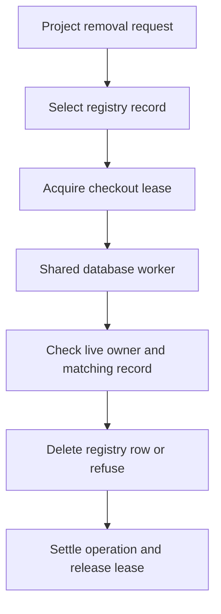

Codex review: blocked before merge. _Reviewed September 15, 2026, 11:57 PM ET / September 16, 2026, 03:57 UTC (Revision 9)._

# ClawSweeper review

## What this changes

Moves project registry removal into the shared database worker while retaining the checkout lease, record-matching checks, and existing return values.

> [!WARNING]
> **SQLite table change**
>
> This PR modifies persisted SQLite tables in `src/infra/sqlite-store.worker.ts`. Prefer a design that avoids changing persisted SQLite tables. If the change is necessary, verify migration and upgrade compatibility against an existing database before merge.

## Merge readiness

⛔ **Blocked before merge - 1 item remains**

Current main still performs registry removal on the Gateway thread, so this PR remains useful. No blocking patch defect was found, and the prior migration-proof warning is unsupported by the unchanged storage contract.

**Priority:** P2
**Reviewed head:** `056fa22c998995d950a4b8956340f0618521b0f6`

## Review scores

| Measure | Result | What it means |
|---|---|---|
| **Overall readiness** | 🐚 platinum hermit **(4/6)** | A coherent owner-preserving refactor with useful supplemental handler evidence and no blocking findings. |
| **Proof confidence** | 🌊 off-meta tidepool | Not applicable: The MEMBER-authored PR is exempt from ordinary contributor proof. Supplemental compiled-handler evidence reports removal, survivor preservation, and reopen on the combined successor; source review found no specific unresolved authority violation requiring additional final-effect proof. |
| **Patch quality** | 🐚 platinum hermit **(4/6)** | No actionable review findings were identified. |

## Verification

| Check | Result | Evidence |
|---|---|---|
| **Real behavior** | Not applicable | Not applicable: The MEMBER-authored PR is exempt from ordinary contributor proof. Supplemental compiled-handler evidence reports removal, survivor preservation, and reopen on the combined successor; source review found no specific unresolved authority violation requiring additional final-effect proof. |
| **Evidence reviewed** | 8 items | Current main still needs the change: The fetched main revision retains the synchronous matching query and DELETE inside removeProjectRegistry. The related merged fixture repairs do not implement this migration. Inspection of the latest release's source blob failed, so no release-inclusion claim is made. Deletion stays inside one guarded transaction: The worker checks the checkout lease scope and key, verifies worker-held ownership, and invokes the registry kernel in one synchronous write transaction. The kernel preserves matching on id, repository root, source, and origin URL before deleting. Live ownership and settlement: Admission requires the original lease context, an active operation, the same database path, exact lease identity, and unexpired ownership. The worker rereads persisted expiry after the grant; unknown native settlement prevents ordinary lease release. Broker failure cleanup joins worker retirement. |
| **Findings** | None | None. |
| **Security** | None | None. |

## How this fits together

The Projects registry stores repositories available to Gateway sessions. Registry removal now sends the selected record to the shared SQLite worker, which validates checkout ownership before deleting the record and returning the result.

## Before merge

- [ ] **Add data-model compatibility proof** - Confirm migration or upgrade compatibility proof before merge.

<strong>Agent review details</strong>

### Security

None.

### PR surface

Source +694, Tests +61. Total +755 across 25 files.

View PR surface stats

| Area | Files | Added | Removed | Net |
|---|---:|---:|---:|---:|
| Source | 20 | 849 | 155 | +694 |
| Tests | 5 | 65 | 4 | +61 |
| Docs | 0 | 0 | 0 | 0 |
| Config | 0 | 0 | 0 | 0 |
| Generated | 0 | 0 | 0 | 0 |
| Other | 0 | 0 | 0 | 0 |
| **Total** | **25** | **914** | **159** | **+755** |

### Review metrics

| Metric | Value | Why it matters |
|---|---|---|
| **Production versus test growth** | Production +694 net lines; tests and test support +61 | Production growth supplies shared live-owner admission and settlement machinery needed to move the guarded transaction across threads. |

### Stored data model

Persistent data-model change detected: `unknown-data-model-change: src/infra/sqlite-store.worker.ts`. Confirm migration or upgrade compatibility proof before merge.

### Technical review

Best possible solution:

Keep removal as one worker-owned transaction under the existing checkout lease, preserving record identity, checkout files, and native settlement ordering.

Do we have a high-confidence way to reproduce the issue?

Not applicable as a functional bug reproduction: this is an execution-placement refactor, and current-main source confirms the synchronous host transaction.

Is this the best way to solve the issue?

Yes. The existing shared worker owns the complete transaction, while the original lease owner retains admission and settlement; no competing persistence implementation is added.

AGENTS.md: found and applied where relevant.

Codex review notes: model internal, reasoning medium; reviewed against [ef93dfcbb0da](https://github.com/openclaw/openclaw/commit/ef93dfcbb0daf5d5bda66b79b52f635bd4abee02).

### Labels

Label justifications:

- `P2`: This is a bounded improvement to Gateway responsiveness during project removal, without evidence of an urgent user-facing outage.
- `rating: 🐚 platinum hermit`: Overall readiness is 🐚 platinum hermit; proof is 🌊 off-meta tidepool and patch quality is 🐚 platinum hermit.
- `status: 👀 ready for maintainer look`: ClawSweeper has no concrete contributor-facing blocker left for this PR. Not applicable: The MEMBER-authored PR is exempt from ordinary contributor proof. Supplemental compiled-handler evidence reports removal, survivor preservation, and reopen on the combined successor; source review found no specific unresolved authority violation requiring additional final-effect proof.

### Evidence

What I checked:

- **Current main still needs the change:** The fetched main revision retains the synchronous matching query and DELETE inside removeProjectRegistry. The related merged fixture repairs do not implement this migration. Inspection of the latest release's source blob failed, so no release-inclusion claim is made. ([`src/projects/project-registry.ts:394`](https://github.com/openclaw/openclaw/blob/ef93dfcbb0daf5d5bda66b79b52f635bd4abee02/src/projects/project-registry.ts#L394), [ef93dfcbb0da](https://github.com/openclaw/openclaw/commit/ef93dfcbb0daf5d5bda66b79b52f635bd4abee02))
- **Deletion stays inside one guarded transaction:** The worker checks the checkout lease scope and key, verifies worker-held ownership, and invokes the registry kernel in one synchronous write transaction. The kernel preserves matching on id, repository root, source, and origin URL before deleting. ([`src/state/openclaw-state.worker.ts:356`](https://github.com/openclaw/openclaw/blob/056fa22c998995d950a4b8956340f0618521b0f6/src/state/openclaw-state.worker.ts#L356), [056fa22c9989](https://github.com/openclaw/openclaw/commit/056fa22c998995d950a4b8956340f0618521b0f6))
- **Live ownership and settlement:** Admission requires the original lease context, an active operation, the same database path, exact lease identity, and unexpired ownership. The worker rereads persisted expiry after the grant; unknown native settlement prevents ordinary lease release. Broker failure cleanup joins worker retirement. ([`src/state/openclaw-state-lease-worker-owner.ts:68`](https://github.com/openclaw/openclaw/blob/056fa22c998995d950a4b8956340f0618521b0f6/src/state/openclaw-state-lease-worker-owner.ts#L68), [056fa22c9989](https://github.com/openclaw/openclaw/commit/056fa22c998995d950a4b8956340f0618521b0f6))
- **Prior review continuity:** The supplied previous review contained no code findings. Comparison against its recorded revision shows no changes to the central registry, kernel, lease-owner, or operation-admission files. ([`src/projects/project-registry.ts:372`](https://github.com/openclaw/openclaw/blob/056fa22c998995d950a4b8956340f0618521b0f6/src/projects/project-registry.ts#L372), [056fa22c9989](https://github.com/openclaw/openclaw/commit/056fa22c998995d950a4b8956340f0618521b0f6))
- **Storage checkpoint does not require a migration here:** The introduced diff changes execution placement and admission mechanics without changing schema, persisted representation, retention, or public SDK contracts. Repository guidance distinguishes these internal mechanics from material storage-contract changes. Public docs: [`docs/reference/database-schemas/storage-changes.md`](https://docs.openclaw.ai/reference/database-schemas/storage-changes). ([`docs/reference/database-schemas/storage-changes.md:460`](https://docs.openclaw.ai/reference/database-schemas/storage-changes), [056fa22c9989](https://github.com/openclaw/openclaw/commit/056fa22c998995d950a4b8956340f0618521b0f6))
- **Reported production-handler evidence:** The captured PR body reports normal-build handler/database proof on combined successor 625b27e1305ce6c5a8d2a5c52e5aabcf90e1198e: registration, canonical close, removal, missing repeat, survivor and checkout preservation, and reopen passed; six host DELETE counters stayed zero. It explicitly excludes WebSocket/authentication coverage and exact-head build equivalence. Successor source equivalence was reported by the contributor and could not be independently inspected locally. ([625b27e1305c](https://github.com/openclaw/openclaw/commit/625b27e1305ce6c5a8d2a5c52e5aabcf90e1198e))

Likely related people:

- **Peter Steinberger:** Suggested for follow-up; no historical authorship or introduction is verified. (role: unverified routing candidate; confidence: low)

### Rating scale

| Score | Internal tier | Crab rank | Meaning |
|---:|:---:|---|---|
| **6/6** | S | 🦀 challenger crab | Exceptional readiness |
| **5/6** | A | 🦞 diamond lobster | Very strong readiness |
| **4/6** | B | 🐚 platinum hermit | Good normal PR; ordinary maintainer review |
| **3/6** | C | 🦐 gold shrimp | Useful, but confidence is limited |
| **2/6** | D | 🦪 silver shellfish | Proof or implementation needs work |
| **1/6** | F | 🧂 unranked krab | Not merge-ready |
| N/A | NA | 🌊 off-meta tidepool | Rating does not apply |

Overall follows the weaker of proof and patch quality.
Shiny media proof means a screenshot, video, or linked artifact directly shows the changed behavior. Runtime, network, CSP, and security claims still need visible diagnostics.

### Workflow

- ClawSweeper keeps one durable marker-backed review comment per issue or PR.
- Re-runs edit this comment so the latest verdict, findings, and automation markers stay together instead of adding duplicate bot comments.
- A fresh review can be triggered by eligible `@clawsweeper re-review` comments, exact-item GitHub events, scheduled/background review runs, or manual workflow dispatch.
- PR/issue authors and users with repository write access can comment `@clawsweeper re-review` or `@clawsweeper re-run` on an open PR or issue to request a fresh review only.
- Maintainers can also comment `@clawsweeper review` to request a fresh review only.
- Fresh-review commands do not start repair, autofix, rebase, CI repair, or automerge.
- Maintainer-only repair and merge flows require explicit commands such as `@clawsweeper autofix`, `@clawsweeper automerge`, `@clawsweeper fix ci`, or `@clawsweeper address review`.
- Maintainers can comment `@clawsweeper explain` to ask for more context, or `@clawsweeper stop` to stop active automation.

### History

Review history (8 earlier review cycles)

<!-- clawsweeper-review-history v=1 total=8 -->
- reviewed 2026-09-15T00:01:17.074Z sha bb80b825b553512fb5756dde84159979ee12c542 :: blocked before merge. :: none
- reviewed 2026-09-15T02:48:41.116Z sha 408d32a598122a745d5a0bb3389c2d1f168bf8ba :: blocked before merge. :: none
- reviewed 2026-09-15T04:32:49.134Z sha 6f76c143b95467ba880cf604c7ed3e30346203b1 :: blocked before merge. :: none
- reviewed 2026-09-15T10:44:58.888Z sha 6f76c143b95467ba880cf604c7ed3e30346203b1 :: blocked before merge. :: none
- reviewed 2026-09-15T11:11:47.093Z sha 6cd24fc665fd756343769374ebb8ba8122706288 :: blocked before merge. :: none
- reviewed 2026-09-15T16:38:51.780Z sha e4f6553f303bf717937de949c64ba4f171071382 :: blocked before merge. :: none
- reviewed 2026-09-15T19:08:33.218Z sha f0c47adff6bd6bb77ce35717b4dc37bdbb1ed04f :: blocked before merge. :: none
- reviewed 2026-09-15T23:14:32.481Z sha 6a9d898c99f8a7c58177bf0f16c9eaa154dd2974 :: blocked before merge. :: none

<!-- clawsweeper-verdict:needs-human item=148623 sha=056fa22c998995d950a4b8956340f0618521b0f6 confidence=high updated_at=2026-09-16T03:52:21Z reviewed_at=2026-09-16T03:57:18.228Z lease_owner=github-run-35053322854-1 lease_comment_id=5691769966 source_revision=1942b8ea97f0d887482c4773e6d7950d10eed4fb880227b1ce2dd30702a606d5 live_verification=absent -->
<!-- clawsweeper-review-state:blocked item=148623 sha=056fa22c998995d950a4b8956340f0618521b0f6 v=1 -->

<!-- clawsweeper-review-version item=148623 reviewed_at=2026-09-16T03:57:18.228Z sha=056fa22c998995d950a4b8956340f0618521b0f6 source_revision=1942b8ea97f0d887482c4773e6d7950d10eed4fb880227b1ce2dd30702a606d5 lease_owner=github-run-35053322854-1 lease_comment_id=5691769966 v=1 -->

<!-- clawsweeper-review item=148623 -->