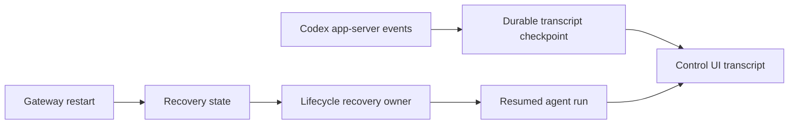

Codex review: needs maintainer review before merge. _Reviewed August 28, 2026, 2:05 AM ET / 06:05 UTC._

# ClawSweeper review

## What this changes

The branch centralizes restart recovery accounting and lifecycle ownership, adds durable Codex transcript checkpoints during active turns, and adds regression coverage for repeated Gateway restarts.

## Regression provenance

Possible regression — probable (reviewed change; failure trace). No predecessor PR is attributed.

## Merge readiness

⚠️ **Ready for maintainer review - 5 items remain**

No concrete introduced defect was found, but the required direct Codex-source contract review and complete current-main comparison are unavailable locally; keep this maintainer-authored PR open pending that evidence.

**Priority:** P1
**Reviewed head:** `e1254a38cbc7b87c16ede16231086eb8557f766b`
**Owner decision:** Required. See [Decision needed](#decision-needed).

## Review scores

| Measure | Result | What it means |
|---|---|---|
| **Overall readiness** | 🦐 gold shrimp **(3/6)** | The local owner-boundary review found no concrete introduced defect, but mandatory upstream-contract and complete-current-main evidence is unavailable. |
| **Proof confidence** | 🌊 off-meta tidepool | Not applicable: The PR is maintainer-authored, so the external-contributor proof gate does not apply; supplied artifacts were not independently retrievable here. |
| **Patch quality** | 🐚 platinum hermit **(4/6)** | No actionable review findings were identified. |

## Verification

| Check | Result | Evidence |
|---|---|---|
| **Real behavior** | Not applicable | Not applicable: The PR is maintainer-authored, so the external-contributor proof gate does not apply; supplied artifacts were not independently retrievable here. |
| **Evidence reviewed** | 5 items | Recovery retry invariant: Retry exhaustion counts charged attempts minus successfully started attempts, and registration persists a start only after cycle, session, run, and lifecycle-generation fences match. Durable transcript ordering: Checkpoint writes serialize pending entries, preserve receipt order, and defer incomplete entries until teardown or readiness. Related race repair: The branch includes the recovery-start persistence teardown repair committed as 044a5242ffe25398db2a96c3893b1c715617dbf3. |
| **Findings** | None | None. |
| **Security** | None | None. |

## How this fits together

Restart recovery resumes interrupted agent runs after a Gateway restart and coordinates persistent recovery state, provider execution, and terminal notices. Codex app-server events also feed the durable transcript that the Control UI renders after reload.

## Decision needed

| Question | Recommendation |
|---|---|
| Should this PR receive the required upstream Codex event-contract and exact-current-main review in a complete checkout before it is merged? | **Complete missing evidence:** Review the relevant Codex event contract and current main in a complete checkout before making the merge decision. |

Why: Repository policy makes direct Codex inspection mandatory for this integration change, and the local comparison is incomplete.

## Before merge

- [ ] **Resolve merge risk (P1)** - Direct upstream Codex event-contract inspection required by repository policy is unavailable.
- [ ] **Resolve merge risk (P1)** - Promisor/DNS failure prevents a complete current-main comparison.
- [ ] **Resolve merge risk (P1)** - This bug-fix branch has a judged production delta of +247 lines, requiring maintainer scrutiny of the enlarged recovery and checkpoint ownership boundary.
- [ ] **Complete next step (P2)** - Keep the maintainer-authored PR open for the missing required Codex contract and complete-current-main review; no source-proven defect warrants an automated repair.

<strong>Agent review details</strong>

### Security

None.

### PR surface

Source +247, Tests +640, Docs +16, Other -1. Total +902 across 40 files.

View PR surface stats

| Area | Files | Added | Removed | Net |
|---|---:|---:|---:|---:|
| Source | 26 | 433 | 186 | +247 |
| Tests | 11 | 836 | 196 | +640 |
| Docs | 2 | 16 | 0 | +16 |
| Config | 0 | 0 | 0 | 0 |
| Generated | 0 | 0 | 0 | 0 |
| Other | 1 | 0 | 1 | -1 |
| **Total** | **40** | **1285** | **383** | **+902** |

### Review metrics

| Metric | Value | Why it matters |
|---|---|---|
| **Production versus test delta** | production +428/-181 (net +247); tests/test support +841/-201 (net +640); docs +16 | A bug fix with material new production ownership code needs explicit review of whether the recovery and checkpoint boundary remains the simplest canonical design. |

### Stored data model

Persistent data-model change detected: `serialized state: src/config/sessions/main-session-recovery.types.ts`, `serialized state: ui/src/pages/chat/tool-stream.ts`, `vector/embedding metadata: extensions/codex/src/app-server/event-projector-snapshot.ts`, `vector/embedding metadata: extensions/codex/src/app-server/transcript-mirror-attestation.ts`. Confirm migration or upgrade compatibility proof before merge.

### Merge-risk options

**Maintainer options:**
1. **Verify recovery and event contracts first (recommended)**  
   Confirm upstream Codex event ordering and the exact current-main interaction before merging persistence and recovery lifecycle changes.
2. **Pause for complete-source review**  
   Keep the PR open if the required Codex checkout and current-main objects cannot be made available.

### Technical review

Best possible solution:

Complete the upstream Codex event-contract and exact-current-main checks in an environment containing the required sibling checkout before deciding whether to merge.

Do we have a high-confidence way to reproduce the issue?

Unclear: the PR supplies a deterministic isolated-Gateway scenario and targeted regression coverage, but this read-only environment did not run it and cannot retrieve all current-main objects.

Is this the best way to solve the issue?

Unclear: local source inspection supports the centralized owner boundaries, but the mandatory upstream Codex event-contract review remains unavailable.

AGENTS.md: found and applied where relevant.

Codex review notes: model internal, reasoning high; reviewed against [87122facbd81](https://github.com/openclaw/openclaw/commit/87122facbd81b015209daaf24d7e8857f77f378b).

### Labels

Label changes:

- add `status: 👀 ready for maintainer look`: ClawSweeper has no concrete contributor-facing blocker left for this PR. Not applicable: The PR is maintainer-authored, so the external-contributor proof gate does not apply; supplied artifacts were not independently retrievable here.
- remove `status: ⏳ waiting on author`: Current PR status label is `status: 👀 ready for maintainer look`.

Label justifications:

- `P1`: Repeated Gateway restarts can interrupt active work and hide completed in-progress transcript content from the Control UI.
- `merge-risk: 🚨 session-state`: The PR changes persistence and replay of active Codex commentary and tool results across abrupt restart.
- `merge-risk: 🚨 availability`: The PR changes bounded retry admission and shutdown/recovery lifecycle ordering for interrupted agent runs.
- `rating: 🦐 gold shrimp`: Overall readiness is 🦐 gold shrimp; proof is 🌊 off-meta tidepool and patch quality is 🐚 platinum hermit.
- `status: 👀 ready for maintainer look`: ClawSweeper has no concrete contributor-facing blocker left for this PR. Not applicable: The PR is maintainer-authored, so the external-contributor proof gate does not apply; supplied artifacts were not independently retrievable here.

### Evidence

Acceptance criteria:

- [P1] Inspect the sibling Codex app-server event protocol at the relevant version.
- [P1] Compare the exact PR merge result with complete current main.
- [P1] Run the existing isolated Gateway/Control UI restart-recovery scenario and verify retained commentary and tool results after repeated restarts.

What I checked:

- **Recovery retry invariant:** Retry exhaustion counts charged attempts minus successfully started attempts, and registration persists a start only after cycle, session, run, and lifecycle-generation fences match. ([`src/agents/main-session-recovery/main-session-recovery-state.ts:56`](https://github.com/openclaw/openclaw/blob/e1254a38cbc7/src/agents/main-session-recovery/main-session-recovery-state.ts#L56), [e1254a38cbc7](https://github.com/openclaw/openclaw/commit/e1254a38cbc7))
- **Durable transcript ordering:** Checkpoint writes serialize pending entries, preserve receipt order, and defer incomplete entries until teardown or readiness. ([`extensions/codex/src/app-server/transcript-checkpoint.ts:64`](https://github.com/openclaw/openclaw/blob/e1254a38cbc7/extensions/codex/src/app-server/transcript-checkpoint.ts#L64), [e1254a38cbc7](https://github.com/openclaw/openclaw/commit/e1254a38cbc7))
- **Related race repair:** The branch includes the recovery-start persistence teardown repair committed as 044a5242ffe25398db2a96c3893b1c715617dbf3. ([`src/agents/agent-command-execution-identity.ts:193`](https://github.com/openclaw/openclaw/blob/044a5242ffe2/src/agents/agent-command-execution-identity.ts#L193), [044a5242ffe2](https://github.com/openclaw/openclaw/commit/044a5242ffe2))
- **Current-main identity:** The available origin/main reference is 87122facbd81b015209daaf24d7e8857f77f378b, but required promisor objects could not be retrieved in this environment. ([87122facbd81](https://github.com/openclaw/openclaw/commit/87122facbd81))
- **Mandatory Codex review gap:** This PR changes the Codex integration and relies on Codex event ordering, while the required sibling ../codex checkout is absent. ([`extensions/codex/src/app-server/transcript-checkpoint.ts:17`](https://github.com/openclaw/openclaw/blob/e1254a38cbc7/extensions/codex/src/app-server/transcript-checkpoint.ts#L17), [e1254a38cbc7](https://github.com/openclaw/openclaw/commit/e1254a38cbc7))

Likely related people:

- **steipete:** Authored the reviewed recovery and checkpoint work, including the prior teardown-race repair. (role: recent recovery and Codex area contributor; confidence: medium; commits: [044a5242ffe2](https://github.com/openclaw/openclaw/commit/044a5242ffe25398db2a96c3893b1c715617dbf3), [e1254a38cbc7](https://github.com/openclaw/openclaw/commit/e1254a38cbc7b87c16ede16231086eb8557f766b); files: `src/agents/main-session-recovery/main-session-recovery-state.ts`, `extensions/codex/src/app-server/transcript-checkpoint.ts`)
- **zhangguiping-xydt:** Related merged PR #96230 is the earlier restart-recovery budget work in this area. (role: earlier restart-budget contributor; confidence: low; commits: [0a868179e4c7](https://github.com/openclaw/openclaw/commit/0a868179e4c70d34dd5ae9968e2e86c650c7cd0a); files: `src/agents/main-session-recovery/main-session-recovery-state.ts`)

### Rank-up moves

Optional improvements that raise the rating; they are not merge blockers.

- Make the direct upstream Codex event-contract evidence and exact-current-main verification available before merge.

### Rating scale

| Score | Internal tier | Crab rank | Meaning |
|---:|:---:|---|---|
| **6/6** | S | 🦀 challenger crab | Exceptional readiness |
| **5/6** | A | 🦞 diamond lobster | Very strong readiness |
| **4/6** | B | 🐚 platinum hermit | Good normal PR; ordinary maintainer review |
| **3/6** | C | 🦐 gold shrimp | Useful, but confidence is limited |
| **2/6** | D | 🦪 silver shellfish | Proof or implementation needs work |
| **1/6** | F | 🧂 unranked krab | Not merge-ready |
| N/A | NA | 🌊 off-meta tidepool | Rating does not apply |

Overall follows the weaker of proof and patch quality.
Shiny media proof means a screenshot, video, or linked artifact directly shows the changed behavior. Runtime, network, CSP, and security claims still need visible diagnostics.

### Workflow

- ClawSweeper keeps one durable marker-backed review comment per issue or PR.
- Re-runs edit this comment so the latest verdict, findings, and automation markers stay together instead of adding duplicate bot comments.
- A fresh review can be triggered by eligible `@clawsweeper re-review` comments, exact-item GitHub events, scheduled/background review runs, or manual workflow dispatch.
- PR/issue authors and users with repository write access can comment `@clawsweeper re-review` or `@clawsweeper re-run` on an open PR or issue to request a fresh review only.
- Maintainers can also comment `@clawsweeper review` to request a fresh review only.
- Fresh-review commands do not start repair, autofix, rebase, CI repair, or automerge.
- Maintainer-only repair and merge flows require explicit commands such as `@clawsweeper autofix`, `@clawsweeper automerge`, `@clawsweeper fix ci`, or `@clawsweeper address review`.
- Maintainers can comment `@clawsweeper explain` to ask for more context, or `@clawsweeper stop` to stop active automation.

### History

Review history (1 earlier review cycle)

<!-- clawsweeper-review-history v=1 total=1 -->
- reviewed 2026-08-28T04:39:37.722Z sha e857a3d83fc65dde6c240aec526764c5320b78a3 :: found issues before merge. :: [P1] Persist recovery starts before allowing teardown

<!-- clawsweeper-verdict:needs-human item=131527 sha=e1254a38cbc7b87c16ede16231086eb8557f766b confidence=medium updated_at=2026-08-28T06:00:46Z reviewed_at=2026-08-28T06:05:47.601Z lease_owner=github-run-33146413608-1 lease_comment_id=5449030337 source_revision=0fef179e4385d88ea7fc216a01a345abfd32f026590a0b474a21e90ac6f5d8d7 live_verification=absent -->

<!-- clawsweeper-review-version item=131527 reviewed_at=2026-08-28T06:05:47.601Z sha=e1254a38cbc7b87c16ede16231086eb8557f766b source_revision=0fef179e4385d88ea7fc216a01a345abfd32f026590a0b474a21e90ac6f5d8d7 lease_owner=github-run-33146413608-1 lease_comment_id=5449030337 v=1 -->

<!-- clawsweeper-review item=131527 -->