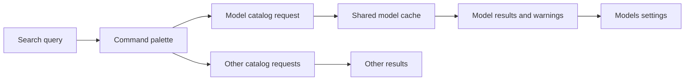

Codex review: needs maintainer review before merge. _Reviewed September 24, 2026, 8:23 AM ET / 12:23 UTC (Revision 8)._

# ClawSweeper review

## What this changes

The Control UI command palette displays model search results from the shared catalog as they arrive, updates failure notices, and adds focused tests and documentation.

## Merge readiness

✅ **Ready for maintainer review**

Current main and the latest release still hold model search results behind unrelated catalog requests, so this PR remains useful. The prior review findings and test-cost request are addressed; this review found no new actionable defect.

**Priority:** P2
**Reviewed head:** `d80ca0e05f27d3415da188b8fd19070b08c247e2`

## Review scores

| Measure | Result | What it means |
|---|---|---|
| **Overall readiness** | 🐚 platinum hermit **(4/6)** | Direct visual proof and focused regression coverage support a sound, bounded UI repair. |
| **Proof confidence** | 🦞 diamond lobster **(5/6)** ✨ media proof bonus | Sufficient (screenshot): Inspected before/after desktop and mobile screenshots exercise the browser command palette with a synthetic Gateway: model rows appear after the change while cron.list remains pending. Recovery has supplemental component coverage; no stored-data contract changes. |
| **Patch quality** | 🐚 platinum hermit **(4/6)** | No actionable review findings were identified. |

## Verification

| Check | Result | Evidence |
|---|---|---|
| **Real behavior** | Verified | Sufficient (screenshot): Inspected before/after desktop and mobile screenshots exercise the browser command palette with a synthetic Gateway: model rows appear after the change while cron.list remains pending. Recovery has supplemental component coverage; no stored-data contract changes. |
| **Evidence reviewed** | 9 items | Current main still waits: The catalog loader awaits models.list in the same Promise.all as cron.list and other categories; a pending automation reply delays model rows. Latest release still waits: The v2026.9.6 source also places models.list in the combined catalog request. Independent model path: The introduced change starts a separate model read and renders model rows from the agent-scoped shared catalog. |
| **Findings** | None | None. |
| **Security** | None | None. |

## How this fits together

The Control UI command palette turns a browser search query into navigation results using Gateway catalogs. Model catalog results feed the palette through a shared cache and lead users to Models settings.

## Before merge

None.

<strong>Agent review details</strong>

### Security

None.

### PR surface

Source +61, Tests +43, Docs 0. Total +104 across 7 files.

View PR surface stats

| Area | Files | Added | Removed | Net |
|---|---:|---:|---:|---:|
| Source | 3 | 115 | 54 | +61 |
| Tests | 3 | 103 | 60 | +43 |
| Docs | 1 | 1 | 1 | 0 |
| Config | 0 | 0 | 0 | 0 |
| Generated | 0 | 0 | 0 | 0 |
| Other | 0 | 0 | 0 | 0 |
| **Total** | **7** | **219** | **115** | **+104** |

### Review metrics

| Metric | Value | Why it matters |
|---|---|---|
| **Production and test growth** | production +61 net lines; tests +43 net lines | The production growth supports independent model loading and scoped recovery, with focused behavior coverage. |

### Technical review

Best possible solution:

Keep model rows and warnings tied to the agent-scoped shared catalog so they update independently while preserving Gateway model restrictions and recovery behavior.

Do we have a high-confidence way to reproduce the issue?

Yes. Hold cron.list pending while models.list resolves, then search for a model; current main's combined request delays the row, and the supplied before/after browser captures show the effect. I did not execute the scenario in this read-only checkout.

Is this the best way to solve the issue?

Yes. Reusing the existing scoped model cache is a narrow repair that leaves catalog and model-policy decisions with their current owners.

AGENTS.md: found and applied where relevant.

Codex review notes: model internal, reasoning high; reviewed against [b5346d6dafe6](https://github.com/openclaw/openclaw/commit/b5346d6dafe60e534897ad31af560a154798f0ba).

### Labels

Label changes:

No label changes.

Label justifications:

- `P2`: This repairs a visible but limited command-palette delay without changing model execution or stored settings.
- `rating: 🐚 platinum hermit`: Overall readiness is 🐚 platinum hermit; proof is 🦞 diamond lobster and patch quality is 🐚 platinum hermit.
- `status: 👀 ready for maintainer look`: ClawSweeper has no concrete contributor-facing blocker left for this PR. Sufficient (screenshot): Inspected before/after desktop and mobile screenshots exercise the browser command palette with a synthetic Gateway: model rows appear after the change while cron.list remains pending. Recovery has supplemental component coverage; no stored-data contract changes.
- `proof: sufficient`: Contributor real behavior proof is sufficient. Inspected before/after desktop and mobile screenshots exercise the browser command palette with a synthetic Gateway: model rows appear after the change while cron.list remains pending. Recovery has supplemental component coverage; no stored-data contract changes.
- `proof: 📸 screenshot`: Contributor real behavior proof includes screenshot evidence. Inspected before/after desktop and mobile screenshots exercise the browser command palette with a synthetic Gateway: model rows appear after the change while cron.list remains pending. Recovery has supplemental component coverage; no stored-data contract changes.

### Evidence

What I checked:

- **Current main still waits:** The catalog loader awaits models.list in the same Promise.all as cron.list and other categories; a pending automation reply delays model rows. ([`ui/src/components/command-palette-catalog-search.ts:289`](https://github.com/openclaw/openclaw/blob/b5346d6dafe60e534897ad31af560a154798f0ba/ui/src/components/command-palette-catalog-search.ts#L289), [b5346d6dafe6](https://github.com/openclaw/openclaw/commit/b5346d6dafe60e534897ad31af560a154798f0ba))
- **Latest release still waits:** The v2026.9.6 source also places models.list in the combined catalog request. ([`ui/src/components/command-palette-catalog-search.ts:325`](https://github.com/openclaw/openclaw/blob/eb377ac59e6c9fd6c7705028034812becf00271b/ui/src/components/command-palette-catalog-search.ts#L325), [eb377ac59e6c](https://github.com/openclaw/openclaw/commit/eb377ac59e6c9fd6c7705028034812becf00271b))
- **Independent model path:** The introduced change starts a separate model read and renders model rows from the agent-scoped shared catalog. ([`ui/src/components/command-palette.ts:395`](https://github.com/openclaw/openclaw/blob/d80ca0e05f27d3415da188b8fd19070b08c247e2/ui/src/components/command-palette.ts#L395), [d80ca0e05f27](https://github.com/openclaw/openclaw/commit/d80ca0e05f27d3415da188b8fd19070b08c247e2))
- **Shared recovery:** Accepted catalog publication notifies subscribers; the palette clears a failed local read when the same agent's catalog becomes available. ([`ui/src/components/command-palette.ts:167`](https://github.com/openclaw/openclaw/blob/d80ca0e05f27d3415da188b8fd19070b08c247e2/ui/src/components/command-palette.ts#L167), [d80ca0e05f27](https://github.com/openclaw/openclaw/commit/d80ca0e05f27d3415da188b8fd19070b08c247e2))
- **Focused regression coverage:** Component cases cover a model result while automation remains pending, navigation to Models settings, recovery after another view publishes the catalog, and restricted primary-model search. ([`ui/src/components/command-palette.test.ts:106`](https://github.com/openclaw/openclaw/blob/d80ca0e05f27d3415da188b8fd19070b08c247e2/ui/src/components/command-palette.test.ts#L106), [d80ca0e05f27](https://github.com/openclaw/openclaw/commit/d80ca0e05f27d3415da188b8fd19070b08c247e2))
- **Inspected visual proof:** The PR body's prepared desktop and mobile before/after screenshots show a model row appearing after the change while “Searching commands” remains visible. The stated browser fixture holds cron.list pending and uses synthetic data.

Likely related people:

- **obviyus:** Suggested for follow-up; no historical authorship or introduction is verified. (role: unverified routing candidate; confidence: low)
- **steipete:** Suggested for follow-up; no historical authorship or introduction is verified. (role: unverified routing candidate; confidence: low)
- **shakkernerd:** Suggested for follow-up; no historical authorship or introduction is verified. (role: unverified routing candidate; confidence: low)

### Rating scale

| Score | Internal tier | Crab rank | Meaning |
|---:|:---:|---|---|
| **6/6** | S | 🦀 challenger crab | Exceptional readiness |
| **5/6** | A | 🦞 diamond lobster | Very strong readiness |
| **4/6** | B | 🐚 platinum hermit | Good normal PR; ordinary maintainer review |
| **3/6** | C | 🦐 gold shrimp | Useful, but confidence is limited |
| **2/6** | D | 🦪 silver shellfish | Proof or implementation needs work |
| **1/6** | F | 🧂 unranked krab | Not merge-ready |
| N/A | NA | 🌊 off-meta tidepool | Rating does not apply |

Overall follows the weaker of proof and patch quality.
Shiny media proof means a screenshot, video, or linked artifact directly shows the changed behavior. Runtime, network, CSP, and security claims still need visible diagnostics.

### Workflow

- ClawSweeper keeps one durable marker-backed review comment per issue or PR.
- Re-runs edit this comment so the latest verdict, findings, and automation markers stay together instead of adding duplicate bot comments.
- A fresh review can be triggered by eligible `@clawsweeper re-review` comments, exact-item GitHub events, scheduled/background review runs, or manual workflow dispatch.
- PR/issue authors and users with repository write access can comment `@clawsweeper re-review` or `@clawsweeper re-run` on an open PR or issue to request a fresh review only.
- Maintainers can also comment `@clawsweeper review` to request a fresh review only.
- Fresh-review commands do not start repair, autofix, rebase, CI repair, or automerge.
- Maintainer-only repair and merge flows require explicit commands such as `@clawsweeper autofix`, `@clawsweeper automerge`, `@clawsweeper fix ci`, or `@clawsweeper address review`.
- Maintainers can comment `@clawsweeper explain` to ask for more context, or `@clawsweeper stop` to stop active automation.

### History

Review history (7 earlier review cycles)

<!-- clawsweeper-review-history v=1 total=7 -->
- reviewed 2026-09-17T17:26:22.573Z sha 4f548dc1b584222243327ddf458a7df1c3d68fa1 :: blocked before merge. :: none
- reviewed 2026-09-18T01:19:26.438Z sha 44806f664cb19bda69173fc0d52ea7b0dabc53ce :: needs changes before merge. :: none
- reviewed 2026-09-18T02:01:08.243Z sha 44806f664cb19bda69173fc0d52ea7b0dabc53ce :: blocked before merge. :: none
- reviewed 2026-09-18T07:23:03.305Z sha 44806f664cb19bda69173fc0d52ea7b0dabc53ce :: blocked before merge. :: none
- reviewed 2026-09-24T10:52:19.521Z sha 4f2cfccccde05cc1164fd4ca78ae5cf64c4c8145 :: needs changes before merge. :: [P2] Update the Gateway observer for the array return | [P2] Clear the failure warning after a shared catalog recovery
- reviewed 2026-09-24T11:16:50.241Z sha 2943123d509e3540873d4b30b1d370b820a459e9 :: needs changes before merge. :: [P2] Clear the warning after shared catalog recovery
- reviewed 2026-09-24T11:35:51.381Z sha d80ca0e05f27d3415da188b8fd19070b08c247e2 :: blocked before merge. :: none

<!-- clawsweeper-verdict:needs-human item=151022 sha=d80ca0e05f27d3415da188b8fd19070b08c247e2 confidence=high updated_at=2026-09-24T12:19:16Z reviewed_at=2026-09-24T12:23:22.176Z lease_owner=github-run-35998106794-1 lease_comment_id=5813936062 source_revision=8fd0aaa090f1f8c6730e626e8f049813b1453a7f92b8f854f6dcfabc82148ae9 live_verification=absent -->
<!-- clawsweeper-review-state:ready item=151022 sha=d80ca0e05f27d3415da188b8fd19070b08c247e2 v=1 -->

<!-- clawsweeper-review-version item=151022 reviewed_at=2026-09-24T12:23:22.176Z sha=d80ca0e05f27d3415da188b8fd19070b08c247e2 source_revision=8fd0aaa090f1f8c6730e626e8f049813b1453a7f92b8f854f6dcfabc82148ae9 lease_owner=github-run-35998106794-1 lease_comment_id=5813936062 v=1 -->

<!-- clawsweeper-review item=151022 -->