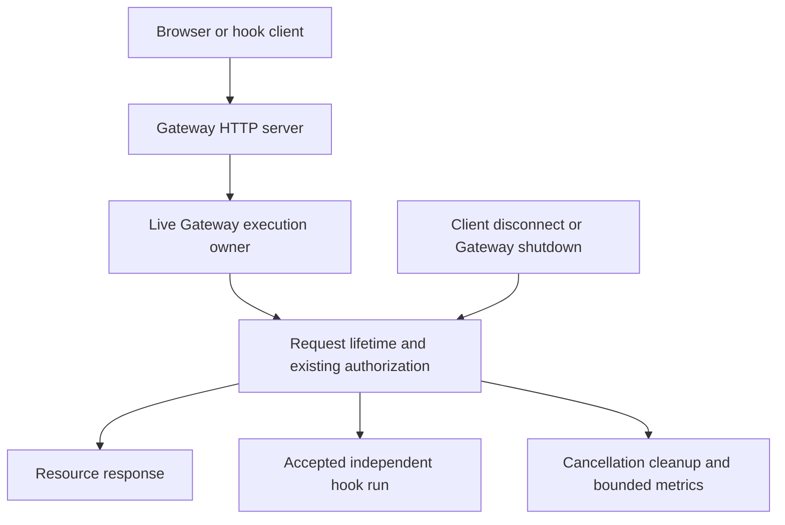

Codex review: needs maintainer review before merge.

## What this changes

The Gateway gives HTTP requests their own live execution lifetime so workspace icons load after startup, disconnected requests cancel cleanly, and accepted background hooks continue.

**Example:** A user loads a workspace icon after Gateway startup completes.
- **Before:** All four recorded icon requests returned HTTP 500.
- **After:** All four recorded icon requests returned HTTP 200 without matching HTTP error records.

## Review scores

| Measure | Result | What it means |
|---|---|---|
| **Overall readiness** | 🐚 platinum hermit **(4/6)** | A useful shared-owner repair with convincing production-entry evidence and no identified correctness findings. |
| **Proof confidence** | 🦞 diamond lobster **(5/6)** | Sufficient (live_output): The recorded public Gateway run exercises the changed HTTP owner after startup retirement with paired-device authentication: icons return 200 instead of 500, sibling resources remain successful, and the Node 24 candidate shuts down cleanly. Recorded transport controls cover disconnect, buffered completion, cleanup ownership, and server rejection accounting; the final diagnostic-only follow-up has focused validation. |
| **Patch quality** | 🐚 platinum hermit **(4/6)** | No actionable review findings were identified. |

## Product

**Kind:** Bug fix · **Worth it:** Yes · **Fix scope:** Complete
**User problem:** Workspace icons fail with HTTP 500 after successful Gateway startup, while repeated AbortError stacks appear in the log.
**Reason:** The recorded failure violates the existing resource-serving contract. The established Gateway-area owner proposes a shared lifetime repair, with no new user configuration or competing UI implementation.

## Merge readiness

✅ **Ready for maintainer review**

This PR addresses a distinct, source-backed Gateway defect that remains on current main. No actionable patch defect was identified; the latest commit resolves the prior stability-recorder omission.

**Priority:** P2
**Reviewed head:** `ec1d1a4a42202ec639df3db8e404e5e5f4cfdc23`

## Before merge

None.

## Findings

None.

<strong>Agent review details</strong>

### How this fits together

The Gateway HTTP server receives browser resource requests and hook calls, checks their existing authorization, and dispatches them to resource or agent owners. Request cleanup must finish before the Gateway releases its runtime resources.

### Technical review

Best possible solution:

Keep HTTP execution and cleanup under the existing live Gateway owner while accepted hooks retain their independent lifetime.

Do we have a high-confidence way to reproduce the issue?

Yes. The startup-retirement mechanism is clear in source and the recorded public Gateway comparison demonstrates HTTP 500 before the repair and HTTP 200 afterward; this read-only review did not execute target code.

Is this the best way to solve the issue?

Yes. The patch repairs execution custody at the shared HTTP boundary, reuses existing transport and detached-work owners, and leaves resource authorization and stored settings intact.

AGENTS.md: found and applied where relevant.

Codex review notes: model internal, reasoning medium; reviewed against [3223e13a514c](https://github.com/openclaw/openclaw/commit/3223e13a514c6134e10ee7f585627434d245fd20).

### Provenance checked

- `src/gateway/server-http.ts: HTTP connection dispatch` keeps the original intent (d7e280fcf6905428b73ed15dfd62c9aa8531a5d6: Serialize application admission and retain transport ownership so body rejection responses reach clients before disposal.)
- `src/gateway/http-request-authority.ts: terminal authority outcomes` keeps the original intent (76e32e92441321b2e564263bc385cc7f4cc8ecd7: Treat disconnect and authority expiry as settled outcomes, preserve operator denial responses, and retain diagnostics for unexpected errors.)
- `src/gateway/server/hooks.ts: independent hook continuation` keeps the original intent (a366218cf46bcfa301f00adf047320ae7d72544c: Keep accepted hook runs tracked and admitted after the originating HTTP request releases admission.)
- `src/infra/http-request-lifecycle.ts: disconnect cancellation` keeps the original intent (3a997793133ce7a1e4574a2295d2e0ead8cf048e: Cancel disconnected request waits without treating ordinary request and response completion as cancellation.)
- `extensions/diagnostics-prometheus/src/service.ts: runtime measurement recording` keeps the original intent (https://github.com/openclaw/openclaw/pull/138249: Retain completed event-loop observations cumulatively without changing readiness or lifecycle decisions.)
- `src/infra/diagnostic-events.ts: internal asynchronous runtime measurements` keeps the original intent (https://github.com/openclaw/openclaw/pull/139592: Deliver runtime measurements through the existing bounded internal diagnostic queue and exporter gates.)
- `src/logging/diagnostic-stability.ts: subscription filtering` keeps the original intent (2456c7745991c5698ca3e536221b6927e3a51881: Filter uninterested diagnostics before projection and cloning to avoid repeated hot-path work.)
- `config/max-lines-baseline.txt` keeps the original intent (f81f9d8570c384da3d838d8729f619cbb3456505: Maintain a shrink-only baseline for existing oversized-file suppressions.)

### Testing

Proof path: shipped entry point.

### Security

None.

### Evidence

What I checked:

- **Request lifetime repair:** The introduced wrapper enters the existing Gateway execution owner, creates a disconnect-aware request scope, restores its context for cancellation and cleanup, and joins outstanding work. ([`src/gateway/http-request-authority.ts:29`](https://github.com/openclaw/openclaw/blob/ec1d1a4a42202ec639df3db8e404e5e5f4cfdc23/src/gateway/http-request-authority.ts#L29), [ec1d1a4a4220](https://github.com/openclaw/openclaw/commit/ec1d1a4a42202ec639df3db8e404e5e5f4cfdc23))
- **Current main still needs the repair:** The HTTP server, request-authority module, and connection lifecycle module are unchanged between the introduced base and fetched current main; main lacks the proposed live-request wrapper. ([`src/gateway/http-request-authority.ts`](https://github.com/openclaw/openclaw/blob/3223e13a514c6134e10ee7f585627434d245fd20/src/gateway/http-request-authority.ts), [3223e13a514c](https://github.com/openclaw/openclaw/commit/3223e13a514c6134e10ee7f585627434d245fd20))
- **Recorded production-entry proof:** The supplied complete PR body records public Gateway startup with synthetic state and paired-device authentication: workspace-icon requests changed from 4/4 HTTP 500 to 4/4 HTTP 200, matching error records fell from four to zero, and document, JavaScript, avatar, and assistant-media controls remained HTTP 200. The integrated Node 24 candidate passed all six route families and shut down cleanly. Body source identity: d1401876b44c15320bb4801acd7c70128bd75157039f9be38bf040f34bc1eac1. ([ec1d1a4a4220](https://github.com/openclaw/openclaw/commit/ec1d1a4a42202ec639df3db8e404e5e5f4cfdc23))
- **Lifecycle and authorization regression coverage:** The shared HTTP server fixture retires startup before serving requests. Cases exercise client disconnect, shutdown with unfinished buffered responses, delivered rejection responses, cleanup ownership, credential expiry, operator revocation, and preservation of unexpected-error diagnostics. ([`src/gateway/server-http.authority-outcomes.test.ts:34`](https://github.com/openclaw/openclaw/blob/ec1d1a4a42202ec639df3db8e404e5e5f4cfdc23/src/gateway/server-http.authority-outcomes.test.ts#L34), [ec1d1a4a4220](https://github.com/openclaw/openclaw/commit/ec1d1a4a42202ec639df3db8e404e5e5f4cfdc23))
- **Accepted-hook contract preserved:** https://github.com/openclaw/openclaw/pull/104686 established that accepted hooks survive request completion. The existing detached continuation preserves independent root admission and adds its own async lifetime; this PR uses that existing owner rather than creating another admission path. ([`src/gateway/server/hooks.ts:492`](https://github.com/openclaw/openclaw/blob/a366218cf46bcfa301f00adf047320ae7d72544c/src/gateway/server/hooks.ts#L492), [a366218cf46b](https://github.com/openclaw/openclaw/commit/a366218cf46bcfa301f00adf047320ae7d72544c))
- **Prior review continuity:** The delta from the previously reviewed head adds the cancellation exclusion to the stability subscription and exhaustive projection switch, extends the existing bounded-projection regression, and documents the exclusion. The previous structured review listed no findings or rank-up moves. ([`src/logging/diagnostic-stability.ts:724`](https://github.com/openclaw/openclaw/blob/ec1d1a4a42202ec639df3db8e404e5e5f4cfdc23/src/logging/diagnostic-stability.ts#L724), [ec1d1a4a4220](https://github.com/openclaw/openclaw/commit/ec1d1a4a42202ec639df3db8e404e5e5f4cfdc23))

Likely related people:

- **Peter Steinberger:** Raw commit 76e32e92441321b2e564263bc385cc7f4cc8ecd7 adds src/gateway/http-request-authority.ts:104 relative to its recorded parents. This identifies author metadata, not feature responsibility or a PR merger. (role: source-line author; confidence: high; commits: [76e32e924413](https://github.com/openclaw/openclaw/commit/76e32e92441321b2e564263bc385cc7f4cc8ecd7); files: `src/gateway/http-request-authority.ts`)
- **Vincent Koc:** Raw commit 3a997793133ce7a1e4574a2295d2e0ead8cf048e adds src/infra/http-request-lifecycle.ts:40 relative to its recorded parents. This identifies author metadata, not feature responsibility or a PR merger. (role: source-line author; confidence: high; commits: [3a997793133c](https://github.com/openclaw/openclaw/commit/3a997793133ce7a1e4574a2295d2e0ead8cf048e); files: `src/infra/http-request-lifecycle.ts`)

### PR surface

Source +121, Tests +260, Docs +11, Other -1. Total +391 across 16 files. Added test files: 0.

View PR surface stats

| Area | Files | Added | Removed | Net |
|---|---:|---:|---:|---:|
| Source | 9 | 190 | 69 | +121 |
| Tests | 5 | 310 | 50 | +260 |
| Docs | 1 | 11 | 0 | +11 |
| Config | 0 | 0 | 0 | 0 |
| Generated | 0 | 0 | 0 | 0 |
| Other | 1 | 0 | 1 | -1 |
| **Total** | **16** | **511** | **120** | **+391** |

### Review metrics

| Metric | Value | Why it matters |
|---|---|---|
| **Production versus test growth** | Production +121 net lines; tests +260 net lines | Production growth supplies request cancellation, cleanup ownership, and bounded telemetry; the tests protect distinct transport and lifecycle regressions. |

### Labels

Label changes:

No label changes.

Label justifications:

- `P2`: The demonstrated failure affects workspace-icon loading after startup, with a bounded repair in the shared HTTP lifetime owner.
- `rating: 🐚 platinum hermit`: Overall readiness is 🐚 platinum hermit; proof is 🦞 diamond lobster and patch quality is 🐚 platinum hermit.
- `status: 👀 ready for maintainer look`: ClawSweeper has no concrete contributor-facing blocker left for this PR.
- `proof: sufficient`: Contributor real behavior proof is sufficient.

### Rating scale

6/6 🦀 challenger crab · 5/6 🦞 diamond lobster · 4/6 🐚 platinum hermit · 3/6 🦐 gold shrimp · 2/6 🦪 silver shellfish · 1/6 🧂 unranked krab. Overall follows the weaker of proof and patch quality; ✨ marks media proof (a screenshot, video, or linked artifact) that directly shows the changed behavior.

### Workflow

ClawSweeper edits this one comment on every review. Comment `@clawsweeper re-review` for a fresh review only; repair and merge need explicit maintainer commands such as `@clawsweeper autofix` or `@clawsweeper automerge`.

### History

Review history (3 earlier review cycles)

<!-- clawsweeper-review-history v=1 total=3 -->
- reviewed 2026-10-09T07:57:14.595Z sha 9335ed0a93edd2aa0313aa851c88bc98e2b2f47e :: needs changes before merge. :: none
- reviewed 2026-10-09T08:52:41.688Z sha 7441d36e6ea54a0c96e6ef8aec637b6e067b1d44 :: needs maintainer review before merge. :: none
- reviewed 2026-10-09T09:08:04.801Z sha 7441d36e6ea54a0c96e6ef8aec637b6e067b1d44 :: needs maintainer review before merge. :: none

_Reviewed October 9, 2026, 5:51 AM ET / 09:51 UTC (Revision 4)._

<!-- clawsweeper-verdict:needs-human item=167697 sha=ec1d1a4a42202ec639df3db8e404e5e5f4cfdc23 confidence=high updated_at=2026-10-09T09:47:07Z reviewed_at=2026-10-09T09:51:23.861Z lease_owner=github-run-37913372511-1 lease_comment_id=6078483344 source_revision=d1401876b44c15320bb4801acd7c70128bd75157039f9be38bf040f34bc1eac1 live_verification=absent hold=not_opted_in findings=0 -->
<!-- clawsweeper-review-state:ready item=167697 sha=ec1d1a4a42202ec639df3db8e404e5e5f4cfdc23 v=1 -->

<!-- clawsweeper-review-version item=167697 reviewed_at=2026-10-09T09:51:23.861Z sha=ec1d1a4a42202ec639df3db8e404e5e5f4cfdc23 source_revision=d1401876b44c15320bb4801acd7c70128bd75157039f9be38bf040f34bc1eac1 lease_owner=github-run-37913372511-1 lease_comment_id=6078483344 v=1 -->

<!-- clawsweeper-review item=167697 -->