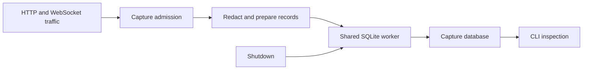

Codex review: blocked before merge. _Reviewed September 26, 2026, 4:21 PM ET / 20:21 UTC (Revision 9)._

# ClawSweeper review

## What this changes

Moves HTTP and WebSocket debug capture to shared SQLite workers, adds asynchronous Plugin SDK capture methods, migrates bundled callers, and drains capture during shutdown.

## Merge readiness

⛔ **Blocked before merge - 2 items remain**

Current main and the latest release still use synchronous capture storage, so this PR remains necessary. The current-head published-updater evidence resolves the previous proof gap, and the inspected paths show no confirmed introduced defect.

**Priority:** P2
**Reviewed head:** `6a01cab02c318882799f2a02671bf815d1f47779`

## Review scores

| Measure | Result | What it means |
|---|---|---|
| **Overall readiness** | 🐚 platinum hermit **(4/6)** | Strong current-head runtime and upgrade evidence supports a coherent cutover, while the broad compatibility surface warrants normal landing review. |
| **Proof confidence** | 🦞 diamond lobster **(5/6)** | Sufficient (terminal): At the exact PR head, the published 2026.9.4 updater exercised the ordinary candidate finalizer with real mixed capture claims: a pending write settled before shared-state close and durable records were observed. The same-package skipped-drain control failed as expected; built Node/Bun loopback launchers also exercised capture. No stored-data contract change was identified. |
| **Patch quality** | 🐚 platinum hermit **(4/6)** | No actionable review findings were identified. |

## Verification

| Check | Result | Evidence |
|---|---|---|
| **Real behavior** | Verified | Sufficient (terminal): At the exact PR head, the published 2026.9.4 updater exercised the ordinary candidate finalizer with real mixed capture claims: a pending write settled before shared-state close and durable records were observed. The same-package skipped-drain control failed as expected; built Node/Bun loopback launchers also exercised capture. No stored-data contract change was identified. |
| **Evidence reviewed** | 9 items | Current-main behavior: The current-main capture owner defaults to the synchronous SQLite store; the worker-backed capture store is absent from main. Release check: The latest release has no asynchronous capture store, and no tag contains the PR head. Worker execution: The proposed capture commands execute the existing capture kernel inside the shared-state worker. |
| **Findings** | None | None. |
| **Security** | None | None. |

## How this fits together

Proxy capture receives diagnostic events from HTTP and WebSocket transports and stores them in OpenClaw's shared state database. CLI inspection reads those records, while shutdown must settle accepted writes before closing storage.

## Before merge

- [ ] **Review config compatibility** - Confirm compatibility and upgrade impact for the changed config or default surface before merge.
- [ ] **Add data-model compatibility proof** - Confirm migration or upgrade compatibility proof before merge.

<strong>Agent review details</strong>

### Security

None.

### PR surface

PR surface statistics unavailable: the file list is incomplete.

### Review metrics

| Metric | Value | Why it matters |
|---|---|---|
| **Code and test growth** | production +3326/−1511; tests +2956/−552 | The substantial production growth is tied to the shared-worker cutover and lifecycle ownership, with focused regression coverage. |
| **Async SDK additions** | 6 async exports added; synchronous exports retained | Third-party plugin compatibility depends on the retained synchronous contract. |

### Stored data model

Persistent data-model change detected: `unknown-truncated-pull-files`. Confirm migration or upgrade compatibility proof before merge.

### Technical review

Best possible solution:

Keep one shared-worker capture owner, preserve shipped synchronous SDK compatibility during migration, and retain the current-head updater and mixed-session proof for landing review.

Do we have a high-confidence way to reproduce the issue?

Yes. Current-main source routes capture through a synchronous SQLite store, and the PR identifies real-worker and loopback checks for that path; this read-only review did not execute them.

Is this the best way to solve the issue?

Yes. The branch reuses the canonical shared-state worker and retains the shipped synchronous SDK contract while moving bundled callers to async operations.

AGENTS.md: found and applied where relevant.

Codex review notes: model internal, reasoning high; reviewed against [915e37b7ddcb](https://github.com/openclaw/openclaw/commit/915e37b7ddcbf884a78cb650e9463bfa9f0000e9).

### Labels

Label changes:

No label changes.

Label justifications:

- `P2`: Moving diagnostic capture off the main thread is a bounded runtime improvement with limited user-facing blast radius.
- `merge-risk: 🚨 compatibility`: The public capture SDK and mixed synchronous/async lifecycle affect third-party plugins, although the shipped synchronous path remains and mixed-session regression coverage is present.
- `rating: 🐚 platinum hermit`: Overall readiness is 🐚 platinum hermit; proof is 🦞 diamond lobster and patch quality is 🐚 platinum hermit.
- `status: 👀 ready for maintainer look`: ClawSweeper has no concrete contributor-facing blocker left for this PR. Sufficient (terminal): At the exact PR head, the published 2026.9.4 updater exercised the ordinary candidate finalizer with real mixed capture claims: a pending write settled before shared-state close and durable records were observed. The same-package skipped-drain control failed as expected; built Node/Bun loopback launchers also exercised capture. No stored-data contract change was identified.
- `proof: sufficient`: Contributor real behavior proof is sufficient. At the exact PR head, the published 2026.9.4 updater exercised the ordinary candidate finalizer with real mixed capture claims: a pending write settled before shared-state close and durable records were observed. The same-package skipped-drain control failed as expected; built Node/Bun loopback launchers also exercised capture. No stored-data contract change was identified.

### Evidence

What I checked:

- **Current-main behavior:** The current-main capture owner defaults to the synchronous SQLite store; the worker-backed capture store is absent from main. ([`src/proxy-capture/runtime-owner.ts:29`](https://github.com/openclaw/openclaw/blob/915e37b7ddcbf884a78cb650e9463bfa9f0000e9/src/proxy-capture/runtime-owner.ts#L29), [915e37b7ddcb](https://github.com/openclaw/openclaw/commit/915e37b7ddcbf884a78cb650e9463bfa9f0000e9))
- **Release check:** The latest release has no asynchronous capture store, and no tag contains the PR head. ([eb377ac59e6c](https://github.com/openclaw/openclaw/commit/eb377ac59e6c9fd6c7705028034812becf00271b))
- **Worker execution:** The proposed capture commands execute the existing capture kernel inside the shared-state worker. ([`src/proxy-capture/store.worker.ts:12`](https://github.com/openclaw/openclaw/blob/6a01cab02c318882799f2a02671bf815d1f47779/src/proxy-capture/store.worker.ts#L12), [6a01cab02c31](https://github.com/openclaw/openclaw/commit/6a01cab02c318882799f2a02671bf815d1f47779))
- **Shutdown settlement:** The capture owner waits for accepted writes and ends the session through the retained lease; the worker lease finalizer runs before native retirement. ([`src/proxy-capture/runtime-owner.ts:631`](https://github.com/openclaw/openclaw/blob/6a01cab02c318882799f2a02671bf815d1f47779/src/proxy-capture/runtime-owner.ts#L631), [6a01cab02c31](https://github.com/openclaw/openclaw/commit/6a01cab02c318882799f2a02671bf815d1f47779))
- **Legacy compatibility regression:** A real-worker regression covers both legacy-first and async-first initialization, synchronous legacy finalization, continued host capture, and final session closure. ([`src/proxy-capture/runtime.compat.test-support.ts:35`](https://github.com/openclaw/openclaw/blob/6a01cab02c318882799f2a02671bf815d1f47779/src/proxy-capture/runtime.compat.test-support.ts#L35), [6a01cab02c31](https://github.com/openclaw/openclaw/commit/6a01cab02c318882799f2a02671bf815d1f47779))
- **Current-head update proof:** The linked PR comment binds a published 2026.9.4 updater run to this exact head. Its terminal trace shows a pending mixed-mode capture write settling in the original drain before state close; a same-package skipped-drain control fails. The raw archive is retained locally rather than published as an independently authenticated artifact. ([6a01cab02c31](https://github.com/openclaw/openclaw/commit/6a01cab02c318882799f2a02671bf815d1f47779))

Likely related people:

- **Peter Steinberger:** Raw commit 5cc4537a456fd0c0eaf952e66761514e760d0d65 adds src/proxy-capture/store.kernel.ts:1 relative to its recorded parents. This identifies author metadata, not feature responsibility or a PR merger. (role: source-line author; confidence: high; commits: [5cc4537a456f](https://github.com/openclaw/openclaw/commit/5cc4537a456fd0c0eaf952e66761514e760d0d65); files: `src/proxy-capture/store.kernel.ts`)
- **unknown:** The claimed source-line change could not be verified from bounded local history. (role: source history unknown; confidence: low)

### Rating scale

| Score | Internal tier | Crab rank | Meaning |
|---:|:---:|---|---|
| **6/6** | S | 🦀 challenger crab | Exceptional readiness |
| **5/6** | A | 🦞 diamond lobster | Very strong readiness |
| **4/6** | B | 🐚 platinum hermit | Good normal PR; ordinary maintainer review |
| **3/6** | C | 🦐 gold shrimp | Useful, but confidence is limited |
| **2/6** | D | 🦪 silver shellfish | Proof or implementation needs work |
| **1/6** | F | 🧂 unranked krab | Not merge-ready |
| N/A | NA | 🌊 off-meta tidepool | Rating does not apply |

Overall follows the weaker of proof and patch quality.
Shiny media proof means a screenshot, video, or linked artifact directly shows the changed behavior. Runtime, network, CSP, and security claims still need visible diagnostics.

### Workflow

- ClawSweeper keeps one durable marker-backed review comment per issue or PR.
- Re-runs edit this comment so the latest verdict, findings, and automation markers stay together instead of adding duplicate bot comments.
- A fresh review can be triggered by eligible `@clawsweeper re-review` comments, exact-item GitHub events, scheduled/background review runs, or manual workflow dispatch.
- PR/issue authors and users with repository write access can comment `@clawsweeper re-review` or `@clawsweeper re-run` on an open PR or issue to request a fresh review only.
- Maintainers can also comment `@clawsweeper review` to request a fresh review only.
- Fresh-review commands do not start repair, autofix, rebase, CI repair, or automerge.
- Maintainer-only repair and merge flows require explicit commands such as `@clawsweeper autofix`, `@clawsweeper automerge`, `@clawsweeper fix ci`, or `@clawsweeper address review`.
- Maintainers can comment `@clawsweeper explain` to ask for more context, or `@clawsweeper stop` to stop active automation.

### History

Review history (8 earlier review cycles)

<!-- clawsweeper-review-history v=1 total=8 -->
- reviewed 2026-09-26T16:34:53.467Z sha 16f5458e8d0b5f2fe29336c19b9339bf8fcfbaba :: blocked before merge. :: [P2] Drain async capture before signal-driven CLI exit
- reviewed 2026-09-26T16:56:12.505Z sha ef481e0387383511b489538dd38247dcaf8a1fa7 :: blocked before merge. :: [P2] Drain capture before signal-driven process exit
- reviewed 2026-09-26T17:13:36.004Z sha 5c67ac2eb371d54540bad3ade9996ccac3ed0e63 :: blocked before merge. :: [P2] Drain capture before signal-driven process exit
- reviewed 2026-09-26T17:20:35.456Z sha 5c67ac2eb371d54540bad3ade9996ccac3ed0e63 :: blocked before merge. :: [P2] Drain capture before signal-driven process exit
- reviewed 2026-09-26T17:35:09.970Z sha 841133fb8c7145134576e9563807236884a635ab :: blocked before merge. :: [P1] Preserve the shipped synchronous finalizer for mixed sessions | [P2] Drain capture before signal-driven process exit | [P2] Drain capture when media cleanup fails
- reviewed 2026-09-26T18:29:04.403Z sha 441e8a918f66dce189fa9abf2184ae800c89f6f4 :: blocked before merge. :: [P1] Preserve synchronous finalization for mixed capture sessions | [P2] Drain capture when media cleanup throws
- reviewed 2026-09-26T18:54:41.106Z sha 4f1648a281734267fb194f8258b03e070ffb573e :: blocked before merge. :: none
- reviewed 2026-09-26T19:22:49.573Z sha 6a01cab02c318882799f2a02671bf815d1f47779 :: blocked before merge. :: none

<!-- clawsweeper-verdict:needs-human item=158848 sha=6a01cab02c318882799f2a02671bf815d1f47779 confidence=high updated_at=2026-09-26T20:17:23Z reviewed_at=2026-09-26T20:21:04.302Z lease_owner=github-run-36268863476-1 lease_comment_id=5849413339 source_revision=6ba0887c236c38d1d13b528f0de83f51e88569f2dbe7bd19f19e0e9ca95622a9 live_verification=absent -->
<!-- clawsweeper-review-state:blocked item=158848 sha=6a01cab02c318882799f2a02671bf815d1f47779 v=1 -->

<!-- clawsweeper-review-version item=158848 reviewed_at=2026-09-26T20:21:04.302Z sha=6a01cab02c318882799f2a02671bf815d1f47779 source_revision=6ba0887c236c38d1d13b528f0de83f51e88569f2dbe7bd19f19e0e9ca95622a9 lease_owner=github-run-36268863476-1 lease_comment_id=5849413339 v=1 -->

<!-- clawsweeper-review item=158848 -->