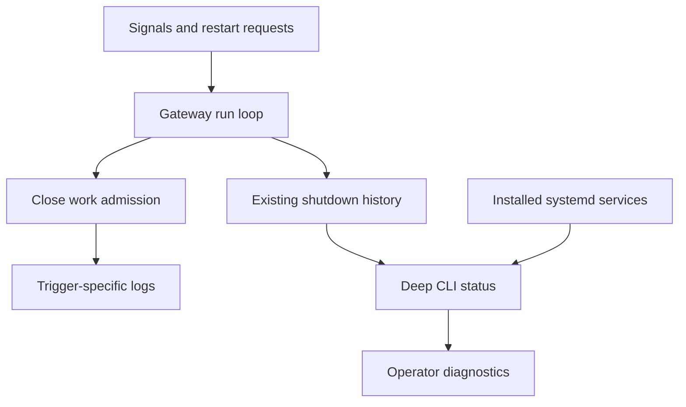

Codex review: needs maintainer review before merge. _Reviewed September 15, 2026, 9:41 AM ET / 13:41 UTC (Revision 10)._

# ClawSweeper review

## What this changes

The PR names stop and restart triggers in Gateway logs and shutdown history, adds repeated-signal hints, and exposes shutdown and competing-service diagnostics in deep CLI status.

## Merge readiness

✅ **Ready for maintainer review**

Keep open: this remains a useful diagnostic repair absent from inspected main. No actionable patch defect was found, and the broader restart-loop report remains unresolved.

**Priority:** P2
**Reviewed head:** `531faaa391fbbfc748105adf192b9858c9dc7a9a`

## Review scores

| Measure | Result | What it means |
|---|---|---|
| **Overall readiness** | 🐚 platinum hermit **(4/6)** | A focused diagnostic repair with meaningful regression coverage and no actionable correctness findings. |
| **Proof confidence** | 🌊 off-meta tidepool | Not applicable: The supplied repository state identifies this as maintainer-authored, so the external-contributor proof gate does not apply. Run-loop, history, and status tests support the diagnostics; the body explicitly discloses that no live Gateway or Linux supervisor campaign was run. |
| **Patch quality** | 🐚 platinum hermit **(4/6)** | No actionable review findings were identified. |

## Verification

| Check | Result | Evidence |
|---|---|---|
| **Real behavior** | Not applicable | Not applicable: The supplied repository state identifies this as maintainer-authored, so the external-contributor proof gate does not apply. Run-loop, history, and status tests support the diagnostics; the body explicitly discloses that no live Gateway or Linux supervisor campaign was run. |
| **Evidence reviewed** | 7 items | Pinned patch and unchanged review head: Reviewed the introduced base-to-head changes. The current head matches the previous completed review, which recorded no findings; git diff --check passed and the checkout remained clean. Main still has misleading admission text: Fetched main still logs the fixed string 'restart drain'. Its inspected lifecycle and run-loop files match the pinned base for this change. Direct release-source inspection could not complete because the required historical blob was unavailable; no shipped-fix claim is made. Diagnostic change preserves lifecycle decisions: The run loop formats accepted requests for logging and completion reasons. Restart routing still uses the original restartReason, and failure completions retain their specific reasons. Admission fencing, authorization, handoff ownership, and exit decisions are unchanged. |
| **Findings** | None | None. |
| **Security** | None | None. |

## How this fits together

The Gateway run loop accepts shutdown signals and restart requests, closes admission to new work, and records lifecycle outcomes. Deep CLI status reads those outcomes and installed-service information to help operators diagnose unexpected stops.

## Before merge

None.

<strong>Agent review details</strong>

### Security

None.

### PR surface

Source +133, Tests +261, Docs +10. Total +404 across 10 files.

View PR surface stats

| Area | Files | Added | Removed | Net |
|---|---:|---:|---:|---:|
| Source | 6 | 152 | 19 | +133 |
| Tests | 3 | 265 | 4 | +261 |
| Docs | 1 | 10 | 0 | +10 |
| Config | 0 | 0 | 0 | 0 |
| Generated | 0 | 0 | 0 | 0 |
| Other | 0 | 0 | 0 | 0 |
| **Total** | **10** | **427** | **23** | **+404** |

### Review metrics

| Metric | Value | Why it matters |
|---|---|---|
| **Production versus test growth** | Production net +133 lines; tests net +261 lines | The PR explains production growth as status plumbing and history diagnostics, with regression coverage for the added behavior. |

### Technical review

Best possible solution:

Keep shutdown diagnostics with the existing lifecycle and service owners, while investigating schema-specific attribution separately in the linked issue.

Do we have a high-confidence way to reproduce the issue?

Yes, for the misleading diagnostic: current main sends ordinary stops through admission code that logs 'restart drain', and the related discussion records that sequence on the released Gateway. This review did not execute the path.

Is this the best way to solve the issue?

Yes, for the stated diagnostic scope: passing the already-known trigger through existing owners avoids changing shutdown policy or introducing another state store.

AGENTS.md: found and applied where relevant.

Codex review notes: model internal, reasoning medium; reviewed against [49c1bc4d6ee9](https://github.com/openclaw/openclaw/commit/49c1bc4d6ee9732b26951ec64e466db670a63ce4).

### Labels

Label justifications:

- `P2`: This repairs misleading operational diagnostics without claiming to fix the reported availability failure.
- `rating: 🐚 platinum hermit`: Overall readiness is 🐚 platinum hermit; proof is 🌊 off-meta tidepool and patch quality is 🐚 platinum hermit.
- `status: 👀 ready for maintainer look`: ClawSweeper has no concrete contributor-facing blocker left for this PR. Not applicable: The supplied repository state identifies this as maintainer-authored, so the external-contributor proof gate does not apply. Run-loop, history, and status tests support the diagnostics; the body explicitly discloses that no live Gateway or Linux supervisor campaign was run.

### Evidence

What I checked:

- **Pinned patch and unchanged review head:** Reviewed the introduced base-to-head changes. The current head matches the previous completed review, which recorded no findings; git diff --check passed and the checkout remained clean. ([531faaa391fb](https://github.com/openclaw/openclaw/commit/531faaa391fbbfc748105adf192b9858c9dc7a9a))
- **Main still has misleading admission text:** Fetched main still logs the fixed string 'restart drain'. Its inspected lifecycle and run-loop files match the pinned base for this change. Direct release-source inspection could not complete because the required historical blob was unavailable; no shipped-fix claim is made. ([`src/process/gateway-work-admission.ts:302`](https://github.com/openclaw/openclaw/blob/49c1bc4d6ee9732b26951ec64e466db670a63ce4/src/process/gateway-work-admission.ts#L302), [49c1bc4d6ee9](https://github.com/openclaw/openclaw/commit/49c1bc4d6ee9732b26951ec64e466db670a63ce4))
- **Diagnostic change preserves lifecycle decisions:** The run loop formats accepted requests for logging and completion reasons. Restart routing still uses the original restartReason, and failure completions retain their specific reasons. Admission fencing, authorization, handoff ownership, and exit decisions are unchanged. ([`src/cli/gateway-cli/run-loop.ts:521`](https://github.com/openclaw/openclaw/blob/531faaa391fbbfc748105adf192b9858c9dc7a9a/src/cli/gateway-cli/run-loop.ts#L521), [531faaa391fb](https://github.com/openclaw/openclaw/commit/531faaa391fbbfc748105adf192b9858c9dc7a9a))
- **Existing storage and service owners reused:** Shutdown lookup uses the existing read-only database owner; repeated-stop counting uses the existing completion transaction. The schema, retention, and crash-loop classifier remain unchanged. Deep status restricts systemd diagnosis to the native local target and sanitizes terminal output. ([`src/infra/gateway-boot-lifecycle.ts:89`](https://github.com/openclaw/openclaw/blob/531faaa391fbbfc748105adf192b9858c9dc7a9a/src/infra/gateway-boot-lifecycle.ts#L89), [531faaa391fb](https://github.com/openclaw/openclaw/commit/531faaa391fbbfc748105adf192b9858c9dc7a9a))
- **Focused regression coverage:** Inspected cases cover signal-specific reasons, repeat-window expiry, persisted clean-stop counting without tripping the breaker, last-shutdown selection, and local/native status targeting. The supplied PR body reports 380 passing tests and passing changed-file checks; no tests were executed during this read-only review. ([`src/infra/gateway-boot-lifecycle.test.ts:78`](https://github.com/openclaw/openclaw/blob/531faaa391fbbfc748105adf192b9858c9dc7a9a/src/infra/gateway-boot-lifecycle.test.ts#L78), [531faaa391fb](https://github.com/openclaw/openclaw/commit/531faaa391fbbfc748105adf192b9858c9dc7a9a))
- **Related discussion distinguishes diagnostics from root cause:** At https://github.com/openclaw/openclaw/issues/148866#issuecomment-5676806036, steipete reports reproducing the misleading label with an external SIGTERM on the published release. Later discussion proposes schema-specific attribution, but the pinned PR body explicitly limits this patch to diagnostics. The reporter subsequently qualifies the plugin-loop hypothesis as unisolated. This patch must not be treated as resolving those broader claims.

Likely related people:

- **steipete:** Suggested for follow-up; no historical authorship or introduction is verified. (role: unverified routing candidate; confidence: low)
- **Dallin Romney:** Suggested for follow-up; no historical authorship or introduction is verified. (role: unverified routing candidate; confidence: low)

### Rating scale

| Score | Internal tier | Crab rank | Meaning |
|---:|:---:|---|---|
| **6/6** | S | 🦀 challenger crab | Exceptional readiness |
| **5/6** | A | 🦞 diamond lobster | Very strong readiness |
| **4/6** | B | 🐚 platinum hermit | Good normal PR; ordinary maintainer review |
| **3/6** | C | 🦐 gold shrimp | Useful, but confidence is limited |
| **2/6** | D | 🦪 silver shellfish | Proof or implementation needs work |
| **1/6** | F | 🧂 unranked krab | Not merge-ready |
| N/A | NA | 🌊 off-meta tidepool | Rating does not apply |

Overall follows the weaker of proof and patch quality.
Shiny media proof means a screenshot, video, or linked artifact directly shows the changed behavior. Runtime, network, CSP, and security claims still need visible diagnostics.

### Workflow

- ClawSweeper keeps one durable marker-backed review comment per issue or PR.
- Re-runs edit this comment so the latest verdict, findings, and automation markers stay together instead of adding duplicate bot comments.
- A fresh review can be triggered by eligible `@clawsweeper re-review` comments, exact-item GitHub events, scheduled/background review runs, or manual workflow dispatch.
- PR/issue authors and users with repository write access can comment `@clawsweeper re-review` or `@clawsweeper re-run` on an open PR or issue to request a fresh review only.
- Maintainers can also comment `@clawsweeper review` to request a fresh review only.
- Fresh-review commands do not start repair, autofix, rebase, CI repair, or automerge.
- Maintainer-only repair and merge flows require explicit commands such as `@clawsweeper autofix`, `@clawsweeper automerge`, `@clawsweeper fix ci`, or `@clawsweeper address review`.
- Maintainers can comment `@clawsweeper explain` to ask for more context, or `@clawsweeper stop` to stop active automation.

### History

Review history (9 earlier review cycles; latest 8 shown)

<!-- clawsweeper-review-history v=1 total=9 -->
- reviewed 2026-09-15T10:17:28.805Z sha dd77304a2a53f00161ee5bfbd5ca2c4c2cf1b2c2 :: needs maintainer review before merge. :: none
- reviewed 2026-09-15T10:31:55.120Z sha 741981550a09e59419979eb95d25907f8d48026c :: needs maintainer review before merge. :: none
- reviewed 2026-09-15T10:54:04.847Z sha 741981550a09e59419979eb95d25907f8d48026c :: needs maintainer review before merge. :: none
- reviewed 2026-09-15T11:12:43.932Z sha bdde166cf423ca544b3739703527b5298fe8e941 :: needs maintainer review before merge. :: none
- reviewed 2026-09-15T11:25:46.766Z sha 3c0a84f7a4bd095cb551329a8ac816dea8756a54 :: needs maintainer review before merge. :: none
- reviewed 2026-09-15T11:46:14.197Z sha 5947c13a0c7b5ec69c8829fca8570d49181b8c53 :: blocked before merge. :: none
- reviewed 2026-09-15T12:24:10.083Z sha 5947c13a0c7b5ec69c8829fca8570d49181b8c53 :: needs maintainer review before merge. :: none
- reviewed 2026-09-15T12:43:40.509Z sha 531faaa391fbbfc748105adf192b9858c9dc7a9a :: needs maintainer review before merge. :: none

<!-- clawsweeper-verdict:needs-human item=148910 sha=531faaa391fbbfc748105adf192b9858c9dc7a9a confidence=high updated_at=2026-09-15T13:38:20Z reviewed_at=2026-09-15T13:41:20.716Z lease_owner=github-run-34976019199-1 lease_comment_id=5681125304 source_revision=941214913b76e31199d52296387387880ec9836e13f6db6e22bf27569311af74 live_verification=absent -->
<!-- clawsweeper-review-state:ready item=148910 sha=531faaa391fbbfc748105adf192b9858c9dc7a9a v=1 -->

<!-- clawsweeper-review-version item=148910 reviewed_at=2026-09-15T13:41:20.716Z sha=531faaa391fbbfc748105adf192b9858c9dc7a9a source_revision=941214913b76e31199d52296387387880ec9836e13f6db6e22bf27569311af74 lease_owner=github-run-34976019199-1 lease_comment_id=5681125304 v=1 -->

<!-- clawsweeper-review item=148910 -->